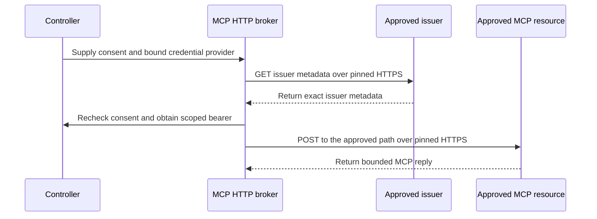
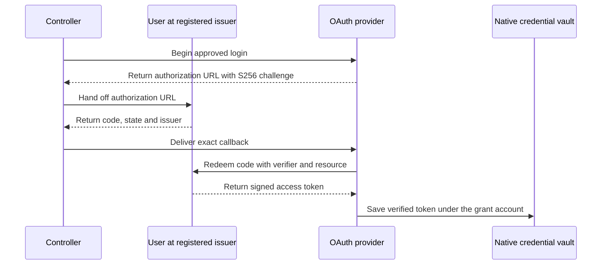

# Universal Tool Platform — MCP Transport Increment T02.1/T02.2

**Target:** `kieransimkin/potbot`
**Checked upstream baseline:** GitHub `main` `84d220fe2fb29d1c001987654c30a75d25048492` (22 October 2026; newer merge checked before packaging).
**Protocol versions implemented:** modern MCP `2026-07-28`; fallback to handshake-era `2025-11-25`, `2025-06-18`, `2025-03-26`.
**Work status:** protocol library + executable tests, **not yet authorized for production deployment**.

## What the increment implements

| Stage | Implementation | Tests | Outstanding |
|---|---|---|---|
| T02.1 | Bounded JSON-RPC framing; both lifecycle eras; stdio streams supplied by an already-approved supervisor; duplicate/invalid/remote-schema rejection; paginated `tools/list` with fingerprint; strict argument/result validation; pinned call admission; unverified Phase 1 observations. | Real modern and legacy subprocess fixtures, calculator call, tool-side errors, strict schemas, changed catalog, duplicate names, circular cursor, child crash, overflow, timeout, unsolicited server request, cancellation-safe poisoned stream. | Production interactive child supervision in the qualified workspace sandbox, SDK-wide interop tests, dynamic subscriptions and richer MCP primitives. |
| T02.2 | Streamable HTTP POST, JSON or bounded SSE, modern per-request metadata and required headers, optional legacy session handshake, bearer supplier callback, no redirects, explicit network approval hook, no automatic replay, 401/403 handling, conservative error classification. | `httpx.MockTransport` end-to-end fixture: modern and legacy, HTTP headers, token handling, SSE, malicious redirect, body cap, schema validation and no-authority denial. | **Public deployment qualification and broader provider compatibility, session restart recovery, x-mcp-header and MRTR handling.** |
| T02.3 | Not implemented by this increment. | N/A | Extend existing `ProcessSupervisor` with a safely confined *interactive* stdio lifecycle; do not spawn unsandboxed child processes inside application adapters. |
| T02.4 | Not implemented by this increment. | N/A | General REST/GraphQL/gRPC adapter contracts and live API benchmarks. |

## Security architecture

- A tool supplied by an MCP server is an **untrusted definition**. `annotations.readOnlyHint` is metadata, not a permission. Only an operator/controller-approved effect classification may populate a `ToolCapabilityDescriptor`.
- No process is launched by `mcp_stdio.py`; it accepts an existing approved stream. The `tests/fixtures/mcp_stdio_server.py` subprocess is solely a controlled local test fixture.
- A connection and its catalogue do not authorize `tools/call`. `McpClient.call_tool` needs an `admit` callback provided by trusted controller code, plus a matching pinned catalog/tool fingerprint, and validates every request against the server's JSON Schema.
- HTTP refuses requests without a controller-supplied egress-approval callback, but **mere presence of a callback is not OS-enforced network isolation**. T03.2 must implement qualifying DNS/IP/route enforcement in an egress proxy. The adapter does not fetch arbitrary webpages or permit redirects.
- `McpHttpBroker` binds a controller-approved resource, issuer, workspace, principal and exact scopes. It asks the consent authority before discovery and again on each POST. The credential provider supplies an ephemeral bearer whose resource audience, full grant and expiry match. The protocol rejects a response or legacy session ID that reflects the bearer.
- Each broker request resolves a public IPv4 destination once. The dial uses that numeric address, while TLS verifies the approved DNS name and HTTP sends the approved host and path. Mixed public/private DNS answers, platform addresses, redirects, environment proxies and cookies are refused or discarded.
- Issuer discovery is an unauthenticated GET to the approved issuer's well-known URL. The broker validates the returned issuer exactly. The credential provider validates issuer metadata against the operator registration. [OpenID Connect Discovery](https://openid.net/specs/openid-connect-discovery-1_0.html)



- `McpOAuthProvider` supports a pre-registered public client, an exact HTTPS callback and an operator-pinned RSA signing key. The controller hands the authorization URL to the user. The pending login keeps its S256 verifier and state in memory, checks the callback issuer, and consumes a matching attempt before exchanging the code. The token request includes the exact MCP resource. [OAuth Security BCP](https://www.rfc-editor.org/rfc/rfc9700.html) · [Authorization response issuer](https://www.rfc-editor.org/rfc/rfc9207.html)
- The provider verifies the RS256 JWT access token and checks the issuer, client, external subject, resource audience, scopes and expiry before saving the token in the native OS vault. It repeats verification on each read. The vault account is derived from the exact grant and client registration. Local sign-out clears the attempt and the stored bearer. The supported profile uses short-lived JWT access tokens. The hosted callback is available through the operator registration described below. [JWT Access Token Profile](https://www.rfc-editor.org/rfc/rfc9068.html)



- The modern MCP revision is stateless: do **not** synthesize session IDs. Legacy session IDs are recognized only after the legacy initialize response.
- Writes are never automatically replayed after disconnect, timeout, cancellation, ambiguous SSE endings or server crashes. The gateway must persist intent/dispatch/result and reconcile any uncertain side effect before issuing a new action.
- Modern MRTR `input_required`, tool `x-mcp-header` annotations, dynamic subscriptions and remote JSON Schema references fail explicitly in this subset, rather than silently improvising higher-privilege behavior.
- `McpCallResult.to_observation` creates an **unverified** result record; persistent artifacts, execution admission, identity checks and independent verification are duties of the existing Potbot gateway and ledgers.


### Hosted OAuth callback

Start `potbot serve` with `--mcp-oauth-registration` pointing to an operator-owned JSON file. It contains exactly `resource`, `issuer`, `scopes`, `client_id`, `subject`, `callback`, `authorization_endpoint`, `token_endpoint`, `key_id`, and `signing_key_pem`. Register the public client with the issuer and set `callback` to the public HTTPS origin followed by `/v1/mcp/oauth/callback`. The signing key entry holds the issuer's public PEM. The controller binds the registration to its authenticated workspace and principal.

Bind the controller to loopback behind its HTTPS reverse proxy. Preserve the registered `Host` and callback path at that proxy, and suppress query strings in access and error logs. Keep the start request and callback on the same controller process because the short-lived PKCE state lives in memory. The callback page has no links or assets, sends `Referrer-Policy: no-referrer`, and discards the response from browser caches. [OAuth Security BCP](https://www.rfc-editor.org/rfc/rfc9700.html#section-4.2)

1. An authenticated operator with the separate setup token posts to `/v1/mcp/oauth/start` and opens the returned authorization URL.
2. The issuer redirects to the exact callback. Potbot exchanges the one-time code and saves the verified bearer in its native vault.
3. The operator posts to `/v1/mcp/oauth/check`. The controller checks discovery and tool listing and returns the protocol, catalog digest and tool count. Tool execution still requires the existing controller admission boundary.

## How to run

From an existing repository checkout containing this patch:

```bash
uv sync --locked --extra semantics --extra providers --extra security --dev
uv run --locked --extra semantics --extra providers --extra security --dev python -m pytest -q \
  tests/unit/test_mcp_protocol.py tests/unit/test_mcp_stdio.py tests/unit/test_mcp_http.py \
  tests/unit/test_mcp_http_broker.py tests/unit/test_mcp_oauth.py
uv run --locked --extra semantics --extra providers --extra security --dev python scripts/tool_phase2_gate.py --mode offline
```

The normal `scripts/check.py` CI runner discovers these tests. The existing `providers` and `semantics` extras supply HTTPX and JSON Schema validation. The TLS fixture uses the pinned `security` extra.

The offline report goes to `artifacts/tool-platform-phase2/phase2-gate.json`. It includes SHA-256 source fingerprints, stage-specific test counts and explicit unqualified production gates. `--mode qualified` delegates to the existing PostgreSQL/sandbox/full-wheel runner, **but must still mark this MCP release not fully qualified until the enforcement and end-to-end tests listed above are implemented.**


The optional upstream SDK check runs Potbot against the official Python SDK 2.3.0 server in process. It verifies discovery or the legacy initialization path, catalog pinning, one admitted tool call, and session headers across JSON and SSE. The fixture selects the SDK's legacy path by emulating a pre-discovery server response. The same SDK handles every subsequent legacy frame. [Official SDK release](https://github.com/modelcontextprotocol/python-sdk/releases/tag/v2.3.0)

```bash
PYTHONPATH=src uv run --no-project --python 3.12 --with mcp==2.3.0 \
  --with httpx==0.28.1 --with jsonschema==4.26.0 python scripts/check_mcp_sdk.py
```

The local probe exercises the common tool protocol. Header annotations, multi-round-trip requests, subscriptions and public deployment qualification remain open.

## Next engineering steps, in order

1. **T02.3.1:** Extend Potbot's production `ProcessSupervisor` to expose a bounded, bidirectional stdio session without bypassing `BubblewrapBackend.prepare`, capabilities, seccomp policy or registered workspace root. Preserve the same resource limits, cancellation, child group termination and redaction controls as one-shot tools.
2. **T02.3.2:** Bind the session to a durable `ToolInstallationDescriptor` and `ToolInvocationIntent` retrieved by the existing `ToolGateway` after checked workspace authorization, reservation, policy revision and lease fencing. Model data must never construct or approve the authority callback.
3. **T02.3.3:** Test a calculator MCP server inside qualified sandbox; no read/write outside workspace, no network, bounded stdout/stderr, 100 crash/restart fixtures without repeated writes.
4. **T02.2.1:** Add a qualified HTTP egress proxy (DNS rebinding/IP/localhost/metadata controls), exact recipient/audience-scoped credential broker, OIDC discovery/issuer validation and explicit consent. Do not persist access tokens in artifacts.
5. **T02.2.2:** Adopt or conformance-check the official MCP Python SDK v2 on both protocol eras; implement header annotations, MRTR and subscriptions behind explicit capabilities when security policy allows.
6. **T02.4:** Add typed, versioned API adapters with no direct service authorization in the advertised metadata.

## References

- MCP spec 2026-07-28: https://modelcontextprotocol.io/specification/2026-07-28
- Discovery spec: https://github.com/modelcontextprotocol/modelcontextprotocol/blob/main/docs/specification/2026-07-28/server/discover.mdx
- Modern Streamable HTTP: https://github.com/modelcontextprotocol/modelcontextprotocol/blob/main/docs/specification/2026-07-28/basic/transports/streamable-http.mdx
- Python SDK v2: https://py.sdk.modelcontextprotocol.io/whats-new/
- Older 2025-11-25 transport: https://github.com/modelcontextprotocol/modelcontextprotocol/blob/main/docs/specification/2025-11-25/basic/transports.mdx
