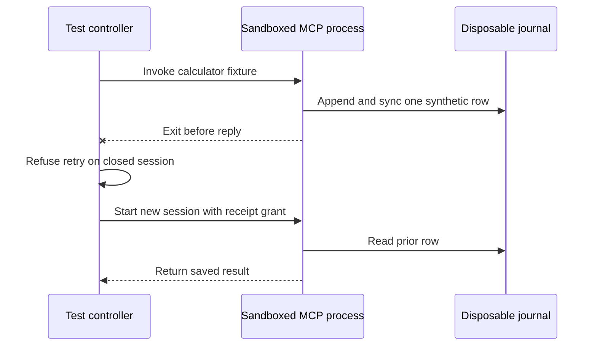

# Universal tool platform — T02.3: qualified CLI and interactive MCP stdio

**Programme:** 48-stage universal tool/MCP implementation plan; Phase 02, Stage T02.3.
**Repository:** `kieransimkin/potbot`; additive patch based on checked `main` at `c2be65f3f45f78684f67afcbe1bd2f2f3ea9ead2` (22 October 2026).
**Delivery status:** T02.3.3 exercises live Bubblewrap/seccomp on Linux. The full stage gate also requires the repository's PostgreSQL and packaging checks on the revision under review.

## 1. Why this increment is needed

T02.1/T02.2 already provide protocol parsing and bounded MCP stdio/HTTP exchange. T02.1 intentionally receives *already-authorized* byte streams and never starts a process. The existing `ProcessSupervisor.run` supports a single bounded command, not a persistent interactive MCP subprocess. This increment bridges those layers without creating another unconfined subprocess or another authorization system.

The existing `ToolGateway`, `ExecutionStore`, `BudgetLedger`, workspace sandbox binding and qualified Linux Bubblewrap/seccomp backend remain authoritative. **Neither a tool listing, a readOnlyHint, a Syn type, an MCP tool name, nor a fingerprint grants execution permission.**

## 2. Delivered code

| Stage | File | Functionality |
| --- | --- | --- |
| T02.3 | `src/potbot/tools/interactive_supervisor.py` | Async interactive process lifetime using existing `ProcessRequest`, `ProcessSupervisor` and Bubblewrap backend; status/stderr draining, redacted metadata-only stderr handling, watchdog, deadline, cancellation callback, process-group shutdown and no host-execution fallback. |
| T02.3 | `src/potbot/tools/mcp_sandbox.py` | Curated MCP server launch with `ToolRegistry`, `ToolDefinition`, `CapabilityContext`, registered `WorkspaceSandbox`, fixed argv and executable digest; exact per-tool read-only allowlist and synchronous trusted authorization callback; calls existing `McpClient` and `McpStdioTransport`. |
| T02.3 | `src/potbot/tools/cli_adapter.py` | Typed CLI calls over **existing** one-shot `ProcessSupervisor.run`; exact executable hashing, fixed argument prefix, independent model-argument validation, no shell entrypoint, workspace CWD confinement and safe default environment; bounded result observation. |
| T02.3 | `tests/unit/test_interactive_supervisor.py` | Real child fixture pipes, deadlines, stderr flood, immediate cancellation, broken cancellation checker and fail-closed isolation. |
| T02.3 | `tests/unit/test_mcp_sandbox.py` | Real JSON-RPC fixture calls, authorization, executable binding and non-replay, denied tools, unexpected replies and cancellation. |
| T02.3 | `tests/unit/test_cli_adapter.py` | Allowlisted runtime, authority, CWD, shell/argument rejection, denied secrets and mutation, isolation identity and output metadata. |
| T02.3 | `tests/integration/test_tool_phase2_3_sandbox.py` | Live Linux Bubblewrap calculator, filesystem and network confinement, stdio limits, 100 crash/restart cycles, and CLI exercises. The sandbox suite runs in qualified CI. |
| T02.3 | `scripts/tool_phase2_3_gate.py` | Reproducible offline-vs-qualified stage gate; JUnit and machine-readable JSON. Qualified mode runs actual sandbox tests and full `scripts/check.py --with-postgres --with-sandbox`. |

## 3. Execution boundaries

The caller must first obtain an authenticated workspace, task contract, active revision, tool installation, approval and budget reservation in the **existing** controller. The new adapters do not replace this admission and cannot mark a task or candidate verified.

Local CLI execution:

1. Look up the installed `ToolDefinition` from the controller-owned `ToolRegistry`; invoke `ToolDefinition.admit` and `CapabilityContext.authorize` against an authoritative task contract.
2. Require an explicitly pinned executable SHA-256 and check the current installed executable bytes; deny shell entrypoints, secret injection, mutating commands and arbitrary model-supplied arguments without a controller-owned validator.
3. Resolve CWD inside an actual `registered-root/candidates/<candidate>` directory. Use fixed `ToolDefinition.argv_prefix` and typed arguments only, **never `shell=True`**.
4. Pass a `ProcessRequest` to the existing `ProcessSupervisor.run`, preserving Bubblewrap isolation, memory/CPU/FD/file/output budgets, termination and capture redaction.
5. Return a hashable **observation**, not a verification certificate or a durable state transition.

Interactive MCP execution:

1. Perform the same installed server definition, task capability, workspace, executable digest and fixed-argv checks. The Phase 2 gateway admits **only read-only server profiles**, with no credential references and no externally authorized network access.
2. Call `InteractiveProcessSupervisor.open(request)` using the **same** `BubblewrapBackend.prepare` path as the existing one-shot supervisor. Preparation failure cannot fall back to a host process. The request mounts only approved workspace areas and runtime inputs.
3. Open one bounded stdio transport and construct the existing MCP client. Negotiate modern `2026-07-28` or supported legacy protocol and pin the discovered catalog.
4. At each `tools/call`, check the *operator-authored* per-tool allowlist, optional tool hash and the supplied **trusted** call approval callback. MCP annotations do not grant rights.
5. A timeout, cancellation, malformed result or unexpected stream termination poisons the transport, terminates the server and never silently repeats the call. The process watchdog and cancellation checker independently stop abandoned children.

**Read-only limitations:** `ToolDefinition.mutates=False` and tool-name allowlists are operator declarations, not proof that third-party code contains no writes. Bubblewrap mounts the candidate tree writable, consistent with Potbot's existing supervisor. Therefore, untrusted MCP servers should run on **disposable candidate copies**, not the sole canonical repository state. Strict read-only mount mode and transactional reconciliation belong to T03.2/T03.4. No external network permission or credential access is supplied by this increment.

**Filesystem/TOCTOU:** executable SHA-256 is a prelaunch integrity check, not cryptographic executable attestation; the existing immutable installation/release machinery and later broker/security work must bind the complete runtime dependency closure. Always install server packages as curated assets and protect their filesystem locations from concurrent mutation.

**Process identity:** Bubblewrap's launch identity is a hash of configured confinement source inputs, not a trusted hardware or operating-system attestation. The status-pipe digest and stderr byte count are diagnostic metadata only. No raw stderr is retained by the interactive gateway.

## 4. Acceptance tests

### Offline tests (local platform independent; never an isolation qualification)

```bash
uv run --locked python -m pytest -q \
  tests/unit/test_interactive_supervisor.py \
  tests/unit/test_mcp_sandbox.py \
  tests/unit/test_cli_adapter.py
uv run --locked python scripts/tool_phase2_3_gate.py --mode offline
```

These tests use a deliberately unconfined **unit-only fake backend** for process-pipe contract checking. They verify code behavior, not OS isolation. An unqualified system reports `fully_qualified: false` even if every fixture test passes.

### Qualified suite (real Linux CI, disposable PostgreSQL and Bubblewrap)

```bash
uv run --locked python -m pytest -q tests/integration/test_tool_phase2_3_sandbox.py
uv run --locked python scripts/tool_phase2_3_gate.py --mode qualified
```

The calculator returns 42 with a recorded isolation identity. The guest cannot read or modify a host canary, inherit a host environment canary, or reach a disposable host loopback listener. An oversized stdout frame closes the session. Stderr flooding leaves a byte count and a truncation flag.

In each of 100 crash/restart trials, the fixture writes one synthetic journal row and exits before replying. The failed session refuses a second call. A fresh session with a read-only receipt grant recovers the row and refuses the original operation. The suite checks the exact 100 journal entries after the last restart.



The journal writes belong to the test fixture. Managed MCP still uses the controller's durable receipt and budget rules. The CLI exercises also check Git, Python, and a controlled nonzero exit. Missing Bubblewrap or an unqualified backend fails the requested gate.

The stage gate additionally demands the project's **full** `scripts/check.py --with-postgres --with-sandbox`: Ruff lint and formatting, mypy, all unit/integration tests, database migrations and RLS, sandbox tests, clean wheel install and existing verification suites.

### Machine-readable evidence

`artifacts/tool-platform-t02-3/t02-3-stage-gate.json` includes current source hashes, JUnit counts, mode, full gate state and outstanding approvals. Reports do not contain tokens or unredacted child stderr. Do not treat unit fixture results as measured production capability.

## 5. Known limitations and next work

- **T02.4:** Add schema-checked REST/OpenAPI/GraphQL/gRPC interface adapters; enforce provider scopes and robust pagination without uncontrolled retries.
- **T03.1/T03.4:** Bind `SandboxedMcpClient` to the actual `ExecutionStore`, fenced leases, durable policy, budget reservations and idempotent external effects. Explicitly reconcile dispatched-but-unobserved calls after worker crashes.
- **T03.2:** Qualify network egress broker, DNS/IP pinning, SSRF defense, redirection policy and truly read-only candidate mounts for read-only tools.
- **T03.3:** Route any credentials exclusively through authenticated, scoped native/OS broker; no bearer strings in discovery/trace surfaces.
- **T11:** Add adversarial launch, sandbox escape, process-tree and provider-evaluation datasets to the benchmark ledger, separate from synthetic fixture task scoring.

Do not expand the tool profiles beyond the read-only sandboxed local default until the controller's durable authorization and recovery layer has passed its own gates.
