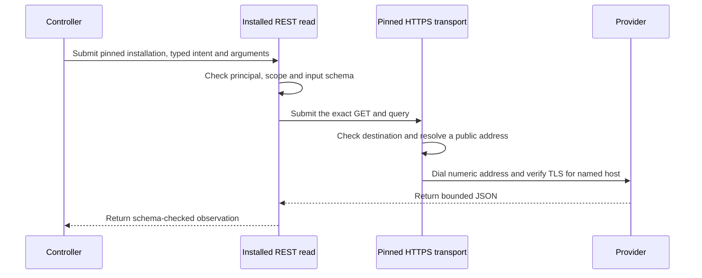
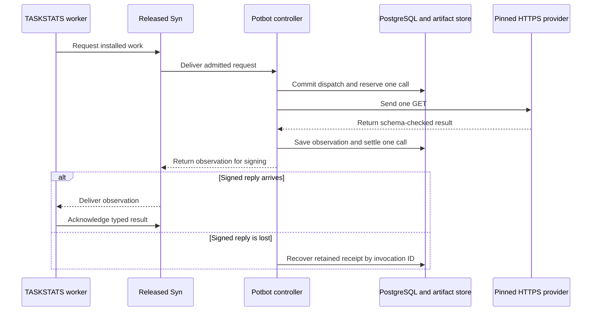
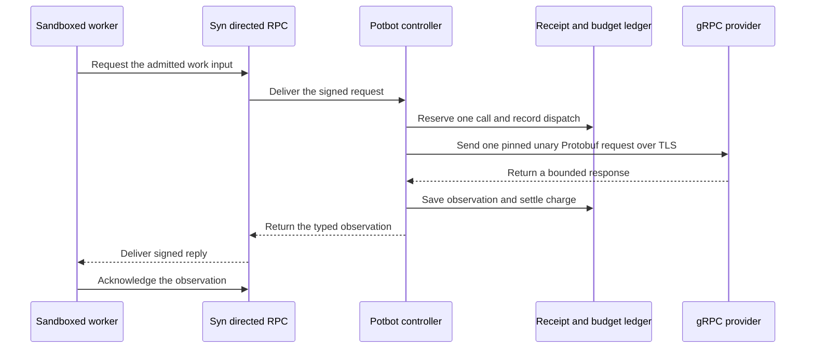

# Universal tool platform — T02.4: OpenAPI, REST, GraphQL and gRPC adapters

**Baseline:** built atop `c6d44ddd8c9557e778177f25db81d67756736080`; refreshed current GitHub `main` at `f3e6f9558ff7523410d72f7f40cc7aee7698a37c` (22 October 2026). This patch adds only new paths and does not touch concurrent Phase 7/MCP modifications.
**Roadmap:** `docs/potbot-tool-mcp-implementation-bundle/potbot-universal-tool-mcp-implementation-plan.md`, T02.4.
**Qualification:** local compatibility fixtures only until the repository's own pinned Python 3.12 / Ruff / mypy / PostgreSQL / sandbox suite runs. This increment does **not** certify production egress or durable remote write execution.

## Delivered modules

| Source | Purpose |
|---|---|
| `tools/api_contracts.py` | Immutable API operation identity, selected `syn://` or `synny://` input/output Types, pinned schema and source hash, effect class, strict limits, call/installation/input hash admission and unverified `ToolObservation` linkage and mutation-resistant result digest |
| `tools/api_openapi.py` | Deterministic offline import of explicitly allowed OpenAPI **3.1** operations. Self-contained JSON Schemas and bounded local `#/components/schemas/` references only; no remote `$ref` or automatic server URLs |
| `tools/api_http.py` | Strict HTTPS and offline-loopback REST and fixed-query GraphQL clients with streaming size caps, no redirects, credential echo check, global deadline, bounded retries only on reads, bounded cursor pagination, scoped opt-in read cache |
| `tools/api_grpc.py` | One-shot unary gRPC over a controller-created approved channel, pinned method and codec descriptor hash, deterministic protobuf-`Struct` example, schema validation and conservative unknown-write handling |
| `examples/tool_api_demo.py` | Mocked OpenAPI search -> admitted request -> schema-validated result -> Potbot hash-linked `ToolObservation` |
| `tests/unit/test_api_*.py` | Negative/positive protocol, schema, mutable argument, cache, timeout, auth, provenance and write-retry tests |
| `tests/integration/test_tool_phase2_4_local_services.py` | Real **loopback-only** GraphQL-over-HTTP and gRPC unary server fixtures. The latter requires the optional `grpcio` and `protobuf` packages |
| `scripts/tool_phase2_4_gate.py` | Machine-readable, explicitly unqualified offline and full-suite stage gates |

### Contract boundaries

A tool description never authorizes execution. The existing semantic hierarchy, `ToolCapabilityDescriptor`, `ToolInstallationDescriptor`, `ToolInvocationIntent` and `ToolObservation` remain authoritative. `ApiOperation.to_capability()` maps the selected protocol into the existing capability contract, not a competing type hierarchy. The controller must **pin an operation fingerprint**, installation, workspace, policy, typed input digest and budget and supply independently trusted per-call authorization.

The controller **must** persist an effect reservation, lease and budget *before* calling the adapter. HTTP egress `scope.egress(url)` is a REQUIRED hook and must be backed by an enforcing DNS/IP/route policy outside this module. A Python callback that merely returns `None` **is not network security**. A channel supplied to the gRPC adapter must already be authenticated/qualified against its permitted peer. A compiled OpenAPI `servers` entry or gRPC reflection response grants no network access.

Remote API credentials are never recorded in API schemas, result hashes, task arguments or diagnostic messages. HTTP allows an ephemeral controller-supplied bearer callback, but production credential custody and secret redaction beyond a simple bytewise echo check are **T03.3** work. Never enable production authorization purely because these fixtures pass. Local tests use `httpx.MockTransport` or loopback sockets only.

### Supported behavior and limitations

- OpenAPI subset: version `3.1.x`, explicit operation IDs, scalar path/query parameters, JSON request body and 200/201 JSON responses. Complex serialization, cookies/headers controlled by a model, polymorphic parameter encoding, callbacks and remote refs are rejected. The import is a *checked subset*, not full OpenAPI conformance.
- REST: trusted origin and relative path, selected method, typed JSON input/output, no automatic redirect, no arbitrary URL, no retries for **any write**. `Idempotency-Key` header is emitted only for an explicitly selected idempotent write, and is **not** permission to retry automatically.
- GraphQL: an operator-approved named query or mutation document, variables as the only model-controlled field, POST to a fixed route, `data`/`errors` envelope handling. Server errors or partial mutation errors are indeterminate outcomes. Complete GraphQL AST validation/introspection refresh and subscriptions are not in this stage.
- gRPC: one approved unary method and deterministic operator-installed message codec on an already-created channel. Server reflection and dynamic arbitrary protobuf descriptor loading are not implemented. Both malformed responses and transport uncertainty after a write are indeterminate; **never replay writes automatically**.
- The HTTP streaming transport consumes response bytes in bounded increments; this is **not** an open-ended SSE/subscription UI. Whole-body JSON is validated before it becomes a result. Raw response bodies are not included in stage-gate logs.
- An opt-in read cache is in-process only, partitioned by controller-provided audience, workspace, task revision, policy, installation, operation and input hash. Read responses are validated before caching; cached values are copied to avoid caller mutation. No persistence or general cross-user caching.
- Pagination is enabled only for selected GET operations and uses **one same-origin path**, capped to 10 pages and total output bytes/time. Cursor strings are restricted, observed cycles are rejected, each following page requires renewed trusted approval, and a still-live cursor at the page limit is an error, not silently a complete result.
- Only the explicitly declared successful HTTP status codes are accepted. HTTP `429`/`503` may be retried **once for reads**, with bounded delay. All writes receive one attempt only. Invalid responses after a possible remote write are reported `indeterminate`, not `failed` and never `succeeded`.

### Pinned HTTPS REST read

An operator can construct an `InstalledRestRead` for a selected OpenAPI GET. The installation pins the origin, compiled operation and its schemas, implementation, workspace, principal and policy. The schema’s own `servers` entries confer no network authority. The controller verifies the typed intent before sending one request. The shared HTTPS transport verifies the exact method and rendered URL, checks the DNS answers, dials a vetted numeric address and verifies TLS for the original hostname. The adapter validates the response before making it available as a typed observation.



This controller profile supports one read without credentials, pagination, redirects or retries. The test compiles a selected OpenAPI operation and executes it against a disposable TLS listener. A different query is refused before the socket opens.

### Managed Syn worker

The operator pairs `InstalledRestRead` with `install_rest_cog` and seals the `rest_read` execution catalogue. The Cog pins the installed operation, the guest interpreter and the Context client from the worker image. The worker uses directed Syn Context RPC. Its first request triggers the controller's single approved GET. The controller records the dispatch and reserves one call before contacting the provider. It saves the response and settles the reservation in one database transaction before sending the signed reply. The worker acknowledges the returned typed observation and shuts down under audit.



`ExecutionCogRuntime.recover_rest_read(run_id)` reads the receipt for the original principal and validates its digest and settlement. It never opens the worker channel or contacts the provider. A lost worker reply can leave the Cog indeterminate with a settled provider receipt. If the provider response itself is unavailable, the invocation stays unresolved with a held reservation. The profile covers one read-only operation and accounts for its reserved deadline as a conservative estimate.

### Pinned GraphQL query

Use `InstalledGraphqlRead` with the `providers` extra and `install_graphql_cog` to admit a named query over the same directed Syn route. The installation pins the query document, variable and response schemas, origin, path and principal. Potbot parses the document at installation and accepts a single query definition. The caller supplies a variables object and the controller sends one HTTPS POST. Responses with GraphQL errors or data that fails the pinned schema yield a failed observation.

The sequence above also applies to GraphQL. Replace the GET with the fixed POST and select the GraphQL Cog profile when importing the execution catalogue. `ExecutionCogRuntime.recover_graphql_read(run_id)` reads GraphQL receipts and settlement by the original invocation ID. The REST and GraphQL profiles keep separate ports and receipt types. The TLS fixture in `test_mcp_http_broker.py` captures the named query and variables that reached the server and checks that a caller-supplied query is rejected before dialing.

A managed WSL run of implementation revision `64baca1` used the signed Syn 0.10.0 release, two disposable enrolled Agents, the signed worker image and the installed TASKSTATS launcher. A disposable TLS provider received two GraphQL POSTs and both calls settled in PostgreSQL. After one signed reply was dropped, a fresh controller recovered the saved result. Repeated recovery and a duplicate invocation sent zero extra requests. The interrupted worker's lease remained fenced because it had no complete stop audit.

### Pinned unary gRPC read

Use `InstalledGrpcRead` with the `providers` extra and `install_grpc_cog` to bind a read-only unary method to one principal, hostname and installed Protobuf codec. The operator pins the method, descriptor digest and input/output schemas. The controller checks every IPv4 DNS answer against the existing public-address policy, dials a checked numeric address on port 443 and verifies TLS against the installed name. The channel disables proxy discovery, DNS service configuration and automatic retries.



`ExecutionCogRuntime.recover_grpc_read(run_id)` reads the receipt and charge using the original invocation ID. If the provider response is unavailable, the reservation stays held and recovery sends no RPC. The real TLS fixture exercises Protobuf delivery, rejects a certificate for the wrong name and checks that malformed admission does not reach the server. The profile admits one read-only method. Streaming, reflection, writes and provider credentials remain outside this profile.

Implementation revision `3322267` passed on managed WSL with the signed Syn 0.10.0 release, two enrolled disposable Agents, the signed worker image and the installed TASKSTATS launcher. The TLS Protobuf fixture received two unary calls and both settled in disposable PostgreSQL. After one signed reply was dropped, repeated recovery returned the same saved observation and charge. Repeating recovery or attempting a duplicate invocation sent zero additional requests. The interrupted worker's lease remained fenced because its stop audit was incomplete.

## Reproduce

From a checked-out Potbot repository after `git apply` and its locked `uv sync`:

```bash
uv run --locked python -m pytest -q \
  tests/unit/test_api_contracts.py \
  tests/unit/test_api_openapi.py \
  tests/unit/test_api_http.py \
  tests/unit/test_api_grpc.py \
  tests/integration/test_tool_phase2_4_local_services.py
uv run --locked python examples/tool_api_demo.py
uv run --locked python scripts/tool_phase2_4_gate.py --mode offline
```

For a real gRPC fixture install `grpcio` and `protobuf` in a separate, **explicitly pinned** test environment and re-run the integration suite. Avoid manually changing the project's locked dependencies without updating and committing `uv.lock`. Missing gRPC modules should yield an explicit skipped test, **not** a claimed gRPC integration qualification.

On a host provisioned for all Potbot integration gates (PostgreSQL + Linux Bubblewrap/seccomp), run:

```bash
uv run --locked python scripts/tool_phase2_4_gate.py --mode qualified
```

The stage report records source digests, unit/integration counts, skipped tests and full-suite status. Both modes record `production_egress_qualified=false` and `durable_api_dispatch_qualified=false` until T03 provides documented evidence. The standalone fixture admission callbacks are **test doubles** and must not be exposed as a production authorizer.

## Acceptance and next work

1. **T02.4 offline acceptance:** Every selected tool enforces input/output contracts, effect classification, pinned schema hash and operation identity; malformed OpenAPI/ref/method/URL fails before dispatch.
2. **HTTP negative tests:** Redirects/oversized or duplicate-key responses fail, rate limits/timeout/cursor loops are bounded, reads cache only under an explicit partition and writes are never retried.
3. **Local services:** The HTTP fixture serves real GraphQL bytes on loopback and the gRPC fixture serves real protobuf-`Struct` unary responses if dependencies are installed.
4. **Evidence:** Save offline JUnit XML, the gate JSON and source hashes; record skipped fixtures and the current Git head. These are not security attestation.
5. **T03 dependencies:** integrate ApiCallScope admission with durable `ExecutionStore`/budget/outbox; provide a qualified egress proxy and audience-scoped credential broker, perform fault-injection/replay tests, then register only qualified API capability instances in the discovery catalog.

## External protocol references

- OpenAPI 3.1 specification: https://spec.openapis.org/oas/v3.1
- GraphQL over HTTP working draft: https://http-spec.graphql.org/draft/
- GraphQL validation: https://graphql.org/learn/validation/
- gRPC Python introduction: https://grpc.io/docs/languages/python/basics/
