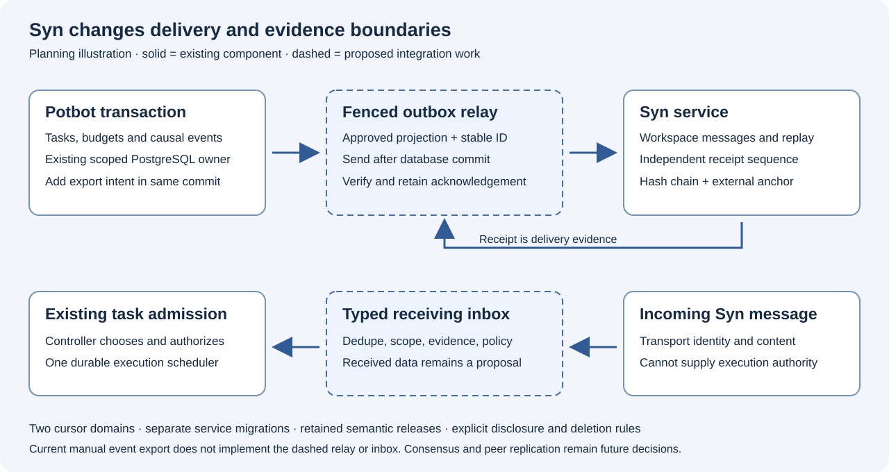

# T01.3 SYN event ledger — initial implementation

Migration 19 adds workspace/RLS-scoped, append-only `syn_execution_events`, using the **existing `job_event_cursors`** row lock to allocate monotonically committed workspace sequence numbers. Job event filtering will naturally have gaps in the shared counter, as it already does for filtered streams. Legacy `job_events` records, REST and WebSocket routes remain untouched.

The new typed `ExecutionEventInput` requires a precise full subject and event Type URI, explicit versions, an independent run UUID, direct trigger reference, private input digest and authenticated emitter. Every child event provides a parent event and run. The database has a scoped parent FK; `append()` also verifies the supplied parent run. The source event is always inserted **after** its parent, preventing cycles for normal append-only clients.

**Current read boundary:** the later [Phase 7 closure increment](../phase7-closure-status.md)
wires `ExecutionEventService` into `potbot serve` and supplies authenticated
workspace/run event pages and resumable WebSocket streams. Those read routes are
present; full run/tree/cause projections, producer instrumentation and their
qualification are separate work.

The [Syn integration amendment](07-syn-integration-plan-impact.md) preserves this
ledger and cursor as Potbot's causal execution authority. Current `sync-events`
manually exports public projections to a separate Syn receipt sequence. The
proposed atomic export intent, fenced relay, admitted inbox and external-anchor
recovery do not exist merely because both ledgers are append-only.

*Generated planning illustration; dashed components are proposed integration work.*

**Pending gates:** type resolution against a sealed SYN release; private input/artifact storage; approval/lease fencing for event emitters; accurate metrics and console sanitization; lifecycle state machine and terminal receipts; integration with MCP/tool/model/Cog workers; full run/tree/cause API read models and UI; actual PostgreSQL qualification including RLS/cross-workspace and concurrency; a bridge preserving causal attribution for legacy job events; and the separately scoped Syn delivery/admission/recovery gates in the amendment. Existing read endpoints do not complete these requirements.
