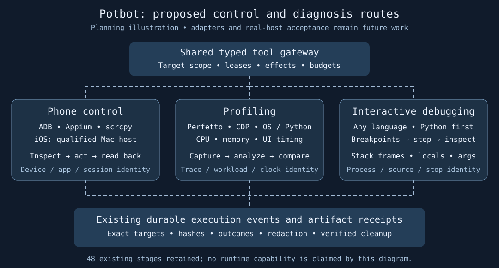

# Phone control, profiling and interactive debugging

Planning requirements, 23 October 2026. This extends the [48-stage master plan](../potbot-tool-mcp-implementation-bundle/potbot-universal-tool-mcp-implementation-plan.md); it does not implement adapters or qualify a connected device. Reuse Potbot's typed tool gateway, credentials, leases, execution events and artifact stores. Candidate tools require pinned versions, licences and host acceptance before installation or use.

Generated architectural illustration of proposed adapters and shared receipts. It is not a capture of running software. No implemented interface exists for these additions to demonstrate yet; actual screenshots and user-controlled recordings are required by the acceptance scenarios below.

## 1. Phone and tablet control

| Route | Planned operations | Host and qualification boundary |
| --- | --- | --- |
| Android Debug Bridge (ADB), USB and supported paired wireless debugging | Explicit device inventory and serial selection; app/package inspection; approved install/update/launch/stop; bounded typed shell commands; scoped push/pull; logcat, screenshots, screen recording, device information and app diagnostics; owned port forwards/reverses. | Qualify real devices and emulators independently. Record platform-tools version, transport, OS/API level, package/build identity, selected device and session lease. Pairing, enabling debugging and device trust require operator authority; an unauthorized/offline device is a hold. |
| Appium with UiAutomator2 / Android UI Automator | Native/hybrid app automation, hierarchy/accessibility inspection, element lookup, taps, long press, swipe, scroll, text entry, keys, rotation and app lifecycle; Android Chrome/WebView context selection. | Pin server and driver compatibility; lease the exact device, app and session ports. Prefer element/semantic actions; coordinate actions need fresh dimensions/orientation and a current screenshot. |
| scrcpy | Optional Android mirroring, approved input control and bounded recording for human observation and reproductions. | Keep capture and input capabilities separate. A mirrored frame does not prove an input action succeeded; independently inspect the selected app's resulting state. Preserve protected content and unrelated sessions. |
| iOS/iPadOS Appium XCUITest and WebDriverAgent | Native app and supported web-context automation, hierarchy inspection, gestures, app lifecycle, screenshots and recording where supported. | Use a separately qualified macOS/Xcode host, explicit device UDID, Developer Mode/trust and required signing/provisioning. Do not imply local Windows control or parity with Android; simulator and physical-device acceptance are distinct. |
| Android Emulator and Apple Simulator | Repeatable fixture devices, approved app installation, resettable test data and controlled orientation/network/lifecycle scenarios. | Pin images/runtime identities and preserve user devices. Emulator/simulator results never qualify physical phone sensors, touch latency, Safari or battery/thermal behavior. Remote device labs remain optional, explicitly connected and cost bounded. |

Publish separate typed capabilities for discovery, capture, UI action, package changes, file transfer, forwarding and debugging; do not expose an unrestricted `adb shell` or Appium arbitrary-script escape. A physical device is an external resource beyond filesystem sandboxing. Bind its ownership, app/data scope and exclusive control lease to the approved workspace and run; qualify a broker that exposes only permitted device operations to the executor. No implicit first-connected-device selection, unlocking, rooting/jailbreaking, lock-screen bypass, unrelated personal-app inspection, global ADB-server restart or firmware/reset operation.

Classify each action's actual effects. Typing, tapping, launch/stop, recording, pairing and install are not read-only simply because their adapter returns JSON. Recheck the selected device/app and fresh UI before input. Read back outcomes after actions. If a disconnect occurs after a tap/submission/install, mark the result indeterminate and reconcile before retrying. Release only owned sessions, recordings, temporary files and port forwards; do not undo a user's persistent trust setting or stop other clients' shared services during cleanup.

## 2. Profiling and performance analysis

Support **record, stop, inspect, analyze and compare** as separate bounded operations. Reuse existing formats and analysis tools rather than create a profiler engine.

| Profile | Candidate tools and evidence |
| --- | --- |
| Browser and mobile web | Chrome DevTools/CDP console, network/HAR, CPU/performance traces, coverage and heap snapshots; Android Chrome/WebView remote debugging on the exact authorized target. |
| Android native/system | Perfetto and supported Android Studio profiling routes; CPU scheduling, memory/allocations, rendering/jank, startup and selected power/network data where supported. System-wide capture needs separate scope and redaction. |
| Apple native/system | Instruments / supported `xctrace` routes on a qualified Apple host; explicit app/device/template, available CPU/memory/energy instruments and exported trace artifacts. Qualify each requested instrument rather than promise all metrics. |
| Python | The pinned interpreter's standard profiler (`cProfile` for Potbot's Python 3.12 baseline), py-spy sampling, `tracemalloc` and optional memory/allocation profilers after compatibility and permission review; retain call counts, cumulative/self time, allocations and flamegraphs where available. |
| Other process/OS profiles | Linux `perf`, Windows ETW/WPR/WPA, Node/V8 CPU/heap tooling and language-specific extensions on demand. OS privileges and target scope are qualified independently. |

Every capture binds target/device/session/PID identity, executable and source/build hashes, symbols/source maps, tool/config versions, capture interval, clock basis, sampling rate, units, trace hash and measured/estimated/unavailable state. Reused PIDs must not redirect an attachment. Keep raw sensitive traces private, provide redacted bounded summaries and preserve source trace provenance. Analyze locally by default; uploading traces to a service is a separate disclosure.

Before/after performance comparisons use the same workload, build configuration, device/host, warmup, repetitions and measurement method, with thermal/power/background-load context and profiler overhead reported. Separate baseline runs from instrumented runs. No universal speedup threshold or unsupported energy/frame-rate claim; missing counters remain unavailable. Demonstrate detection of a planted CPU hotspot, retained allocation and slow UI path with attributable traces and a repeatable comparison.

## 3. Interactive debugger adapters

Use the Debug Adapter Protocol (DAP) as the common structured route where supported, with debugpy for Python and independently qualified adapters such as lldb-dap for native languages. Admit GDB, Node Inspector/CDP and other runtime-specific debuggers through the same tool contracts when DAP is not the appropriate route. Declare supported launch/attach, breakpoint, stepping, stack, variable and exception capabilities per adapter; unsupported operations return an explicit unavailable result.

Bind every debug session to an authorized workspace, exact executable/source snapshot, process start identity, interpreter/runtime, adapter version, source/path mapping, host/device lease and a unique session ID. Expose no unauthenticated public listener. Launch and attach, interrupt/pause, continue/step, variable writes, expression evaluation, code injection, restart and process termination are separately classified operations. A debugger can execute target code and read secrets even when displaying variables; redact projections, limit depth/bytes/time and never infer read-only evaluation from its syntax. Function/property rendering and conditional breakpoint expressions may execute code too. Production/system-process attachment and privilege elevation require their own explicit scope.

### Language-neutral debugger contract; Python first

The common interface must support any programming language through an admitted debugger adapter, rather than bake Python names or object shapes into Potbot's tool schema. Register structured operations for `debug.launch`, `debug.attach`, `debug.set_breakpoints`, `debug.configure_exceptions`, `debug.continue`, `debug.pause`, `debug.step_over`, `debug.step_into`, `debug.step_out`, `debug.threads`, `debug.stack`, `debug.scopes`, `debug.variables`, `debug.evaluate`, `debug.detach` and `debug.terminate`. These are proposed capability names, not existing APIs. Adapter-specific options live in versioned typed configuration extensions. Normalize stopped reasons, source locations, frame/scope/variable references, exception details and target lifecycle events while retaining the original bounded adapter payload and language/runtime identity.

Use a shared session state machine (created, configuring, running, stopped, disconnected, terminated, indeterminate) with ordered event/stop revisions. Inspection requires a current stopped state; every frame/variable handle is scoped to session, thread and stop revision. Async, multi-process, native, managed and interpreted runtimes negotiate additional capabilities. If a language has no admitted backend or a backend lacks an operation, report unsupported/unqualified without inventing results or silently switching runtimes. DAP is the preferred common transport; non-DAP adapters translate into the same contract. Never assume every language has a DAP adapter or identical stepping semantics.

**Implementation order:** define the language-neutral schemas, state machine, policy and shared conformance fixtures first; implement and test Python/debugpy end to end next; only then qualify other adapters such as native C/C++/Rust through lldb-dap/GDB and JavaScript/TypeScript through Node Inspector or a maintained DAP adapter. Java, .NET and further languages extend the same registry on demand. Python passing establishes one implementation of the common contract, not acceptance of other languages.

### Required step-by-step process debugging

1. **Select and reproduce.** Identify the language, exact interpreter/runtime/compiler environment, program/module or test, build/source commit/hash, arguments, working directory and redacted environment. Reproduce the failure in an isolated fixture or approved candidate process and retain baseline output. Choose **launch** or **attach** explicitly; attach requires the exact permitted PID and process-start identity, never a broad scan-and-attach. The first real fixture uses Potbot's pinned Python interpreter.
2. **Start the debug session.** Admit a pinned language/runtime adapter (debugpy through DAP for the first Python test), bind the session to the selected runtime/process and approved local/private endpoint, negotiate capabilities and validate source/path mappings for local, container or qualified remote hosts. Wait for initialization/configuration acknowledgements; a successful connection is not a paused process.
3. **Set and verify breakpoints.** Set source line breakpoints and exception breakpoints for raised/uncaught exceptions as supported; record enabled state, requested line and actual verified/bound location. Support conditional breakpoints, hit counts, logpoints and function breakpoints only when the adapter advertises them, with separate expression/log-output policy. Handle unloaded modules, invalid lines and stale source as unbound/blocked rather than claim a working breakpoint.
4. **Run to a confirmed stop.** Complete configuration and launch/continue. Consume thread/process/stopped/exited events; record the stopped reason, thread ID, selected frame, exception information and source location. A timeout, disconnect, running process or unverified breakpoint is not a breakpoint hit.
5. **Inspect the call stack.** Request threads and the selected thread's `stackTrace`, page through bounded frames, select the relevant caller/callee frame, then request `scopes` and `variables` for locals, arguments and permitted globals. Expand objects with depth/count limits and show the file, line and function alongside each frame. Preserve exception/chained-exception context and multi-thread context; redact sensitive values. A formatted variable summary may invoke target code, so use safe rendering or explicitly permitted evaluation.
6. **Step through execution.** Provide **step over** (`next`), **step into** (`stepIn`), **step out** (`stepOut`), **continue** and **pause** as explicit actions on the selected thread/session. After every action wait for a fresh stopped/terminated event, then refresh source location, stack and variables. Honor adapter all-thread/single-thread semantics, bounded execution time and pause/cancel paths; invalidate all previous frame IDs and variable references when execution resumes. Async-task-aware views are conditional on actual adapter support.
7. **Inspect values and hypotheses.** Compare variables between stops; add bounded watches or evaluate an expression in the selected current frame only when authorized. Default to variable inspection. Treat evaluation, property calls and variable assignment as potentially effectful, with immutable input and result receipts; do not silently change state to make the bug disappear.
8. **Resolve, rerun and clean up.** Record the causal failing line and stack/value evidence, propose an isolated source correction, and rerun the original failing test outside the debugger plus a relevant regression check. Remove owned breakpoints/watch state and close owned debug listeners/forwards. **Detach** from an attached process without killing it; terminate a launched process only under its launch policy. Verify session closure and label the outcome reproduced, diagnosed, proposed, fixed or independently verified according to the evidence.

**First real implementation and test: Python/debugpy.** Use a small versioned fixture with nested calls and a known exception or incorrect variable value. Set a verified breakpoint; stop in the inner function; inspect at least two stack frames and their locals/arguments; step over, into and out; continue to an exception stop; inspect its stack; detach/terminate as appropriate. Retain a redacted DAP transcript, exact source and input hashes, screenshots and a short actual recording with captions. Separately demonstrate attach on an explicitly started authorized fixture process. A scripted transcript or mocked screenshot does not satisfy real debugpy acceptance. Each later language repeats the common conformance suite and an equivalent real-language fixture, documenting any unsupported optional operation and language-specific behavior.

## 4. Stage allocation and acceptance

Keep all 48 stage IDs, existing dependencies and implementation statuses. Append requirements to their existing deliverables:

| Stages | Additional requirement |
| --- | --- |
| T01.1–T01.3 | Inventory existing routes; register device, capture, profile and debug Types without duplicate roots; extend receipts with device/process/session/stop identities, app/build/source hashes, metrics and capability support. |
| T02.3–T02.4 | Typed ADB, scrcpy and profiler CLI adapters plus Appium/WebDriver, DAP and remote-host transports; bounded streams, exact target routing, protocol negotiation and cancellation. |
| T03.1–T03.4 | Device ownership and exclusive leases, target/process confinement, credential/signing custody and operation-level effect/approval/reconciliation policy. |
| T04.1–T04.4 | Discover and route device/profiling/debug capabilities with host/platform requirements, separate capture/control scopes, health, pinning and revocation; do not route iOS to an unqualified Windows host. |
| T06.1–T06.4 | Browser and native phone sessions, remote mobile CDP/performance, ADB/Appium/scrcpy/iOS capture/control, native UI evidence and real/emulated device fixture reliability. |
| T07.2–T07.4 | Source/symbol/path binding; process profiling and language-neutral interactive debugging, tested with Python/debugpy first; evidence-led performance/bug repair and independent test closure. |
| T10.2, T11.1–T11.4 | Durable per-device/session execution events; device/debug fixtures, trace integrity and repeatable measurement; crash/disconnect, replay and cross-target denial tests. |
| T12.1–T12.3 | Optional workspace-local SDKs/drivers/profilers/adapters, qualified macOS/remote hosts; UI control, paused stack/variables and trace views; actual demonstrations and cleanup guides. |

Mandatory offline contract cases cover multiple/unauthorized/offline devices, serial/PID reuse, revoked leases, incompatible drivers, missing permissions/symbols, changed orientation, wrong app/context, forged stops, stale frame/variable handles, debugger timeout and lost callbacks. Reject cross-workspace/device/process actions, arbitrary shell escapes, unapproved expression execution, secret-bearing output and repeat side effects after disconnect. Verify target processes resume/detach or terminate according to policy and only owned sessions are cleaned up.

**Host qualification is separate:** mocks run without hardware in CI, Android Emulator and Apple Simulator have their own gates, then each enabled physical-device/OS/debug adapter needs an opt-in real-host smoke. An unavailable phone, Mac, signing identity, privilege or profiler counter is recorded as a named unqualified route. It cannot silently pass mandatory qualification or block unrelated headless profiles.

## 5. Primary implementation references

Reviewed 23 October 2026; these identify candidate contracts, not installed tool versions. Pin implementation revisions during stage inventory.

- [Android ADB](https://developer.android.com/tools/adb), [Android Perfetto command](https://developer.android.com/tools/perfetto), [Perfetto capture/analysis](https://perfetto.dev/docs/).
- [Appium UiAutomator2](https://appium.github.io/appium-uiautomator2-driver/latest/overview/), [Appium XCUITest](https://appium.github.io/appium-xcuitest-driver/latest/overview/) and its linked host/device preparation documentation.
- [scrcpy source and control documentation](https://github.com/Genymobile/scrcpy), [Chrome Android remote debugging](https://developer.chrome.com/docs/devtools/remote-debugging/).
- [Debug Adapter Protocol](https://microsoft.github.io/debug-adapter-protocol/), [debugpy](https://github.com/microsoft/debugpy), [lldb-dap](https://lldb.llvm.org/use/lldbdap.html), [Node debugging](https://nodejs.org/en/learn/getting-started/debugging).
- [Python 3.12 profiling](https://docs.python.org/3.12/library/profile.html), [py-spy](https://github.com/benfred/py-spy), [Windows Performance Toolkit](https://learn.microsoft.com/en-us/windows-hardware/test/wpt/).

Apple Instruments and Linux perf remain candidates requiring an accessible current host-specific CLI reference during qualification; no commands or compatibility claims are certified here.
