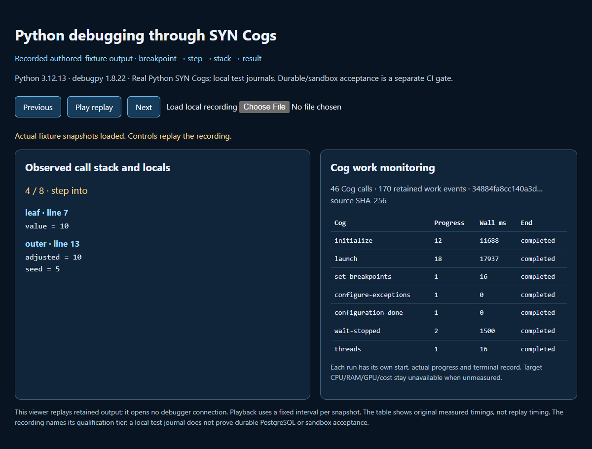

# Language-neutral debugger Cogs: Python first

Source preview: Potbot **0.5.0.dev3**. The common interface is implemented as 21 registered SYN execution Cogs, with a pinned Python 3.12/debugpy 1.8.22 backend as the first test target. This is one slice of T07.3, which remains **in progress**: additional languages, remote/hardware transports, profiling and general deployment qualification have separate gates.



Actual output replay from the authored Python fixture, including measured Cog statistics. The [interactive replay](../../examples/debugging/replay.html) reads the adjacent public-safe [recording](media/python-debugger-cogs.json); it is a recorded demonstration, not a live connection or evidence of remote/device qualification. The recording identifies its source/runtime and qualification tier. A hand-drawn concept image would add no evidence to this debugger walkthrough; the retained actual stack/value and timeline capture is the useful medium.

[Play the recorded output replay](media/python-debugger-cogs.webm) with user-controlled playback. Transcript: stop in `outer` with `seed=5`; step over; reject the previous frame; step into `leaf` with `value=10` and caller `adjusted=10`; step over and out; cross the caller-assignment boundary where required; continue to observed exit 0. The adjacent table retains actual start/progress/completion statistics. The video records playback of these real snapshots at a fixed interval, not the original wall-clock execution speed.

## Run the acceptance

Install the locked debugger, PostgreSQL, semantics and development extras in the owning project. Keep caches and scratch under that project. Local authored-fixture checks run real Python through the SYN Cogs with explicit test journals:

```powershell
uv sync --locked --extra debugger --extra postgres --extra semantics --dev
uv run --locked pytest -q tests/unit/test_debugger_cogs_live.py tests/unit/test_debugger_cog_admission.py
```

The live cases exercise launch, verified line breakpoints, thread selection, step over/into/out, two call frames and their locals, expired handles, breakpoint removal, natural exit, an uncaught exception, and attach/detach preserving a separately owned process. The attach fixture chooses its own loopback endpoint and binds the target's stdout handshake to a fresh spawn nonce. Windows venv redirector PIDs can differ from the actual Python PID: compare the debugger to the authenticated child handshake, not an assumed launcher PID. No arbitrary program, remote endpoint or unrelated PID is selected by these tests.

The **durable end-to-end gate** runs on the qualified Linux CI host with real PostgreSQL, pgvector, Bubblewrap and seccomp:

```bash
uv run --locked pytest -q tests/integration/test_debugger_cogs.py
```

This gate imports the exact installed SYN snapshot, constructs the production controller from the authenticated workspace, executes the authored target in the existing supervisor, restarts the event reader, pages the real ledger, reads hashed input/output artifacts, and checks the existing authenticated REST and WebSocket replay. It checks a second workspace cannot read the events. Both normal and exception cases are mandatory; test journals cannot satisfy this gate. CI retains its authored-fixture JSON evidence as `python-debugger-cog-evidence`.

## Registered operations and values

Use [BoundCogRegistry.debugger()](../../src/potbot/cogs/registry.py), [DebuggerCogRuntime](../../src/potbot/debugging/cog_runtime.py) and [DebuggerCogClient](../../src/potbot/debugging/cog_client.py). The installed definitions are in [potbot.cogs.debugger](../../src/potbot/cogs/debugger.py). Each operation has its own `syn://cog/potbot-debug-<operation>-v1`, concrete Cog subtype, single registered request Type and single registered result Type. Request/result Types use the existing flat SYN URI syntax; no new parallel ontology root or model-provided handler is loaded.

| Operations | Behavior |
| --- | --- |
| `initialize`, `launch`, `attach` | Negotiate the backend and begin an admitted target configuration. Launch/attach may return `configuring`; that is not a breakpoint hit or completed target execution. |
| `set_breakpoints`, `configure_exceptions`, `configuration_done` | Configure verified locations and exception filters separately; finish the deferred DAP startup. |
| `wait_stopped`, `threads`, `stack`, `scopes`, `variables` | Return observed stops and bounded inspection data, with opaque session/frame/value references and source locations. |
| `step_over`, `step_into`, `step_out`, `continue`, `pause` | Control the selected thread and require a fresh stop for stepping. Resume invalidates previous stop/frame/value references. |
| `exception_info`, `evaluate` | Inspect exceptions; evaluation additionally requires explicit target-code execution authority and is disabled by default. Variable rendering can execute backend code too, so host policy still applies. |
| `wait_terminated`, `detach`, `terminate` | Observe exit or close under ownership policy. Detach preserves an attached target; termination of an attached process is denied. |

Every request is versioned and field/size checked. Controller authority is supplied out of band: the trusted host loads task/repository revisions, target ownership, current grants, lease fences and budgets. The mandatory `admit` callback is checked before work starts and immediately before dispatch; it must be idempotent for the same invocation ID. A model's `approved` field, returned Cog value, session token or transformation receipt supplies no authority. The registry snapshots the request bytes before async dispatch and rejects changed Types, installed bindings, semantic snapshots and input mutation.

The production `from_workspace` constructor requires the exact imported immutable Cog snapshot, matching authenticated workspace and a qualified supervisor identity beneath its registered root. On Windows/macOS, the trusted authored local fixture is useful backend evidence; production untrusted execution still requires a qualified backend. There is no unrestricted fallback.

## Compose through Cogs

The host first imports `registry.snapshot` with the existing `SynService.import_snapshot`, then opens an already admitted `SandboxedDebugger(..., initialize_on_enter=False)`. The host supplies the trusted callback and authoritative revision IDs to `DebuggerCogRuntime.from_workspace`. A caller then uses typed Cog operations:

```python
client = DebuggerCogClient(registry, controller)
await client.call("initialize")
await client.call("launch", configuration=approved_backend_configuration)
points = await client.call("set_breakpoints", source=approved_source, lines=[14])
assert all(point["verified"] for point in points["breakpoints"])
await client.call("configure_exceptions", filters=["uncaught"])
await client.call("configuration_done")
stop = await client.call("wait_stopped", after_revision=0)
frames = await client.call("stack", stop_ref=stop["stop_ref"])
stop = await client.call("step_into", stop_ref=stop["stop_ref"])
```

`approved_backend_configuration`, `approved_source` and the controller are host-supplied values, not defaults granting arbitrary host execution. The complete executable workflow is [python_cog_walkthrough](../../src/potbot/debugging/cog_acceptance.py); its first fixture computes `outer(5)`, enters `leaf(10)`, observes `value=10` and caller `seed=5`, and returns 33. Python may stop step-out at the caller's assignment before its next line; the acceptance checks and steps across that boundary explicitly. Each later backend must repeat the neutral conformance plus a real-language fixture.

## Start, progress and completion statistics

[CogWorkMonitor](../../src/potbot/controller/cog_work.py) writes to the existing `syn_execution_events` ledger and content-addressed artifact service. Migration 20 adds a bounded `telemetry` JSONB column while preserving the old ledger, immutable events, workspace RLS and shared commit-ordered cursor. The existing `/v1/executions/events`, per-run REST history and `/v1/executions/.../stream` routes return those same records; there is no second private monitoring stream.

Each attempt has its own run ID. Its start, progress (`updated`) and terminal occurrences have distinct event IDs, exact Cog/handler/catalog identity, input artifact SHA-256, emitter and direct causal input/event. Progress records actual dispatch/wait status, with bounded one-second waiting updates and no fabricated percentages. Completion stores the typed output and separate Cog receipt as a hashed artifact. Start and finish UTC, monotonic elapsed wall milliseconds and controller-process CPU time are recorded with units and provenance. Target CPU, RAM/GPU/VRAM, IO, tokens and costs remain explicit unavailable values when no qualified observer supplies them. Controller CPU interval measurements do not claim exclusive target CPU usage.

Completion means the Cog request returned its typed result. A configuring result, actual stop, observed process exit and independent test verification remain different states. Denial has an audit occurrence and zero dispatch, without a fictitious start. Missing monitoring before dispatch prevents the call; lost storage/acknowledgement after a possible effect poisons that control lease and produces indeterminate/reconciliation handling. There is no automatic effect retry. Live session objects are not restored after a controller crash; their durable history survives for reconciliation.

## Limits and qualification

The DAP transport has bounded framing, pending requests, output and deadlines, correlation checks and rejection of reverse process-launch requests. Inspection limits frame/variable counts, depth via explicit expansion, returned string size and outstanding handles. Secrets are redacted from inspection output; private input artifacts remain workspace controlled. Expression evaluation, property/pretty-printer execution, production attachment and privilege escalation retain their own grants.

Python is the first implemented backend; successful local launch/attach does not qualify other languages, remote hosts, phones, JTAG/SWD/ICSP or JIT activation. Those remain in the [device/debugger specification](07-device-control-profiling-debuggers.md). The [tool-Cog contract](10-syn-tool-cogs.md) and [work-monitoring specification](05-syn-execution-monitoring.md) remain the programme-wide requirements. T07.3 stays in progress until its remaining scope passes.

## Source-preview publication

The [release workflow](../../.github/workflows/release.yml) builds the exact versioned tag, checks source/package identity and a clean wheel install, then attaches wheel, source distribution, manifest and checksums to GitHub without replacing existing assets. [build_release.py](../../scripts/build_release.py) also runs in CI before release. Model weights, caches and private operational material are excluded; the legitimate `potbot.models` Python source package is retained.

An optional PyPI job uses the official [PyPA trusted-publishing action](https://github.com/pypa/gh-action-pypi-publish) with a pinned revision and independent registry hash readback. It stays disabled until the owner confirms project ownership, configures this exact trusted publisher and sets `POTBOT_PUBLISH_PYPI=true`. No registry destination is currently enabled; GitHub publication does not establish PyPI acceptance. Initial account/publisher setup is a separate external requirement, not permission to create or take over a registry project.
