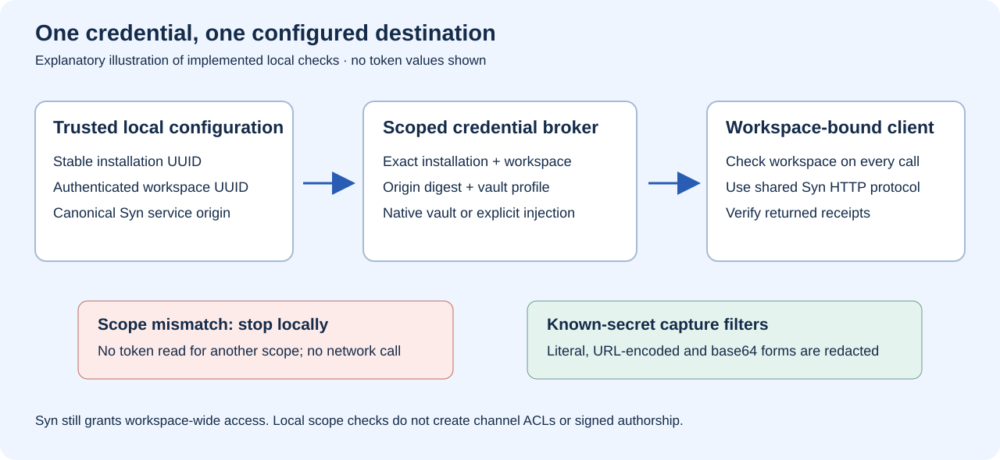

# Syn increment: scoped credentials and CI access

23 October 2026. This implements the first credential boundary from the
[revised plan](07-syn-integration-plan-impact.md), extending P020/P029 and
T03.1/T03.3 without marking either whole stage complete. The existing manual
message/event adapters use this boundary; unattended export remains pending.



*Explanatory illustration of implemented checks. The contracts in
`tests/unit/test_syn_credentials.py` exercise scope rejection, native-vault
management, HTTP denial and capture redaction with synthetic values. There is
no new graphical interface to record; credential-entry screenshots/video would
add disclosure risk rather than explain the backend checks.*

The [recorded scoped-service trace](../media/syn-scoped-service-acceptance.json)
exercises the real scoped Potbot adapter against the local Syn HTTP API:
foreign-workspace denial, message/retry/conflict behaviour, authenticated reads,
event anchoring, restart replay and tamper rejection. It uses synthetic tokens
and an SQLite durability fixture. It does not establish PostgreSQL concurrency,
production deployment or remote-agent execution.

## Runtime credential identity

A Syn token now has four local identity components: the native-vault profile,
Potbot installation UUID, workspace UUID, and SHA-256 of the canonical Syn
service origin. Its audience is explicitly `communication-token`:

```text
secret://syn/<installation-UUID>/<workspace-UUID>/<origin-SHA256>/communication-token
```

The origin hash identifies a configured destination; it is not a secret,
certificate pin or proof of server identity. HTTPS continues to authenticate
the service, except for the explicitly supported loopback HTTP fixture.
Host case and default ports normalize to the same origin. A changed host or
non-default port selects a different credential identity.

Set these non-secret configuration values when enabling Syn:

```text
POTBOT_INSTALLATION_ID=<stable canonical installation UUID>
POTBOT_SYN_WORKSPACE_ID=<authenticated Potbot workspace UUID>
POTBOT_SYN_URL=https://<Syn service origin>
```

Generate and retain the installation ID once per installation. Existing
configurations with only a URL/token must add the two explicit IDs; configured
communication fails closed until they do. The server and CLI compare their
authenticated/requested workspace with the configured workspace before
resolving its token. Every wrapped client operation also checks the workspace
before making a network request. Local configuration is operator authority;
model output and incoming messages cannot select another credential scope.

## Native vault or explicit environment injection

Install the `credentials` extra for native-vault support. Store a token through
the hidden native-vault prompt:

```sh
uv run potbot credentials syn-set \
  --installation-id <UUID> --workspace-id <UUID> --url https://<origin>
uv run potbot credentials syn-status \
  --installation-id <UUID> --workspace-id <UUID> --url https://<origin>
uv run potbot credentials syn-delete \
  --installation-id <UUID> --workspace-id <UUID> --url https://<origin>
```

The existing `--profile` global option precedes the subcommand when selecting a
non-default vault profile. Status returns presence and the non-secret reference;
set/delete confirm native-vault readback. No plaintext fallback is introduced.
Tokens require 32–4096 visible ASCII characters, matching `syn-client`.

Headless deployments may inject `POTBOT_SYN_TOKEN` explicitly, with all three
scope settings above. It takes precedence over the matching native-vault entry
and is never autosaved. Requests for a different installation, workspace or
origin fail before the broker reads a token. Changing service origin requires
explicit provisioning for the new scope. Rotate at the Syn service and rebuild
the corresponding Potbot clients/workers; an already constructed HTTP client
retains its token until it is replaced.

Hosted-worker capture filters now include the configured native Syn token and
explicitly injected Syn tokens, including malformed-scope configurations.
They reuse `CaptureRedactor` for literal, URL-encoded and base64 forms. Existing
limits apply: this is protection against known values and supported encodings,
not arbitrary transformations by hostile code.

Syn still accepts workspace-wide bearer access. These local checks do not add
per-channel ACLs, signed authorship or remote-agent authorization. Raw message
contents still need operator approval before the manual send/export command.

## CI source access

The application verification job checks out Potbot without submodules, resolves
the `vendor/syn` gitlink, then checks out exactly that revision of
`Synsphere/syn` at `vendor/syn` with a dedicated read-only deploy key. The key is
in the repository Actions secret `SYN_SUBMODULE_SSH_KEY`; it is not a personal
account token. Both checkout steps disable credential persistence. The job does
not save a dependency cache populated while private source is present.

Native identity and Windows launcher checks need only public Potbot source.
Fork PRs run those checks without private credentials; full application
qualification requires a reviewed same-repository branch. A skipped private
lane on a fork does not qualify the complete integration. Existing `push`,
`pull_request` and manual triggers remain; no privileged fork trigger is added.

Deploy-key creation requires the organization's deploy-key policy to permit it.
The approved CI key grants read access to Syn only, has no expiry, and can be
revoked by deleting it in Syn and removing the Potbot Actions secret. Rotation
must provision the replacement before revoking the prior key, then confirm an
exact-revision checkout. Send multiline keys as exact bytes: Windows text-mode
stdin can corrupt their line endings for Linux OpenSSH. Never print the key or
retain it in a repository, diagnostic artifact or local plaintext backup.

The first restored run exposed three historical migration tests that required
the entire ledger to end at version 18. They now check the unchanged historical
prefix, while the separate execution-event test still requires migration 19.
No migration SQL or stored schema history was rewritten.

Sources: [checkout credential handling](https://github.com/actions/checkout),
[deploy-key scope and lifecycle](https://docs.github.com/en/authentication/connecting-to-github-with-ssh/managing-deploy-keys),
[organization policy](https://docs.github.com/en/enterprise-cloud%40latest/organizations/managing-organization-settings/restricting-deploy-keys-in-your-organization).

## Remaining sequence

The [first exchange contract](10-syn-exchange-contracts.md) now supplies explicit
manual approval, metadata minimization, preview and versioned delivery identity.
Complete sealed-release/issuer admission before richer or unattended exports.
Then commit event plus delivery intent atomically, add fenced
outbound delivery outside transactions, and finally implement admitted receiving
and recovery qualification. This increment introduces no automatic relay or
inbox, changes no existing stage IDs/statuses, and deploys no production service.
