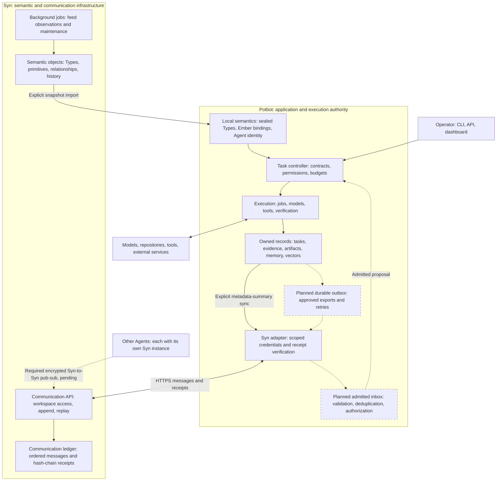

# Syn and Potbot architectural integration

23 October 2026. Source reconciliation and design for the current draft branches.
Read alongside the [programme amendment](07-syn-integration-plan-impact.md),
[service guide](../syn-service.md) and [exchange contract](10-syn-exchange-contracts.md).

**Potbot owns the work; Syn provides shared meaning and durable communication.**
Potbot decides what to do, controls tools and models, verifies results and accepts
knowledge. Syn supplies semantic objects, relationships, provenance and receipts.
The submodule pins compatible source. At runtime these remain separately managed
services with explicit interfaces and independent migration ownership.

**Updated owner requirement:** every unique Agent has its own Syn instance.
Agents communicate exclusively through Syn, using a private encrypted P2P
pub-sub group. The operator derives/distributes unique numbered Agent account
keys and the derived group key, and owns non-duplication. The
[private Agent mesh contract](11-syn-private-agent-mesh.md) controls this target
and supersedes a shared central Syn service. Current HTTP and summary code is
the local Potbot-to-own-Syn foundation; the encrypted mesh is still pending.
The [provisioning increment](12-syn-agent-key-provisioning.md) now supplies
operator-only derivation, restricted account vaults and current-group-key rotation.
The [detailed blockchain and transaction plan](13-syn-blockchain-transaction-plan.md)
extends this architecture into 24 dependency-ordered implementation packages,
including shared transaction authority, consensus/proofs and effect recovery.

## Components inside each Agent

Solid arrows identify existing integration paths; dashed arrows identify proposed
work. Execution/research modules exist, but this map does not qualify the complete
autonomous reasoning or learning programme.

*This component map repeats for each unique Agent; the two-Agent topology is
drawn in the mesh contract. Architecture illustrations, not runtime captures.
The first manual metadata
summary is implemented; outbox and inbox remain future work. This backend design
has no new graphical UI. A recording of proposed components would not establish
implementation; actual HTTP evidence is retained through the service guide.*

## Potbot components

| Part | Responsibility |
| --- | --- |
| Task controller | Task contracts, revisions, approvals, budgets, cancellation and decisions about permitted work. |
| Execution and reasoning | Durable jobs, candidates, research state, model/tool calls and verification. Full autonomous selection, learning and live-model qualification retain their existing gates. |
| Model and tool gateways | Permitted routes, isolation, disclosure, usage accounting and actual external operations. Syn messages describe work but do not grant tool authority. |
| Evidence, artifacts and memory | Source material, outputs, verification, retrieval indexes and local knowledge admission. |
| Semantic and identity runtime | Exact snapshots, immutable task-pinned releases, inherited Ember contracts, Agent signatures and local secret custody. |
| Syn adapter | Scoped credentials, manual send/read, receipt verification and bounded metadata export. Durable delivery and admitted receiving remain planned. |

Potbot's class named `SynService` is its **local semantic snapshot/resolution
service**, separate from the remote communication service. `BoundCogRegistry`
dispatches explicitly registered local computations; a remote Cog record does not
register executable code. MCP/provider routes stay with their existing adapters.

## Syn components and primitives

| Primitive | Intended meaning |
| --- | --- |
| Type | Class contract, inheritance and required/optional properties or Embers. Potbot selects sealed versions for execution. |
| Thing | Identifiable entity or information object: repository, document, person, machine or dataset. |
| Event | An occurrence. A configured computation and each invocation have distinct identities. |
| Ember | Unit of knowledge, including property and implementation knowledge. Recording is not truth or acceptance. |
| Cog | Computation-capable entity, including an idle configured entity. Description is not execution authority. |
| Credential | Authentication/locking-related object. Public identity descriptions are distinct from private custody and grants. |
| Enigma | Intended unit of trust. Current native ancestry maps to `question`; reconcile this explicitly before changing records. |
| Pondle | Reasoning; the native evaluation-record mapping is a narrower case. |
| Snug | Emotion; the native attachment-record mapping is a narrower case. |
| Om | Morality or good karma; not currency, token budget or a universal score. |

These meanings follow the [owner clarification](../syn-primitive-semantics-and-ember-contracts.md).
Syn adds ontology inheritance, typed relationships and object history. Its Type
API works; other primitive controller placeholders do not establish a complete
general object CRUD API. Credential `privateData` stays out of public exports.

The communication ledger is separate from ordinary object history. Syn's own
scheduler maintains the service and collects feed observations; it does not
replace Potbot job ownership. Observations can become cited, untrusted input
after explicit admission. Existing peer discovery does not replicate application
messages or provide consensus.

An Agent is an acting entity or coordinated group under one wallet key hierarchy.
Several workers can belong to one Agent. Local signing is implemented but is not
automatically attached to communication messages.

## Boundary contents

| Exchange | Content and interpretation |
| --- | --- |
| Communication, implemented | Workspace bearer authentication, stable message UUID, channel, sender assertion and bounded JSON. Syn returns ordered hash-chain receipts and timestamps. Receipts establish storage/integrity relative to the service and retained anchor, not execution, truth or authorization. |
| Execution summaries, implemented increment | Explicitly approved source/event/run identities, source sequence, causal parent IDs, lifecycle/trigger enums and supplied elapsed milliseconds. No semantic-admission claim or private input evidence is exported. |
| Semantic exchange, explicit import exists | Selected snapshots of Types, relationships and public information with source identity/provenance. Potbot validates and seals a selected release. Mutable Syn edits cannot silently change a running task. |
| Agent collaboration, proposed | Typed requests, proposals, observations or results, with task/cause references, semantic versions, audience and identity/authorization evidence. A local inbox admits a proposal before execution or memory use. |

Potbot execution cursors and Syn receipt sequences remain separate. Keep source
installation/snapshot context with Syn references: `syn://thing/example` alone
is not global identity. There is no native `syn://artifact/` kind; Potbot artifacts
retain their own identities, access checks and storage owners.

Large/sensitive content stays with its artifact owner. Even references or digests
need disclosure and retention approval. Keys, provider secrets, browser cookies,
unrestricted prompts and private/deletable memory do not belong in the ledger.
Transport authentication uses a protected header, not an application payload.

## Intended interaction and ownership

1. Potbot commits a verified result and causal event locally.
2. A future local transaction also commits an approved delivery intent.
3. An outbox worker sends after commit, outside database transactions.
4. Syn appends and returns a receipt; Potbot verifies and records it.
5. Lost acknowledgement retries identical ID/content without repeating a tool
   action or paid provider call.
6. A receiving agent reads the message. Its future inbox checks identity,
   audience, contract, semantic version, duplicates and local grants.
7. Its controller decides whether to accept a proposal or investigate evidence.

Potbot owns task state, authorization, execution, budgets, verification and memory
admission. Syn owns its published records and selected-service message history.
Neither service writes the other's tables. Separate roles/migrations apply even
on one PostgreSQL host. Communication bearer access does not replace Potbot RLS
or authenticate every legacy Syn endpoint.

The current blockchain-like feature is a per-workspace hash-chained message
history. Independently retained checkpoints help detect rewritten prefixes. It
does not supply consensus, global finality, signed authorship or federation, and
does not make all Syn objects immutable.

## Implementation sequence

1. Retain the pinned dependency, CI qualification, scoped credentials and manual
   service foundation.
2. Implement exchange/disclosure contracts. The [metadata-only increment](10-syn-exchange-contracts.md)
   exists; richer semantic admission, artifact disclosure and producer qualification remain open.
3. Freeze and implement the operator-provisioned account, restricted vault and
   encrypted private Syn pub-sub contracts, then qualify two Agent-owned instances.
4. Complete richer semantic/causal admission before adding the durable local
   outbox to the Agent's own Syn and the admitted receiving path.
5. Qualify outages, rotation, restore, bounded backlogs, correction/deletion,
   adversarial input and retained anchors. Syn owns all inter-agent transport;
   consensus remains separate.

No existing P/T programme stage is renumbered or marked complete here.
