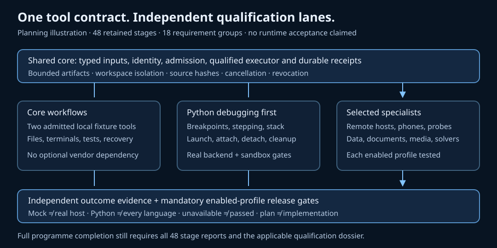

# Tool-plan gap audit and completion contract

Reviewed 23 October 2026 against Potbot `main` at `37e5e23cf0f69fd7f1bfb1266a033994d950767d` (runtime source 0.5.0.dev2). These are planned requirements, not implemented or qualified capabilities. The earlier phone/debugger plan remains authoritative for its specific target and protocol boundaries.

Generated architecture illustration, not a runtime screenshot. A video or runtime screenshot would imply execution absent from this requirements audit; actual demonstrations are required by the fixtures below. The existing device/debug planning diagram remains available in the [device specification](07-device-control-profiling-debuggers.md).

All agent-callable operations in this audit must follow the [mandatory SYN Cog contract](10-syn-tool-cogs.md). This applies to every gap and existing tool family; a transport adapter without registered typed Cogs is not full integration.

## Qualification and ordering

- **core:** Contract, policy, qualified executor, artifact and durable-gateway gates; two local admitted fixture tools. No vendor, phone, formal solver or paid-model prerequisite.
- **python_debug:** Shared neutral contract, qualified executor and real Python launch/attach, line/exception breakpoints, over/into/out, thread/stack/locals, stale-handle, detach/cleanup and outside-debugger test gates. A trusted local demo cannot qualify sandbox execution.
- **specialists:** Each enabled adapter requires its mapped stages plus actual language/OS/host/vendor qualification. Physical phones, Apple hosts, remote boards/probes, postmortem formats and profilers are independently gated.
- **full_programme:** All 48 reports plus every enabled mandatory profile, security/DB and release gate. Optional disabled integrations remain documented unavailable, never represented as passed.

The 48 existing IDs and statuses remain unchanged. The register records nine dependency corrections; these change ordering only. Local code intelligence no longer requires a repository-host connector. T10.1 uses two admitted local tools; T11.1 starts with the core suite and grows with enabled profiles. T12.1 qualifies installation per enabled profile before programme-wide completion. T12.2 requires durable execution and integrity views; specialist/benchmark panels are qualified as enabled. A full programme release still needs all 48 reports. Re-estimate P02, P03, P07, P08, P10–P12 after inventory; previous estimates cannot absorb these expansions silently.

## Requirement and acceptance register

P0 means a core/coding contract gap; P1 means a demand-led specialist capability whose selected profile still has mandatory acceptance. All gaps below have status **planned**.

### G01 — Workspace files and atomic editing

**Priority:** P0. **Stages:** T02.3, T03.2, T07.2, T07.4. **Fixture:** WF16.

**Baseline coverage:** Repository search and the existing patch pipeline are covered; general file operations lack a typed contract.

Add bounded list/read/search/stat, range reads, create/copy/move/delete and multi-file patch operations. Preserve encoding, BOM, newline mode, executable bits and binary identity. Bind expected base hashes, workspace roots and symlink/reparse-point resolution; use staging plus a journal and recovery for multi-file commits rather than claiming a filesystem-wide atomic rename.

**Acceptance:** A two-file UTF-8/CRLF fixture preserves bytes outside the patch; stale bases and symlink swaps are rejected. Inject failure between commits: recovery restores the old set or completes the journaled new set, and a partial set is never verified. Preview and readback prove the exact resulting hashes.

**Demonstration:** Edit two files, inject a concurrent edit and an interrupted commit, then inspect conflict and recovery receipts.

### G02 — Interactive terminal sessions

**Priority:** P0. **Stages:** T02.3, T03.4, T10.2, T12.2. **Fixture:** WF17.

**Baseline coverage:** Bounded one-shot CLI pipes exist in the plan; a PTY and its session lifecycle are unspecified.

Offer optional PTY sessions with explicit executable, cwd, environment projection, input/EOF, resize, signals and owned process-tree cleanup. Qualify POSIX PTY and Windows ConPTY separately. Gate each input against the current session lease; sanitize terminal control sequences and links before operator rendering; secrets use the credential broker, never model-entered prompts.

**Acceptance:** An authored interactive child accepts two inputs, resizes and exits; slow output remains bounded. Expired-session input and terminal escape injection fail; cancellation cleans the owned tree. A dropped connection cannot replay a command or claim a prompt was answered.

**Demonstration:** Run a local interactive fixture, disconnect once and inspect output, lease expiry and cleanup.

### G03 — Remote development and compute targets

**Priority:** P1. **Stages:** T02.3, T03.2, T03.3, T08.4, T12.1. **Fixture:** WF18.

**Baseline coverage:** Remote debugger hosts and cloud candidates are named; general SSH/container/VM execution is not specified.

Add separately admitted SSH/SFTP, container and VM targets with host-key or workload identity, fixed workspace mapping, immutable image/build identity, scoped transfer and process control. Lease port forwards, bound their destination and close owned channels. Kubernetes exec and devcontainers require their own profiles; never mount a raw Docker socket or forward an agent credential as an implicit capability.

**Acceptance:** A disposable SSH/container fixture transfers a hash-pinned file and runs a fixed command. Reject changed host keys, wrong cluster/namespace, escaping mounts and stale target leases; cancellation removes only the fixture's processes and forwards. Physical remote-host qualification is recorded independently.

**Demonstration:** Inspect a target, transfer a fixture, execute it and verify remote output hashes and teardown.

### G04 — Network diagnostics and protocol clients

**Priority:** P1. **Stages:** T02.4, T03.2, T06.2, T08.3. **Fixture:** WF19.

**Baseline coverage:** HTTP APIs and CDP network traces are covered; host-level DNS/TLS/socket diagnosis is missing.

Add scoped DNS resolution, TCP reachability, TLS certificate/chain inspection, HTTP timing and bounded WebSocket/SSE clients. Apply egress policy to resolved and redirected addresses. Treat packet capture, proxy changes, network interfaces and firewall mutation as distinct privileged capabilities; packet payload capture defaults off.

**Acceptance:** A local fixture distinguishes DNS failure, refused connection, expired certificate, redirect denial and slow response. WebSocket reconnect exposes a new attempt without duplicating a write. Capture size/duration is enforced and secret headers/payloads are omitted from receipts.

**Demonstration:** Diagnose a planted TLS/HTTP fault and compare it with a healthy endpoint using the same policy.

### G05 — Processes, services and operating-system evidence

**Priority:** P1. **Stages:** T02.3, T03.1, T07.3, T08.4. **Fixture:** WF20.

**Baseline coverage:** Process execution and profiling are planned; OS/service inventory and bounded log queries are unspecified.

Provide typed process/resource inventory, scoped service status and bounded journal/Event Log queries with time windows and cursors. Bind PID plus process start identity, user and host; service start/stop/restart, signals and dump collection are separate effects. Preserve unavailable metrics and native privilege requirements.

**Acceptance:** A fixture emits an error and exits; queries locate its exact process and time span. PID reuse cannot redirect a signal; an unrelated service cannot be stopped. Log flooding hits limits without losing a truthful truncation cursor or exposing a planted secret.

**Demonstration:** Correlate a service error with its process, log window and resource observations.

### G06 — Database transactions, migrations and restore

**Priority:** P1. **Stages:** T08.1, T08.3, T11.4, T12.4. **Fixture:** WF21.

**Baseline coverage:** SQL defaults to read-only and writes require authority; safe write execution and restore acceptance are not defined.

Add separately granted parameterized writes, explicit transaction boundaries, lock/statement timeouts, affected-row limits and optimistic concurrency. Plan schema migrations against exact schema versions, dry-run where supported, checkpoint backups and restore rehearsal. DDL auto-commit and non-transactional effects must be declared; never promise rollback when the engine cannot provide it.

**Acceptance:** A disposable database passes read/write isolation, stale-row rejection, mid-transaction rollback and lock timeout. Restore a hashed backup into a fresh instance and check schema/data invariants. Lost acknowledgement after commit remains indeterminate until reconciled, without repeating the write.

**Demonstration:** Apply and recover a small migration, then show restore evidence from a separate disposable instance.

### G07 — Documents, tables, OCR and archives

**Priority:** P1. **Stages:** T05.2, T08.4, T09.1, T11.1. **Fixture:** WF22.

**Baseline coverage:** Fetch/extraction and cloud files are candidates; local document authoring and format fidelity are not acceptance-gated.

Add scoped PDF, DOCX, XLSX, CSV/TSV and archive inspect/extract/transform adapters, plus OCR with confidence and page coordinates. Retain formulas, units, styles, page/source spans and original bytes; formula recalculation and rendering require qualified engines. Macros, external links and spreadsheet formula execution default off; bound archive expansion, nested depth and parser resources.

**Acceptance:** A fixture round-trips Unicode and tabular values, renders a document and traces OCR text to page boxes. Zip traversal, archive bombs, external-link fetches and formula injection are blocked. Report unsupported layout/formula features and compare rendered pages where visual fidelity matters.

**Demonstration:** Extract a table from an authored PDF, inspect source spans and export a reviewed spreadsheet with a rendered preview.

### G08 — Image, audio and video tool composition

**Priority:** P1. **Stages:** T08.4, T09.1, T11.1, T12.3. **Fixture:** WF23.

**Baseline coverage:** DanceFlow domain tools are listed, but media IO, time bases and composition acceptance are unspecified.

Describe typed image/audio/video inspect, decode, transform, transcript/subtitle and bounded capture contracts with MIME, dimensions, colour space, sample rate, channels, frame/time base and source hashes. Compose maintained DanceFlow tools for supported analysis/rendering rather than copying engines. Keep generation, transformation, model inference and source evidence distinct; require rights/cost/retention policy and project-local models for optional inference.

**Acceptance:** An authored local clip preserves expected duration, sample/frame mapping and caption offsets through a supported adapter. Reject unsupported codecs and oversized inputs explicitly; verify exported bytes and playback separately from a successful render command. No optional model download or paid generation occurs merely on discovery.

**Demonstration:** Inspect an authored short clip and execute one supported transformation with before/after metadata and user-controlled playback.

### G09 — Inbound events, subscriptions and connector writes

**Priority:** P1. **Stages:** T02.4, T08.3, T08.4, T10.2. **Fixture:** WF24.

**Baseline coverage:** Webhooks and collaboration connectors are named; delivery, unsubscribe and uncertain-send semantics are incomplete.

Define authenticated webhook/subscription/timer inputs with signature verification, replay windows, deduplication, ordered cursors where supported and bounded dead-letter retention. Explicitly separate drafts, sends, acknowledgements, edits and deletion; use exact-payload grants for connector writes and reconcile uncertain delivery. Subscription creation/renewal/unsubscribe and revocation are owned resources, not permanent background access.

**Acceptance:** A local event source delivers duplicate/out-of-order events and rotates its signing key. Only one admitted workflow is created per canonical occurrence; spoofed and expired events fail. Lost send acknowledgement cannot cause a duplicate; unsubscribe stops new delivery and reports outstanding events.

**Demonstration:** Trigger a workflow from a signed local event, replay it and inspect the single accepted occurrence.

### G10 — Large artifacts, streaming and retention

**Priority:** P0. **Stages:** T01.3, T02.4, T03.4, T10.2, T12.2. **Fixture:** WF25.

**Baseline coverage:** Output caps and artifact hashes exist; paged access, backpressure and retention are not one shared contract.

Specify MIME/encoding/length/hash, range and cursor reads, resumable chunk upload, bounded streaming and backpressure over the existing artifact store. Bind cursors and references to tenant, grant and revision; define expiry, redaction, retention, deletion and cache invalidation. Preserve a complete artifact separately from truncated model/operator projections; a digest alone is not an accessible output.

**Acceptance:** Stream an artifact above the inline cap, reconstruct exact bytes by ranges and verify its hash. Disconnect/reorder/duplicate chunks without corruption; reject foreign/expired cursors and changed revisions. Slow consumers stay within declared buffers; retention removes access and reports unavailable historical content honestly.

**Demonstration:** Inspect a large trace in bounded pages, reconnect and verify the retained full artifact.

### G11 — Test discovery, coverage and failure reduction

**Priority:** P0. **Stages:** T07.3, T07.4, T11.1, T11.3. **Fixture:** WF26.

**Baseline coverage:** Language test/lint tools are listed; test identity, coverage and flaky-result handling lack criteria.

Normalize test discovery, selection, subtests, parameterized cases, stdout and JUnit receipts with exact source/runtime/command. Report line/branch coverage with source maps and distinguish coverage from correctness. Add bounded property/fuzz runs and minimized counterexample artifacts; retain seeds, reruns, skips and flaky classification without converting a retry into an unqualified pass.

**Acceptance:** A Python-first fixture discovers parameterized tests, isolates a planted failure and records source-bound coverage. A seeded property failure reproduces from its minimized input. Changed tests invalidate prior evidence; skipped mandatory cases and a flaky rerun cannot make the original failure disappear. Qualify later language runners independently.

**Demonstration:** Select one failing Python case, debug it, rerun outside the debugger and inspect the source-bound test receipt.

### G12 — Debugger completeness and postmortem inspection

**Priority:** P1. **Stages:** T02.3, T07.2, T07.3, T11.1. **Fixture:** WF27.

**Baseline coverage:** Live line/exception breakpoints and stepping are already required; multi-thread/process and postmortem cases need explicit gates.

Extend negotiated debugger capabilities with breakpoint replacement/removal and pending verification, thread selection, async/logical stacks, child-process policy, source maps, optimized/missing-symbol frames and read-only core/minidump inspection. Treat logpoints, conditions, watches and pretty-printers as potentially executing target code. Distinguish attach/detach from launch/terminate; hot reload, reverse execution and instruction/data breakpoints are optional capabilities, not universal promises.

**Acceptance:** Local Python remains first: test breakpoint removal and delayed verification, an actual attach/detach preserving a separately owned fixture, exception stacks and thread selection where supported. Resume invalidates all frame/value handles; mismatched source maps/dumps are rejected. A read-only postmortem fixture cannot resume or mutate a live target. Unsupported async/reverse/native features remain explicit.

**Demonstration:** Compare a live Python exception stack with a separately qualified postmortem view; do not claim Python live acceptance qualifies dump formats.

### G13 — Distributed traces and comparable profiling

**Priority:** P1. **Stages:** T01.3, T06.2, T07.3, T11.2, T12.2. **Fixture:** WF28.

**Baseline coverage:** Causal SYN events and profiling are defined; cross-host trace export and clock uncertainty need a concrete contract.

Map optional OpenTelemetry trace/span/link identities onto canonical SYN run/event receipts without replacing authority or the durable ledger. Preserve monotonic local durations, wall clocks, units, host clock offsets/uncertainty, dropped samples and profiling overhead. Correlate logs, traces and metrics with exact workload/build/source; do not send sensitive baggage or high-cardinality private attributes by default.

**Acceptance:** A local two-process fixture preserves parent and fan-in links; injected wall-clock skew cannot produce fabricated negative durations or false ordering. Compare the same workload with profiler off/on and report overhead, missing counters and sampled uncertainty. Telemetry exporter failure does not lose execution receipts or authorize retries.

**Demonstration:** Inspect a causally linked service trace and a reproducible CPU hotspot comparison with measured overhead.

### G14 — Reproducible environments and dependency updates

**Priority:** P0. **Stages:** T04.4, T07.3, T12.1, T12.4. **Fixture:** WF29.

**Baseline coverage:** Pinned packages and SBOM are planned; offline reproduction and build/update provenance need acceptance.

Define language/runtime/compiler/OS/architecture lock identities, native library and system package prerequisites, licences and provenance. Separate dependency resolution/download/install/build/execute rights; cache only integrity-checked artifacts within project scope. Add offline replay from an approved cache, compatibility matrices, vulnerability revocation and upgrade/downgrade tests. Sign/attest published artifacts through established release routes when configured.

**Acceptance:** A clean offline fixture rebuilds from a pinned cache or reports exact missing artifacts, never downloading silently. Tampered wheels/binaries and incompatible ABI profiles fail before execution. An update/rollback preserves active-run pins and produces the expected source/package hashes; licence restrictions are reported before redistribution.

**Demonstration:** Recreate a minimal Python tool environment offline and compare its dependency and output identities.

### G15 — Recovery, quotas and operator stop authority

**Priority:** P0. **Stages:** T03.4, T10.2, T11.4, T12.2, T12.4. **Fixture:** WF30.

**Baseline coverage:** Crash fencing and budgets are covered; end-to-end recovery, storage exhaustion and stop acknowledgement need cross-tool acceptance.

Specify per-tenant admission/concurrency/fairness/storage quotas, queue backpressure, deadlines and cancellation propagation through nested tools. Stop authority remains available while a target is paused or an approval is pending. Model compensation as a separately authorized effect, not a guaranteed undo; include journal recovery, expired leases, dead-letter inspection, store backup/restore and incident runbooks. Record requested, acknowledged and independently observed cleanup states separately.

**Acceptance:** Inject worker death, full scratch storage, dropped cancellation and a stuck child across a bounded workflow. No new effects dispatch after revocation; owned resources reach an observed terminal state or an explicit hold within a configured deadline. Restore a disposable store and reconcile uncertain effects without replay; another tenant's queue remains responsive.

**Demonstration:** Cancel a nested workflow during a debugger stop and inspect target, worker, artifact and approval final states.

### G16 — Operator handoffs and accessible evidence views

**Priority:** P1. **Stages:** T03.4, T06.3, T12.2, T12.3. **Fixture:** WF31.

**Baseline coverage:** The dashboard covers execution and approvals; keyboard interaction, external handoffs and bounded sessions need explicit criteria.

Provide keyboard-accessible catalog, diff/approval, terminal, debugger stack/variables and artifact views. Render untrusted text safely and distinguish proposal, admitted, running, paused, unknown and independently verified states. Human handoffs bind exact action/source hashes, expiry, target and continuation; resume revalidates authority and fresh state. Export redacted receipts, screenshots and user-controlled demonstration media without browser-session secrets.

**Acceptance:** Complete one fixture by keyboard, including deny, cancel and inspection of an indeterminate result. Reject stale/changed approval payloads and cross-workspace links; terminal/HTML artifacts cannot execute in the dashboard. Closing a view does not silently terminate a target or imply cleanup. A handoff resumes exactly once after fresh state validation.

**Demonstration:** Review a file diff and paused stack, deny one action, then resume an authorized continuation with an auditable receipt.

### G17 — Core versus specialist gates and traceability

**Priority:** P0. **Stages:** T01.1, T01.4, T10.1, T10.3, T11.1, T12.1, T12.4. **Fixture:** WF32.

**Baseline coverage:** The 48-stage outline over-couples core composition, benchmarks and installation to every optional specialist.

Keep all 48 stage identities and historical implementation states, but encode executable hard dependencies separately from optional feature gates. Core composition needs two admitted fixture tools, not every search/database/formal-proof integration. Qualification is per enabled profile; unsupported devices/vendors remain named unavailable routes. Maintain requirement-to-stage-to-fixture-to-gate evidence; inventory source capability separately from programme completion and re-estimate expanded phases before commitment.

**Acceptance:** The plan checker verifies 48 unique stages, acyclic explicit hard edges, synchronized Markdown/JSON/CSV, unique gap IDs and complete requirement/fixture coverage. Missing specialist hosts cannot fail an unrelated core profile; an enabled mandatory gate cannot be skipped or declared passed by a mock. No stage status changes merely because requirements were written.

**Demonstration:** Render the core dependency path and show that Python-first acceptance can run without Apple, hardware probes, Wolfram or a formal prover.

### G18 — Typed conversion and discovery lifecycle

**Priority:** P0. **Stages:** T01.2, T02.1, T02.2, T04.2, T10.1. **Fixture:** WF33.

**Baseline coverage:** Types and discovery are covered; lossy conversion, changing schemas and server-originated operations need cross-protocol criteria.

Make units, locale/timezone, precision, MIME/encoding, pagination and lossiness explicit in converter Cogs; preserve source spans and require validation after conversion. Pin current MCP version and separately test legacy compatibility. Reconcile capability/list changes with active-run schema pins. Server-originated sampling, elicitation, resource subscriptions or future extensions receive explicit local admission and budgets; a server cannot confer model, filesystem or user-consent authority.

**Acceptance:** Reject an ambiguous date/unit conversion, precision loss beyond tolerance, incompatible schema change and an unauthorized server-originated request. A benign discovery refresh does not alter an active run; revocation blocks new dispatch. Round-trip a source-bound typed fixture and retain any declared loss; current and legacy MCP flows have separate contract tests.

**Demonstration:** Route a typed table through a unit converter, refresh its tool schema and inspect admission of the next invocation.

## Retained evidence and plan checks

Every implementation report binds requirement ID, stage ID, source/config hashes, adapter/runtime version, host/profile, authored versus real target, command/input and expected/observed result, artifacts, denial cases, resource bounds and cleanup. Discovery, installation, execution, completion and independent verification are separate states. Synthetic contract tests cannot satisfy a real-host gate. Public artifacts must exclude credentials, private records, model weights and operational coordination.

Run `python scripts/check_tool_plan.py` from the checkout. It checks exact cross-format parity, expanded hard edges, DAG validity, all requirement/fixture/stage links, local documentation/media references and planning-only statuses. Its in-memory negative probes demonstrate rejection of a cycle, missing stage, tracker drift and unowned requirement. It does not test any proposed adapter.

## Primary contract references

Checked 23 October 2026. MCP currently identifies 2026-07-28 as current, so the existing plan pin is retained; compatibility with older handshake-based revisions is a separate fixture. DAP standardizes language-neutral operations; individual backend capability support still needs negotiation. OpenTelemetry is an optional correlation/export surface, never Potbot authorization or durable execution authority.

- [MCP versioning and compatibility](https://modelcontextprotocol.io/specification/versioning).
- [DAP overview and session lifecycle](https://microsoft.github.io/debug-adapter-protocol/overview).
- [OpenTelemetry tracing API, span contexts and links](https://opentelemetry.io/docs/specs/otel/trace/api/).

Candidate adapter names elsewhere in the plan require current primary documentation and immutable version selection during inventory/implementation. This audit adds no download, pairing, cloud write, paid model call or public-site deployment.
