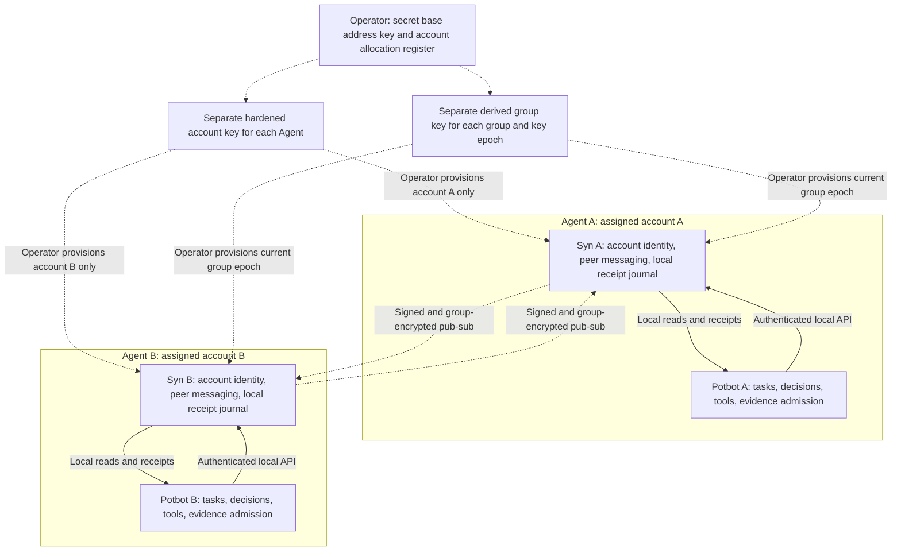

# Required topology: private Syn instance and encrypted pub-sub per Agent

23 October 2026. **Owner requirement, superseding the shared-service target:**
every unique Agent runs its own Syn instance. All inter-agent communication goes
through those Syn instances over a private encrypted P2P publish/subscribe group.
The operator derives and distributes a distinct account key for every Agent from
the base address key, assigns the unique account number and is responsible for
ensuring no two Agents use the same key.

**Status:** binding design requirement and implementation order, not implemented
encrypted networking. The existing HTTP/client/ledger and metadata-summary code
is a local integration foundation. Current Syn has peer discovery, but no private
group pub-sub, stable account-bound peer identity or encrypted application frames.
The [operator provisioning increment](12-syn-agent-key-provisioning.md) implements
restricted account vaults, an encrypted allocation register, signed membership and
current-group-key rotation. It does not yet wire those keys into a Syn peer runtime.

*Target architecture illustration. Dashed paths require provisioning/security and
mesh implementation; solid local API paths use the existing adapter. There is no
current encrypted multi-node demonstration to record. Capture the actual two-node
acceptance when implemented; a mock recording would not establish it.*

## Agent and instance ownership

- An Agent has one operator-assigned account identity and its own Syn runtime,
  persistent peer identity, private store, receipt history and local API binding.
  Workers acting under that same Agent identity are not automatically new Agents.
- Different Agents must not point at one shared Syn as their communication owner.
  They do not call another Agent's Potbot API, database, MCP session or shared-file
  inbox. Requests, replies, coordination, results, acknowledgements and recovery
  traffic all travel through Syn. Calling an external tool to perform task work
  remains distinct from using that tool as a covert inter-agent transport.
- Potbot talks to its own Syn through an authenticated local interface (loopback
  or an equivalently protected same-Agent service binding). Syn owns discovery,
  membership validation, peer transport, encryption, signing/verification and
  peer message persistence. Private operations use the protected native broker;
  raw keys do not enter Potbot prompts, Python payloads or logs.
- A received message remains a proposal/evidence claim. Potbot owns task grants,
  budgets, tool effects, independent verification and memory admission.

Map a peer's source Agent/workspace to a permitted local tenant explicitly.
Matching workspace UUIDs or membership in the encrypted group do not grant local
database access or permission to dispatch a task.

## Key hierarchy and operator provisioning

"Base address key" means secret operator-held wallet key material, not the public
address or verification key. Public identifiers can be context but cannot supply
an encryption secret. Preserve the existing wallet profile and base identity;
do not silently redefine its currently published derivation path.

The intended hierarchy has separate hardened agent-account and group-key
branches beneath the secret base key. Each Agent receives only its assigned
account's key material and the current group key, never the root seed, base
private key, sibling account keys or group-derivation secret. Account numbers are
explicit operator assignments in a bounded hardened index domain, not defaults
chosen independently at startup. The concrete branch allocation and versioned
key/export profiles are frozen with independent derivation vectors in the
[provisioning contract](12-syn-agent-key-provisioning.md).

Use the existing Ed25519-BIP32 implementation for the hardened account derivation
rather than inventing another wallet algorithm. The general hardened account
separation principle is illustrated by [CIP-1852](https://cips.cardano.org/cip/CIP-1852);
that does not make Syn's existing custom base path a CIP-1852 wallet path.
Use a separately labelled KDF context for group encryption keys, including the
protocol, group identity and key epoch. [RFC 5869 section 3.2](https://www.rfc-editor.org/rfc/rfc5869.html#section-3.2)
describes binding HKDF output to application-specific context. Signing, transport
identity, group encryption and vault protection must not reuse raw key bytes.

The operator keeps the allocation register and securely hands out the bundles.
Provisioning should reject duplicate account numbers and duplicate public-key
fingerprints within the known operator inventory, and startup checks should bind
one Syn instance to its assigned Agent. Those checks cannot prove that an operator
has not copied a bundle elsewhere, particularly across a partition. Responsibility
for non-duplication remains with the operator, as requested.

The current native vault's `Secrets` contains entropy, root and base private
keys, and unlock reconstructs the wallet hierarchy. **Do not distribute that
operator vault as an Agent bundle.** A new restricted account-vault profile must
accept an operator-derived account key without requiring or retaining the parent
wallet seed. Legacy operator vaults remain separately identified; no automatic
conversion or key migration is implied.

## Private group contract

Every admitted Syn instance has an operator-root pin, account number, account
public-key fingerprint, instance/peer binding, group ID and current key epoch.
Membership evidence binds the allowed Agent account to that group. A self-supplied
key, topic name or `sender` string is not membership evidence.

The [node identity and Type-policy contract](14-type-consensus-and-node-identity.md)
requires all Syn sender, recipient, peer and voter references to use the assigned
account's public-key hash: lowercase SHA-256 of its raw 32-byte Ed25519 public key.
The operator/issuer fingerprint is custody evidence, never another node address.
Transport peer IDs remain authenticated internal locators. Common-issuer
certificates plus fresh key possession admit a participant; the canonical Type's
policy still decides its voting role, agreement protocol and required proof.

Syn publishes a signed application frame encrypted under the derived group key.
The authenticated frame must bind protocol/profile versions, group, epoch,
originating Agent/account, message identity, sequence/replay identity and payload
digest. Receivers verify the group/epoch, ciphertext integrity, actual account
signature, membership and replay policy before exposing a local message to Potbot.
All group members know the encryption key, so a valid group authentication tag
alone does not establish which member authored a message.

Use maintained libp2p pub-sub primitives, but do not infer private application
encryption from a topic or encrypted peer link. The [libp2p pub-sub description](https://docs.libp2p.io/concepts/pubsub/)
describes dissemination, transient duplicate suppression and application
validation; those do not supply this complete membership/durability contract.
Bind persistent transport peer IDs to the admitted account identity. A newly
generated peer ID at every startup is not sufficient.

Nonce uniqueness is a protocol gate, including concurrent senders, crashes,
restores and copied instance state. Choose and test the authenticated-encryption
profile, nonce allocation/persistence and key-epoch rules before release. Refuse
unsupported profiles, unknown members, wrong groups/epochs and unsafe restored
counter state. No plaintext or direct-Potbot fallback is permitted.

The operator distributes new group-epoch keys to retained members when membership
changes. A removed Agent must not derive future keys from a distributed secret.
Rotation controls future access; it does not erase messages or keys already held
by a former member. Do not claim forward secrecy from this static shared-key
design without an additional qualified protocol.

## Receipts, replay and application contracts

Each Syn owns its local commit order and hash-chain journal. There is no single
workspace sequence shared by every Syn instance. Retain source Agent and message
identity across hops, but preserve separate Potbot event, sender-Syn journal and
receiver-Syn journal cursor domains. Local storage acknowledgement, peer receipt,
application admission and completed work are distinct states.

Pub-sub delivery needs durable Syn-side publish/replay and receiving deduplication;
transient gossip caches are insufficient. Receipt requests, acknowledgements and
catch-up also pass through Syn. A restored or disconnected node reconciles by
retained message identity/digests and explicitly scoped checkpoints; receipt
chains alone do not establish consensus or a global order.

The existing `execution-summary:v1` is a minimized **application payload** from
Potbot to its own Syn. Its destination namespace/origin denotes that local
history, not authenticated peer membership. Keep that v1 byte/identity recipe
frozen; a separately versioned Syn peer envelope carries Agent, membership,
group/epoch and cryptographic transport evidence. Do not reinterpret old HTTP
receipts or the `potbot` sender label as signed account-bound peer messages.

## Revised order before an automatic outbox

1. Freeze the account, membership, local Agent-to-Syn binding and group-envelope
   contracts. Retain the implemented minimized application projection.
2. Use the implemented operator provisioning and restricted account vaults with
   known-answer derivation tests, no parent/sibling key access, duplicate-inventory
   rejection, documented restore/rotation limits and explicit operator handoff.
   Qualify the later Syn runtime against this boundary before enabling peer traffic.
3. Implement authenticated encrypted Syn pub-sub with stable account/peer binding,
   bounded queues, replay protection and safe nonce/epoch persistence.
4. Run an actual two-Agent/two-Syn acceptance: authorized exchange; wrong-key,
   wrong-account/group/epoch and forged-signature rejection; tamper/replay tests;
   restart, partition, duplicate assignment, restore and revocation cases.
5. Complete Potbot's richer semantic/causal producer and receiving admission.
   Then add the local transactional outbox to **its own Syn**. Syn owns peer
   delivery; Potbot must not introduce a parallel network sender.

This requirement changes the topology and stage dependencies; it does not mark
the existing 204-step or 48-stage programme complete or require distributed
consensus. Subsequent implementation belongs in Syn for networking and in the
native identity/provisioning owner for secret operations.
