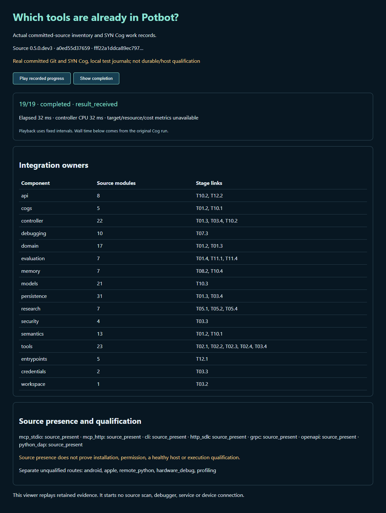

# A monitored inventory before extending the tools

Potbot **0.5.0.dev4** implements T01.1 as `syn://cog/potbot-tool-inventory-v1`: one registered request Type and one registered result Type, sealed installed handler, controller admission and existing Cog work monitoring. This stage inventories source and extension owners. It does not certify the later transport, discovery or native-host stages.



Actual replay of the committed dev3 baseline at `a0ed55d37659e7b40badf39a56db28c1fe8d1b36`, produced by the new inventory Cog. The source snapshot has 183 Python modules, 16 integration owners and 19 work events. Its test journals are explicitly not durable qualification. The separate mandatory CI gate inventories its own exact committed source using real PostgreSQL, authenticated artifacts, sealed SYN import and REST/WebSocket replay.

[Recorded progress replay](media/tool-inventory.webm) · [interactive viewer](../../examples/tools/inventory.html) · [public-safe recording](media/tool-inventory.json). Transcript: started; admitted dispatch; report each of 16 checked integration owners; completed with measured wall/controller CPU intervals. Playback uses fixed intervals and shows the actual original metrics; it starts no source scan or connection. A generated illustration would add no source evidence; the actual capture and progress replay are the useful media for this technical guide.

## Existing services remain the owners

The inventory reads an authenticated immutable `RepositorySnapshot` from `RepositoryStateStore`, not arbitrary source paths from a model. It retains commit, tree, full content digest, lock identity, source-file hashes, source version, owner-to-stage links and unresolved submodule references. Source is parsed as data, never imported or executed. Every captured Python module needs an explicit integration owner; new unmapped namespaces, missing mandatory files, dirty snapshots, version disagreement and changed expected content fail closed.

Existing MCP stdio/HTTP, CLI, HTTP/SDK, gRPC and OpenAPI adapter code is present in the baseline. That is a reuse finding, not a new transport implementation or qualification claim. The extension map points at the existing database/migrations, authenticated workspace identity, native broker, ToolGateway, supervisor, artifact storage and shared execution ledger. No parallel database, scheduler, identity service or agent-facing transport registry is added.

`core` and `python_debugger` are inventory profiles with mandatory source inputs. Android, Apple, remote Python, hardware and profiling stay named unqualified routes. Their unavailable hosts do not block a core inventory; requesting an unsupported enabled inventory profile or omitting a required source fails. Source presence cannot mint dispatch authority or turn a raw adapter into an agent-callable Cog.

## Invoke through the installed Cog

The host captures an explicit committed revision with the existing `RepositoryStateStore.capture(..., committed_ref=reviewed_commit)`, imports `BoundCogRegistry.tool_inventory().snapshot` with `SynService.import_snapshot`, then constructs `ToolInventoryRuntime.from_workspace` with authenticated storage, the exact state/content digest and mandatory admission callback. This is trusted host setup, not request-supplied authority.

```python
registry = BoundCogRegistry.tool_inventory()
context = CogRunContext(
    registry.snapshot.fingerprint, task_revision_id, repository_state_id, invocation_id
)
request = TypedCogValue(
    SIGNATURE.input_type_ref,
    {
        "schema_version": 1,
        "profile": "core",
        "expected_content_digest": admitted_repository_content_digest,
    },
)
outcome = await registry.invoke(str(SIGNATURE.cog_ref), request, context, controller=controller)
```

The controller checks the exact installed catalog, task and repository state, one-use invocation identity and immutable input. Admission is checked before starting work and again immediately before dispatch. Direct handler calls, type/profile mismatch, stale content, denied/revoked rights and missing monitoring cannot read the snapshot. Every successful call records start, actual component progress and completion through `CogWorkMonitor`, typed input/output artifacts and its separate Cog receipt. Unknown target/resource/cost quantities remain unavailable. Storage uncertainty poisons that controller for reconciliation without automatically retrying.

For a source-checkout demonstration on Linux, with developer dependencies installed:

```bash
uv run --locked python scripts/tool_inventory_demo.py --trusted-local-source --output NEW_FILE.json
```

This developer demo uses explicitly labelled local test journals. Production/durable acceptance is:

```bash
uv run --locked pytest tests/integration/test_tool_inventory.py -q
uv run --locked python scripts/check_tool_inventory.py artifacts/tool-inventory/tool-inventory.json --output artifacts/tool-inventory/T01.1-gate.json
```

The gate requires a real committed source matching HEAD, current package version, complete owner/stage map, deterministic digest and the retained typed result/work chain. The test independently rereads the repository state, input/output artifacts, receipts and events through a fresh service; checks workspace isolation; and verifies existing REST and WebSocket replay. CI retains `tool-inventory-cog-evidence` and never replaces a missing mandatory case with a mock. T01.2 is the next foundation stage; later stages retain their own acceptance requirements.
