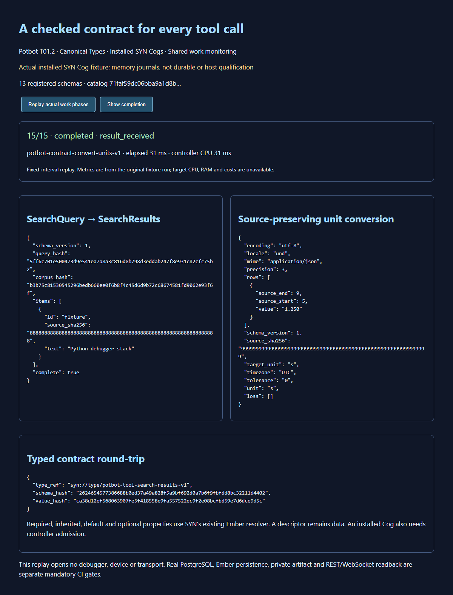

# Canonical contracts for installed SYN tools

Potbot **0.5.0.dev5** implements T01.2 through the existing SYN catalog, Cog registry, Ember resolver, artifact store and work ledger. Six versioned record contracts describe a tool, capability, implementation, installation, invocation and result evidence. Three installed, controller-admitted Cogs demonstrate typed search, contract round-trips and unit conversion. Existing builtin, debugger and inventory snapshots retain their identities.



Actual captured output replay from the installed Cogs using bounded source-checkout test journals. This image establishes the demonstrated fixture behaviour; it does not establish durable storage or a connected device. [Recording](media/semantic-contracts.webm) · [interactive replay](../../examples/tools/contracts.html) · [public-safe original observations](media/semantic-contracts.json). The recording replays the actual phases at fixed intervals and displays their original measured times. Transcript: search started, admission checked, corpus searched, result validated, completed; contract validator started, round-tripped, completed; converter started, converted 1,250 ms to 1.250 s with preserved source spans, completed. Target resource/cost metrics remain unavailable.

## Registered data and installed handlers

All canonical Types have full `syn://type/potbot-tool-…-v1` references under the existing protected data-record root. The new opt-in snapshot includes the authoritative semantic hierarchy profile, rather than re-declaring tool-definition ancestry. Its Type metadata contains exact, closed object schemas. Existing descriptor constructors additionally enforce representation bounds and immutable hash links. `synny://type/` aliases resolve to the same registered identity; shorthand, unknown Types, non-data ports, changed schema pins, missing properties and invalid inheritance fail.

| Record | Canonical Type suffix | Meaning |
| --- | --- | --- |
| Tool | `descriptor-v1` | A discovery description, never an executable installation |
| Capability | `capability-v1` | Exact input/output Types, schemas, effect class and internal transport |
| Implementation | `implementation-v1` | Capability hash, package digest and declared publisher/version |
| Installation | `installation-v1` | Workspace, implementation/configuration/policy hashes and permitted scopes |
| Invocation | `invocation-v1` | Immutable proposed call, input hash, task/workspace and bounded limits |
| Evidence | `evidence-v1` | Observation linked to that invocation, typed output hash or explicit failed/indeterminate status |

These are checked descriptions. `check_executable_binding` separately verifies the installed Cog’s handler reference, revision, binding hash, port Types and exact schemas, then the capability → implementation → installation hash links. Controller admission remains mandatory. A declared package hash is not binary attestation; T01.3 retains its separate signed provenance/lifecycle scope.

`contract_ember_bundle` uses the maintained `EmberContractResolver` and `EmberContractService`: each concrete Cog inherits required input/output/binding slots and a default schema version from its parent, while description remains optional. Missing required values, incompatible overrides, unknown ranges and incorrect workspace/catalog scope are rejected. Production construction imports the exact sealed catalog, persists its checked owner/public Ember projections and authenticates the pinned repository state before exposing a controller.

## Three one-input/one-output Cogs

| Installed Cog | Input → output | Actual operation |
| --- | --- | --- |
| `syn://cog/potbot-contract-search-v1` | SearchQuery → SearchResults | Bounded case-insensitive substring search of an authenticated host-supplied, immutable corpus; deterministic ordering, source hashes, query/corpus identities and explicit truncation |
| `syn://cog/potbot-contract-validate-v1` | ContractCheck → ContractChecked | Validate the registered Type/schema pin, strict JSON and representation; return canonical JSON and value identity |
| `syn://cog/potbot-contract-convert-units-v1` | UnitTable → UnitTable | Decimal ms/s conversion with explicit locale/timezone, MIME/encoding, precision/tolerance, original source hash/spans and declared absolute rounding loss |

Use `BoundCogRegistry.tool_contracts()` and `ToolContractRuntime.from_workspace(...)`. The host supplies authenticated database/artifacts/actor, imported snapshot, task and repository state, bounded corpus and a mandatory admission callback. The request carries no grants, credentials, handler path or controller authority. `registry.invoke(...)` freezes the typed input before dispatch. New calls receive unique invocation IDs; compatible edges carry the preceding Cog receipt hash. Raw handlers, unknown Cogs, wrong Types, repeated IDs, revocation, modified inputs and failed monitoring block dispatch.

Every invocation uses `CogWorkMonitor` to retain start, admitted dispatch, the actual operation phase, typed result validation and completion, with unique event identities and direct trigger/emitter links. Typed input/output artifacts and Cog receipts use the existing workspace store. Wall time and controller-process CPU intervals are measured; unavailable target CPU/RAM/GPU/IO/tokens/provider time/cost/budget settlement remain explicit. A failed conversion and denied new invocation retain distinct failed observations. Lost storage poisons the controller for reconciliation; it never silently retries.

## Schema evolution and specialist contracts

`require_compatible_schema` conservatively permits only new optional properties; changes to existing fields, required fields, units, constraints or other schema semantics need a new major Type. This deliberately avoids claiming general JSON Schema compatibility. Candidate refreshes do not replace an active catalog/schema pin. Revocation is rechecked immediately before dispatch. Ambiguous dates/units/locales and precision loss beyond tolerance fail; declared losses and original source spans survive conversion. Existing modern and legacy MCP subprocess/HTTP fixtures remain separate transport regression gates. T02/T04/T10 own subsequent live discovery, active-run refresh and workflow routing; this stage does not claim their implementation.

Registered target-session and capture/stop/stack/value receipt schemas preserve exact session, target, process-start identity, source hash, revision and artifact hash. `check_target_receipt` rejects identity mismatch. Capability states explicitly distinguish supported, unsupported and unqualified with a reason. These contracts provide a common representation for devices, profilers and debuggers. Python remains the separately tested first debugger backend. No ADB/iOS/profiler/JTAG/ICSP/SWD or additional language qualification is inferred from registering these Types; a reported receipt does not independently verify its target.

## Repeat the checks

```bash
uv run --locked python scripts/semantic_contract_demo.py --trusted-local-fixture --output NEW_FILE.json
uv run --locked pytest tests/unit/test_semantic_tool_contracts.py -q
uv run --locked pytest tests/integration/test_semantic_tool_contracts.py -q
uv run --locked python scripts/check_semantic_tool_contracts.py artifacts/tool-contracts/semantic-contracts.json --output artifacts/tool-contracts/T01.2-gate.json
```

The mandatory integration test uses a real committed Git fixture, authenticated SYN import, durable Ember owner/public records, real PostgreSQL artifacts/events, fresh paginated readback, workspace isolation and the existing REST/WebSocket APIs. Its exact-source gate checks the running version, committed source byte hashes, six schema identities, nine completed invocations and every recorded lifecycle; CI retains `semantic-tool-contract-cog-evidence`. Missing mandatory evidence fails the job. A local fixture journal never substitutes for this gate. The documentation screenshot and video are actual fixture captures; a generated picture adds no contract-validation evidence and is omitted here.
