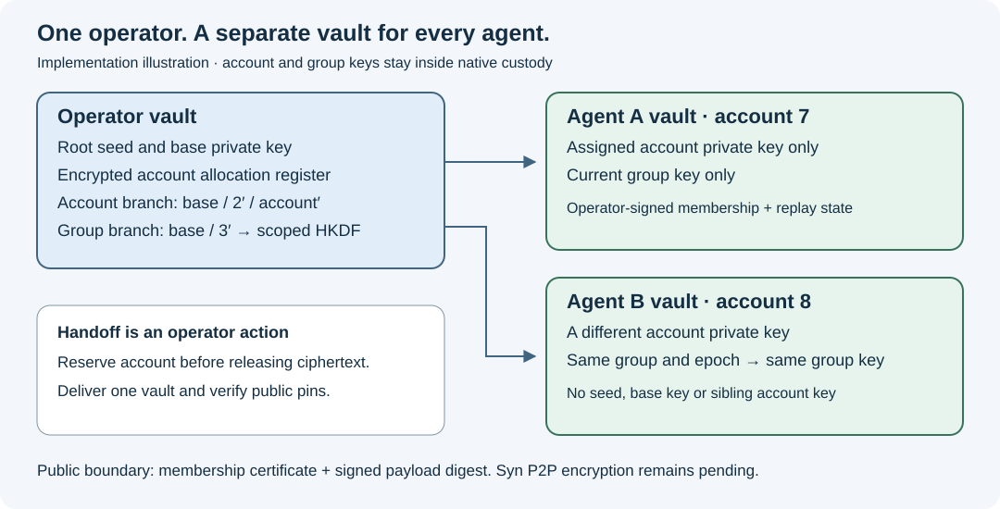

# Operator provisioning and restricted Agent vaults

23 October 2026. Implements the key-custody increment of the
[private Agent mesh requirement](11-syn-private-agent-mesh.md). The operator
retains the existing base identity and recovery seed. Every explicitly assigned
account gets a separate password-protected vault containing only its account
private key and the current group key as secrets. Public membership and local
replay metadata accompany them. Encrypted Syn networking and automatic delivery
remain pending; these commands do not start a Syn node or send keys to a peer.



*Generated implementation illustration. This is not a screenshot of a live mesh.
The native process acceptance uses disposable keys and takes the operator vault
offline while checking and signing with the Agent vault. Password-entry recordings
are omitted because they add disclosure risk; the public fixture and automated
acceptance provide the reproducible evidence.*

## Frozen derivation and public contracts

For the planned Syn network, the existing Agent public-key fingerprint is its
canonical node reference. The operator fingerprint remains an issuer trust pin.
See the [node identity and per-Type consensus contract](14-type-consensus-and-node-identity.md)
for full-key/hash checks, live possession and roster rules. This design does not
change any existing v1 derivation, certificate or signature bytes.

The existing Icarus/Ed25519-BIP32 V2 base path stays
`m/6969'/420'/0'/0/0`. Hardened indices are the encoded integer `2^31 + n`.
Account numbers and group epochs are explicit integers from 0 through `2^31-1`.

| Purpose | Recipe |
| --- | --- |
| Existing hourly signing | `base / 1' / hour'`; unchanged |
| Assigned Agent account | `base / 2' / account_number'` |
| Group derivation secret | `base / 3'`; remains operator-only |
| Current group key | HKDF-SHA256 of that branch's complete 96-byte extended private key; 32-byte output |

The HKDF salt is the UTF-8 string `syn-private-pubsub-group-key-v1`. Its `info`
is the existing canonical JSON encoding of `profile` with that same value,
`operator_fingerprint`, canonical UUID `group_id`, and integer `group_epoch`.
[RFC 5869 section 3.2](https://www.rfc-editor.org/rfc/rfc5869.html#section-3.2)
explains application-specific HKDF context. The key is derived from secret base
material, never a public address. Distinct account keys cannot derive the base,
sibling accounts or group-derivation branch. A current group key cannot derive
other epochs; possession of it permits group access until effective rotation.

The closed `syn-agent-account-v1` membership certificate contains schema version,
operator and Agent public descriptors, account number, instance UUID, group UUID,
group epoch and an operator signature. The signature covers the unsigned
canonical document prefixed by `syn-agent-membership-v1` and a NUL byte. Receivers
must independently pin the operator fingerprint. Private operations additionally
require the independently selected Agent fingerprint. A self-consistent key in
a supplied certificate does not establish trust in its operator.

An Agent's `syn-agent-proof-v1` signs a request UUID, exact payload SHA-256, issue
and expiry times, and that membership certificate. Its domain prefix is
`syn-agent-proof-v1` plus NUL. Validity is 1–300 seconds. Native signing reserves
the request durably before returning public evidence. Python independently checks
both Ed25519 signatures and the selected group, epoch, account pin, digest and
time. This is an authorship primitive for the future peer envelope. It is not
the existing hourly artifact signature profile, a pub-sub frame or an execution
grant. Receiving replay admission and current-epoch policy still belong to the
future transport and Potbot's admission owners.

## Custody and write ordering

The native broker owns all derivation, passwords and private bytes. Python passes
public assignments or hashes and receives public certificates/proofs. It never
decrypts the vault. There is no command to export raw private keys or group keys.
The future native transport boundary must consume these secrets internally.

`syn-restricted-agent-vault-v1` is a separate closed wrapper. Its encrypted
`AgentSecrets` has exactly two fields: the assigned 96-byte extended account
private key and one 32-byte current group key. It contains no entropy, parent or
base key, group-derivation secret, sibling key or history of group keys. Its
encrypted state binds the membership digest, vault identity, generation,
clock high-water mark and replay reservations. The existing root-vault parser
rejects this profile, and the Agent parser rejects root vaults. Legacy recovery
and base-signing commands cannot open an Agent vault.

Both profiles reuse the existing Argon2id/HKDF/AES-KW/AES-GCM envelope and native
memory protection. Production operations fail closed on an unqualified host.
Passwords use the native controlling terminal; the existing Linux private file
descriptor input is used by automated custody acceptance. Passwords never enter
Python, public JSON, environment variables or command arguments. Private files
use existing owner-only permissions, exclusive OS locks and flushed atomic writes.

The encrypted operator register rejects duplicate account numbers, public-key
fingerprints and instance UUIDs within its known inventory (maximum 1,024).
There is no default or auto-selected account number. Provisioning first commits
the operator reservation, then creates the distributable encrypted Agent vault,
then releases public membership. Existing destinations are refused.

If the second write fails, the account remains reserved even when no Agent file
was delivered. Inspect `agent-allocations`, preserve the incident and choose a
new unused assignment; automatic account reuse or reissue is deliberately absent.
Keep the encrypted register backed up with the operator vault. First allocation
upgrades the private root-state schema to 2; old binaries reject it. Legacy
unallocated vaults remain readable. The public base descriptor and key do not change.

## Operator workflow

Run on a qualified custody host. Use the existing `potbot identity build` and
`preflight` commands from the [identity guide](../agent-identity-and-ember-runtime.md). The variables
below stand for operator-selected absolute paths and independently verified public
fingerprints. The operator vault and its password stay with the operator.

```powershell
potbot identity agent-provision --vault $operatorVault --agent-vault $agentVault `
  --expected-operator-hash $operatorFingerprint --account-number 7 `
  --instance-id 22222222-2222-4222-8222-222222222222 `
  --group-id 11111111-1111-4111-8111-111111111111 --group-epoch 0
potbot identity agent-allocations --vault $operatorVault `
  --expected-operator-hash $operatorFingerprint --offset 0 --limit 50
```

The native terminal asks for the operator password and a separate new Agent-vault
password with confirmation. Output is signed public membership. Review it and
retain the operator/Agent fingerprints, account, instance, group and epoch in the
handoff. Allocation output is paginated (limit 1–128); follow `next_offset` until
`has_more` is false. It contains public assignment metadata, never private keys.

Securely deliver only that Agent's encrypted vault and its unlock credential,
with independently authenticated public pins. The provisioning command performs
no network transfer. On the assigned host, using its owner-only vault directory:

```powershell
potbot identity agent-public --vault $agentVault `
  --expected-operator-hash $operatorFingerprint --expected-agent-hash $agentFingerprint
potbot identity agent-check --vault $agentVault `
  --expected-operator-hash $operatorFingerprint --expected-agent-hash $agentFingerprint
potbot identity agent-sign --vault $agentVault --payload $publicPayload `
  --expected-operator-hash $operatorFingerprint --expected-agent-hash $agentFingerprint `
  --group-id 11111111-1111-4111-8111-111111111111 --group-epoch 0
```

`agent-public` checks membership without decrypting. `agent-check` also unlocks
and checks the restricted encrypted state. `agent-sign` hashes the exact selected
payload bytes and requests only a scoped proof. Check public membership against
the assigned instance/group configuration before a future Syn startup; automatic
runtime binding is not implemented by these commands.

## Group rotation, restore and limits

Choose the next epoch explicitly and rotate each retained member on the operator
host, using both passwords and the Agent pin:

```powershell
potbot identity agent-rotate --vault $operatorVault --agent-vault $agentVault `
  --expected-operator-hash $operatorFingerprint --expected-agent-hash $agentFingerprint `
  --group-epoch 1
```

This preserves the account key, replaces and zeroizes the in-memory previous group
key string, signs the new membership and reseals the Agent vault. It commits the
operator's advanced epoch first. An interrupted Agent replacement can be retried
at the same epoch; rollback below the highest known epoch is refused. Other members
still need their own updates. An old Agent vault rejects requests for the new epoch;
an updated vault rejects requests for the old one. Future receivers must enforce
their own current epoch, rather than accepting any historically valid certificate.

Revocation requires rotating retained members and withholding the new group key
from removed members, plus future receiver membership/revocation enforcement.
These commands alone do not revoke a live peer, erase copied files or remotely
delete old keys. Old encrypted backups may still contain old keys. There is no
forward-secrecy claim against compromise of the operator base key.

The operator is responsible for distributing distinct assignments and avoiding
copies running as multiple Agents. A copied/rolled-back operator vault, recovery
from words without the allocation register, or restored Agent replay state can
lose inventory/epoch/replay history. Local generation counters do not establish
an external rollback anchor or global uniqueness. Preserve trustworthy current
backups, reconcile allocations before recovery, and never silently auto-provision
a missing Agent vault from the base seed on its host.

## Reproducible checks and next increment

Native unit checks cover separate account and group contexts, maximum hardened
index, exactly two secret fields, parser separation, certificate/ciphertext binding,
wrong passwords/pins, durable replay, rotation, interrupted delivery and rotation
retry. Known answers were independently calculated using Python HMAC/PBKDF2 and
libsodium scalar multiplication against the existing synthetic Icarus fixture.
The [public Rust-generated proof fixture](../../tests/fixtures/security/native-agent-public-proof.json)
is verified independently by Python's cryptography implementation.

The Linux `production_restricted_agent_custody_acceptance` gate exercises actual
native processes under the protected allocator, owner-only files, operator-vault
unavailability, duplicate refusal, signing/replay and rotation. CI runs it alongside
the existing production custody test. Windows CI builds the protected executable
and runs library contracts; that is distinct from a Windows production-process
custody acceptance. No real operator keys are created by these fixtures.

Next: implement native use of the restricted keys in authenticated, encrypted Syn
pub-sub, exact local Agent/Syn binding, replay/nonce persistence, receiver epoch
and revocation policy, then run the actual two-Agent acceptance. Add the durable
outbox only after that boundary is qualified. Existing execution-summary v1 and
P/T programme stage statuses remain unchanged.
