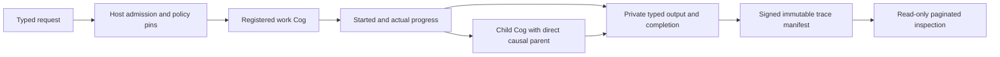

# Execution envelopes and signed historical receipts

Open the [recorded-trace viewer](../../examples/tools/provenance.html) and select
`execution-provenance.json` from the retained `execution-provenance-cog-evidence`
CI artifact. Its user-controlled fixed-interval replay displays the original
observations and metrics. It neither runs tools nor verifies signatures itself.

The opt-in `BoundCogRegistry.provenance()` profile installs 17 work-kind Cogs and
two receipt Cogs alongside the four existing pure transforms. Each has one
registered input and output Type, an installed handler binding and inherited
required/default/optional Ember declarations. Imported SYN data cannot load Python
code. Existing debugger, inventory and canonical-contract profiles keep their
original identities.
Seven discoverable JSON Schemas cover work requests/results, seal/replay ports
and the signed manifest. The existing canonical catalog validates and round-trips
these records; admission remains independently supplied by the host.

`ExecutionCogRuntime` takes host-owned `HostOperation` installations, a sealed
workspace snapshot, repository state, policy and independent admission callback.
Inputs are frozen and checked against registered canonical schemas. Admission
runs before monitoring starts and again before dispatch. The async handler has a
bounded deadline and output limit; it reports actual progress through its supplied
`ExecutionCall`. Children return through the same Cog boundary with their own run
identities. A failed write after dispatch is indeterminate and requires
reconciliation; the controller never retries it automatically.
Uncertain writes or unavailable monitoring fence further work dispatch in that
runtime; historical receipt inspection remains available for reconciliation.

The ledger remains `syn_execution_events`, sharing its existing workspace commit
cursor, REST feed and WebSocket replay. Migration 21 adds immutable run bindings,
receipt references and opaque cursors under existing workspace RLS and append-only
guards. Historical migrations and existing runtime producers are preserved. These
older producers do not acquire policy pins retroactively.

Each admitted run binds its catalog, task/repository revision, implementation,
policy/configuration/source hashes, approval hash when supplied, explicit budgets,
emitter and private input artifact bytes. Child and supporting causal references
must exist in the same authenticated scope. Raw ledger append cannot extend a
bound run. Orphan, reused, self-causal, terminal and changed-input observations
are rejected. A parent cannot finish with a live child.

Wall duration and controller-process CPU interval are measured using monotonic
clocks. Optional wall-clock offset/uncertainty and trace/span IDs are labelled
metadata; SYN identities remain authoritative. Target CPU, RAM, GPU, VRAM, I/O,
tokens, cost and settlement remain explicitly unavailable unless a future adapter
measures them. Nested process CPU intervals overlap and must not be added as
exclusive child costs.

The seal Cog accepts only a terminal, bounded root family. It checks retained
input/output bytes and signs a manifest binding the full trace artifact, sizes,
encoding, counts, original input and policy hashes. Production signing uses the
existing native Ed25519 broker; Python only receives public signatures. Tests use
synthetic keys. Signature validity means the trace was signed, with outcome
verification explicitly `not_assessed`. A failed or cancelled trace retains its
actual status.

The replay Cog verifies at the trusted stored acceptance time and returns 1–8
compact events per page. Its workspace/principal/receipt/policy/expiry-bound
cursor grants observation only. It never dispatches the original operation, and
changed input or policy invalidates reuse. A historical signature is not fresh
execution authority. Full traces remain separate retained artifacts, capped at
16 MiB, 256 runs, 2,048 events and depth 16. Paging bounds response size; this
implementation reads that bounded artifact into memory. A separate opt-in
[artifact-range Cog profile](15-artifact-range-cogs.md) now provides bounded
reads of general retained artifacts on the local POSIX backend. Receipt paging
itself retains its existing bounded in-memory projection. Network streaming,
uploads and physical retention remain later G10 requirements.

The mandatory PostgreSQL fixture exercises all work-kind registrations, nested
causation, supporting fan-in, actual Python CLI and MCP stdio subprocesses,
cProfile off/on output comparison, Ed25519 sealing, unchanged effect counts on
replay, expiry and foreign-workspace rejection, REST and WebSocket readback.
Other work-kind handlers in this fixture are scripted: this does not qualify
live models, browser sessions, CI systems or remote hardware. The single profiling
sample records timings and output equality; it is not a stable overhead benchmark.

Remote declarations pin probe, target, core, firmware, symbols and halt revision,
with explicit unsupported/unqualified capabilities and protected endpoints.
Attach declarations never imply reset, flash, erase or unlock authority. ICSP
programming, SWD/JTAG debug, GDB transports and JIT crash attachment retain separate
qualification and effect gates.

T01.3 remains **in progress** for production adoption by every existing producer,
network artifact transport, uploads/retention, exporter failure qualification and independent
remote/hardware profiles. This release supplies the shared core and its durable
fixture, rather than claiming those integrations are complete. The recorded
demonstration and exact-source acceptance artifacts are linked after verification.
