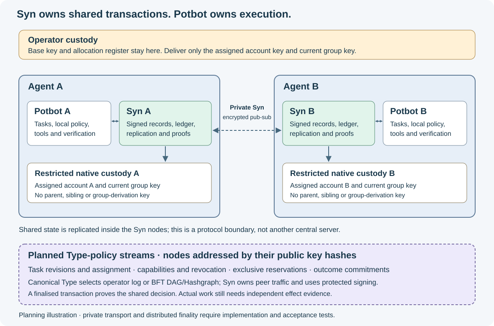
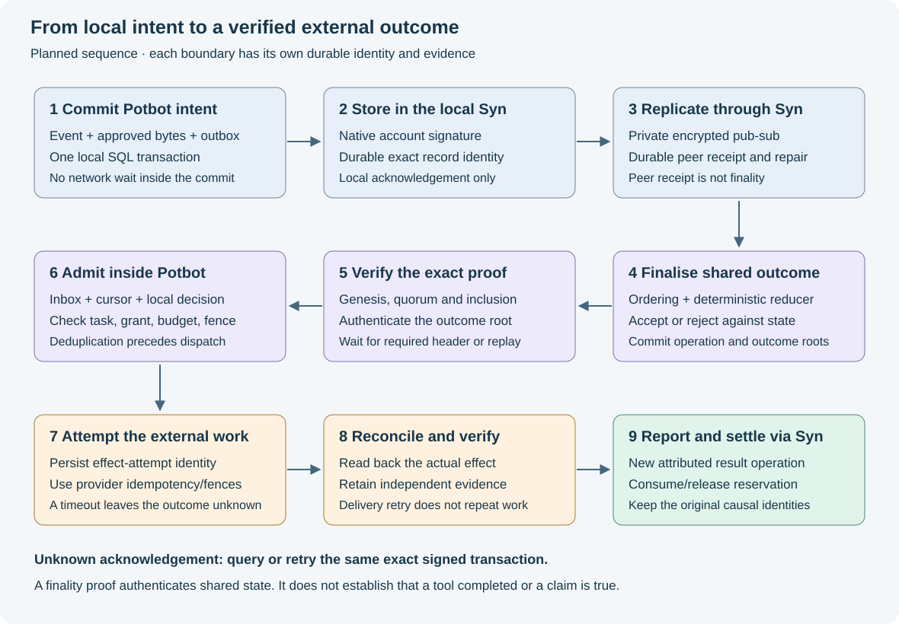

# Implementation plan for Syn as Potbot blockchain and transaction layer

23 October 2026. **Status: proposed implementation sequence.** This plan extends
the [architecture](09-syn-potbot-architecture.md), [private Agent mesh](11-syn-private-agent-mesh.md)
and implemented [operator provisioning](12-syn-agent-key-provisioning.md).
Its work-package IDs are local planning references; the existing 204 P-steps and
48 T-stages retain their identities and recorded completion states.

The target is a **private, permissioned Syn ledger for shared transactions**, with
one Syn instance per unique Potbot Agent. Syn authenticates submissions, replicates
signed records, orders operations that require agreement, enforces shared-state
invariants and produces verifiable outcomes. Potbot decides what work to attempt,
controls tools and models, verifies observations and manages local execution.
PostgreSQL remains durable storage in both systems, under separate owners.

For example, Agents A and B can propose taking the same exclusive task. Syn
finalises one assignment against the task's expected revision and rejects the
other. The winning Potbot then checks its local grant, budget and execution policy
before acting. A finalised assignment proves the shared decision; completing the
external work requires its own result and verification evidence.

## 1 Target architecture and meaning of a transaction



*Generated architecture illustration of the proposed integration. It is not a
capture of an implemented consensus network. Each Agent has its own Syn; the
shared domain is a replicated protocol, rather than a central shared service.*

Three transaction boundaries must be implemented separately:

| Boundary | Atomic operation | Authority and evidence |
| --- | --- | --- |
| Potbot local transaction | Commit task/event state, local idempotency and an approved delivery intent together | Potbot PostgreSQL transaction and RLS; no remote call inside it |
| Syn shared transaction | Atomically accept or reject a bounded operation against one ledger domain's prior finalised state | Deterministic Syn reducer and backend-specific finality evidence |
| External effect | Attempt a repository, model, tool or service action; reconcile its actual outcome | Potbot's existing effect owner, provider idempotency/status evidence and local verification |

There is no implied ACID transaction across these boundaries. Recovery uses
durable intents, stable identities, fencing, reconciliation and explicit
compensating operations where the business operation supports them. A blockchain
cannot roll back a sent email or undo an already charged model request.

### State ownership

| State | Owner after integration | Treatment |
| --- | --- | --- |
| Shared task identity/revision, assignment and exclusive reservation | Syn domain state, when explicitly opted into shared execution | Potbot stores a verified projection and the proof/checkpoint that authorised it |
| Shared capability grants, revocations and agreed semantic-release adoption | Syn domain state | Potbot still applies its own local policy; a remote grant cannot widen it |
| Shared conserved resource allowances | Syn domain state, only for a declared resource model | Atomic reserve/consume/release; no independent writable balance in each Potbot |
| Local task planning, prompts, worker attempts, local leases and cancellation | Potbot | Existing transaction and scheduler owners remain responsible |
| Provider credentials, root/base keys, private artifacts, memory bodies and vectors | Their existing local owners | No automatic replication; approved references and commitments only |
| Signed claims and execution reports | Syn authored-record history | Preserve attribution, amendments and disagreement; endorsement and truth are separate |
| Execution verification and memory admission | Potbot | A peer's report or a finality proof is input to admission, not a verified result |
| Object aliases, ontology records and shared semantic views | Syn, with explicit domain and version identity | Potbot imports/seals a selected release rather than following mutable state during a run |

The first transaction engine is a versioned registry of deterministic operations.
Arbitrary Python, remote Cogs, LLM calls and unreviewed contract code do not execute
inside consensus. Om, Snug and other Syn primitives retain their documented
meanings; this plan introduces no currency or reputation-derived voting power.

### Non-negotiable network and key boundaries

- Each unique Agent owns one Syn runtime, private state directory and explicitly
  assigned account. Workers under that identity are not automatically new Agents.
- Every inter-agent message, including consensus, repair, acknowledgements and
  checkpoint exchange, travels through Syn's private encrypted P2P pub-sub group.
  Potbot never sends directly to another Potbot, database or shared-file inbox.
- The operator retains the base/root secrets and allocation register. Agents get
  only their assigned account key and current group key. Purpose-specific runtime
  subkeys, if required, derive beneath that account inside native custody.
- Account membership, transport identity, validator authority and permission to
  perform a task are distinct bindings. Possessing the group key supplies none
  of the other authorities by itself.
- One common operator root can rederive every assigned account. Even separately
  hosted validators under that root do not protect against its compromise or
  deliberate misuse. The first deployment explicitly trusts that operator.

## 2 Verified starting point

Source baseline: Potbot `058612c66c2569750bb661f29092f745caba1ac4`, with Syn pinned
at `57da1be8ee69e00375bb2756bb09839bf0d4bc06`. The baseline's
[PR CI](https://github.com/kieransimkin/potbot/actions/runs/39939022622) and
[push CI](https://github.com/kieransimkin/potbot/actions/runs/39939017453) passed
2,231 Python tests, packaging/static checks, native library checks on Linux and
Windows, and both protected Linux custody acceptance tests. Those checks qualify
the existing code; the work below requires its own acceptance evidence.

| Existing component | Reuse | Missing integration |
| --- | --- | --- |
| Syn `src/syn/communication.py` and `syn-client` | Authenticated local HTTP, idempotent append, workspace receipt chains and replay | Account-signed peer records, private mesh, replication and distributed finality |
| Syn `src/syn/p2p.py` | Host lifecycle, bootstrap and discovery integration | Persisted account/peer binding and application pub-sub protocols |
| Syn semantic models and ObjectChronicle | Types, relationships, object history and query projections | Domain-qualified network identity and deterministic shared-state application |
| Potbot `native/potbot-identity/src/provisioning.rs` | Restricted vaults, operator allocations, membership and current-key rotation | Durable ledger signatures, protected transport/validator signing and runtime binding |
| Potbot `src/potbot/persistence/outbox.py` | Existing transactional jobs, idempotent enqueue and generation fencing | A qualified Syn delivery handler and immutable export-intent binding |
| Potbot `controller/execution_events.py` | Append-only causal events with workspace commit cursor | Complete producer admission and atomic coupling to approved Syn delivery |
| Potbot `domain/syn_exchange.py` and `controller/syn_service.py` | Frozen metadata-summary projection, preview and manual synchronisation | Shared transaction API, receiving admission and proof-aware projections |

There is already a general Potbot outbox. The missing feature is its specific
Syn integration; a second generic queue or scheduler would duplicate an existing
owner. Syn also needs its own durable network publication journal, which has a
different responsibility from Potbot's local application outbox.

Syn's current receipt chain is a local ordered journal. It does not supply shared
consensus, validator finality or a global sequence. The new protocol preserves
legacy receipt and `execution-summary:v1` bytes and identities exactly.

## 3 Delivery order and gates

The [machine-readable checklist](13-syn-blockchain-transaction-work-packages.json)
contains the same 24 packages, dependencies, owners, outputs and acceptance gates.
Advance on evidence rather than elapsed-time estimates.

| Milestone | Packages | Result |
| --- | --- | --- |
| M0 Contracts and custody | SBT01–SBT04 | Exact authority, signed contracts and one-account runtime binding |
| M1 Private signed replication | SBT05–SBT08 | Actual two-Agent/two-Syn exchange, recovery and rotation; explicitly non-BFT |
| M2 Shared transaction finality | SBT09–SBT12 | Chosen compatible backend, deterministic transactions and independent proofs |
| M3 Potbot business integration | SBT13–SBT18 | Admitted producers, outbox/inbox, shared assignments and reconciled external effects |
| M4 Recovery and qualified pilot | SBT19–SBT24 | Governance, migration, observability, adversarial acceptance and controlled rollout |

Do not enable Potbot's automatic Syn export handler before SBT08 and SBT13 pass.
Schema work and offline tests can be prepared earlier, but the live sender remains
disabled. Backend experiments can begin after signed replication; production
selection waits for the transport, custody, proof and recovery gates.

### SBT01 Freeze domain boundaries and authoritative operations

**Owner:** both projects. **Depends on:** reviewed baseline.

1. Record both source revisions, native-broker/client profiles, database histories
   and existing CI receipts in an integration manifest.
2. Write ADRs for one-Agent/one-Syn ownership; local versus shared state; ledger
   domains; operation authority; confidentiality; availability during partitions;
   and the operator-root trust assumption.
3. Define each domain's immutable UUID, genesis digest, controller authority,
   initial validator policy, selected semantic release and permitted groups.
   Keep domain ID, workspace ID, Agent ID, instance ID and transport peer ID separate.
4. Classify every first-release operation: independently authored observation,
   community endorsement, exclusive mutation or private local operation. Assign
   exactly one authoritative writer to each mutable shared invariant.
5. Start with one private domain and one synthetic exclusive task/resource.
   Cross-domain atomic transfers and public-chain anchoring remain separate work.

**Gate:** a reviewed authority matrix covers every first-release write, including
outage behaviour. No shared mutable value has two authoritative databases.

### SBT02 Freeze versioned transaction and record contracts

**Owner:** Syn protocol/client and Potbot domain adapters. **Depends on:** SBT01.

1. Define separate schemas for authored records, transaction intents, deterministic
   outcomes, peer frames, receipts/checkpoints and domain-qualified object IDs.
2. Specify canonical bytes, hash domains, signature domains, maximum sizes,
   schema/version negotiation, unknown-field policy and error codes before code.
3. Use a new canonicalisation profile for the new ledger protocol. If adopting
   Syn's proposed JCS profile, implement it explicitly in both languages and
   publish Unicode, integer and encoding vectors. Do not reuse ordinary sorted
   Python JSON as an assumed JCS implementation.
   Use [RFC 8785](https://www.rfc-editor.org/rfc/rfc8785.html) for the selected
   profile's exact string, number and property-order rules.
4. Represent unbounded-width sequences and exact quantities with a specified
   interoperable integer/string encoding; reject floating amounts, duplicate
   keys, noncanonical identities, excessive depth and oversized dependency sets.
5. Bind intent identity to immutable operation bytes. Record every idempotency
   scope explicitly; an ID/content conflict is an error, never an automatic re-ID.

**Gate:** independent Rust and Python implementations agree on accepted bytes,
digests and signatures, and reject the same malformed corpus. Existing receipt,
summary and account-membership vectors remain unchanged.

### SBT03 Extend protected native custody for ledger use

**Owner:** existing native identity/provisioning owner; Syn invokes its protected
interface. **Depends on:** SBT02.

1. Retain the implemented operator and restricted-vault profiles. Expose narrowly
   typed native operations for ledger-record signing and protected frame sealing/
   opening; never add a raw-key export or arbitrary-message signing endpoint.
2. Specify any account-descendant signing roles and purpose paths in a new
   profile with independent vectors. Keep account, transport and validator roles
   distinct even if all are controlled by the assigned account.
3. Add durable author-sequence reservation and previous-record binding. Persist
   the reservation and recoverable signed result before releasing it. A failed
   publish retries the exact signed record rather than signing a new sequence.
   Version any extended private-state layout and retain bounded recovery data;
   the restricted vault's only identity/encryption secrets remain its account
   key and current group key.
4. Define historical verification independently of the current short-lived
   `syn-agent-proof-v1`. Its 1–300-second validity is useful for current requests,
   but cannot become the lifetime of an archival transaction's evidence.
5. Select a bounded local IPC/session model for Syn, with OS caller controls,
   explicit unlock lifetime, lock-on-stop and protection/readiness checks. Python
   receives permitted plaintext/public results, never account or group key bytes.
6. Keep one canonical implementation. Initially deploy the existing executable
   by exact digest; any later move into a shared Syn-owned native package needs
   an explicit source/version migration and Potbot compatibility shim.

**Gate:** real native-process tests prove scoped signing, crash/retry recovery,
no parent/sibling access, secret-free diagnostics and refusal on an unqualified
host. Unsupported custody must not fall back to Python or plaintext key files.

### SBT04 Bind each Syn runtime to its assigned Agent

**Owner:** Syn startup/configuration and local API; Potbot startup adapter.
**Depends on:** SBT03.

1. Require operator pin, account pin, instance UUID, group/epoch, domain/genesis,
   restricted-vault reference and private data directory in explicit configuration.
2. Validate public membership and encrypted-state binding before networking.
   Refuse operator vaults, wrong accounts/groups, missing state and unsafe restores.
3. Bind a persistent transport identity to that account and instance using signed,
   versioned evidence. Lock the local instance directory to prevent concurrent
   same-state starts; retain the operator's cross-host non-duplication responsibility.
4. Authenticate Potbot only to its own Syn through a protected local API. A matching
   workspace UUID alone does not identify its owner or grant peer access.
5. Bootstrap membership with a pinned operator-approved configuration. Later
   changes must follow the finalised control state and SBT19's cutover rules.

**Gate:** swapped vault, swapped directory, wrong genesis, duplicate local start
and wrong local API caller fail before private network admission. Restart keeps
the same qualified instance/account binding.

### SBT05 Implement the durable signed Syn record store

**Owner:** Syn storage and independent verifier. **Depends on:** SBT04.

1. Add append-only authored records, author heads, signed operation bytes,
   dependency quarantine, publication jobs and peer acknowledgement facts using
   new Alembic revisions after the then-current head.
2. Store domain/author/record identity, sequence and previous digest; reserve and
   append through one owner. Equal identity/equal bytes is a retry; different bytes
   are retained as a conflict or equivocation evidence.
3. Preserve signed but rejected records as provenance without applying their
   semantic effect. Missing dependencies cannot become trusted placeholders.
4. Add a distinct Syn publication journal with bounded retries and stored frame/
   record identity. This is Syn's delivery implementation, not Potbot's outbox.
   Reconcile the native journal and Syn SQL explicitly: native reservation,
   durably recoverable signed result, idempotent Syn append, then publication.
   There is no atomic commit across the vault file and SQL; a crash between them
   must recover the same result without reusing an author sequence.
5. Add domain-qualified identities and local alias mappings alongside ObjectRef.
   Do not globally rewrite `syn://kind/slug` or existing object history.

**Gate:** concurrent appends, restart, missing parents, conflicting author sequence,
database-role tampering and identical retry tests pass against real PostgreSQL.
The verifier can inspect records without trusting a mutable query projection.

### SBT06 Implement private encrypted Syn pub-sub

**Owner:** Syn P2P plus native custody. **Depends on:** SBT05.

1. Verify the exact installed py-libp2p capabilities and choose a maintained pub-sub
   implementation. Qualify any native helper through the same service boundary.
2. Freeze the AEAD profile, domain-separated key use, authenticated headers and
   nonce allocation/restore rules. Test concurrency, counter reservation, crashes,
   backups and copied-state hazards; do not equate a topic name with encryption.
3. Publish only a signed, group-encrypted frame binding protocol, domain/genesis,
   group/epoch, author/account, instance, stable record identity and exact digest.
4. Verify membership, current epoch, account signature, integrity and replay policy
   before publishing a local received-message event. Shared group authentication
   alone cannot establish which Agent authored a frame.
5. Carry requests, replies, acknowledgements and addressed repair/control messages
   as bounded Syn group protocols. Add quotas, rate limits, dependency limits,
   cancellation, queue backpressure and rejection telemetry.

**Gate:** actual two-process tests reject wrong key/account/group/epoch, forged
signatures, tampering and replay; packet capture finds no application plaintext
or direct Potbot-to-Potbot communication. Gossip delivery is not a durable receipt.
The [Gossipsub specification](https://github.com/libp2p/specs/blob/master/pubsub/gossipsub/gossipsub-v1.1.md)
is a dissemination/validation reference; the complete custody and durability
contract above is Syn's integration responsibility.

### SBT07 Add catch-up and explicit data availability

**Owner:** Syn replication/storage. **Depends on:** SBT06.

1. Define bounded inventory/checkpoint announcements, missing-record requests,
   dependency fetch, chunking, receiver cursors and peer acknowledgement messages.
   All travel over the encrypted Syn group protocols.
2. Persist inbound acceptance and deduplication before acknowledging durability;
   persist replay progress with the received records. Keep each local journal
   cursor separate from author sequence and future consensus height.
3. Implement restart/partition recovery and bounded retention. Verify requested
   records against advertised identities/digests before admitting them.
4. Require all inputs needed for a deterministic transaction to be present in its
   bounded inline operation or already finalised state. An external blob may be
   opaque evidence; a validator must not fetch it during state transition.
5. Define permitted blob owners and access checks. No automatic publication of
   artifacts, source, prompts, credentials or private memory follows from a hash.

**Gate:** restart and partition/heal tests recover without duplicate records or
lost acknowledged data; unavailable and unauthorised dependencies stay bounded
and provisional. A digest proves identity, not availability.

### SBT08 Qualify the two-Agent security boundary

**Owner:** both projects' acceptance fixtures. **Depends on:** SBT07.

1. Start two real Potbot/Syn pairs with different assigned accounts, private stores
   and the same current group key. Keep the operator vault offline during exchange.
2. Exercise signed request/reply, lost acknowledgement, concurrent publishing,
   full restart, reconnect/catch-up and one bounded private artifact reference.
3. Attempt copied configuration, wrong pins, forged membership, stale epoch,
   replay, record conflict, invalid dependency and cross-workspace access.
4. Rehearse a paused group-key cutover with only the current group key active in
   each Agent. Prove a removed member cannot decrypt new traffic or regain admission.
5. Retain source/config identities, sanitised traces, real PostgreSQL results and
   a public-safe demonstration. Label the result signed replication, not BFT.

**Gate:** repeatable positive and negative acceptance passes. This is the first
mandatory enabling gate for any later automatic Potbot sender.

### SBT09 Build the deterministic Syn transaction reducer

**Owner:** Syn ledger application. **Depends on:** SBT05 and SBT02; enable against
the replicated network only after SBT08.

1. Implement `apply(previous_state, operation, agreed_context)` returning the next
   state, a bounded outcome and deterministic events. Version the reducer and state.
2. Start with membership/capability changes, expected-version task assignment and
   one exclusive resource. Encode all checks as deterministic rules, including
   duplicate intent, stale version, insufficient allowance and revoked authority.
3. Define atomic all-or-nothing operations within one domain. If a bounded batch
   is supported, specify ordering and whether each sub-operation can fail or the
   entire batch aborts; do not leave partial-application behaviour implicit.
4. Exclude wall-clock reads, randomness, HTTP, SQL iteration-order assumptions,
   model inference and external side effects from the transition.
5. Commit ordered operation, deterministic outcome, state/receipt roots, reducer
   version and applied position atomically in Syn's database. Search indexes can
   be rebuilt asynchronously and never become the authoritative state hash.

**Gate:** independently replayed traces produce identical roots and outcomes on
clean machines, including rejection paths; a crash at every commit boundary
neither loses a committed transition nor applies it twice.

### SBT10 Qualify and select an ordering backend

**Owner:** Syn consensus adapter/native custody. **Depends on:** SBT08 and SBT09.

1. Define an `OrderingAdapter` interface for submission, ordered execution,
   finality evidence, validator history, checkpoint/recovery and health. Mark mocks
   and single-owner test modes explicitly; they cannot issue BFT evidence.
2. Use CometBFT as the first reference experiment, consistent with Syn's current
   research proposal. Pin a supported release and images at experiment start;
   the source links below are protocol references, not a latest-version claim.
3. Resolve the network constraint before selection: native consensus engine peer
   traffic must be carried by a qualified Syn-owned encrypted group gateway or
   supported transport integration. Bind engine-facing ports to protected local
   endpoints, disable independent peer discovery and prove there is no bypass.
   Do not quietly introduce a second cross-agent network.
4. Resolve the key constraint: use a supported protected signer integration with
   durable domain/height/round/step anti-double-sign state. No validator private
   key may be exported to the sidecar's normal key file. Qualify transport-key
   handling too; a supported remote consensus signer alone does not solve it.
5. Implement the engine's full application/recovery interface. Mempool approval
   is provisional; ordered execution checks the then-current state again. For
   CometBFT, pin and test ABCI++ lifecycle, handshake and activation semantics.
6. Run the bounded Hiero/Hashgraph comparison proposed in Syn's research, using
   the same operations and mandatory transport/custody/proof/recovery gates.
   Ordering evidence from a service does not automatically certify Syn's reducer root.
7. Select only a candidate passing the gates. If neither fits, retain explicitly
   non-final signed replication and record the smallest unresolved adapter task.
   A native Syn consensus algorithm is a separate research commitment.

**Gate:** four equal-weight test validators commit with three available, tolerate
the declared one-fault scenario, stop finality in a 2–2 partition and recover
without conflicting commits. Four processes on one host test protocol mechanics.
Shared operator-root custody remains a correlated trust assumption even across hosts.
Relevant pinned references are the [ABCI methods](https://raw.githubusercontent.com/cometbft/cometbft/v0.38.21/spec/abci/abci%2B%2B_methods.md)
and [validator signing rules](https://raw.githubusercontent.com/cometbft/cometbft/v0.38.21/spec/consensus/signing.md).

### SBT11 Implement independent finality and outcome verification

**Owner:** Syn verifier/client, consumed by Potbot. **Depends on:** SBT10.

1. Define a proof bundle binding domain/genesis, backend and protocol, transaction
   bytes/digest, inclusion position, outcome, state commitment and applicable
   validator-set/checkpoint evidence.
2. Keep operation inclusion, protocol finality, accepted application outcome and
   query-state authenticity as distinct verifiable claims.
3. Verify from a trusted genesis or recent trusted checkpoint using the backend's
   maintained verifier and validator-update/trusting rules. A service's JSON
   assertion or arbitrary signature count is not a substitute.
4. Start with full deterministic snapshot/replay verification. Add succinct
   state-map proofs only after specifying actual membership/nonmembership rules.
5. Test root authentication timing. In the referenced CometBFT design, the header
   commits the prior block's application hash: a result from height H needs the
   appropriate later authenticated header, or explicit verified replay evidence.
   Expose `outcome_proof_pending` until the required evidence exists.
6. Store trusted checkpoints outside the Syn database being audited, with explicit
   retention, comparison, corruption detection and recovery rules.

**Gate:** an offline verifier detects modified bytes/outcomes, wrong genesis,
forged/missing quorum evidence, stale trust state and mismatched application roots.
The [header structure reference](https://raw.githubusercontent.com/cometbft/cometbft/v0.38.21/spec/core/data_structures.md)
defines the cited AppHash relationship; the selected version must pass its own vectors.

### SBT12 Expose the versioned Syn transaction API

**Owner:** Syn service and `syn-client`. **Depends on:** SBT11.

1. Add proposed local routes for submit, status, proof, finalised operation pages,
   state-at-checkpoint and scoped subscription. Keep the existing communication
   API compatible; do not reinterpret a legacy append receipt as finality.
2. Submit exact signed bytes with a stable transaction ID. Return the same known
   transaction on identical retry and a conflict on changed bytes. Status queries
   after a timeout must distinguish unknown from rejected.
3. Return separate local durability, replication, ordering, accepted/rejected
   outcome, proof and projection facts. Add bounded error codes and retriable
   versus terminal classifications.
4. Query shared state at an explicit checkpoint and include projection lag. A
   mutable latest-state response cannot authorise a stale shared mutation.
5. Have Potbot use only its own Syn endpoint. Syn handles all peer submission and
   reconciliation over the encrypted group.

**Gate:** client/server contract, authentication, cursor, timeout-after-commit,
identical retry, changed-content and independent-proof tests pass over real HTTP
and the private mesh. Unsupported versions fail closed.

### SBT13 Complete Potbot producer and disclosure admission

**Owner:** Potbot event/controller, semantics and credentials. **Depends on:**
SBT02; runtime qualification uses SBT08 and SBT12.

1. Admit exact semantic Types and versions against task-pinned sealed releases.
   Validate authenticated producer, cause/run/input identity, current lease,
   task revision, audience and permitted operation.
2. Classify fields for each outbound record: safe inline metadata, restricted
   reference, protected local evidence or forbidden secret. Validate a whole
   bounded export page before committing any send intent.
3. Preserve `execution-summary:v1` and its delivery IDs. Put transaction-specific
   fields in a new explicit application contract rather than expanding v1.
4. Freeze approved canonical payload bytes/digest, disclosure policy revision,
   source identity and target domain in the intent. A later policy restriction
   can hold/cancel an unsent intent; it must not mutate that intent silently.
5. Preserve preview without reading transport credentials or contacting Syn.

**Gate:** malicious producer, forged cause, stale lease, unknown Type, changed
policy and secret/reference injections are refused. Existing v1 vectors and
preview tests continue to pass.

### SBT14 Extend the existing Potbot transactional outbox

**Owner:** Potbot persistence/worker adapter. **Depends on:** SBT08, SBT12, SBT13.

1. Refactor the existing admitted event append so event and immutable Syn intent
   can share one database connection/transaction. Do not call the current
   self-committing append and enqueue later, leaving a dual-write gap.
2. Reuse `outbox_jobs`, idempotent commands and generation-fenced claims. Add only
   required intent/receipt relations or fields through the next numeric migration.
   Existing `enqueue_job` validates an `evidence_events` reference; causal events
   live in `syn_execution_events`. Add an explicit scoped bridge or adapted job
   contract rather than inserting one table's UUID into the other's foreign key.
3. The worker sends after commit, outside SQL locks. It rechecks cancellation and
   delivery policy, uses only the local Syn API, and persists the exact response.
4. On unknown acknowledgement, query/retry the same transaction or message bytes.
   On conflict, quarantine; on outages, back off within backlog/age/attempt bounds.
5. Distinguish local Syn storage acknowledgement from verified shared finality.
   A stale worker cannot record success after its claim generation changes.

**Gate:** crashes before/after local commit, remote commit, receipt verification
and acknowledgement commit cause neither lost intents nor repeated business work.
Concurrent/fenced workers, tenant isolation and bounded backpressure pass real DB tests.

### SBT15 Implement receiving admission and proof-aware projections

**Owner:** Potbot receiving/controller boundary. **Depends on:** SBT14.

1. Consume only the local Syn's qualified subscriptions or replay pages. Verify
   sender binding, domain/genesis, target audience, signed bytes and required
   finality/outcome evidence before admitting a shared-state mutation.
2. Map remote Agent/domain/workspace to an explicitly authorised local tenant;
   equality of UUIDs or group membership is insufficient.
3. In one local transaction, persist inbox deduplication, consumer position and
   the resulting proposal/projection/event. Retain rejected/quarantined evidence
   under bounded policy without advancing past missing required data silently.
4. Revalidate current task revision, local grant, budget and lease before dispatch.
   A peer-completed event is an attributed claim until local verification admits it.
5. Rebuild query projections from retained finalised input, keeping their cursor,
   reducer version and source checkpoint visible.

**Gate:** redelivery, reconnect, crash, out-of-order input, forged proofs and
cross-tenant messages cannot duplicate dispatch or widen authority. Rebuilt
projections match their declared checkpoint.

### SBT16 Move shared assignments and reservations behind Syn

**Owner:** Syn reducer plus Potbot task/budget adapters. **Depends on:** SBT15.

1. Add explicit operations such as create shared task, revise expected version,
   assign Agent, reserve resource, consume allowance, release unused reservation
   and record settlement reference. Each states its capability and invariant.
2. Give a successful assignment/reservation a monotonic fencing generation bound
   to domain, resource/task, owner, operation and agreed revision.
3. Treat Potbot's local copy as a projection. To change shared state, submit a new
   Syn operation against the expected checkpoint/revision; never write a second
   authoritative local assignment or spendable allowance.
4. Use exact integer units and conservation rules for any shared allowance.
   Settled usage cannot exceed the reservation without another authorised grant.
5. Define expiration in agreed order/time and distinguish it from proof that an
   external worker stopped. Do not release an uncertain in-flight effect merely
   because its lease elapsed.

**Gate:** two Agents racing for one task cannot both obtain the same exclusive
generation; concurrent reserve/consume/release conserves units; revoked or stale
owners cannot mutate the latest shared state. Tests include delayed old workers.

### SBT17 Connect external actions through a recoverable saga

**Owner:** Potbot's existing tool/model/effect owners. **Depends on:** SBT16.

1. Require the action's configured level of finalised intent/outcome proof before
   dispatch. Recheck the local approval, task revision, capability, budget and
   latest applicable fence immediately before the effect.
2. Persist a distinct effect-attempt identity and provider idempotency key before
   calling the external service. Preserve actual remote operation handles.
3. Record attempted, acknowledged, outcome-unknown, independently verified and
   compensated states separately. Submit permitted result evidence to Syn only
   through the admitted outbox path.
4. After a crash or timeout, use provider status/readback and existing effect
   reconciliation. Never treat retrying ledger delivery as permission to repeat
   a paid call or irreversible action.
5. Reassign only when the effect boundary can enforce the new fence/idempotency
   rule, or after explicit reconciliation establishes a safe next action. If an
   external provider cannot fence, retain that limitation and hold unsafe overlap.

**Gate:** failure injection after every external boundary avoids false completion
and duplicate effects where provider guarantees support prevention. Unsupported
exactly-once guarantees are reported explicitly; compensation is an additional
recorded action rather than deletion of history.

### SBT18 Integrate semantic records and evidence admission

**Owner:** Syn semantic projection and Potbot sealed-release/evidence services.
**Depends on:** SBT15.

1. Publish approved observation/result assertions with domain-qualified subjects,
   causal references, exact schema/reducer versions and authorised evidence commitments.
2. Preserve conflicting claims as separate records. Corrections and retractions
   refer to exact prior digests; consensus records their valid admission, not truth.
3. Adopt shared ontology changes through ordered expected-version operations.
   Deterministically reject invalid Type graphs and retain rejected proposals.
4. Map network identities to legacy local aliases explicitly; do not collapse
   independently installed objects with the same `syn://...` slug.
5. Rebuild Syn views and Potbot imports at named checkpoints. Existing running
   tasks retain their sealed semantic release and private evidence owner.

**Gate:** identical finalised records yield identical declared projections;
conflicts remain inspectable; Type cycles, alias collisions and forged evidence
cannot silently enter an accepted task or memory view.

### SBT19 Implement governance, revocation and key cutover

**Owner:** operator tooling, Syn control state and native custody.
**Depends on:** SBT11, SBT16, SBT18.

1. Define genesis controller policy and separate validator, writer and reader
   membership. The current root operator's power must be explicit. Any future
   multi-controller or multi-root governance is a reviewed change in trust.
2. Finalise grants/revocations against the state immediately preceding each
   operation. Backdated client times do not restore revoked authority. Verify
   historical operations against the authority valid at their finalised position.
3. Define a stop-and-resume v1 group-key cutover: finalise the boundary/checkpoint,
   pause affected publication, let the operator update retained Agents' bundles,
   replace the current key, then resume only in the new admitted epoch.
   Keep only the current group key active; do not assume overlapping epochs or
   zero-downtime rotation. No new key is broadcast under the old shared group key.
4. Test engine-specific validator-set activation and protected signer state.
   Group epoch and validator-set epoch are distinct; changing one does not
   implicitly change the other.
5. Restore from verified checkpoints with anti-double-sign/nonce/author high-water
   state. Unsafe restored signer state requires explicit recovery or new approved
   identity/key context, not resetting counters and continuing.
6. If quorum cannot authorise normal recovery, require an attributed new lineage/
   genesis and explicit client trust update. Never label a recovery fork as the
   old chain's uninterrupted finality.

**Gate:** revoke-before-submit, submit-before-revoke, removed-reader cutover,
validator replacement and stale backup tests preserve the specified authority.
Rotation cannot recall old plaintext or keys already held by former members.

### SBT20 Migrate through shadow operation and explicit cutover

**Owner:** both database/service owners. **Depends on:** SBT17, SBT18, SBT19.

1. Inventory legacy records, histories, running jobs, private data, current receipt
   anchors and compatibility requirements. Take and restore-test separate backups.
2. Add migrations without editing shipped history: Syn Alembic after its current
   head; Potbot numeric migration after its current maximum. Re-read both heads
   at implementation time rather than reserving revision numbers in this plan.
3. Create signed domain genesis and an attributed import manifest with source
   revisions, selected rows/digests and a fixed cutoff. Legacy records remain
   legacy evidence; do not manufacture historical Agent signatures or consensus.
4. Run shadow submission/projection against synthetic then approved real metadata.
   Existing owners remain authoritative until the explicit cutover barrier;
   shadow writes cannot authorise effects.
5. Choose the cutoff/checkpoint, drain or reconcile in-flight shared operations,
   switch each selected invariant to Syn authority and disable its old write path.
   Verify routing, projection freshness and effect fences before enabling work.
6. On failure, pause new shared effects and reconcile finalised outcomes. Roll
   back application binaries only when protocol-compatible; retain ledger history.
   Do not restore an old database and reopen the old shared writer after Syn finality.

**Gate:** rehearsal on a disposable copy demonstrates import, shadow comparison,
cutover, outage and rollback without duplicate authority, lost committed evidence
or repeated external effects. Both v1 communication clients and existing jobs pass.

### SBT21 Add operator inspection and explicit status models

**Owner:** Syn/Potbot APIs, CLI and existing UI. **Depends on:** SBT12, SBT15.

1. Expose source Agent, local durability, peer acknowledgement, ordered position,
   accepted/rejected outcome, proof readiness, projection cursor and actual effect
   verification as separate fields. Avoid a single misleading completed flag.
2. Add submit/status/proof/verify/checkpoint/reconcile/hold controls with scope,
   current identity and safe error messages. A retry control states which boundary
   it retries; it cannot automatically repeat business execution.
3. Measure queue age/size, replication and finality latency, lag, unavailable
   dependencies, rejected signatures, epoch mismatch, conflicts and quarantines.
4. Surface quorum loss, proof lag and operator action requirements without dumping
   raw payloads, passwords or private references. Include audit exports with
   independently verifiable public evidence.

**Gate:** operators can distinguish stored, replicated, accepted, proven, projected
and externally verified states in a real demonstration, including stalled and
recovered examples. Captures use synthetic/public-safe data.

### SBT22 Run the adversarial and invariant test programme

**Owner:** both test suites and independent verifier fixtures.
**Depends on:** SBT20 and SBT21.

1. Run schema/canonical/signature property and mutation corpora in both languages.
2. Exercise four-validator ordering with crash, Byzantine equivocation, malformed
   proposals, stale authority, missing required data, partition and heal scenarios.
3. Inject failures at every native reservation, SQL commit, frame publication,
   acknowledgement, consensus commit, proof handoff, projection and external effect.
4. Rebuild from genesis and trusted snapshots; compare roots, outcomes, private
   visibility, accepted reservations and all cursor domains.
5. Test resource ceilings with oversized frames, dependency floods, rapid invalid
   signatures, stale peers, slow consumers and unavailable blob owners.
6. Retain reproducible source/config/image identities and actual results. Simulation
   supports state-machine exploration; real processes/storage/network faults are
   required for integration and operational claims.

**Gate:** no conflicting accepted exclusive assignment within the stated fault
model, no forged authority, no unbounded recovery, no cross-tenant leakage and no
unsupported claim of exactly-once effects or operator-root independence.

### SBT23 Package deployment and qualify operating limits

**Owner:** each repository's CI/deployment owner. **Depends on:** SBT22.

1. Add standalone Syn CI for protocol, PostgreSQL, private mesh and consensus
   adapters; retain Potbot's exact private-submodule checkout and public lanes.
2. Test a compatibility matrix across client, protocol, native broker, reducer,
   database and selected backend versions. Pin source/image digests and hashes.
3. Package per-Agent data directories, protected local ports, private mesh access,
   secret-vault references, backup/checkpoint ownership and optional validator mode.
   Do not make every Agent a validator or require a base key on its host.
4. Benchmark declared 1/10/50/100-operation-per-second profiles as an initial
   experiment, with explicit payload sizes, batching, hardware and failure model.
   Measure local durability, replication, finality/proof and projection separately.
5. Set operating limits from measured results: backlog/age, peer/dependency quotas,
   storage/retention, p95/p99 latency, recovery time and admin effort. No capacity
   or delivery-time promise is inferred from these proposed load points.
6. Exercise supported upgrades and rollback at agreed activation heights; deploy
   only recognised protocol/reducer versions. Preserve immutable release assets
   and existing release/publication requirements.

**Gate:** a clean host can install, verify, start, upgrade, stop, restore and audit
the exact profile without plaintext keys or public engine bypass ports. Windows
development and Linux validator hosting have separately recorded qualification.

### SBT24 Rehearse and enable a controlled pilot

**Owner:** operator and both application owners. **Depends on:** SBT23.

1. Name actual Agent/validator hosts, operator/controller custody, data classes,
   selected backend, root trust assumption, operating costs and rollback owner.
2. Run the complete task-race and external-effect scenario below under the exact
   deployment profile; retain independent verification and recovery evidence.
3. Enable one low-impact shared task/resource family behind explicit configuration,
   then progressively admit other tested operation families. Private/offline local
   work keeps its declared mode; it must not impersonate finalised shared state.
4. Set stop conditions for quorum loss, stale proof/root, suspected compromise,
   unexplained state divergence, resource overrun and uncertain external effects.
5. Review operational and security evidence before a production commitment. A
   technically passing pilot is distinct from authorisation to deploy, disclose
   private records or incur an external service cost.

**Gate:** the operator can explain each authoritative outcome and recover from
the rehearsed faults. Record exact remaining limits; do not promote an unqualified
backend, data class or external effect through a successful unrelated test.

## 4 Proposed contracts and source ownership

These names are targets to freeze in SBT02, not existing endpoints or classes.

| Contract | Required binding |
| --- | --- |
| `SynTransactionIntentV1` | Profile, domain/genesis, stable transaction and idempotency identity, author/account, author sequence/previous digest, operation and canonical arguments, subject/expected revision, capability reference, semantic release, validity by agreed context, visibility and signature |
| `SynTransactionOutcomeV1` | Exact intent digest, accepted/rejected result code, finalised position, consumed/current revision, reservation/fence where applicable, reducer version and authenticated outcome commitment |
| `SynFinalityProofV1` | Backend, trust anchor, validator history, authenticated inclusion/finality evidence and the additional state/outcome-root evidence the claim needs |
| `SynPeerFrameV1` | Group/epoch, domain/genesis, account/instance/peer binding, stable inner record identity/digest, nonce/replay scope, bounded ciphertext and signatures |
| `PotbotSynIntentV1` | Source installation/workspace/event/run, approved application bytes/digest, disclosure and semantic policy versions, target domain/local Syn identity, stable delivery identity and required evidence level |
| `PotbotSynAdmissionV1` | Received exact identity/digest, verified sender/proof, explicit tenant mapping, local task/grant/revision decisions and source projection cursor |

The group encryption envelope, authored identity, business transaction and
Potbot event have distinct IDs. Preserve each relationship explicitly. A legacy
v1 summary is carried as application bytes; its versioned delivery ID is not
replaced with a transaction hash to conceal a conflict.

### Proposed API surface

```text
POST /ledger/v1/domains/{domain_id}/transactions
GET  /ledger/v1/domains/{domain_id}/transactions/{transaction_id}
GET  /ledger/v1/domains/{domain_id}/transactions/{transaction_id}/proof
GET  /ledger/v1/domains/{domain_id}/operations?after=<position>&limit=<bound>
GET  /ledger/v1/domains/{domain_id}/state?checkpoint=<id>&key=<scoped-key>
```

Bind these to the protected local service. Submission acknowledgement does not
mean accepted finality. A status response identifies the exact intent and reports
its known evidence; an absent response after a timeout means outcome unknown.
All remote work behind these routes uses Syn, including consensus/catch-up.

### Proposed storage and implementation map

| Owner | Existing extension point | Proposed additions |
| --- | --- | --- |
| Syn protocols | `packages/syn-client/src/syn_client/` | Separate ledger codecs, schemas, golden vectors and public verifier |
| Syn runtime | `src/syn/p2p.py`, config and server lifecycle | Account-bound private mesh, protected native IPC and backend gateway |
| Syn storage | SQLAlchemy models and Alembic | Domains/genesis, signed records/author heads, transaction/outcome log, deterministic state, native-reservation linkage, peer publication/receipt facts and verified checkpoints |
| Syn application | New `src/syn/ledger/` modules | Reducer, capability/expected-version rules, ordering adapters, proof assembly and projection builders |
| Native custody | `native/potbot-identity/src/` | Typed ledger/transport operations; qualified validator signer if selected; durable anti-replay/anti-double-sign state |
| Potbot contracts | `domain/syn_exchange.py`, new ledger types | Explicit immutable intent/admission and proof policy |
| Potbot controller | `controller/execution_events.py`, `controller/syn_service.py` | Admitted producer transaction, local Syn ledger adapter and inbox admission |
| Potbot persistence | Existing outbox/jobs/events and numeric migrations | Scoped intent/receipt/projection relations, atomic event coupling and inbox deduplication |
| Tests | Both repositories' unit/integration/native lanes | Shared vector corpus, actual two-Agent mesh, four-validator faults and external-effect recovery |

Do not have Potbot apply Syn migrations, Syn update Potbot job tables or an
ordering sidecar query arbitrary Potbot private data. Shared-state SQL storage
is an implementation detail of Syn's deterministic application, not a shortcut
for another service to bypass transaction validation.

## 5 End to end acceptance scenario



*Generated sequence illustration. Local acknowledgement, finalised acceptance,
proof readiness, application admission and verified work are separate boundaries.
Capture an actual synthetic run when SBT24 is executed; a staged animation would
not prove these outcomes.*

1. The operator provisions Agents A/B with distinct numbered accounts, one current
   group key and separate Syn runtimes. Remove the operator vault from Agent hosts.
2. Create one shared task at revision R with one exclusive resource/allowance.
   A and B submit competing signed assignments against R through their own Syns.
3. Syn's finalised order accepts one assignment and rejects the stale competitor.
   Verify the exact accepted outcome and revision/fence independently.
4. The winner's Potbot admits that proof and checks its own effect policy. Its
   transaction persists the action attempt identity and allowed delivery intent.
5. Attempt the external fixture once, interrupt after its external commit but
   before the local acknowledgement, then restart the worker.
6. Reconcile using the provider/fixture operation identity; do not repeat the
   business action. Record independently verified completion and settle the
   reservation through another Syn operation.
7. Drop a Syn acknowledgement. Retry the exact transaction; the outcome/receipt
   remains attributable to the original intent and source event.
8. Partition a four-validator domain 2–2. Shared finality stops. Allowed local
   private work remains explicitly local; no shared assignment is fabricated.
9. Heal the partition, verify consistent finalised outcomes and rebuild one
   Potbot projection. Duplicate received messages produce no duplicate effects.
10. Revoke a member, perform the paused current-key-only rotation and resume.
    The removed member cannot decrypt the new group traffic or submit an admitted
    mutation. Historical proofs remain verifiable against their original state.
11. Restore an old Agent/signer backup. It must hold until current checkpoint and
    signing/nonce safety can be established, rather than reusing stale counters.
12. Demonstrate a compatible application rollback without deleting finalised
    records or re-enabling an obsolete shared-state writer.

**Required evidence:** both source revisions; protocol/native/backend/image
digests; genesis/operator pins; actual deployment fault model; DB migration
histories; signed operation/proof fixtures; database/network/native test results;
effect readback; bounded metrics; sanitised recording/transcript; and the explicit
limits of the operator-root trust model.

## 6 Evidence levels and operating policy

Use separate stored facts rather than one linear success field:

| Fact | Meaning |
| --- | --- |
| Local durable | This Syn stored the exact signed record |
| Peer durable receipt | A named admitted peer acknowledged durable storage |
| Ordered/finalised | The selected backend finalised this domain position |
| Accepted or rejected | Syn's deterministic application outcome at that position |
| Outcome proof verified | The client verified the evidence required for that result/root |
| Potbot admitted/projected | The receiving application applied its local rules and projection transaction |
| Effect verified | Independent evidence establishes the external outcome claimed |

If a task requires finality, missing quorum or proof blocks that shared gate.
If its policy permits local work with later anchoring, keep that work's local
status explicit and queue only bounded approved metadata. A later rejected
transaction cannot retroactively make the external action authorised.

Privacy and retention apply before publication. Immutable metadata and low-entropy
digests can still disclose information. Restricted content stays with its owner;
correction/tombstone/access-denial records do not erase independently held copies.
Cross-domain evidence imports need explicit source checkpoint and local admission;
they do not create an atomic cross-domain transaction or another spendable resource.

## 7 First implementation slice and decision register

Implement **SBT01–SBT04 first**, reusing the completed provisioning code. The first
code PR should contain the authority ADRs, frozen record/intent schemas and vectors,
typed native ledger-signing contract, and fail-closed Syn startup binding. The
second slice adds SBT05–SBT08 and the real two-Agent mesh demonstration. Do not
begin by moving all Potbot SQL into a blockchain or enabling an automatic sender.

| Decision | Working default | Resolve by |
| --- | --- | --- |
| Shared-state authority | One named Syn domain per explicitly shared work scope | SBT01 |
| Root trust | Operator remains trusted and can derive all assigned accounts | SBT01; revisit before any independent-governance claim |
| Canonicalisation and ledger signature profile | New explicit profile, independently implemented; old v1 bytes frozen | SBT02–SBT03 |
| AEAD, nonce and unsafe-restore policy | Maintained cryptography with qualified persistent nonce/key context | SBT06 before sending frames |
| Ordering backend | CometBFT first experiment; bounded Hiero comparison | SBT10, only after custody/network/proof/recovery gates |
| State-proof method | Verified full snapshot/replay first; succinct map proofs later | SBT11 |
| Current-key-only rotation | Paused checkpointed cutover, then resume in new epoch | SBT08 rehearsal and SBT19 full governance |
| External effect guarantee | Per-provider idempotency/fence/reconciliation evidence | SBT17 per effect family |
| Performance and operational limits | Measure named load profiles and failure recovery | SBT23 |

The implementation owner records an ADR and named continuation for any failed
gate. A failed backend experiment must not weaken the user's private-Syn-only
transport or restricted-custody requirements.

## 8 Source and compatibility notes

The existing code and [guides 09–12](09-syn-potbot-architecture.md) supply the
implemented baseline. Syn's same-date `docs/distributed-ledger-plan.md` and
`docs/consensus-comparative-review.md` were additional **uncommitted working-tree
research inputs** during this review. Their backend recommendation is provisional;
review and pin those documents before making them a cross-repository dependency.
This integration plan adds Potbot-specific transaction ownership, private transport,
native custody, migration and external-effect gates to that proposal.

External technical references are linked beside the specific constraints they
support. Protocol references pinned at CometBFT v0.38.21 are examples used for
design review, not a deployment version selection. Record the actual supported
release/API and reproduce these assumptions in the adapter spike.

The new diagrams describe planned components. There is no new running blockchain
UI or multi-validator deployment to screenshot or record in this planning task.
Screenshots/video belong to the actual SBT08, SBT21 and SBT24 demonstrations;
illustrative raster artwork adds no implementation evidence to this technical plan.
