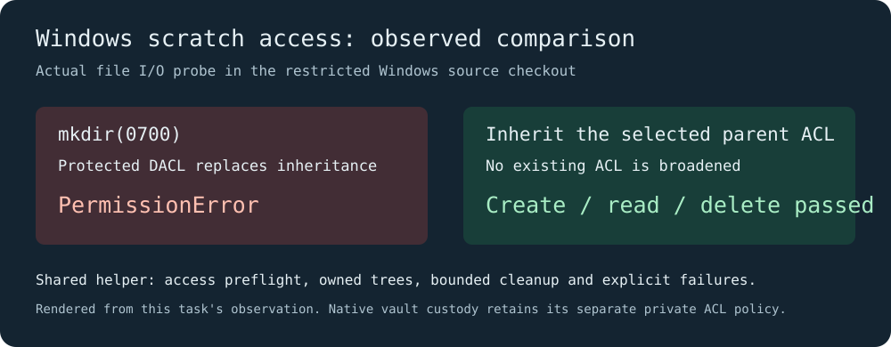
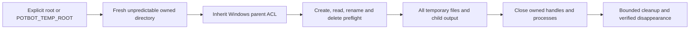

# Temporary storage on Windows

Potbot owns one scratch-directory policy in `potbot.tools.temporary`. Tests,
check/release scripts, supervised embedding workers, benchmark scratch space and
the native broker's **public policy staging** use this helper. Atomic output
files remain beside their destination and are closed before replacement.
Native vault custody and its private ACL contract remain separate.

*Observed in this task's restricted Windows source checkout. This chart renders
the actual file I/O result; it is not a screenshot or a blanket access guarantee.*

The default scratch parent is the current project's ignored `.potbot/temporary`.
An explicit operation root takes precedence, followed by `POTBOT_TEMP_ROOT`.
Pytest selects this checkout's root, or a caller-supplied `--basetemp` parent,
and allocates a fresh child without deleting another run. All `tmp_path`,
`tmpdir`, `tmp_path_factory` and pytest-cache files use that run's directory.

[The pinned CPython implementation](https://github.com/python/cpython/blob/v3.12.13/Modules/posixmodule.c)
creates a protected Windows DACL for `mkdir(0700)`.
[`tempfile.mkdtemp`](https://github.com/python/cpython/blob/v3.12.13/Lib/tempfile.py)
uses that mode. A restricted Windows token can lose access that the parent
directory supplied through inherited sandbox ACEs. Potbot's non-custodial scratch
directories preserve the selected parent's existing ACL rather than replacing it.
POSIX scratch directories retain mode 0700. Existing ACLs are never broadened or
repaired automatically.

Preflight checks writing, flushing, reopening, renaming and deleting a file, and
creating/listing/removing a child directory before payload work starts. It fails
with the exact retained path and an actionable access error. Cleanup retries
Windows sharing/lock violations and a briefly nonempty directory, clears only
an owned regular file's read-only attribute when necessary, and never changes an
ACL. Permanent denial is explicit; an original operation failure keeps its
traceback and receives a cleanup note rather than being replaced.

The Windows CI smoke test exercises actual Unicode/binary/nested/read-only files,
a child process reopening a closed temporary file, and cleanup disappearance.
Portable regression tests cover isolated roots, explicit roots, preflight failure,
transient locks, permanent denial and preservation of an original exception.
This is coverage of repository-owned scratch paths, not a promise to override a
host denial, third-party private-directory policy, antivirus policy or another
process's open handle. Hosts must grant the selected root normal access.

Media: the diagram explains the filesystem lifecycle. No UI screenshot, video
or generated artwork is useful evidence of these file operations; retained CI
logs and actual byte/readback assertions provide the evidence.

