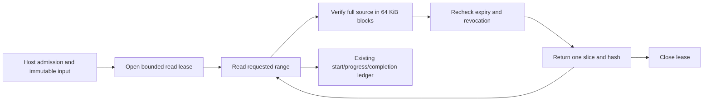

# Bounded artifact reads through SYN Cogs

The opt-in `BoundCogRegistry.artifact_ranges()` profile adds three concrete tools
to the pinned provenance profile. Existing built-in/debugger/inventory/contract/
provenance snapshot identities stay unchanged. Each tool has one registered input
and output Type, a fixed installed binding, inherited Ember declarations and the
shared controller's independent admission checks. Importing metadata grants no
access and cannot load code.

| Cog | Purpose |
| --- | --- |
| `syn://cog/potbot-artifact-open-read-v1` | Pin an artifact's exact ID/SHA-256/length to an actor and policy; create an expiring read lease. |
| `syn://cog/potbot-artifact-read-range-v1` | Return at most 32 KiB of verified opaque bytes, base64-encoded in a typed result. |
| `syn://cog/potbot-artifact-close-read-v1` | Append an idempotent lease revocation; retain the artifact. |

Provide the host-owned `ArtifactRangeService` as `artifact_ranges=` when creating
`ExecutionCogRuntime`, together with the exact sealed range-profile snapshot,
repository state, policy and an independent `admit` callback. Call the concrete
Cogs through `registry.invoke`; trusted workflows may call `ExecutionCall.child_cog`
to keep the same causal parent, receipt and admission checks. Service methods are
internal implementation, not an alternative agent-facing API.

Open requests contain a caller-chosen UUID `lease_id`, `artifact_id`,
`artifact_sha256`, `byte_length`, `ttl_seconds` and `schema_version: 1`.
Retries of an identical open do not extend the original expiry. Conflicting or
expired reuse fails. Read requests pin that lease/SHA and supply `offset` and
`length`; close requests pin the lease/SHA. A lease is not authorization by itself.
Each invocation re-enters host admission and the authenticated workspace boundary.
Migration 22 adds actor/policy/revision-bound lease and revocation rows using
existing workspace RLS and append-only guards. Historical migrations are unchanged.

The qualified backend is the existing **local POSIX** artifact store. It opens
components without following symlinks and rejects non-regular files, including
nonblocking FIFO rejection. It checks size, full SHA-256 and descriptor identity/
timestamps before returning any slice. Reads request at most 64 KiB at a time and
retain only the selected range, with a source limit of 64 MiB. It never falls back
to a whole-object buffer. This deliberately repeats full verification for each
range; it is bounded in read size, not a throughput optimization. Reported logical
verification bytes and requested block size do not establish physical disk I/O
or peak process memory. Those unmeasured work metrics remain unavailable.

The controller rechecks revocation and expiry after I/O. Missing retained bytes
produce `source_unavailable`; corrupted data fails integrity checking. Closing a
lease does not delete bytes. Each admitted tool retains start, actual progress and
completion/failure statistics through `syn_execution_events`, private artifacts,
the same workspace cursor, REST and WebSocket views. Failed or denied reads do not
become successful empty output. Reads may repeat safely with distinct run IDs.

## Actual reconstruction demonstration

Open the [recorded byte-range viewer](../../examples/tools/artifact-ranges.html)
through a local static server and select `artifact-ranges.json` from the retained
`artifact-range-cog-evidence` CI artifact. Its user-controlled replay checks chunk
hashes, replays the recorded out-of-order deliveries, deduplicates repeated
ranges and verifies the complete reconstructed SHA-256. It executes no original
tools. Browser memory used to reconstruct this small synthetic fixture is distinct
from the server's bounded reader. The JSON includes the original monitoring and
source/catalog hashes. An actual recording accompanies the verified project post;
the diagram above describes the contract rather than claiming a test result.

The mandatory PostgreSQL fixture invokes the registered tools, reconstructs an
artifact above the 128 KiB inline limit after a fresh controller/service instance,
and checks duplicate/out-of-order delivery, wrong revision/policy, foreign scope,
expiry, revocation during I/O, missing/corrupt bytes, host-grant withdrawal and
REST/WebSocket monitoring. The source-bound checker rejects drift or incomplete
evidence. Native Windows/macOS artifact backends, network range transports,
resumable uploads, physical retention/GC and cache invalidation remain unqualified.
T01.3/G10 stays in progress for those independently tracked requirements and the
existing universal-producer/exporter/hardware gates.
