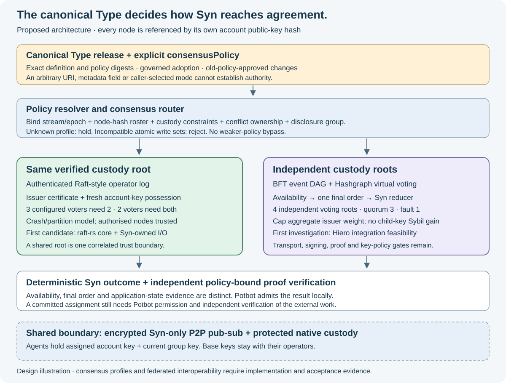
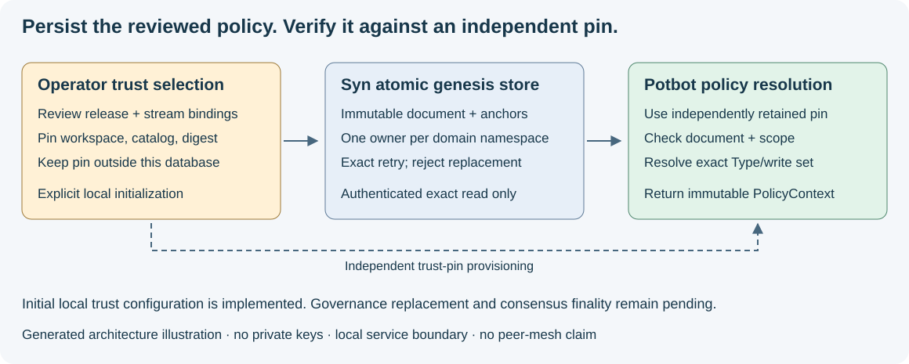

# Implemented Type consensus foundation

23 October 2026. SBT01/SBT02 have started. Contracts and offline resolution are
implemented. 24 October adds durable explicit local genesis and authenticated
reads against independent Potbot trust pins. Runtime binding, encrypted transport, native ledger signing, governed
adoption, consensus engines and automatic delivery remain pending.

*Generated target illustration. The Type contract/resolver is implemented; the
agreement adapters and networking shown remain future work.*

## Shared contracts and Potbot consumption

`syn_client.consensus` is the canonical implementation in the Syn submodule.
Potbot's `semantics.consensus` consumes it through optional imports, preserving
core domain imports and existing SynSnapshot v1 bytes. Supply an immutable Type
release, independently selected catalog UUID/release digest and trusted stream
bindings; resolve exact Type/definition/policy pins into an immutable PolicyContext.
Never take the expected trust digest from the remote document being checked.

The context binds release, Type, protocol, proof profile, conflict namespace and
domain/genesis/stream/epoch/roster. Missing policies, wrong pins/rosters, conflicting
namespace owners and incompatible atomic write sets fail closed. Callers must
provide all operation/subject Types from their admitted write contract; the
resolver cannot discover omitted writes or grant permission to execute them.

`NodeKeyHash` validates lowercase SHA-256 of raw 32-byte account public keys.
`node_identity_from_membership` reuses the existing native-certificate verifier
and returns the assigned account's full key/hash binding. The issuer hash is a
separate trust constraint, never the node address. This verifies assignment;
live possession and account/instance/peer startup binding remain SBT04 work.

## Authoring, export and canonical bytes

Syn migration 0013 adds first-class nullable `types.consensusPolicy`. Type PUT
validates its closed schema: omission preserves the draft for old clients;
explicit null clears it. The consensus-definition GET returns a bounded
structural projection, digest and `status: draft`. It does not adopt the release.
Statistics, credentials and arbitrary knowledge metadata are excluded; richer
semantic schema contents need explicit versioning/adoption.

`syn.consensus-json/1` uses compact UTF-8 JSON, Unicode-codepoint key sorting,
bounded exact integers and duplicate/depth/size checks. Floats, surrogates and
implicit normalization are forbidden. This is an explicit new profile, not JCS.
Policy/Type/release hashes have separate NUL-terminated profile domains. Existing
receipt, membership, summary and snapshot bytes remain frozen. Rust parity and
protected signing remain mandatory before new ledger signatures are used.

Canonical Type releases are distinct from advisory `metadata_json`. Legacy Types
remain readable for local features but cannot resolve shared policies without an
explicit definition. Initial trust means independently selected pins. It can now
be persisted as explicit local genesis; old-policy-approved governance transitions
remain pending.

## Durable genesis and independent trust

*Generated architecture illustration of the implemented local storage/read path.*

Syn's `syn.policy-genesis/1` document commits the workspace, complete canonical
release and epoch-one stream bindings. An operator explicitly reviews and
provisions its digest through a trusted channel separate from the database/response.
`python -m syn.policy_bootstrap initialize` requires explicit configuration,
manifest and workspace/catalog/adoption pins; it performs no implicit migration.

Migration 0014 atomically stores the immutable adoption, domain genesis anchors
and namespace owners. Initialization serializes across catalogs in one workspace.
Exact retries return the existing document; changed pins, domain forks and a
second catalog claiming the same namespace are refused. PostgreSQL triggers
reject updates, deletes and truncation. Independent pins remain necessary against
a database owner who can bypass SQL protection.

The workspace-authenticated Syn API serves only an exact catalog/adoption digest.
`SynClient.policy_adoption` parses bounded strict JSON and checks the independent
pins. Potbot's optional `adopted_policy_resolver` rechecks them before returning
the existing Type/write-set resolver. No automatic startup adoption or unqualified
latest route is added. Service bearer tokens grant local reads; they are distinct
from account signing keys and private group keys. All future inter-Agent traffic
still belongs exclusively to the encrypted Syn mesh.

Local genesis is an administrative trust choice, not signed governance proof or
finality. Policy replacement remains held until a versioned successor format,
old-policy proof, Type governance and atomic namespace transfer can be verified.
Runtime admission must bind the selected workspace/domain to the assigned Agent;
choosing another workspace cannot grant authority over an existing transaction.
See [Syn's genesis guide](https://github.com/Synsphere/syn/blob/codex/potbot-communication-service/docs/development/policy-genesis.md)
for the command, registry scope, failure behaviour and remaining gates.

## Repository workflows and compatibility

Syn now owns Ubuntu application checks for Python 3.12/3.13, real PostgreSQL
bootstrap/constraints/concurrency tests, an installed client-wheel matrix on
Ubuntu/Windows and manual compatibility against an exact reviewed Potbot commit.
The [Syn workflow design](https://github.com/Synsphere/syn/blob/codex/potbot-communication-service/docs/development/ci.md)
defines triggers, permissions and qualification limits. Manual dispatch may need
the workflow to reach the default branch before GitHub exposes it.

The first client matrix passed. PostgreSQL bootstrap exposed historical scratch
tables surviving until transaction commit. Migrations 0006/0007 now drop completed
scratch tables before 0010 changes the ObjectRef domain. Migration IDs and
persistent schema remain intact; applied revisions are not rerun. The new service
lane checks a full clean upgrade rather than skipping that failure.

Potbot's `.gitattributes` retains LF for byte-fingerprinted vocabulary JSON.
Windows conversion had changed working-tree input bytes despite unchanged Git
content. Committed provenance digests and application snapshot bytes are unchanged.

## Acceptance and next work

Tests cover full-key/hash mismatch, issuer-as-node substitution, native-produced
certificate evidence, release tampering, duplicate JSON fields, strict profile
combinations, missing policies, namespace bypass and incompatible atomic writes.
API tests check draft exports and omission/null semantics. PostgreSQL acceptance
exercises upgrade, the policy-object constraint and downgrade/re-upgrade.

Next: signed Type-governance/genesis authority and transition proofs, native cross-language
vectors, live account/instance binding, encrypted two-Agent exchange and admitted
producers. Qualify each agreement adapter and independent outcome verifier before
live shared transactions. An offline PolicyContext is not finality evidence.

The diagram explains this contract boundary. No running consensus UI exists for
a relevant screenshot or video; actual mesh, fault and recovery demonstrations
remain later acceptance deliverables.
