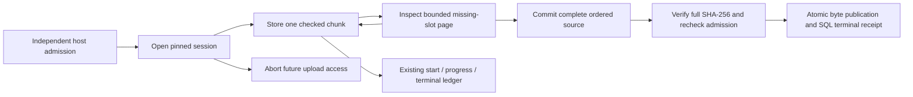

# Resumable artifact uploads through SYN Cogs

The opt-in `BoundCogRegistry.artifact_uploads()` profile extends the unchanged
26-Cog range profile with five installed tools and ten compiled semantic ports.
It shares the existing controller, inherited Ember declarations, artifact store,
execution ledger and independent host admission. Each admitted call logs its
start, actual progress and completion/failure statistics. Importing this catalog
does not grant permission or install code from metadata.

| Cog suffix after `syn://cog/potbot-artifact-` | Purpose |
| --- | --- |
| `open-upload-v1` | Pin the owner, workspace, policy, whole SHA-256, byte length and lifetime. |
| `upload-chunk-v1` | Retain one checked, fixed slot; identical repeats are idempotent. |
| `inspect-upload-v1` | Return totals and at most 128 missing offsets with a continuation cursor. |
| `commit-upload-v1` | Verify the complete ordered source and return one durable artifact receipt. |
| `abort-upload-v1` | Close an unfinished session without claiming physical deletion. |

Pass matching host-owned `ArtifactUploadService` and `ArtifactRangeService`
instances as `artifact_uploads=` and `artifact_ranges=` to `ExecutionCogRuntime`.
The runtime requires the exact sealed 31-Cog catalog, repository revision and
policy. Calls enter through `registry.invoke`; trusted workflows can use
`ExecutionCall.child_cog` to preserve the direct causal parent. Service methods
and filesystem transports are internal implementation, not agent-facing APIs.

Open requests specify `schema_version: 1`, a caller-chosen UUID `upload_id`,
`artifact_sha256`, `byte_length`, `media_type` and `ttl_seconds` (1–300). Identical
open retries keep the original expiry; conflicting or expired reuse fails.
Other requests pin `upload_id` and the same SHA-256. Each chunk adds `offset`,
`chunk_sha256` and `data_base64`. Slots are aligned to **8192 bytes**; each must
fill its expected length except the last. The source limit is **64 MiB**. The
maximum encoded request fits the unchanged **16 KiB** inline work-input cap.
The backend's configured artifact limit may be smaller and is checked at open.

Inspection uses an integer slot `cursor`, initially zero, and returns
`missing_offsets`, `next_cursor`, received chunk/byte totals and accurate
open/expired/committed/aborted state. A cursor is only a position within the
owner/policy/revision-bound session; possession of an upload ID is not authority.
Clients can retain completed slots, create fresh controller/service instances,
inspect what is missing and send remaining chunks in any order. Conflicting
duplicates are rejected. Terminal commit retries return the same artifact after
checking retained bytes; an aborted session cannot later commit.

Migration 23 adds append-only, workspace-RLS-protected sessions, chunk slots and
terminal receipts with owner-membership and artifact foreign keys. No UPDATE
permission is added to immutable tables. Per-workspace/upload transaction advisory
locks serialize cooperating writers; a fresh SQL statement after acquiring the
lock observes a competing commit/abort's terminal state. Inspection uses the same
serialization so its pages and totals form a consistent observation.

Chunks remain small artifacts in the existing store. A commit reads each chunk
only after checking its declared bounded metadata, streams the ordered bytes to
an owned staging file, checks whole length/SHA-256, and rechecks expiry and host
admission before atomic publication. Artifact metadata and the terminal receipt
commit in one SQL transaction. Existing content-addressed artifacts may already
exist or deduplicate with a staged chunk; only the upload terminal receipt claims
that this upload committed. Corruption never overwrites a retained object.

The existing conservative runtime fence is preserved: an admitted write that
raises after dispatch is recorded as indeterminate and fences that controller.
A trusted replacement controller must independently inspect durable upload state
under current admission before continuing. Clock-injected deadline tests exercise
the bounded writer's monotonic checks without claiming a measured long wait.

Failure before publication removes the owned temporary assembly. A rolled-back
SQL transaction can leave unreferenced content-addressed bytes, as with the
existing store; no incomplete upload is reported as committed. Abort retains
staged artifacts and does not delete a previously committed artifact. Storage
quotas, physical retention/GC and deletion remain separate gates. Logical chunk
sizes do not establish peak process memory or physical disk traffic; unmeasured
metrics remain unavailable in the shared monitoring records.

## Actual recorded demonstration

Serve the repository locally, open the [upload recording viewer](../../examples/tools/artifact-uploads.html)
and select `artifact-uploads.json` from the retained `artifact-upload-cog-evidence`
CI artifact. User-controlled playback checks actual uploaded bytes, highlights
controller-instance recreation, reversed delivery and a duplicate, then verifies
the independently recorded range-read bytes and complete SHA-256. It executes no
original tool and grants no permission. Browser memory for this small fixture is
separate from the bounded server assembly. The displayed JSON is a recording;
browser content-integrity checks do not authenticate arbitrary loaded metadata.

The mandatory genuine PostgreSQL fixture invokes all five installed upload Cogs
and the existing range Cogs, verifies concurrent commit retries, empty files,
bounded inspection pages, exact source/schema identities, negative authority and
integrity cases, parent/child monitoring, and REST/WebSocket readback. Actual
screenshots and video accompany the verified task report and project article;
the diagram above explains the contract, not a measured result.

Qualification is the local POSIX backend and controller/service recreation in
one test process. Actual network disconnections, OS-process crash/power-loss
recovery, other backends, physical cleanup, universal producer adoption and real
devices remain unqualified. T01.3/G10 stays in progress for those requirements.
