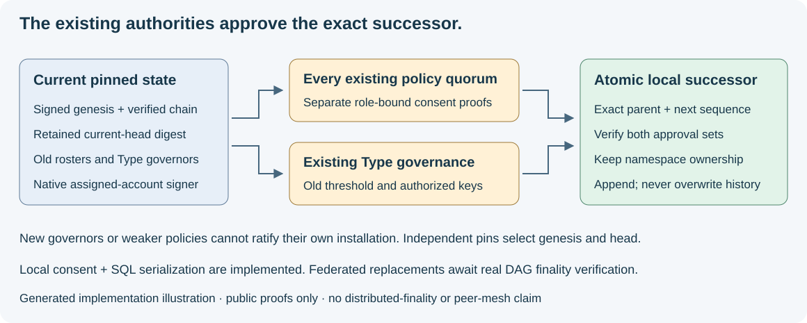

# Signed genesis and local policy succession

24 October 2026. SBT01/SBT02 now include signed genesis and locally governed
operator-policy replacements. Runtime admission, private transport, consensus
execution and operational federation remain gated. [Bounded DAG replay](17-syn-dag-finality.md)
now verifies federated governance replacements offline under the existing epoch.

*Generated illustration of the implemented local consent and storage boundary.
It is not a screenshot of an operational consensus network.*

The shared implementation belongs to `syn_client.governance` and
`syn_client.custody`. A signed state commits its canonical Type release, all
domain/genesis/stream/epoch/roster bindings, Type-governance authority and policy
authorities. Type governance currently applies to the whole catalog; every Type
policy independently selects its roster and quorum. Initial trust still requires
independently reviewed workspace/catalog/genesis pins.

Each record commits the exact predecessor, next sequence and full state. Approval
payloads distinguish existing-policy votes from Type-governance consent and bind
the exact proposal and authority. Replacement requires every old policy quorum
and the old governance threshold, including unchanged siblings. New governors,
new rosters and weaker policies cannot ratify their own installation.

Operator policies require one verified issuer and a strict majority of assigned
account nodes. Distinct node/account/instance checks prevent repeated credentials
from multiplying votes. Existing BFT policies require record v2, the old epoch's
first finalized authorized proposal in DAG replay, and separate old Type-governor
consent. A signature list cannot replace that finality evidence. Independent
custody admission remains an external assumption; distinct issuer keys alone do
not prove independent human custody. Coin-dependent histories remain held.

Potbot's `security.governance.sign_governance_approval` first verifies the retained
signed history and genesis/head pins, then selects the signer from the previous
authority. An independent proposal digest commits the reviewed replacement.
For genesis it selects the explicitly reviewed proposal's governors before the
completed record exists. The helper calls the existing protected native
`sign_agent` operation and verifies its public response. Python receives no
account private key, operator base secret, password or group key.

The native v1 membership/proof bytes remain frozen. Their issuer-signed assignment
and account-signed payload bind the public account hash to this exact role and
proposal. Proofs must be live on first local admission, within at most 300 seconds.
Time is sampled after the database lock and rechecked before leaving the
transaction, so queued or slow verification cannot use an earlier clock sample.
Exact stored retries can succeed after expiry. Historical verification validates
the original signatures without claiming a trusted acceptance timestamp, current
liveness or that an older pinned head is the latest global state.

Syn migration 0015 creates immutable signed records and catalog namespace claims.
A workspace lock serializes them with legacy initialization. Verification,
predecessor comparison, namespace protection and successor append share one
transaction. A competing successor loses and must be reviewed again against the
new head. Old records and claims are not overwritten. This local ordering does
not provide distributed non-equivocation or Raft/Hashgraph finality.

`governed_policy_resolver` consumes Syn's authenticated exact chain read, verifies
every link from retained genesis to retained head, and returns the existing
Type-policy resolver. It never adopts a server-selected `latest` value. Missing
approvals, changed proposals, truncated/forked histories, skipped revisions/epochs,
removed protection and renamed/forked namespaces/anchors hold without fallback.
Chains are bounded to 128 records and 2 MiB pending authenticated checkpoints.

Legacy unsigned genesis remains immutable and cannot be silently promoted. Its
namespace cannot be taken by a signed catalog or vice versa. Explicit legacy
migration/recovery and coordinated credential/group rotation remain later work;
restoring an older vault or deleting registry rows is not an upgrade procedure.
Native request-ID reservations do not yet enforce permanent one-vote-per-parent
across restored state, so global anti-equivocation is not claimed.

Signing and import are local operations. No Agent-to-Agent transport is added:
future approval delivery, consensus and repair must use assigned Syn instances
and their encrypted private group. Automatic delivery remains disabled.

See [Syn's signed-governance guide](https://github.com/Synsphere/syn/blob/codex/potbot-communication-service/docs/development/signed-governance.md)
for exact record profiles, the explicit local import command, trust/time limits
and failure modes. No existing Syn database was initialized or migrated during
development; acceptance uses synthetic credentials and disposable databases.
No useful actual consensus screenshot/video exists at this stage; the diagram
explains the code boundary and real multi-Agent demonstrations remain future work.
