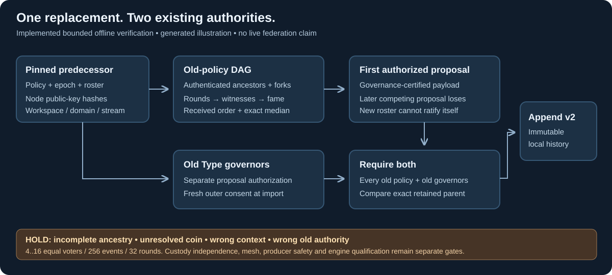

# Federated governance finality boundary

24 October 2026. The pinned Syn client independently replays a bounded signed
DAG before accepting a record-v2 federated policy replacement. Potbot's existing
`governed_policy_resolver` verifies the entire retained chain, including this
evidence, before returning the adopted Type-policy context.

[Protected native signing and recovery](18-protected-dag-signing.md) now add an
explicit v2 policy/proof profile with independent operator reservations. The v1
research profile remains frozen; installing v2 requires the existing authority.

*Generated architecture illustration, mirrored from Syn. It describes implemented
offline verification, not an operating federation or a Hiero compatibility claim.*

The predecessor supplies the old policy, native account assignments, roster,
domain/genesis/stream/epoch and exact parent record. Every signed ancestor is
verified under that roster. Replay computes fork-aware visibility, rounds,
witnesses, fame and final order. The first Type-governance-certified proposal in
that order wins the epoch; a later ordered proposal cannot also authorize a
replacement. Every other old Type policy must authorize the same successor, and
the old Type governors must separately approve it. A proposed new authority or
weaker policy never ratifies itself.

Record v1/native v1 bytes remain frozen. Record v2 has distinct proposal/record
digest domains, supports v1-to-v2 succession and refuses downgrade. The public
`federated-governed-chain.json` fixture exercises installed client verification
and Potbot consumption without distributing private keys. The protected native
approval helper can sign old Type-governance consent; it refuses a federated
existing-policy consent request because that role requires actual DAG evidence.

This profile supports 4..16 equal voters with distinct admitted issuer keys,
256 events and 32 rounds per proof. Common-root accounts cannot multiply voting
weight; custody independence remains a governed admission assumption. Missing
parents, forks with inflated weight, invalid signatures, wrong contexts, truncated
history and missing old-governor approval hold. Coin rounds that need randomness
remain unresolved; no native signature is treated as a qualified common coin.
There is no asynchronous liveness guarantee or production consensus qualification.

The test histories cover a silent voter, one signed forker, independent graph-walk
visibility checks, delivery-order independence, competing proposals, authority
rotation and failed append rollback. Syn's PostgreSQL CI uses its disposable
service. These are synthetic offline tests, not a live Byzantine mesh campaign.

The next operational steps remain the SBT10 Hiero adapter/coin feasibility and
review, protected durable event signing/restore safety, Syn-only encrypted peer
channels, independently verified application outcomes and authenticated recovery
checkpoints. No Agent producer, automatic outbox sender, base-key export or direct
Agent transport is enabled by this slice. Existing P/T programme statuses and
SBT completion gates remain unchanged.

See Syn's [exact verifier contract](https://github.com/Synsphere/syn/blob/codex/potbot-communication-service/docs/development/dag-finality.md)
and [pinned Hiero source review](https://github.com/Synsphere/syn/blob/codex/potbot-communication-service/docs/development/hiero-boundary.md).
The maintained static renderer supplies useful explanatory media here. No live
consensus interface exists for a relevant screenshot/video; no such capture or
operational demonstration is claimed.
