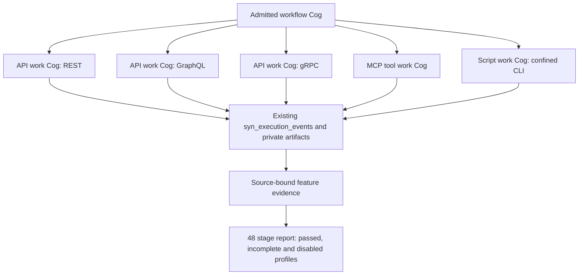

# Source-bound tool programme acceptance

Source preview **0.5.0.dev9** connects the existing approved CLI, MCP stdio/HTTP,
REST, GraphQL and gRPC adapters to installed SYN work Cogs. It also adds a report
for every stage of the 48-stage programme. Whole-stage completion and a passing
local feature fixture remain separate. The full programme is still incomplete.



Generated contract diagram. The actual fixture and recording viewer are linked
below; this diagram alone proves no call or result.

## Installed transport bindings

`potbot.controller.transport_cogs` supplies `api_operation`, `mcp_operation` and
`cli_operation` factories. Each returns a host-installed `HostOperation` for the
existing registered work Cog of its kind. The binding fixes one native operation
reference, one canonical input Type, one canonical output Type, codec digest,
transport identity, effect class and execution policy. Host-authored conversion
functions map canonical values to the native request and back. These functions
are installed Python code; remote schemas and model data cannot install them.

An operator supplies these bindings to `ExecutionCogRuntime.operations`. The
runtime checks the sealed SYN snapshot, registered port schemas, inherited Ember
declarations, actor/repository/task identity and independent controller admission.
Its existing monitor records start, actual dispatch/response or cleanup progress,
private typed input/output artifacts, causal child runs and one terminal record.
Controller CPU and wall intervals are measured; target CPU, memory, physical I/O
and cost remain unavailable when unmeasured. No second ledger is introduced.

The native transports retain their admission too. API calls receive a fresh
`ToolInvocationIntent` tied to the current Cog invocation, installation, workspace,
task and exact encoded input. Existing schema, egress, credentials, deadlines and
no-write-retry checks still apply. MCP installations fix catalog and tool hashes;
changed discovery requires reinstallation under current admission. CLI installations
fix the registered tool and executable digest, candidate, sandbox and argument
policy. This initial CLI route accepts read-only tools; durable mutations still
belong to `ToolGateway`.

CLI cancellation signals the actual `ProcessSupervisor` and awaits owned-tree
cleanup before emitting a cancelled terminal. Explicitly uncertain outcomes,
including unverified cleanup, fence the controller. Every post-dispatch write
exception still becomes indeterminate. A fresh trusted controller must inspect
durable state before deciding on another attempt. A generic completed transport
receipt does not independently verify the external outcome.

## Reproduce and inspect acceptance

Use the locked Python 3.12 environment and the existing disposable PostgreSQL and
qualified Linux Bubblewrap/seccomp host setup from CI:

```sh
uv run --locked python -m pytest -q tests/integration/test_transport_cogs.py
uv run --locked python scripts/check.py --with-postgres --with-sandbox
```

The first command uses real local HTTP/GraphQL and gRPC services, a genuinely
confined MCP stdio server and a confined CLI. Five tool child runs return the same
authored sum, 42. A separate live CLI is cancelled after it signals readiness;
its supervisor must report the owned tree stopped. A deliberately dropped write
response permits one request and must fence subsequent work. Each admitted run
retains start, progress and terminal statistics in PostgreSQL.

The CI workflow then validates the existing inventory, contracts, provenance,
range and upload receipts plus the transport evidence, and executes:

```sh
uv run --locked python scripts/tool_programme_gate.py \
  --artifacts artifacts --output artifacts/tool-programme/report.json
```

The report pins the clean source commit/tree at runner start and completion,
checks mandatory migration/bootstrap/cleanup receipts and counts actual JUnit
cases. Empty suites, failures, missing receipts, skipped PostgreSQL/sandbox cases,
stale feature source/version and duplicate required checks fail. Optional disabled
features remain disabled. Unit tests deliberately reproduce these negative cases.
The report includes all 48 unchanged IDs and hard prerequisites; currently only
T01.1 and T01.2 have complete whole-stage fixtures. Passing T01.3/T02 feature
subsets never promotes their parent stages.

`--mode full_programme` deliberately fails until whole-programme acceptance is
available. The default implemented-profile gate may pass while
`full_programme_qualified` is false. Both fields must be shown to an operator.
The evaluator checks trusted CI receipts; loading arbitrary JSON does not
authenticate it or grant execution authority.

[Open the local receipt viewer](../../examples/tools/tool-programme.html), choose
`tool-programme/report.json` and the optional `transport-cogs/transport-cogs.json`
from the `tool-programme-evidence` CI artifact. Playback inspects recorded events
and stage states. It never repeats the original calls. Screenshots and a short
recording are retained in the task report after the exact-source fixture passes;
a recording before that would show an unqualified candidate. Additional generated
pictorial artwork belongs to the public article, rather than replacing evidence.

## Remaining qualification

This is local service and qualified Linux fixture acceptance. Production egress,
OAuth discovery/consent, MCP server lifetimes/resources/prompts/progress callbacks,
universal producer adoption, general streaming/retention, interactive terminals,
remote Python, phone control, profilers and board/probe/JIT/ICSP support retain
their named plan gates. The operator confirmed no physical target is available;
physical-device profiles are disabled and unqualified. Importing a client or
passing this fixture never qualifies a physical device or another language.

Stage statuses remain honest: T01.3/T01.4, T02.1–T02.4 and T07.3 are in progress;
unimplemented stages remain not started. See the
[canonical plan](../potbot-tool-mcp-implementation-bundle/potbot-universal-tool-mcp-implementation-plan.md)
and [gap register](09-tool-plan-gap-audit.md). Real-device qualification needs an
identified target and probe; the other software stages still require implementation.
