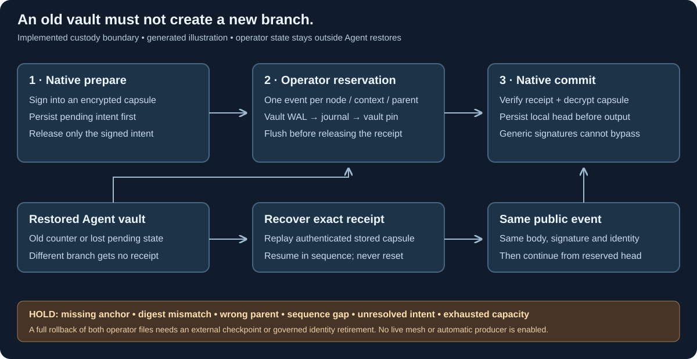

# Protected DAG event signing and recovery

24 October 2026. SBT03 now implements protected native preparation, independent
operator reservations and exact event recovery. SBT01/SBT02 include an explicitly
versioned protected policy/proof contract. Operational consensus, the encrypted
peer mesh and automatic producers remain gated.



*Generated implementation illustration. It does not depict a running federation.*

Agent-vault counters alone cannot survive a vault rollback safely. An operator
therefore keeps one authoritative anchor outside Agent backups. Agent
workers must also lack write access to both operator files; operator custody
belongs in a separate permission/service boundary. The Agent's native
process seals its pending event and releases only a signed intent containing an
encrypted recovery capsule. The operator's native process reserves one exact
event digest per node/context/sequence/parent. The Agent verifies that permanent
receipt, decrypts the capsule, persists its head and then releases the event.

Restarts retry the same intent and event. A vault restored to before preparation
may generate another intent, but the independent anchor refuses its conflicting
slot. Exporting the original receipt recovers byte-identical public output, with
earlier receipts replayed first if needed. There is no cancel/reset operation,
expiry-based reuse or safety-state pruning. A current-head retry preserves a
pending next event. Credential rotation holds until pending events are resolved.

The operator vault binds the anchor's path and digest. A sealed write-ahead
receipt repairs the crash window before journal replacement or before the vault's
completion write. The CLI holds native file locks and flushes each required write
before public output. Missing, mismatched, singly rolled-back or alternate-path
anchor history stops signing. Restoring both operator files together, or running
another independent operator copy with the same base key, is outside this
guarantee and needs external checkpoint/hardware protection or governed identity
retirement. No local counter can distinguish a complete rollback from old state.

The base key stays in the operator's protected native vault. An Agent still stores
only its assigned account key and current group key. Capsule keys are derived
inside native memory; capsules contain only the pending public event/proof.
Passwords, account/base/group secrets and decrypted vault state never enter
Python. The native protection preflight and locked heap/stack have no fallback.

## Version and admission boundary

The canonical Type must adopt `syn.bft-dag-hashgraph/2` with
`syn.dag-hashgraph-finality/2`. Its signed event proof has a dedicated
`syn-dag-event-proof-v1` domain and an operator
`syn-dag-anchor-receipt-v1`. Generic Agent consent cannot substitute. V1 research
encodings stay frozen. An existing federated Type moves to v2 only with finality
under its old policy plus old Type-governance approval.

`security.dag.prepare_governance_dag_event` first verifies the caller's retained
history and independent genesis/head pins. It selects the old Type policy and
assigned node, requires the exact derived context, authenticates any other-parent
evidence, and verifies current-epoch proposal headers and governor certificates
before invoking the broker. Syn's finality verifier independently enforces those
bindings again. An earlier epoch's otherwise valid certificate becomes a no-op.

The event content digest covers body plus account proof; its independent receipt
signs that digest. This avoids a circular receipt reference while committing the
exact protected signature. The full governed record still commits every byte.
An operator receipt is a signing reservation, not a consensus vote, transaction
outcome, availability certificate or substitute for DAG finality.

## Explicit local commands

Use absolute paths. Initialize one anchor on the operator's independent storage:

```text
potbot-identity dag-anchor-initialize --vault OPERATOR_VAULT --anchor OPERATOR_ANCHOR --expect-signer ISSUER_HASH
potbot-identity agent-dag-prepare --vault AGENT_VAULT --expect-operator ISSUER_HASH --expect-agent NODE_HASH < body.json
potbot-identity dag-anchor-reserve --vault OPERATOR_VAULT --anchor OPERATOR_ANCHOR --expect-signer ISSUER_HASH < intent.json
potbot-identity agent-dag-commit --vault AGENT_VAULT --expect-operator ISSUER_HASH --expect-agent NODE_HASH < receipt.json
```

For recovery, `dag-anchor-export` accepts an exact public query with `node_hash`,
`context_digest` and positive decimal-string `sequence` on stdin. It first repairs
any exact pending write-ahead transition and returns the original receipt. Commit
that receipt through the assigned Agent vault. These examples represent local
operator custody steps, not an Agent-to-Agent file courier. Future transport of
intents, receipts, DAG events and repairs must use the Agent's Syn instance and
encrypted private Syn channels. The operator must be available for every new
event; no bypass is added for outages. Python broker methods expose only these
public frames and leave password prompts to the native controlling terminal.

Bodies use the native ASCII/nonnegative safe-integer subset of the shared codec,
up to 16 KiB; capsules are bounded to 32 KiB. The operator journal holds at most
128 receipts and 1 MiB. Agent state permits 64 contexts and 16 pending intents.
Capacity holds. Authenticated checkpoints, safe retirement and larger qualified
storage are future gates, as are the existing bounded verifier's coin protocol,
Hiero adapter and live mesh.

## Verification evidence

Native library tests exercise restored/pre-prepare vaults, exact retries,
write-ahead crash recovery, rollback of either operator file, alternate paths,
authenticated capsule failures, sequence/parent holds, generic-signature bypass
and rotation with unresolved intents. Linux production acceptance runs the real
protected binary through prepare/reserve/commit, restores the Agent vault,
rejects a fork, exports the stored receipt and recovers the same public event.
It also checks that a missing anchor cannot be reinitialized. Python independently
verifies the actual Rust-produced public fixture; the public protected-chain
fixture covers client, HTTP, PostgreSQL and policy-consumer paths.

See [Syn's exact signing/recovery contract](https://github.com/Synsphere/syn/blob/codex/potbot-communication-service/docs/development/protected-dag-signing.md).
The static diagram was rendered and visually checked. A live consensus interface
does not yet exist for useful screenshots/video; no live-network demonstration
is claimed. Existing rendering tools meet this code/documentation need.
