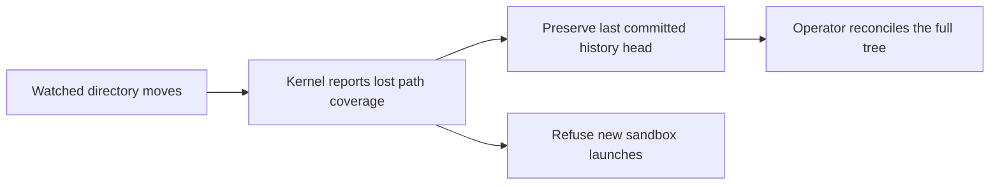

# S6 — Agent-writable `/etc/ai`, operator-monitored `/etc/ai-past`

## Required guest topology

- `/etc/ai` is a **workspace-specific, persistent, group-writable mount**. Any admitted agent in that workspace may modify ordinary configuration files in this tree. It is not the system `/etc` and does not grant write access to `/etc/passwd` or other OS configuration.
- `/etc/ai-past` is backed by a physically separate, **operator-owned append-only history directory**, projected into the guest through `--ro-bind`. Agents can inspect prior versions but cannot erase, rewrite, or roll back the operator's evidence themselves.
- Both mount source paths are outside the immutable rootfs, `/home`, `/var/ai`, the shared model library and `/usr/local/tools`. Image build creates two *empty mount targets*. The operator must provision their durable, disjoint sources and start `AiConfigHistoryMonitor` before starting *any* sandboxed process.
- On a new rootfs containing those targets, omitting either source or an active healthy monitor makes the sandbox fail closed. Legacy rootfs fixtures without these targets retain their older mount set until upgraded; this is a migration contract, not proof that all deployed sandboxes are enabled.

## Change monitoring and inverse records

**Canonical policy decision, 1 November 2026:** configuration change detection uses
the operating system's native filesystem notification facility rather than a
polling loop. Linux and WSL2 use inotify/fanotify as qualified by the host profile;
a future native Windows backend uses `ReadDirectoryChangesW`; a future native
macOS backend uses FSEvents/kqueue as appropriate to the required granularity.
The watcher backend and its capabilities are part of the qualified runtime
identity. Unsupported hosts fail closed rather than silently falling back to
unqualified polling.

The operator starts a bounded recursive native watcher and takes an initial exact
snapshot (file bytes, modes, directories and SHA-256 content identity). For each
observed event batch, and during full-tree reconciliation checkpoints, the
operator persists:

- `head.json`: latest durable complete snapshot plus its content-and-layout digest.
- `000000000001.reverse.json`: machine-readable per-path changes with **previous file bytes** encoded losslessly (including binary data), prior modes, target-before/after identities, rename/delete/create evidence and sampled inotify events.
- `000000000001.reverse.diff`: human-readable reverse unified text diff (`new -> previous`); binary and directory operations refer to the JSON reverse record for exact restoration.

Each revision is written with exclusive creation and fsync, followed by an atomic head update. A storage error, unknown symlink/special file, snapshot race, buffer overflow, lost watch, exceeded size/file limit, corrupt persisted head or offline mutation makes the monitor unhealthy. New sandbox launches are then refused. The operator must review and reconcile the discontinuity; restarting the process does not silently accept an unobserved state as baseline.

**Scope of guarantee:** the product contract is an **OS-native filesystem change
journal with explicit loss detection and reconciliation**, not a claim that every
individual `write(2)`/Win32 write call is captured as a separate semantic revision.
Native watcher APIs may coalesce notifications and their queues may overflow. A
queue overflow, dropped/lost watch, journal discontinuity, scan race, operator
restart with an unverified gap, or unsupported event class marks the history
**indeterminate**. New work is fenced until the operator performs a full-tree
reconciliation against the last durable head and records the discontinuity and
result. The system never invents intermediate bytes it could not observe.

On Linux, moving or unmounting a watched directory fences new launches and
keeps the last committed head available for operator reconciliation. Inotify
follows the watched inode, so a replacement at the original path can have the
same files and still lack a watch. Ordinary file renames and directory deletions
continue to produce reverse records.



The Linux regression reproduces root and nested replacements with temporary
directories. This headless behavior is shown in the diagram and test results.

Records therefore accurately reverse committed observed filesystem states and
retain native event provenance where available. Platform-specific watcher
qualification must test overflow/loss/restart behavior as well as ordinary
create/modify/rename/delete events.

**Security:** All previous config bytes become readable in `/etc/ai-past`; never put credentials, tokens or private keys in `/etc/ai`. Use the existing controller credential broker. The history is a diagnostic/recovery store, not an authorization source or place to run scripts. Host access controls, journal rotation/retention, policy-governed rollback and cross-process locking require separate operator qualification.

## Operator wiring

The operator provisions both source directories, pre-creates the guest mount targets during the image build, and invokes:

```python
with AiConfigHistoryMonitor(config_dir=ai_root, past_dir=history_root) as monitor:
    runtime = SharedWorkspaceRuntime(..., ai_config_dir=ai_root, ai_history_dir=history_root)
    backend = SharedWorkspaceBubblewrapBackend(runtime, ai_monitor=monitor)
    # Keep monitor alive for the entire lifetime of all guest processes.
```

The installation executor accepts the same operator-owned watcher and never creates
one per agent. Watcher selection belongs to the host/operator runtime, not the
guest. To verify on a qualified Linux/WSL2 host, execute the updated
`scripts/qualify_shared_workspace.py` with `--ai-config` and `--ai-past`; check
writable `etc/ai`, read-only `etc/ai-past`, normal shared-tool read-only behavior,
native watcher health/overflow handling and new reversals. Unit tests use actual
Linux inotify but **mock Bubblewrap construction**; a live sandbox acceptance
remains mandatory. Future Windows/macOS support must exercise the corresponding
native watcher and the same loss/reconciliation contract before qualification.

The journal holds an exclusive host-side `.monitor.lock` with Linux `flock`: only one operator may write the history for a workspace. `reconstruct_prior_snapshot` round-trips each inverse record against the previous snapshot before publication; it is **not** a guest-exposed rollback endpoint. If the monitor becomes unhealthy, the controller's supervised tool cancellation and Bash session watchdog halt active workloads rather than allowing unmonitored writes to continue indefinitely. An unexpected crash may still leave an in-flight write or an indeterminate lease requiring manual reconciliation.
