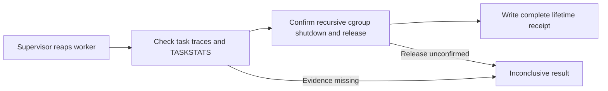
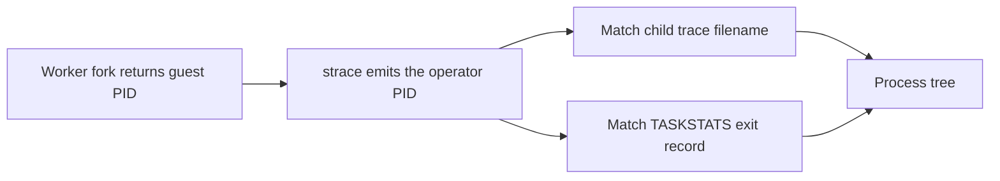
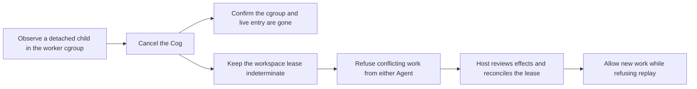
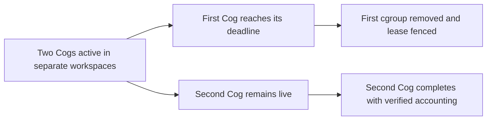
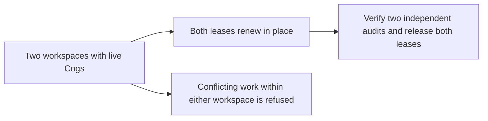
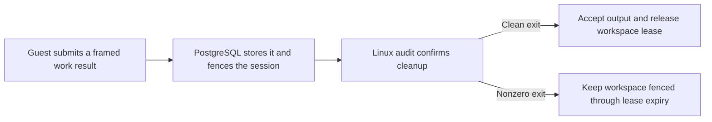
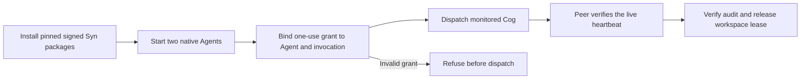
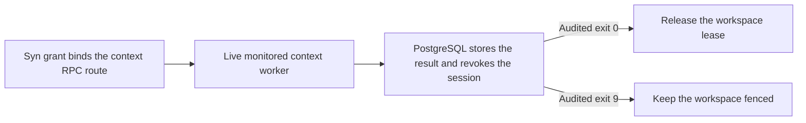

# Phase 38 — monitored Cog operator release gate

The Phase 34 sandbox-only work dispatch and kernel TASKSTATS exit collector
already exist. This gate validates their prerequisites **on the target host**;
it does not substitute for integration tests, and it does not itself install
sandboxing or syscall hooks.

Run from the repository root using the same environment, kernel, effective
privileges, pinned executables and cgroup delegation as the operator:

```bash
python scripts/qualify_operator_workers.py \
  --rootfs /PATH/rootfs --home /PATH/workspace-home \
  --model-staging /PATH/staging --shared-models /PATH/models \
  --shared-tools /PATH/tools --image-digest IMAGE_DIGEST \
  --qualification-sha256 QUALIFICATION_SHA256 \
  --report /PATH/operator-private/worker-qualification.json
```

This invokes the existing Phase 35 real Bubblewrap/cgroup/fork and audited
process-tree smoke test, rather than trusting an arbitrary success command.
It must additionally be paired with the registered-agent Cog-dispatch and
forced cancellation/timeout integration suite for release sign-off.

The runner fails nonzero when Linux/cgroup v2/configuration is missing, if
TASKSTATS cannot register or account for every probe, if the live integration
command fails/times out, or if any required stage is omitted. A successful
exit is a prerequisite, **not** proof of comprehensive forensic completeness:
a separate release assessment must still verify syscall loss detection,
namespace escape tests, full Cog-route enumeration, and operation under stress.

## U03-Q completion evidence

The worker tracer keeps the terminal line for each task. A process tree is
complete only when each task has one unambiguous terminal line, each observed
child has a trace, and the fork graph is consistent. The operator still
requires a TASKSTATS exit record for each traced task. A missing, repeated or
ambiguous terminal line leaves the audit incomplete.

The monitor reads the kernel's recursive `cgroup.events` population flag. A
worker cgroup may have an empty direct process list while a nested cgroup is
still running. The monitor checks that the new cgroup is empty before dispatch. It confirms
recursive shutdown and releases the cgroup before writing a positive lifetime
receipt.



The Linux CI fixture records real fork, thread, exec and signal exits, then
removes a terminal line to check refusal. It also creates a disposable nested
cgroup and verifies that an empty direct list does not let a live child escape
shutdown. These tests qualify the two completion checks. Deployment host
qualification still covers the full Bubblewrap, TASKSTATS and Cog route
combination, including concurrent load and cancellation.

### Worker PID namespaces

A fork inside Bubblewrap returns a PID from the worker namespace. The audit
tracer and TASKSTATS identify that child using the operator namespace. Pin a
strace build that supports `--pidns-translation`. The process graph uses the
translated PID to join a fork to its trace file and exit counters. Missing or
invalid joins keep the worker audit incomplete. The monitor secures completed
trace files before publishing the receipt, including when the operator's
default umask would leave them group-readable. [strace PID translation](https://github.com/strace/strace/blob/v6.8/src/pidns.c) · [Linux TASKSTATS](https://docs.kernel.org/accounting/taskstats.html)



Hosted Ubuntu traces real forks in a separate PID namespace and verifies that
removing their translations breaks the join. It also attempts two registered
Cog launches through the real supervisor using a disposable root filesystem
and the development Syn fixture. The dedicated CI job requires TASKSTATS
registration; a local runner may report a capability skip. This fixture covers the
typed JSON route. The cancellation case waits for a live guest child in a new
session before cancelling the registered Cog. It checks that the worker cgroup
and live index entry are gone. The lease still blocks conflicting work for both
Agents because they share `/home`. After the fixture's host reconciles the
cancelled invocation, the second Agent can complete its work and the original
invocation ID still cannot be replayed.



### Timeout while a second workspace is active

The concurrent Linux case starts two registered Cogs in separate disposable
workspaces. Both reach a live detached child. The first Cog exceeds its wall
deadline, its cgroup and live entry are removed, and its workspace keeps an
indeterminate lease. The second Cog stays alive in its own cgroup, completes
after the test releases it, and passes independent trace and TASKSTATS
verification. Its trace must include its own child PID and exclude the timed
out child's PID.



### Concurrent work across lease renewal

The Linux renewal case holds two registered Cogs in separate workspaces until
both ledgers record a later lease expiry under the original generation.
A second Agent in each workspace attempts conflicting work and is refused
before the supervisor runs it. Both original Cogs remain in their own live
cgroups through renewal. After release, both produce independently verified
receipts, their trace PID sets are disjoint, and both leases and cgroups clear.



### Context RPC through the monitored worker

The context acceptance job uses the shipped guest client, a disposable
PostgreSQL database, Bubblewrap, strace, cgroup v2 and TASKSTATS. The registered
Cog reads its typed input and agent context over the framed channel, checks the
read-only projection against that context, and submits an idempotent result.
After a result, the session refuses further context reads.

PostgreSQL retains the result and revokes the session for both exits. A clean
exit with a complete audit lets the controller accept the output and release
the workspace lease. After a nonzero exit, the controller stops renewing the
lease. It blocks conflicting work immediately and becomes indeterminate at
expiry, even when the result reached PostgreSQL and the cgroup was cleaned up.



The context RPC test uses the development Syn relay. The hosted renewal case
exercises one renewal interval with two workers.

### Authorization with official Syn packages

The official Syn worker job installs v0.7.0 and v0.8.0 in separate Ubuntu
fixtures. It pins the source commit, signed manifest digest and release
authority for each version. The fixture starts two independently installed
native Syn Agents with separate UIDs and keystores. Their registered identities
authorize one monitored typed JSON Cog each through Potbot's normal executor.

A peer observes the authenticated heartbeat for each live Cog invocation.
The host then releases the probe and verifies the worker's trace, TASKSTATS
receipt, cgroup removal and workspace lease release. Missing grants, changed
task revisions, cross-Agent grants and consumed grants are refused before
dispatch.



The job retains a bounded receipt for each version.

### Context RPC with official Syn authorization

The same two release lanes exercise the shipped context client and the real
PostgreSQL session store. A grant for typed JSON cannot open context RPC. The
test verifies that this refusal creates neither a context session nor a
worker audit. A valid context grant starts the monitored worker and a native
peer sees a new heartbeat after the worker is live.

The clean exit releases the workspace lease. The other worker returns exit
code 9 after saving its result. PostgreSQL retains both results and both
sessions are revoked, while the failed exit continues to block conflicting
work. The recorded exit codes come from the independently verified Linux
audits.



The released Syn check uses disposable Ubuntu images. The deployed image and
host, sustained production load and the remaining cutover gates still need
their own evidence.

Do not publish raw trace output or private filesystem paths with the JSON
qualification summary. Pin the approved operator image/build and retain
qualified test evidence for each deployment. Re-run after any kernel, cgroup,
strace, taskstats, sandbox image or dispatch change.
