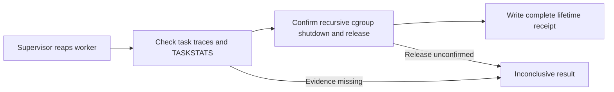
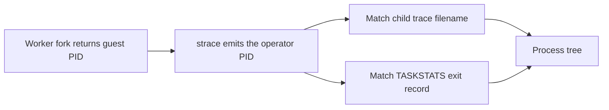

# Phase 38 — monitored Cog operator release gate

The Phase 34 sandbox-only work dispatch and kernel TASKSTATS exit collector
already exist. This gate validates their prerequisites **on the target host**;
it does not substitute for integration tests, and it does not itself install
sandboxing or syscall hooks.

Run from the repository root using the same environment, kernel, effective
privileges, pinned executables and cgroup delegation as the operator:

```bash
python scripts/qualify_operator_workers.py \
  --rootfs /PATH/rootfs --home /PATH/workspace-home \
  --model-staging /PATH/staging --shared-models /PATH/models \
  --shared-tools /PATH/tools --image-digest IMAGE_DIGEST \
  --qualification-sha256 QUALIFICATION_SHA256 \
  --report /PATH/operator-private/worker-qualification.json
```

This invokes the existing Phase 35 real Bubblewrap/cgroup/fork and audited
process-tree smoke test, rather than trusting an arbitrary success command.
It must additionally be paired with the registered-agent Cog-dispatch and
forced cancellation/timeout integration suite for release sign-off.

The runner fails nonzero when Linux/cgroup v2/configuration is missing, if
TASKSTATS cannot register or account for every probe, if the live integration
command fails/times out, or if any required stage is omitted. A successful
exit is a prerequisite, **not** proof of comprehensive forensic completeness:
a separate release assessment must still verify syscall loss detection,
namespace escape tests, full Cog-route enumeration, and operation under stress.

## U03-Q completion evidence

The worker tracer keeps the terminal line for each task. A process tree is
complete only when each task has one unambiguous terminal line, each observed
child has a trace, and the fork graph is consistent. The operator still
requires a TASKSTATS exit record for each traced task. A missing, repeated or
ambiguous terminal line leaves the audit incomplete.

The monitor reads the kernel's recursive `cgroup.events` population flag. A
worker cgroup may have an empty direct process list while a nested cgroup is
still running. The monitor checks that the new cgroup is empty before dispatch. It confirms
recursive shutdown and releases the cgroup before writing a positive lifetime
receipt.



The Linux CI fixture records real fork, thread, exec and signal exits, then
removes a terminal line to check refusal. It also creates a disposable nested
cgroup and verifies that an empty direct list does not let a live child escape
shutdown. These tests qualify the two completion checks. Deployment host
qualification still covers the full Bubblewrap, TASKSTATS and Cog route
combination, including concurrent load and cancellation.

### Worker PID namespaces

A fork inside Bubblewrap returns a PID from the worker namespace. The audit
tracer and TASKSTATS identify that child using the operator namespace. Pin a
strace build that supports `--pidns-translation`. The process graph uses the
translated PID to join a fork to its trace file and exit counters. Missing or
invalid joins keep the worker audit incomplete. The monitor secures completed
trace files before publishing the receipt, including when the operator's
default umask would leave them group-readable. [strace PID translation](https://github.com/strace/strace/blob/v6.8/src/pidns.c) · [Linux TASKSTATS](https://docs.kernel.org/accounting/taskstats.html)



Hosted Ubuntu traces real forks in a separate PID namespace and verifies that
removing their translations breaks the join. It also attempts two registered
Cog launches through the real supervisor using a disposable root filesystem
and the development Syn fixture. If the runner cannot register TASKSTATS, the
test report records that capability gap separately. This fixture covers the
typed JSON route. The deployed image, released Syn authorization, context RPC,
cancellation and concurrent load still have their own qualification gates.

Do not publish raw trace output or private filesystem paths with the JSON
qualification summary. Pin the approved operator image/build and retain
qualified test evidence for each deployment. Re-run after any kernel, cgroup,
strace, taskstats, sandbox image or dispatch change.
