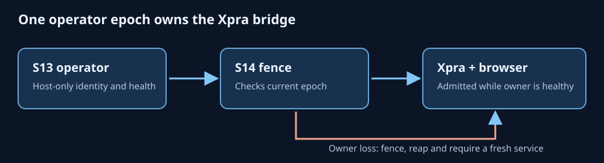

# S14 — Xpra/browser owner-epoch fencing and live-host qualification

**Baseline:** drafted against `ec976f39d6f91e9740ab427dc08d2228c9e32628`; rebased onto `13f9b599a39da8e151106f680709de1c37f83061` to retain the later S39 browser gateway and read-only Xpra input work.
**Scope:** `src/potbot/tools/xpra_app_sessions.py`, `x11_workspace_server.py`, host-only `xpra_operator_fence_s14.py`, acceptance tests. No release-gate or credential-vault migration.



*Generated explanatory diagram of the intended control flow; live Xpra and browser behavior still require the host qualification below. A screenshot or demonstration video would imply a live session that has not been run.*

## Why this is necessary

Previously `load_operator_application_policy()` started a second
`AiConfigHistoryMonitor` for modern images. S13 already owns that watcher and
holds its singleton lock, so the Xpra process could never independently start
its own compatible monitor. The replacement attaches to S13's existing Unix
socket via `SharedWorkspaceBubblewrapBackend.operator_attachment`, which checks
the exact workspace, image, qualification SHA and mount-fingerprint identity.
It never makes the socket accessible inside an agent sandbox.

When the modern image contains `/etc/ai` and `/etc/ai-past`, the application
policy must declare both exact host mount paths and a live operator attachment
must exist **before** opening a display. If `POTBOT_OPERATOR_REQUIRED=1` is
set, an Xpra service without an apps policy is denied.

## Owner and process lifetime

An Xpra service creates one `XpraOperatorFence` for the currently attached
operator epoch. The fence is checked:

1. At startup, *before* Xpra launches, and immediately after Xpra is ready.
2. Before every authenticated REST action: status, tickets, app lifecycle,
   browser reservations and browser commands.
3. On WebSocket admission; an independent async task rechecks every 250 ms
   while frames/input are being forwarded.
4. In an independent host thread for existing GUI processes. The application
   supervisor separately checks owner health during its process/lease watchdog.

Operator loss, health failure, identity mismatch or epoch change permanently
fences the current bridge. It stops its owned application processes and Xpra
session and clears outstanding stream tickets. **Do not** adopt an operator
replacement in the same process; restart this service after reviewing
outstanding workspace leases and the `/etc/ai` history.

A dead process or interrupted browser mutation is not an automatically
successful operation. Existing host `WorkspaceLeaseGuard` and
`BrowserSessionCoordinator` continue to record indeterminate states. UI
clients receive no new privilege or secret. Ordinary unattached legacy
Xpra still works where permitted, but modern application sandboxes cannot
silently degrade into that mode.

## Linux/WSL2 setup

The host must have a running S13 operator and an **operator-owned private** apps
policy with a pinned workspace ID, principal ID, rootfs digest/qualification,
ledger path, bounded recipes, and `aiConfig`/`aiPast`. Start the Xpra bridge
with the same host-only attachment environment the native service uses:

```bash
export POTBOT_OPERATOR_REQUIRED=1
export POTBOT_OPERATOR_SOCKET=/absolute/controller/private/operator.sock
export POTBOT_OPERATOR_WORKSPACE_ID=WORKSPACE_UUID
# Existing bridge secret stays in a private environment source, NOT the command line.
python -m potbot.tools.x11_workspace_server \
  --workspace-id WORKSPACE_UUID \
  --sandbox-root /absolute/workspace/home \
  --apps-policy /absolute/controller/private/xpra-apps.json \
  --browser-origin http://127.0.0.1:3100 \
  --port 8766
```

### Real host two-phase acceptance

Use a **disposable workspace**, a live Bubblewrap/Xpra/Chromium host and an
operator-owned bridge token. The probe does not modify the operator or its
leases, and it requires the bridge to be a loopback address.

```bash
python scripts/qualify_operator_xpra_s14.py \
  --url http://127.0.0.1:8766 --workspace WORKSPACE_UUID \
  --phase healthy --report /absolute/controller/private/s14-healthy.json
```

Observe real browser windows, X11 input and controlled-browser commands under
an active operator; keep their process IDs and lease receipts in operator-only
test evidence. In the disposable workspace, explicitly stop the operator and
verify browser/WebSocket closure and subprocess-tree termination. Then run:

```bash
python scripts/qualify_operator_xpra_s14.py \
  --url http://127.0.0.1:8766 --workspace WORKSPACE_UUID \
  --phase fenced --report /absolute/controller/private/s14-fenced.json
```

The fenced test accepts HTTP `503` or connection refusal, **not** an unrelated
`401` response that could be caused by using the wrong token. Verify that the
browser/WebSocket cannot issue new tickets, the process groups were reaped and
the lease ledger marks genuinely uncertain work indeterminate. Restart the
operator and confirm the original Xpra process cannot attach to its new epoch.
The two reports intentionally omit tokens, filesystem paths and raw process
output.

## Limitations / next qualification

- Offline unit tests cover owner-epoch failure and a real loopback acceptance
  HTTP fixture. **They are not proof of kernel isolation or real Xpra behavior.**
- Xpra application processes currently use their existing host launch path,
  rather than the Cog-specific cgroup/strace process telemetry supervisor.
  Resource attribution, descendant open-file auditing and test-host run IDs
  still need a dedicated Linux audit acceptance pass.
- This is a per-bridge-process fail-closed latch; distributed operator election,
  multi-node recovery and automatic adoption are intentionally not included.
- Socket path/runtime policy ownership must be enforced outside all guest
  mounts; S13's private peer-credential and mount checks remain mandatory.
