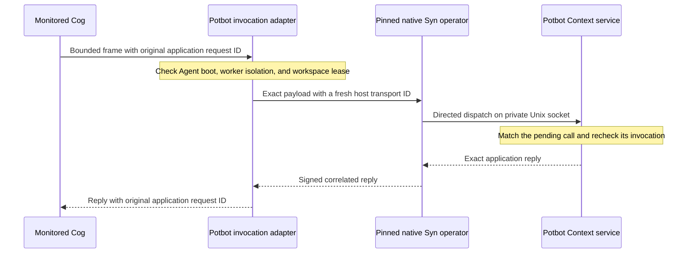

# Context RPC through Syn: invocation binding

The monitored Cog dispatcher can take an explicitly selected host-only Syn
Context route. Once selected, a Context request can reach the handler only
through that route. Guest pipes still carry the bounded request and response
between the isolated Cog and its controller; they do not connect the Cog to
the service. The adapter does not give the guest an operator socket,
database credential, route token, or identity selector.



*Sequence of the candidate route. It shows where application bytes and identity
checks cross boundaries; it does not represent a deployed managed worker.*

The host captures the workspace, registered Agent, invocation, native Agent key
and boot, process isolation receipt, and lease ID and generation. The Context
endpoint checks the native operator peer UID, then matches the transport ID and
payload hash to the pending invocation. Each delivery is accepted once. The
application's request ID stays inside the payload and remains the key for
PostgreSQL reconciliation. A failed transport faults that invocation. Potbot
does not execute locally or resend on an uncertain outcome. Teardown waits
for any accepted operation to settle before revoking its Context session.

## Enable the installed route

Install a signed Syn runtime through the normal release store. The operator
policy must require `syn.operator-local-rpc/1` and pin the exact release and
manifest. Run both user services under the same unprivileged Linux account.
Sandboxed Cogs continue to use their assigned Agent accounts.

Run these commands in the native Linux host or managed WSL distribution,
with the existing operator root and release policy.

```bash
potbot syn-operator configure-context-route --workspace-id "$WORKSPACE_ID" \
  --store "$SYN_STORE" --policy "$SYN_POLICY" --operator-root "$SYN_OPERATOR_ROOT"
potbot syn-operator install-service --context-rpc \
  --store "$SYN_STORE" --policy "$SYN_POLICY" --operator-root "$SYN_OPERATOR_ROOT"
```

The foreground `syn-operator serve` command also takes `--context-rpc`.
For an existing managed Linux unit, the installer adds the route flag and
restarts the service. It restores the previous unit if the service manager
rejects the restart. A customized unit requires a separate update. The
operator registration and identity are reused.

Select `potbot.hosted-native-cog/2` in the administrator-owned native Cog
profile passed to `potbot service install --native-cog-config`. Retain the
existing fields and add this `context_rpc` object. Use the SHA-256 of the
exact private Syn operator policy file.

```json
{
  "store": "/private/syn/packages",
  "operator_root": "/private/syn/operator",
  "policy": "/private/syn/operator-policy.json",
  "policy_sha256": "<64 lowercase hex digits>"
}
```

The trusted hosted worker checks the live signed operator boot and the
supervisor's route digest before listening on the private service socket.
The original profile `potbot.hosted-native-cog/1` still selects the historical
stdio fixture. Qualification of profile 2 requires two installed Agents,
reply loss before and after commit, and lease fencing after collector loss.
