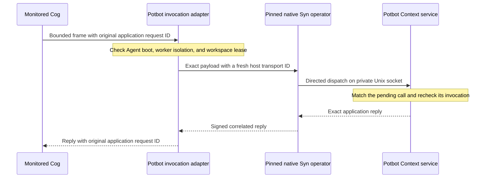

# Context RPC through Syn: invocation binding

The monitored Cog dispatcher can take an explicitly selected host-only Syn
Context route. Once selected, a Context request can reach the handler only
through that route. Guest pipes still carry the bounded request and response
between the isolated Cog and its controller; they do not connect the Cog to
the service. The adapter does not give the guest an operator socket,
database credential, route token, or identity selector.

*Sequence of the candidate route. It shows where application bytes and identity
checks cross boundaries; it does not represent a deployed managed worker.*

The host captures the workspace, registered Agent, invocation, native Agent key
and boot, process isolation receipt, and lease ID and generation. The Context
endpoint checks the native operator peer UID, then matches the transport ID and
payload hash to the pending invocation. Each delivery is accepted once. The
application's request ID stays inside the payload and remains the key for
PostgreSQL reconciliation. A failed transport faults that invocation. Potbot
does not execute locally or resend on an uncertain outcome. Teardown waits
for any accepted operation to settle before revoking its Context session.

The installer does not select the route yet. Before cutover, pin a signed Syn
release that advertises directed local RPC, provision the private service
socket and operator-side client identity, and run the installed worker through
the route. Test two Agents, loss before and after commit, and collector-loss
lease fencing. The historical direct stdio fixture remains available for
its existing acceptance checks until the installed route passes.
