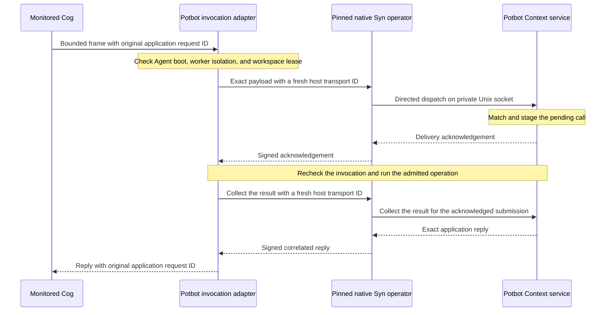
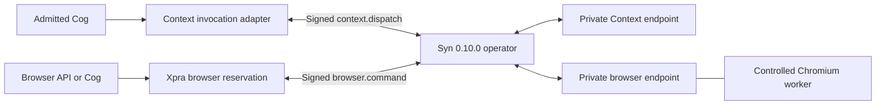
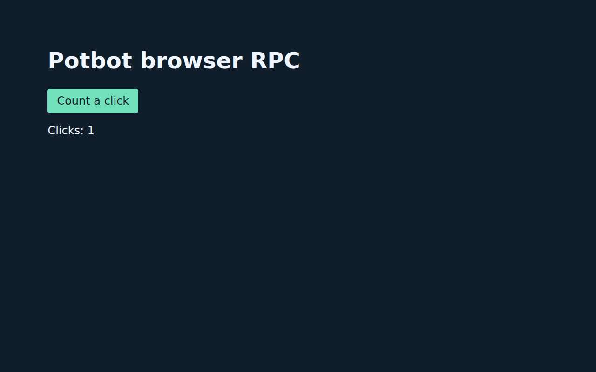
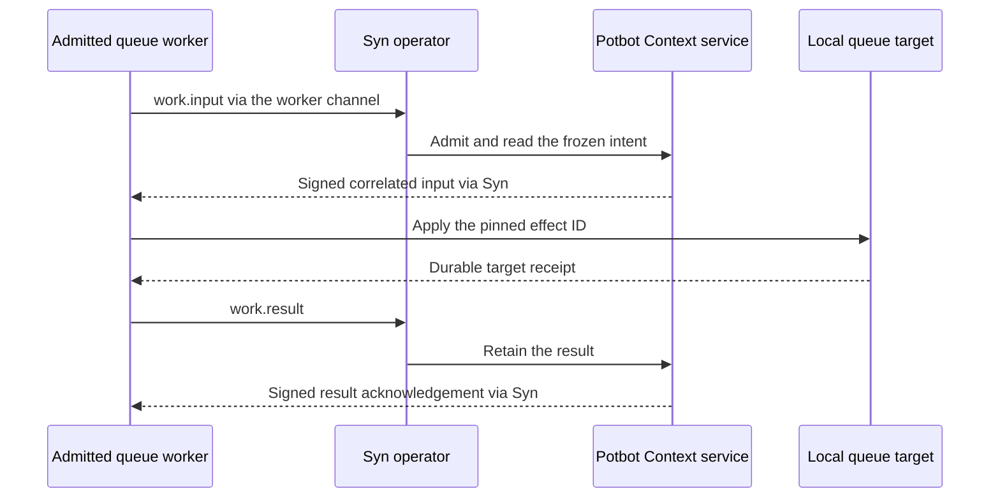

# Directed Context and browser RPC through Syn

The monitored Cog dispatcher can take an explicitly selected host-only Syn
Context route. Once selected, a Context request can reach the handler only
through that route. Guest pipes still carry the bounded request and response
between the isolated Cog and its controller; they do not connect the Cog to
the service. The adapter does not give the guest an operator socket,
database credential, route token, or identity selector.



*Sequence of the Context route with the Syn 0.9.0 directed RPC profile.*

The host captures the workspace, registered Agent, invocation, native Agent key
and boot, process isolation receipt, and lease ID and generation. The Context
endpoint checks the native operator peer UID, then matches the transport ID and
payload hash to the pending invocation. A verified Syn acknowledgement permits
the Context service to execute the delivered request once. The service performs
the live Agent, worker, lease and database checks between the two bounded Syn
exchanges. This keeps those checks outside Syn 0.9.0's two-second socket deadline.

The reply travels through Syn on a separate one-use collection bound to the
same submission. The application's request ID stays inside the payload and
remains the key for PostgreSQL reconciliation. A lost acknowledgement prevents
execution. A lost result after execution leaves the outcome for reconciliation.
A failed transport faults the invocation without resending. Teardown waits for
in-flight work to settle before revoking its Context session.

## Enable the installed route

Install a signed Syn runtime through the normal release store. The operator
policy must require `syn.operator-local-rpc/1` and pin the exact release and
manifest. Run both user services under the same unprivileged Linux account.
Sandboxed Cogs continue to use their assigned Agent accounts. Use the checked-in
`scripts/fixtures/syn-0.10.0-context-operator.json` and Agent policy for the
Syn 0.10.0 qualification. The operator policy also requires
`syn.local-rpc-routes/1`. With that profile, the configuration command writes
`application-rpc.json` with a Context destination and a browser destination.
An older single-route policy still selects its original file.

Run these commands in the native Linux host or managed WSL distribution,
with the existing operator root and release policy.

```bash
potbot syn-operator configure-context-route --workspace-id "$WORKSPACE_ID" \
  --store "$SYN_STORE" --policy "$SYN_POLICY" --operator-root "$SYN_OPERATOR_ROOT"
potbot syn-operator install-service --context-rpc \
  --store "$SYN_STORE" --policy "$SYN_POLICY" --operator-root "$SYN_OPERATOR_ROOT"
```

The foreground `syn-operator serve` command also takes `--context-rpc`.
For an existing managed Linux unit, the installer adds the route flag and
restarts the service. It restores the previous unit if the service manager
rejects the restart. A customized unit requires a separate update. The
operator registration and identity are reused.

Select `potbot.hosted-native-cog/2` in the administrator-owned native Cog
profile passed to `potbot service install --native-cog-config`. Retain the
existing fields and add this `context_rpc` object. Use the SHA-256 of the
exact private Syn operator policy file.

```json
{
  "store": "/private/syn/packages",
  "operator_root": "/private/syn/operator",
  "policy": "/private/syn/operator-policy.json",
  "policy_sha256": "<64 lowercase hex digits>"
}
```

The trusted hosted worker checks the live signed operator boot and the
supervisor's route digest before listening on the private service socket.
The original profile `potbot.hosted-native-cog/1` still selects the historical
stdio fixture. Qualification of profile 2 requires two installed Agents,
reply loss before and after commit, and lease fencing after collector loss.

## Route browser commands through the same operator

Add `"synRpc"` to the private Xpra application policy and set it to the same
four-field object shown above. The application policy must enable
`browserLeases` and `strictXpraInput` and admit a `controlled-browser` recipe.
The Xpra application supervisor opens the private browser socket for that
workspace. With `POTBOT_OPERATOR_REQUIRED=1`, a controlled-browser recipe
requires this configuration.



The supervisor submits the typed command to Syn and checks the signed delivery
acknowledgement. It holds the reservation while Chromium works and asks Syn
for the result in a second signed exchange. Each exchange has its own two-second
deadline. A command can take longer within the worker's deadline. The
process-local worker channel connects the application supervisor to Chromium.
The supervisor fences and terminates the browser if a signed exchange leaves
the outcome indeterminate. A subsequent request cannot repeat the action in
that session.

The managed WSL qualification used the signed Syn 0.10.0 release, a fixture
Context document, and Chromium on a private Xvfb display. Both routes used the
same native operator boot. The rendered frame shows the page after a browser
click over the directed route.



## Local queue effects

The queue installer can select the directed worker with `directed=True`
and the executable digest from an image that includes that worker. The
installed worker uses `work.input` to receive its frozen queue request and
`work.result` to return the target receipt through Syn. This operation admits
only those two calls. It requires the verified native Syn route.



A lost result leaves the existing queue attempt and budget for
reconciliation. After confirmed worker shutdown, a separately admitted
resolver queries the same target and effect ID and returns the existing
outcome. An unconfirmed process or failed audit keeps the workspace fenced.

Managed WSL qualification used the signed Linux amd64 worker from
[the image build](https://github.com/kieransimkin/potbot/actions/runs/43026119152),
the installed scoped TASKSTATS launcher, and PostgreSQL over TLS. After the
verified result reply was dropped, the resolver found the original queue row
and settled one call. Repeating recovery returned the same receipt. A fresh
submission with the same effect ID was rejected before dispatch. Both workers
had four accounted exits, zero missing exits, and released workspace leases.
This test used a disposable Agent binding and the official Syn 0.10.0 operator.

## Sandboxed MCP tool calls

Stop the managed Syn operator before adding the MCP endpoint to its pinned
workspace route table. With the same store, policy, and operator root, run
`potbot syn-operator configure-context-route --include-mcp` with the required
workspace and installation options shown above, then restart the operator.
This retains the Context and browser entries. A running operator holds the
configuration lock until it stops.

~~~mermaid
sequenceDiagram
    participant C as Potbot MCP controller
    participant S as Syn 0.10.0 operator
    participant M as Sandboxed MCP server
    C->>C: Check grant and pinned input schema
    C->>S: Deliver admitted tools/call
    S-->>C: Confirm delivery to the private MCP endpoint
    C->>M: Call the selected server using MCP stdio
    M-->>C: Return the MCP result
    C->>S: Collect the correlated result
    S-->>C: Return the signed result
~~~

The controller opens `installed_mcp_route` for its workspace outside the
sandbox mounts and passes it to `SandboxedMcpClient` with a `ManagedMcpScope`.
The scope binds the authenticated workspace, registered Agent home and run ID
to the pinned shared worker image. The client verifies the executable digest
and requires the scoped TASKSTATS launcher. A workspace lease covers the
process lifetime and stays fenced if shutdown or accounting is unconfirmed.
The same run ID cannot start a second session.

MCP negotiation, tool discovery, and server I/O stay on the external stdio
boundary. Each tool call requires the existing read-only grant and schema
checks. If Syn cannot confirm delivery or return the result, the client
closes the MCP stream immediately. The supervisor allows a bounded interval
for the child to exit and return its accounting receipt before escalating
termination. The client refuses subsequent calls on that session.

Managed WSL used the official Syn 0.10.0 release, the signed worker image,
and the installed scoped TASKSTATS launcher. The admitted tool returned 42
through Syn. The test discarded the verified result for a second call.
The guest log recorded exactly two calls. The supervisor confirmed the
worker stopped and TASKSTATS accounted for all three exits. The workspace
lease was released, and a new session using the same run ID was refused.
