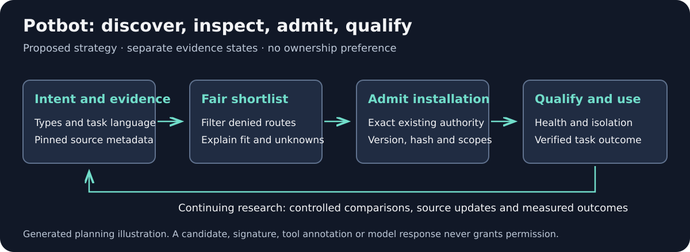

# Potbot plugin and capability discovery strategy

Strategy update: 23 October 2026. Baseline inspected: `e2f7b2e423ceb7360df76b18b076de09bf39936a`. This document extends the [universal tool plan](../potbot-tool-mcp-implementation-bundle/potbot-universal-tool-mcp-implementation-plan.md), especially T04.1–T04.4. It is proposed implementation and evaluation work, not a claim of a running discovery service or qualified automatic installation.

Blogworthiness: FAIL for this strategy-only update: it documents future retrieval and qualification work without a new measured selection result. Reassess actual implementations and experiments independently.

## Purpose and authority

Help Potbot find a suitable capability from a user's task, explain credible implementation choices and admit an installation only under applicable operator authority. Then qualify the exact installed instance before execution. Preserve the existing semantic Types, inherited Ember contracts, gateway, event lineage, credentials, budgets and sandbox requirements.

Discovery, recommendation, installation, registration, authorization, execution and verified success remain separate states. A registry entry, publisher signature, `readOnlyHint`, tool description or model preference cannot grant permission. A previously granted, still-applicable exact authority can be reused; do not add repeated confirmation where the existing policy already permits the action.

*Generated explanatory diagram, 23 October 2026. Proposed flow; no runtime behavior or successful installation is established. A screenshot or recording of an unimplemented flow would add no evidence. Add actual discovery and admission demonstrations when T04 acceptance runs exist.*

## Current implementation boundary

[MCP transport evidence](02-mcp-transports.md) distinguishes protocol tests from production qualification, and retains outstanding egress, identity and lifecycle work. The [HTTP/API increment](04-http-api-adapters.md) has its own acceptance boundaries. Do not bypass these to make an installation demonstration pass. This update does not change any stage's existing status.

The current DanceFlow source is a useful interoperability candidate: it has task-language search, workflow retrieval, typed jobs, native tool federation and canonical engine references. Its [source-level MCP guide](https://github.com/kieransimkin/DanceFlow/blob/a424100b4293d83bf9aa4044d64f0ea753770a59/docs/mcp-ecosystem.md) explicitly distinguishes newer source from the released package. Discover the pinned version's actual interfaces before qualification; an umbrella catalogue does not imply all engines are installed or headless.

## Ordered work in the existing stages

1. **T04.1 — Record candidate sources.** Extend the existing local catalogue with declared source adapters for the official MCP Registry, operator-admitted publisher repositories, package registries and supported vendor directories. Store retrieval time, canonical source URL, immutable revision/version, manifest/schema hash, namespace/publisher evidence, license, distribution method and source access limits. Read metadata without running package code or lifecycle hooks. Unsupported directories remain unavailable sources; do not invent an API or scrape an authenticated session.
2. **T04.1 — Normalize capabilities without granting trust.** Map user intent, input/output Types, examples, host/transport requirements, effects, scopes, dependencies and costs to existing canonical semantic contracts. Keep published claims, inspected source, third-party reports and qualified local observations distinct. Deduplicate package/server aliases by proven identity, not similar names. Admit changes through the established controller and signed/versioned catalogue; source admission is separate from package admission.
3. **T04.2 — Reconcile live discovery.** For enabled, admitted servers, enumerate actual tools/resources/prompts with bounded pagination, supported protocol negotiation, schema fingerprints, TTL and supported change notifications. Cache by workspace, principal, installed binding and exact revision. On removal, revocation or incompatible change, invalidate planner references and require revalidation. Keep third-party registry metadata as candidates until admitted. Tool count and keyword match are not execution proof.
4. **T04.3 — Parse the actual task.** Extract requested outcome, source/data Types, platform, location/privacy constraints, permitted effects, budget and required evidence. Use existing KeywordMoves literal/source-evidence operations when they materially help; no new model or paid search is required by this strategy. Expand only reviewed synonyms and supported task language. Preserve source spans; mark model proposals separately. Local phrase occurrence is not search volume or proof of capability.
5. **T04.3 — Filter before ranking.** Apply hard exclusions for incompatible platform/data contracts, denied effects/scopes, revoked or unresolved identity, unmet isolation, unsupported dependencies and explicit user constraints. An uninstalled candidate can be suggested for inspection but cannot be labelled executable. Prefer an existing adequate built-in/installed route when it satisfies the task; discovery should solve a real gap rather than maximize installations.
6. **T04.3 — Rank inspectable alternatives.** Combine typed fit, bounded lexical relevance, existing graph/vector retrieval where qualified, firsthand reliability, latency/cost and setup friction. Store feature contributions, source identity and uncertainty; test weights rather than asserting an optimum. Missing quality/cost data stays unknown. Return a small shortlist with reasons, prerequisites, authority requirements, evidence and a no-suitable-candidate result. Do not hard-code owned tools, vendor popularity or marketing language as a trust bonus.
7. **T04.4 — Prepare a concrete install decision.** Produce an inspectable plan with exact publisher/package/version/hash, dependency and license inventory, requested configuration/scopes, possible network/download costs, storage root, rollback and required qualification. Resolve actual authority immediately before mutation. Install only the selected admitted candidate in the existing workspace tool boundary; preserve project-local ignored model storage. Never silently install every search result, execute a manifest command or accept another agent's metadata as consent.
8. **T04.4 — Qualify and bind the instance.** Verify bytes, launch/transport schema, health, declared effects, egress and sandbox acceptance. Bind invocation to the exact installation descriptor, principal, policy revision and gateway intent. Test denied paths, malformed schemas, cancellation, replay ambiguity and cleanup. Deactivate/quarantine failed or revoked instances, retain rollback and reconcile uncertain writes. Successful setup does not authorize an unrelated tool action.
9. **T04.3/T04.4 — Evaluate completed tasks.** Measure task discovery, useful shortlist, inspection, installation suggestion, authorized installation, qualification, tool selection and verified task success separately. Preserve causal input, child run/attempt, emitter, source/version and observation/output receipts through existing event contracts. An install receipt alone cannot close the user's task.

## Discovery channels and their limits

| Channel | Strategy and required evidence |
| --- | --- |
| Official MCP Registry | Inspect `server.json`, underlying package and namespace verification. Metadata availability is not vendor approval, package safety or guaranteed ingestion by any client. Retain endpoint/version/API compatibility. |
| Publisher GitHub/package records | Verify ownership and immutable package identity, then inspect source and current release evidence. A repository manifest only proves a distribution declaration. |
| OpenAI directory | Distinguish packaged plugin, local/remote eligibility, review approval, publication and discretionary suggestions. Read current official requirements before importing assumptions into Potbot. |
| Claude directory | Distinguish plugin bundles, remote connector listings, account-synced plugins and a publisher's own marketplace. A known install URL is not unaided discovery. Official-marketplace access is separate from the public directory process. |
| Other agent clients | Add only documented and verified discovery/installation routes. Cursor, VS Code, Gemini CLI and other systems are research candidates until qualified. |
| Installed MCP tools | Lazy-load relevant definitions with bounded search and inspect actual schemas. Installed-tool selection is a different experiment from recommending a new installation. |

Primary references checked for the companion programme: [OpenAI submission](https://developers.openai.com/plugins/deploy/submission), [Claude plugin submission](https://claude.com/docs/plugins/submit), [Claude distribution](https://code.claude.com/docs/en/plugins/publish), [MCP Registry](https://modelcontextprotocol.io/registry/quickstart). Refresh these before implementation; vendor surfaces and eligibility can change.

## Keyword-aware, ownership-neutral benchmark

Extend the existing forty-request golden set rather than inventing a competing benchmark. Freeze prompts, expected capability class and held-out paraphrases before tuning. Include music analysis, timed lyrics/video, web motion, images, keyword evidence and ordinary coding/administrative requests. Include independent synthetic implementations with comparable descriptors and a built-in-suffices control.

Vary spelling and wording naturally: visualiser/visualizer, beat synced/audio reactive, lyric timing/LRC captions. A term can help retrieval only when the pinned interface supports the requested outcome. Negative cases include choosing a web-only library for offline MP4 export, selecting an image tool for plain text, and accepting an unavailable engine as executable.

Retain class recall@3, precision/false triggers, permission-disallowed executable results (target zero), revoked/stale candidate use (target zero), ranking determinism, cold-discovery token/tool budget, latency, installation friction and verified-task completion. Preserve the universal plan's existing recall acceptance threshold; do not lower it to fit a new result. Separate offline fixtures, controlled live observations and vendor-facing trials.

Test registration order, name/description length, repeated keywords and ownership permutations so an owned product does not gain unexplained preference. Add hostile manifests, hidden instructions, forged annotations, wrong hashes, schema changes, pagination loops, unknown costs, denied network/model downloads and safe no-result cases. Use existing trusted admission callbacks; a model never constructs its own approval.

## Continuing research and update policy

Keep an evidence log per experiment: question, hypothesis, primary source/date, host/model/version, installation state, exact task, available alternatives, controlled variable, retrieval/ranking record, authority decision, observed result, uncertainty and next change. Retain private account and tool outputs locally; publish only safe summaries.

Review material official discovery changes weekly alongside the [DanceFlow approval and discovery plan](https://github.com/kieransimkin/DanceFlow/blob/docs/plugin-approval-agent-discovery-20261023/docs/plans/plugin-approval-and-agent-discovery.md). Investigate how other agents select integrations without claiming access to proprietary algorithms. Improve Potbot using controlled results, not unsupported beliefs about keywords or recommendation systems. A vendor's utility/satisfaction guidance is a hypothesis source, not a measurable ranking formula.

Update canonical strategy, applicable T04 tracker fields and maintained documentation together. Do not mark T04 complete from this document, from registry publication or from DanceFlow approval. Runtime implementation requires its existing prerequisite stages, regression tests, real PostgreSQL and qualified sandbox gates where applicable. Preserve immutable versions, source ownership and matching software publication when actual implementation work is delivered.
