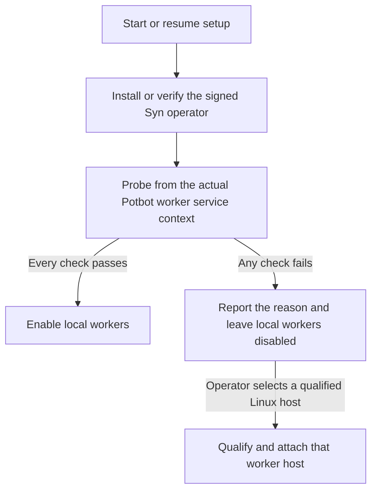

# Potbot self-contained installer mini-plan

**Status:** Proposed. This plan covers installation and worker activation.
The [Syn release and deployment contract](syn-release-dependency-and-node-deployment.md)
and the [worker qualification gate](38-operator-worker-qualification.md)
remain the sources for their respective acceptance requirements.

The goal is a single Potbot setup entry point that provisions local
prerequisites and can resume after a reboot or interruption. On Windows,
setup can install WSL2 and provision a dedicated Ubuntu distro for Syn.
Fully local Potbot worker execution is a separate milestone. Syn packages
come from the independently signed upstream release channel. An offline
installation can use the same verified release artifacts from a cache.

1. **Provision and verify Syn.** On Windows, use stock WSL2 by default.
   Reuse the installer-owned distro and operator when present. Record any
   required reboot and resume setup without creating a second distro or
   identity. Verify the exact Syn version, publisher signature and package
   digests before installation. Use the existing native keystore flow and
   verify the retained operator identity and enrollment on repair or upgrade.
   Report Syn readiness separately from worker readiness.
2. **Qualify and activate Potbot workers.** Run the live accounting and
   sandbox probes with the intended service identity, privileges, namespaces
   and cgroup delegation. Exercise the pinned worker image and require
   an exit record for every traced test task, plus verified shutdown of
   the entire process tree. Report a specific failure reason and leave
   local workers disabled if any evidence is missing. An explicitly selected
   native Linux worker host must pass the same gates before activation.
   Recheck after a kernel, image or service configuration change.
3. **Qualify a local Windows accounting path.** Prove that Potbot can match
   every traced task to its exit record across the PID namespaces used by
   WSL and the sandbox. Exercise concurrent workers, cancellation, timeout
   and restart. Missing or ambiguous records must keep affected work fenced.
   Use this evidence to decide whether local workers need a custom kernel.

The custom Microsoft WSL kernel built for the experiment booted with
TASKSTATS enabled and matching modules. Potbot’s live subscription still
failed with `EINVAL`. The tested kernel permits CPU exit-event subscriptions
only from the initial PID namespace and reports exit PIDs in that namespace.
The WSL distro ran in a nested PID namespace. TASKSTATS is a Boolean
build option, and bundling a precompiled copy of that kernel would reproduce
the failure. The test restored the stock WSL settings and verified boot.
[TASKSTATS build option](https://raw.githubusercontent.com/microsoft/WSL2-Linux-Kernel/linux-msft-wsl-6.18.54.1/init/Kconfig)
· [Subscription check](https://github.com/microsoft/WSL2-Linux-Kernel/blob/d504d40ab83839cb61942a812a99d183c42227b9/kernel/taskstats.c#L304-L313)
· [Exit event PID selection](https://github.com/microsoft/WSL2-Linux-Kernel/blob/d504d40ab83839cb61942a812a99d183c42227b9/kernel/taskstats.c#L630-L655)

If a future qualified configuration needs a custom kernel, offer it as a
separate opt-in package. Build it in CI for each supported architecture and
ship the image and matching modules VHDX under a signed, versioned manifest.
Retain the corresponding source, patches and build configuration. Check WSL
compatibility and the artifact pins before staging. Save the existing
`.wslconfig` and obtain approval before changing it and restarting WSL,
since the setting applies across the user’s WSL2 distros. Verify the kernel,
modules and worker audit after boot. Restore the saved configuration and
verify rollback if any check fails.
[WSL configuration](https://learn.microsoft.com/en-us/windows/wsl/wsl-config)
· [Microsoft build instructions](https://raw.githubusercontent.com/microsoft/WSL2-Linux-Kernel/linux-msft-wsl-6.18.54.1/README.md)
· [Kernel licence](https://raw.githubusercontent.com/microsoft/WSL2-Linux-Kernel/linux-msft-wsl-6.18.54.1/COPYING)

The first installer increment is the stock-WSL setup and the separate worker
activation gate. Exercise a clean install, a repeat run, an interrupted
install, and an upgrade that retains identity and enrollment. Verify that an
unsupported accounting path leaves Syn usable and worker activation disabled,
and that a qualified host can activate workers. Test kernel rollback if the
optional bundle is introduced. SYN-R07 still governs removal of `syn-node/`.
