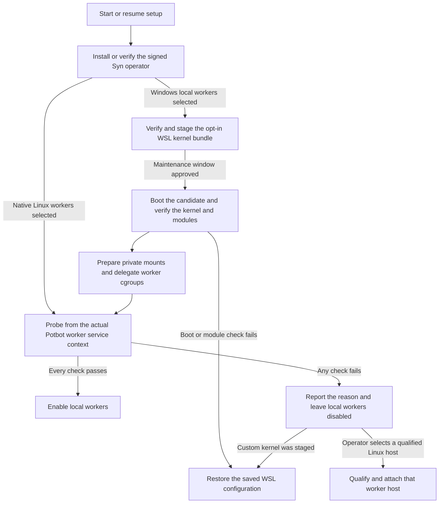
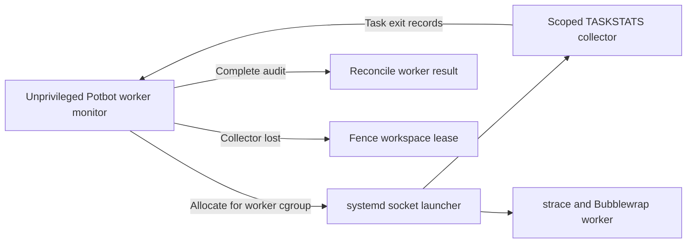
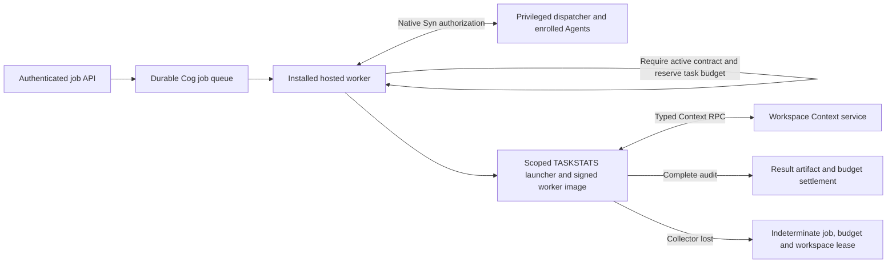

# Potbot self-contained installer mini-plan

**Status:** Stock WSL host setup, controller recovery and the installed
service's scoped accounting check are implemented. Signed kernel
distribution and automatic launcher provisioning remain planned.
The [Syn release and deployment contract](syn-release-dependency-and-node-deployment.md)
and the [worker qualification gate](38-operator-worker-qualification.md)
remain the sources for their respective acceptance requirements.

The goal is a single Potbot setup entry point that provisions local
prerequisites and can resume after a reboot or interruption. On Windows,
setup can install WSL2 and provision a dedicated Ubuntu distro for Syn.
Fully local Potbot worker execution is a separate milestone. Syn packages
come from the independently signed upstream release channel. An offline
installation can use the same verified release artifacts from a cache.

1. **Provision and verify Syn.** On Windows, use stock WSL2 by default.
   Reuse the installer-owned distro and operator when present. Record any
   required reboot and resume setup without creating a second distro or
   identity. Verify the exact Syn version, publisher signature and package
   digests before installation. Use the existing native keystore flow and
   verify the retained operator identity and enrollment on repair or upgrade.
   Report Syn readiness separately from worker readiness.
2. **Qualify and activate Potbot workers.** Run the live accounting and
   sandbox probes with the intended service identity, privileges, namespaces
   and cgroup delegation. Exercise the pinned worker image and require
   an exit record for every traced test task, plus verified shutdown of
   the entire process tree. Report a specific failure reason and leave
   local workers disabled if any evidence is missing. An explicitly selected
   native Linux worker host must pass the same gates before activation.
   Recheck after a kernel, image or service configuration change.
3. **Qualify a local Windows accounting path.** Prove that Potbot can match
   every traced task to its exit record across the PID namespaces used by
   WSL and the sandbox. Exercise concurrent workers, cancellation, timeout
   and restart. Missing or ambiguous records must keep affected work fenced.
   Use the patched kernel candidate below for this host’s WSL2 qualification.

## Resume stock WSL setup

Use the same command for a first install, a retry after Windows asks for a
reboot, and selection of another reviewed controller wheel. Choose the
wheel digest independently of the file being installed.

~~~powershell
potbot syn-operator host-setup --controller-wheel C:\Reviewed\potbot.whl --controller-sha256 <selected-sha256>
potbot syn-operator host-status
~~~

~~~mermaid
flowchart LR
    A[Record registration intent] --> B[Install owned Ubuntu in WSL2]
    B -->|Reboot required| A
    B --> C[Verify registered WSL2 identity and path]
    C --> D[Resume native prerequisites]
    D --> E[Verify the digest-selected controller]
    E --> F[Record controller selection]
    D --> P[Report kernel accounting prerequisites separately]
~~~

When the WSL platform is missing, setup asks Windows to install WSL
without the default distro. Rerun the command after any requested reboot
to register the managed Ubuntu distro.

Setup retries an unfinished registration while the intended directory is
absent. Once Windows registers the distro, setup records its identity and
checks it on subsequent runs. An unexpected registration, unclaimed
storage, or a missing previously registered distro requires reconciliation.

The controller installer keeps each digest in its own environment. A
retry can finish an interrupted build or verify and reuse a completed
environment. The selected controller changes after the new wheel and its
installed payload pass verification. Syn release selection, private
keystore setup and worker qualification use their separate commands.

Host status reports the current kernel and its accounting options. For
example, the managed stock WSL host reported that the host was ready and
accounting was unsupported. Even when the options are available, run the
[live worker qualification](38-operator-worker-qualification.md) before
enabling workers. Host status can boot the owned distro to read the kernel
configuration. The diagram shows the sequence and the headless status
command supplies the actual observation.

[Microsoft WSL installation and reboot behaviour](https://learn.microsoft.com/en-us/windows/wsl/install)

## Start an installed scoped worker

Install the Linux service with its operator manifest and
`--scoped-worker-launcher` after the administrator has provisioned the
launcher, the delegated cgroup and the pinned audit executables. Use
`--no-start` to prepare configuration before those prerequisites are
ready. The existing `potbot service start` command starts the installed
service, and the worker starts after the service proves it can register
and cleanly stop the scoped TASKSTATS collector.

~~~mermaid
flowchart LR
    S[Start the installed service] --> A[Attach the operator and start the API]
    A --> Q[Check the delegated cgroup and scoped collector]
    Q -->|Registration and shutdown confirmed| W[Start the worker]
    Q -->|Check fails| B[Keep the worker blocked and log the failure]
    W -->|Worker exits| Q
~~~

The check runs under the installed service identity. It uses a fresh
empty cgroup, confirms the broker's join-helper digest, and removes the
probe cgroup. A failure logs `service.worker_blocked` and keeps the worker
blocked until the service is restarted. The operator and API remain
available while their own checks pass. Use `potbot service logs` to
inspect the result. The service repeats the check before restarting a
worker, and each Cog still needs the full per-run audit and authority.

The headless probe exercises accounting registration and cleanup. The
[live worker qualification](38-operator-worker-qualification.md) separately
covers the selected image, executable route, and real task exit evidence.

The first custom Microsoft WSL kernel booted with TASKSTATS enabled and
matching modules. Potbot’s live subscription still
failed with `EINVAL`. The tested kernel permits CPU exit-event subscriptions
only from the initial PID namespace and reports exit PIDs in that namespace.
The WSL distro ran in a nested PID namespace. TASKSTATS is a Boolean
build option, and bundling a precompiled copy of that kernel would reproduce
the failure. The test restored the stock WSL settings and verified boot.
[TASKSTATS build option](https://raw.githubusercontent.com/microsoft/WSL2-Linux-Kernel/linux-msft-wsl-6.18.54.1/init/Kconfig)
· [Subscription check](https://github.com/microsoft/WSL2-Linux-Kernel/blob/d504d40ab83839cb61942a812a99d183c42227b9/kernel/taskstats.c#L304-L313)
· [Exit event PID selection](https://github.com/microsoft/WSL2-Linux-Kernel/blob/d504d40ab83839cb61942a812a99d183c42227b9/kernel/taskstats.c#L630-L655)

The follow-up x86-64 candidate filters exit events by the subscribing PID
namespace and reports PIDs as seen by that subscriber. In a disposable Ubuntu
24.04 WSL2 distro, the pinned, signature-verified worker image passed the real
operator gate and all 14 workspace assertions on two fresh boots. The live
worker suite passed seven cases, including cancellation, overlapping
workspaces and lease renewal.
Those seven lifecycle cases use the development Syn fixture. A separate
disposable WSL run used the same signed worker image with official Syn
0.7.0 and 0.8.0. Two Agents per release passed monitored Cog authorization,
live peer heartbeat, invalid-grant refusal and cleanup. The candidate still
needs installer and production qualification before worker activation.
[Syn 0.7.0](https://github.com/Synsphere/syn/releases/tag/v0.7.0) · [Syn 0.8.0](https://github.com/Synsphere/syn/releases/tag/v0.8.0)

Disabling WSL automount and interop left a Windows driver share mounted at
`/usr/lib/wsl/drivers`. Run the worker service in a private mount namespace and
detach that share there. Check the service's actual mount table for any
remaining 9p or DrvFs mounts before admitting workers. Delegate the `cpu`,
`memory`, `io` and `pids` controllers to the worker subtree and verify those
controllers from the service context. The test used the disposable distro’s
own cgroup namespace and restored the stock WSL configuration after boot.

Use `6.18.54.1-microsoft-standard-WSL2-potbot-ns-taskstats` as the x86-64
deployment candidate. It is based on Microsoft source commit
`d504d40ab83839cb61942a812a99d183c42227b9`, with `CONFIG_TASKSTATS`,
`CONFIG_TASK_XACCT` and `CONFIG_TASK_IO_ACCOUNTING` enabled and the PID
namespace patch applied. The retained local bundle is under
`%LOCALAPPDATA%\Potbot\WSL\6.18.54.1-microsoft-standard-WSL2-potbot-ns-taskstats`.
Its manifest pins the kernel image, matching modules VHDX, build configuration
and patch. Offer the kernel as an opt-in installer package after CI builds it
for each supported architecture and signs the versioned manifest. Retain the
corresponding source, patch and build configuration with the release record.

1. **Verify the deployment inputs.** Record the WSL version, host architecture,
   installed distro versions, current kernel and existing `.wslconfig` hash.
   Verify the retained bundle against its qualification hashes and pin the
   intended Potbot build, signed worker image and official Syn release. Keep
   worker admission disabled while qualifying the host.
2. **Stage the VM change.** Save and verify an exact copy of `.wslconfig`,
   including whether it originally existed. Prepare a diff that sets only
   `kernel` and `kernelModules` in `[wsl2]` to absolute Windows paths.
   Preserve other settings. Review the diff and obtain approval for a
   maintenance window. Drain WSL workloads and stop them cleanly before
   applying the reviewed diff and running `wsl --shutdown`. The settings
   apply to every WSL2 distro in the Windows user’s VM.
3. **Verify boot and isolation.** Boot the intended distro and verify the
   exact kernel release with `uname -r`, the three accounting options in
   `/proc/config.gz` and the matching module tree under
   `/lib/modules/$(uname -r)`. Start the worker service with its intended
   credentials, private mounts and delegated cgroup. Confirm no 9p or DrvFs
   mounts are visible from that service and check the delegated controllers.
4. **Qualify the live service.** Run the existing operator gate and require a
   TASKSTATS record for every traced task. Repeat the PID namespace isolation,
   unprivileged subscription and port reuse checks. Verify cancellation,
   overlapping work, lease renewal and cleanup on the pinned signed image.
   Verify monitored Cog authorization and context RPC with the pinned official
   Syn release, then repeat the service checks after restart. Record the
   configuration, artifact digests and receipts before enabling workers.
5. **Roll back on failure.** Fence worker admission, stop the test service,
   and compare the active configuration with the staged hash before restoring
   it. Restore the original bytes or the file’s original absence. If the file
   changed independently, reconcile the edits before writing it. Shut WSL down
   again and verify the baseline kernel and distro boot. Keep the failure
   receipt and the worker gate closed.

The diagram covers the proposed sequence. The recorded qualifications use
headless probes and structured receipts. The deployment run supplies new
evidence from the intended service.

A host switch selected the candidate and passed live worker qualification
in a disposable WSL2 distro. PostgreSQL-backed Context RPC passed with
official Syn 0.7.0 and 0.8.0, including session revocation after a result,
lease release after clean exits and fencing after an intentional nonzero
exit. The signed-image operator gate passed again after reboot. The host
retained the candidate and verified its stock rollback backup. At that
checkpoint, installed worker service qualification and legacy-state
cutover remained open.

The follow-on installed-service check corrected two launcher defects. The
systemd unit now preserves the virtualenv interpreter and emits a valid
`WorkingDirectory=` path. Under its actual user identity, TASKSTATS
registration returned `EPERM` and the WSL driver share was still visible.
The root control recorded both test exits. The failure triggered a verified
rollback to stock WSL.

A disposable native systemd unit verified the proposed audit and mount
boundary. It placed each worker and its auditor in separate per-worker PID
and network namespaces. The auditor used only `CAP_NET_ADMIN`. Each worker
ran without capabilities and saw no Windows filesystem mounts. Two workers
with the same local PID produced separate exit records, and the parent
distro retained its driver mount. Stock WSL was restored after the test.

The worker monitor now accepts an inherited, administrator-created socketpair
for a single run. The collector acknowledges the worker ID, PID namespace
and empty cgroup before the monitor issues a launch command. The trusted
tracer supplies the task IDs used to reconcile exit records. The collector
checks the cgroup identity again after the worker stops.

A disposable WSL2 run exercised the Potbot monitor with real strace and
cgroups. Two traced tasks each produced an exit receipt. An absent
collector prevented dispatch. Killing the collector during a worker run
made the monitor unhealthy. The test supervisor stopped the tracer and the
monitor removed the cgroup without issuing a complete receipt. Stock WSL
was restored and the parent driver mount was preserved.

Enable the scoped launcher with `potbot service install --operator-manifest … --scoped-worker-launcher`
after provisioning the administrator-owned systemd socket. The user service
keeps its native vault access and starts workers without Linux capabilities.
Each request gets a private PID, network and mount namespace. The launcher
detaches the WSL driver share in that namespace and refuses to start if it
still sees a Windows filesystem. The existing WSL preflight continues to
reject other shares before dispatch.

The host administrator provisions `/run/potbot-scoped-worker.sock` using a
systemd socket with `ListenSequentialPacket=`, `Accept=yes` and mode `0660`.
Set the socket group to the installed service's dedicated primary group. The
paired `potbot-scoped-worker@.service` takes `StandardInput=socket` and runs
`python -I -m potbot.tools.scoped_launcher accept CGROUP_ROOT CGROUP_JOIN SERVICE_UID SERVICE_GID AUDITOR_UID`.
Use an administrator-owned interpreter and installed package. Supply the
same delegated cgroup root and pinned cgroup join helper to the installed
worker monitor. The auditor account has a different UID. The socket and
monitoring assets must be outside guest mounts.

The socket launcher passed a disposable WSL2 test using an unprivileged
monitor, real strace and cgroup v2. All four traced tasks produced receipts.
The monitor forwarded a worker status descriptor and rejected a complete
receipt when the collector died. A separate PostgreSQL Context RPC test
ran through that launcher on the signed image with the development Syn
mesh. A clean result released the lease. In the fault case, the Context
session was revoked when it recorded a result. The collector then died,
the lease became indeterminate, and the next claim was refused. The test
also checked cgroup removal and the absence of a complete audit receipt.

The combined disposable WSL2 check installed and started the normal
`potbot.service` user unit, then attached a same-UID qualification
dispatcher to the live operator. The dispatcher used the installed worker's
scoped launcher settings and forwarded public Syn operations through a
fixture-only bridge to the verified native Agents. The pinned official Syn
0.7.0 and 0.8.0 packages each passed signed-image Context RPC with two
Agents. Both clean runs released their leases. Killing the collector after
a result kept the faulted lease indeterminate and blocked the next claim
for each release.

The installed hosted worker can opt into native Cog dispatch through
`--native-cog-config`. Provision an administrator-owned profile with the
workspace, signed worker image and qualification hashes, one official Syn
manifest hash and signing authority, and the enrolled Agent cohort and
group epoch. Register the bounded read-only Context RPC operations and their
typed ports in the profile, and pin their executable entrypoints in the
operator manifest. Provision the native dispatcher under the privileged
Agent owner with its own deployment manifest using
`python -I -m potbot.syn_release.mesh_service DISPATCHER_MANIFEST`.
Start it after the enrolled Agents are healthy and before starting
`potbot.service`. Keep the local socket and profiles outside the worker
mounts. The dispatcher checks the dedicated worker's UID and GID before
accepting a connection.

Each relay binds to one boot of its enrolled Agents. Syn fences those Agent
processes when the relay closes. For a planned restart, stop Potbot, stop
the dispatcher, and start the same enrolled Agents from retained native
custody. Verify their selected identities and new boot IDs before starting
the dispatcher with the same manifest. Start Potbot after dispatcher
readiness. The relay releases its startup claim once its child has exited.
An interrupted stop can leave a claim behind and requires operator
reconciliation before a new relay can start.

Clients submit `cog.execute` jobs through `POST /v1/jobs` with the profile
hash, operation, Agent ID, repository state ID and typed input. Each job
uses its installed profile's release pin. The qualification matrix exercises
0.7.0 and 0.8.0 in separate cohorts to cover the release transition.

In disposable WSL2, the ordinary installed worker claimed all six jobs
submitted through the API on the signed image. For each release, one
Context RPC job per Agent completed with a full audit, settled its budget,
and released the workspace lease. Killing the collector after the third
job recorded its result left the job, budget, and lease indeterminate and
blocked the next workspace claim. The test exercised the production socket
endpoint and native Agent attachment against a relay started by the
qualification harness.

A second disposable WSL2 run started the dispatcher as a separate systemd
service using its production entry point. On both official releases, the
dispatcher rejected an unauthorized socket peer and removed its socket and
relay claim at clean stop. Both Agents fenced the previous boots. After
reopening retained native custody, their selected keys, assignments and
configuration hashes matched, and the same dispatcher manifest opened a
fresh relay session. The installed worker then repeated the two clean
Context RPC jobs and the collector-loss case on the signed image.

The managed WSL qualification passed with the installed worker, the signed
image, the scoped launcher and pinned Syn 0.8.0. It verified Context RPC
for two Agents and lease fencing after collector loss. Potbot removed the
transitional runtime in PR #46. PR #43 added the official Syn 0.7.0 and
0.8.0 Context RPC checks.
[Removal](https://github.com/kieransimkin/potbot/pull/46) · [Release checks](https://github.com/kieransimkin/potbot/pull/43)

[systemd socket activation](https://www.freedesktop.org/software/systemd/man/latest/systemd.socket.html)
[WSL configuration](https://learn.microsoft.com/en-us/windows/wsl/wsl-config)
· [Microsoft build instructions](https://raw.githubusercontent.com/microsoft/WSL2-Linux-Kernel/linux-msft-wsl-6.18.54.1/README.md)
· [Kernel licence](https://raw.githubusercontent.com/microsoft/WSL2-Linux-Kernel/linux-msft-wsl-6.18.54.1/COPYING)

Complete installer acceptance on a clean Windows host. Exercise WSL
feature installation, a reboot and resume, and an operator upgrade that
retains identity and enrollment. Verify that unsupported accounting leaves
Syn usable and blocks local worker admission. Qualify the installed worker
with its signed image and pinned Syn release on the deployment host.
Test kernel rollback if the optional bundle is introduced.
