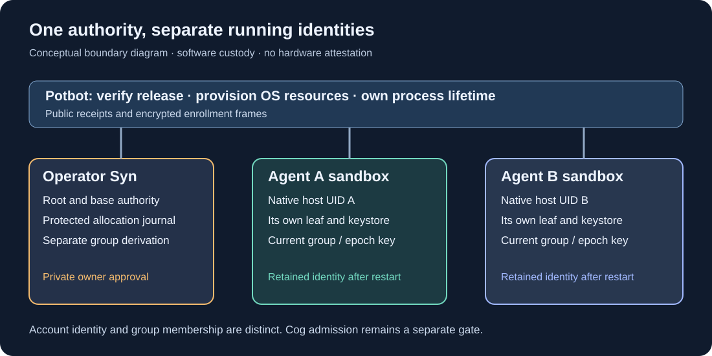
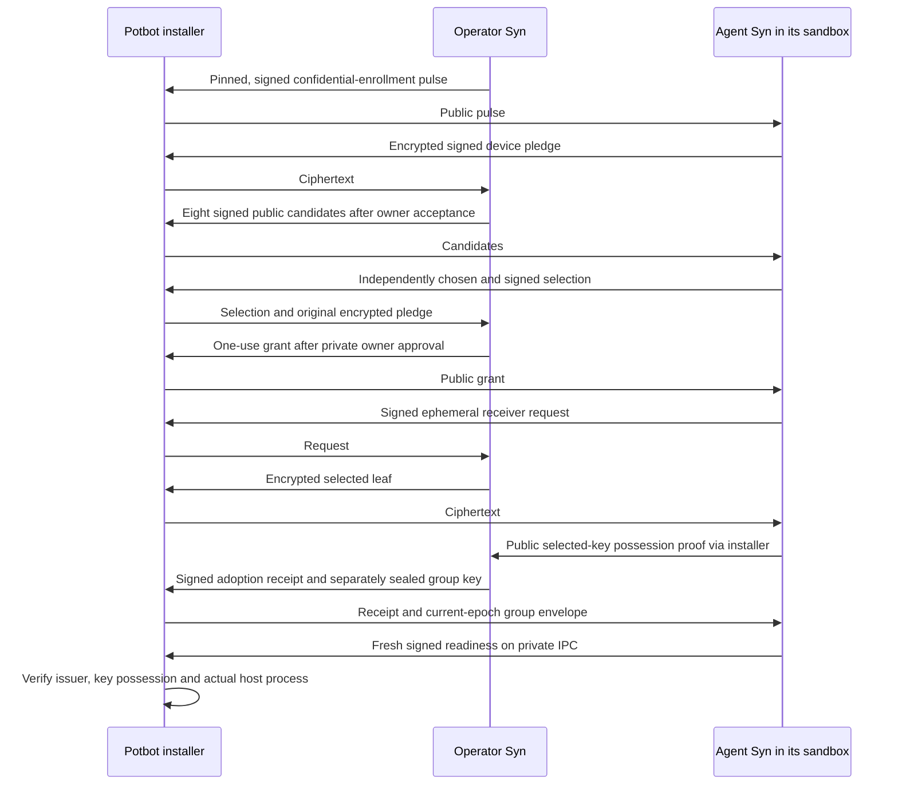

# SYN-R04 — genuine Syn Agent provisioning

**Delivery status, 2 November 2026:** the canonical Syn 0.3.0 candidate and this
Potbot controller implement Agent provisioning. Disposable WSL source-package
acceptance has run two real nodes with native encrypted keystores, separate host
UIDs, selected keys and retained identities across node and full keystore-session
restarts. Signed publication and exact official-package acceptance are separate
gates; this source record does not claim that 0.3.0 is already published.

*Generated architectural illustration. Each sandbox holds its assigned leaf and
the current group key. The operator retains derivation authority. This diagram
is not an attestation or a capture of the test run.*

## What belongs to whom

Syn creates identities, checks the Agent's independent selection, seals the
selected key, imports it into native custody and serves fresh readiness proofs.
Potbot verifies the official release, provisions restricted OS resources, mounts
the admitted package read-only and owns the process lifetime. Its enrollment
pipe carries public documents and ciphertext. The private password prompt runs
inside Syn and reads the controlling terminal directly.

One Agent owns one long-lived Syn node. A Cog invocation does not create a new
Agent identity. Provisioning leaves `cog_execution_authorized=false`; SYN-R05
must bind the genuine node to the monitored execution boundary before work can
be admitted. Existing worker actors and the transitional `syn-node/` remain
historical development paths, outside this production launch path.

## Approved virtual-device policy

Kieran approved **host-bound virtual-device IDs** on 2 November 2026 because
several Agents share one WSL host and that host exposes no TPM. The explicit
profile is `syn.host-bound-virtual-device/1`. Syn combines the native host binding
with a separate OS-random per-Agent seed held in that Agent's keystore. The
temporary Ed25519 signing key is independently random and does not determine
inheritance. The frozen v2 inheritance calculation still consumes the exact raw
ID bytes followed by the operator's chosen octet.

This qualifies a software virtual-device policy. It provides no physical-device
attestation, TPM non-exportability or resistance to a complete cloned host and
keystore. Moving the directory, changing the native UID or changing the host
binding fences the retained identity. Missing or partial credentials require
reconciliation; provisioning never reseeds or erases them to make progress.

## Enrollment and readiness

*Generated enrollment sequence. The installer courier is limited to enrollment;
it is not an Agent-to-Agent messaging transport.*

The operator's journal is anchored in its native keystore. Selection, grant,
seal, receipt and group-key release are append-only, bounded transitions. A
restored old file, copied state path, second key choice or reused transfer fails
closed. The Agent receives one leaf's extended secret and leaf chain code,
never the root, base, sibling keys or parent derivation material.

Group custody is separate from account identity. Syn derives the current group
key in a versioned HKDF domain bound to operator, network, group UUID and epoch.
It seals that key separately and signs a certificate binding the group and epoch
to the selected node. Initial custody does not implement general epoch rotation,
revocation or group messaging; those retain their later acceptance gates.

## Native host boundary

The first Agent profile runs on **Linux x86-64, including the managed Ubuntu WSL2
host**. Existing native macOS operator support is retained; macOS Agent sandbox
qualification remains unavailable. An explicit privileged native controller
provisions a non-login host account for each Agent. The namespace UID preserves
that actual host UID. A changed label mapped back to host root cannot qualify.

Bubblewrap supplies separate mount, PID, network, user, IPC, UTS and cgroup
namespaces. The shared Potbot seccomp primitive admits only AF_UNIX sockets for
the private credential service and readiness endpoint. The root filesystem and
runtime mounts are read-only; the Agent home is its only persistent writable
mount. Operator and peer homes, buses and Windows drive mounts are absent.
Capabilities and their bounding set are empty, and new privileges are disabled.
Runtime memory, process, descriptor and file-size limits are applied. This is a
Syn runtime profile; it does not replace Cog image, lease, syscall-audit,
PostgreSQL or budget qualification.

## Controller entry point

Use `potbot syn-agent --help` for the complete argument contract. Operations run
as the privileged controller **inside native Linux or WSL**. Select an exact
agent-mode release policy with `syn.agent-local/1`, `syn.agent-group/1` and the
declared custody capabilities. Supply the independently pinned operator, existing
Agent UUID, restricted UID, group UUID/epoch and the explicitly approved device
profile. Do not use a source checkout as the Syn runtime.

`session` owns one private native-keystore session and genuine Syn process;
`--new-identity` is required only for explicitly empty first installation.
`attach` checks retained public pins without taking process ownership. Enrollment
accepts only its fixed public/encrypted frame types. It has no arbitrary command,
private-key export or general signing operation. EOF stops only the owned
session; an unexpected node or credential-service exit fences it.

## Acceptance evidence and remaining work

The source-package check exercises the real pinned HD provider, encrypted native
Linux Secret Service, two simultaneous nodes, distinct selected identities,
matching current group keys, graceful node restart, full native session restart,
locked-store refusal and outside-the-sandbox process inspection. Portable client
tests separately reject wrong issuers, nodes, groups, epochs and changed signed
commitments. Fault fixtures are labelled separately from native custody evidence.

The upstream native workflow must repeat this against the exact reviewed Potbot
consumer and then against the signed published release. The official lane must
exercise the complete `potbot syn-agent` controller, immutable store and fresh
client verification. Retain its manifest, source, consumer and wheel digests.

SYN-R05 still owns Cog admission and the supported Syn messaging integration.
SYN-R06 owns general upgrades, recovery and group rotation/revocation. SYN-R07
owns removal of the transitional runtime after released parity. No production
consensus, cross-host networking or autonomous coding is established by R04.

There is no Agent GUI to screenshot. The diagram explains the boundaries;
actual CI captures and an appropriately sanitised demonstration belong to the
dated release acceptance record. Password and keystore footage is excluded.
