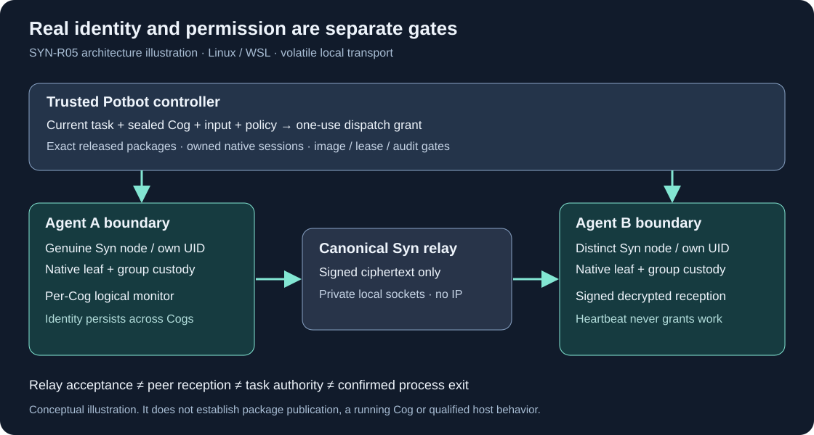
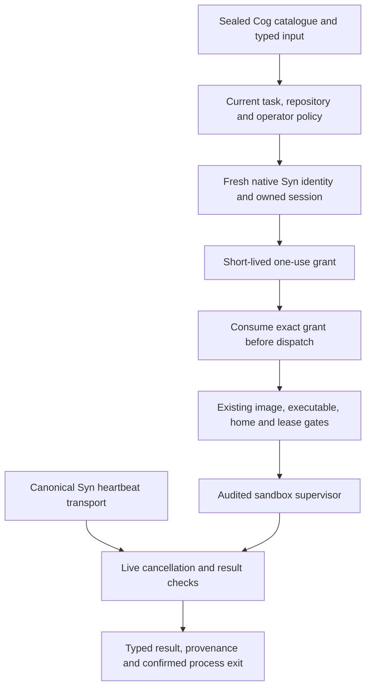

# SYN-R05 — native Syn identity at Cog dispatch

**Implementation candidate, 2 November 2026.** Potbot's normal sandboxed Cog
execution path now requires released native Syn nodes and a one-use task grant.
Syn 0.4.0 is the paired upstream candidate. Required CI, publication and exact
official-package qualification must be recorded separately before selecting it.



*Generated architectural illustration; it does not demonstrate execution or host acceptance.*

## Two independent gates

`SynPrivateMesh` freezes an operator-selected workspace cohort from genuinely
enrolled `SynAgentDeployment`/`AgentSession` instances. Each participant must
share the operator, network, current group/epoch and exact release manifest,
while retaining a distinct selected identity. The adapter verifies installed
release capabilities, fresh upstream signed readiness and the owned native
process tree. It launches the canonical upstream relay and exchanges only public
SDK documents. Cryptography, native credential access and replay enforcement
remain in Syn. See the [upstream protocol](https://github.com/Synsphere/syn/blob/master/docs/development/private-pubsub.md).

`ReleasedSynWorkerNodeMesh` binds logical invocation monitors to that fixed
cohort. It publishes typed heartbeats through the genuine Syn node and consumes
signed native receptions, including while peers are idle. A received heartbeat
must match the selected source leaf, boot, logical Agent, workspace and active
controller-owned invocation. A publication acknowledgement is not reception,
and a heartbeat is not a process-termination or permission receipt.



`ExecutionCogRuntime` performs its existing admission checks and fresh node
probe, then issues a grant through the configured executor. The grant binds
principal/workspace, Agent, task revision, repository state, sealed Cog snapshot,
invocation and upstream receipt, exact installed operation/binary/protocol,
typed input, mesh session and native node boot. It expires after ten seconds,
is held only by the trusted controller, and is consumed once before any worker
launch. Reconstructed, changed, expired or replayed grants fail closed.

`SandboxedCogExecutor` requires this native mesh by default. The original
in-process `SynWorkerNodeMesh` remains available only with the explicit
`development_syn_fixture=True` option for unit/isolated sandbox smoke tests.
There is no automatic production fallback. Tests that replace worker RPC are
labelled as doubles and cannot establish native or kernel qualification.

## Lifecycle and restrictions

The trusted controller owns both lifetimes:

```python
with native_mesh.running(), released_worker_mesh.running():
    # Construct the qualified executor with syn_mesh=released_worker_mesh.
    # Invoke installed Cogs through ExecutionCogRuntime and its current policy.
    ...
```

These are operator APIs, not model instructions or a grant to execute arbitrary
code. An Agent's Syn process persists across Cog invocations. A per-Cog logical
monitor never creates, replaces or exports its identity. Syn and Cog processes
can have different native/guest UIDs and namespaces, bound to the same logical
Agent; existing shared-workspace guest identity and isolation checks still apply.

Loss of a node, relay, native credentials or verified heartbeat consumer fences
monitors and subsequent admission. The existing supervisor sees the fault while
work is running. Lost confirmation after dispatch remains indeterminate and
requires reconciliation. Syn readiness always says
`cog_execution_authorized=false`; discovering a type or receiving a valid message
cannot enable write/execute effects. Existing task/budget admission, read-only
defaults, leases, pinned image and executable, cgroup/syscall accounting, context
checks, typed ports, journal and confirmed-stop rules remain required.

The first profile is Linux x86-64/WSL2, at most eight peers, bounded volatile
queues and exact typed heartbeat messages. It adds no IP listener, sandbox
network bypass, cross-host ordering, durable delivery or consensus guarantee.
General upgrades/recovery and group rotation remain SYN-R06. Transitional runtime
removal is SYN-R07. Provider/model workers outside this Cog path, full production
host acceptance and general rollout retain their own roadmap gates.

## Evidence boundaries

- Unit tests reject changed task/input/repository/snapshot/Agent/boot/session,
  expired, forged, absent and replayed grants, forged heartbeat claims and loss.
- Existing Linux sandbox-executor tests exercise leases, typed results and
  uncertain process exit using an explicit process double.
- Syn's source-wheel native fixture exchanges ciphertext between two genuine
  isolated nodes, verifies signed decrypted reception and fences on relay loss.
- The paired official-package lane exercises the complete Potbot public adapter
  against independently verified published packages. It records no positive Cog
  process dispatch: audited image/cgroup/TASKSTATS and U16 host qualification
  remain separate mandatory acceptance, never inferred from a transport test.

Source implementation and passing fixture tests do not set U00's
`runtime_qualified` flag or qualify autonomous coding. The persisted operator's
private unlock/upgrade is a separate host handoff; no existing keystore is reset.

The headless protocol has no GUI to capture. The conceptual image and sequence
are useful media; signed native receipts and CI logs provide actual evidence.
External browser capture is currently unavailable, and no password/keystore
recording or fabricated screenshot/video is included.
