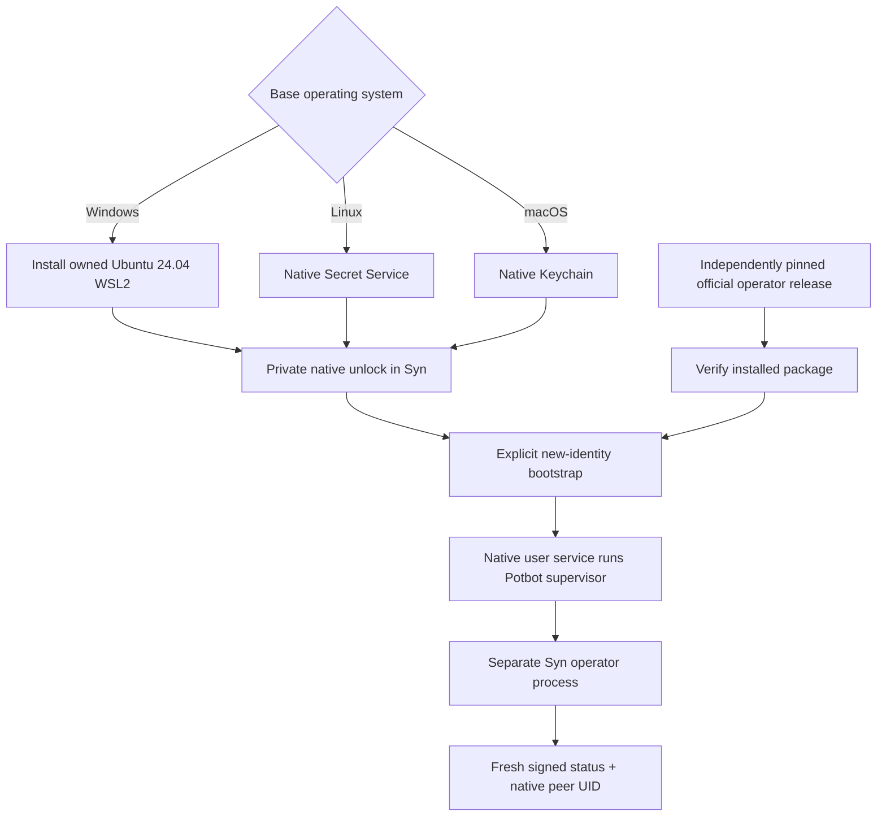
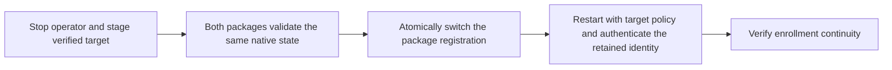
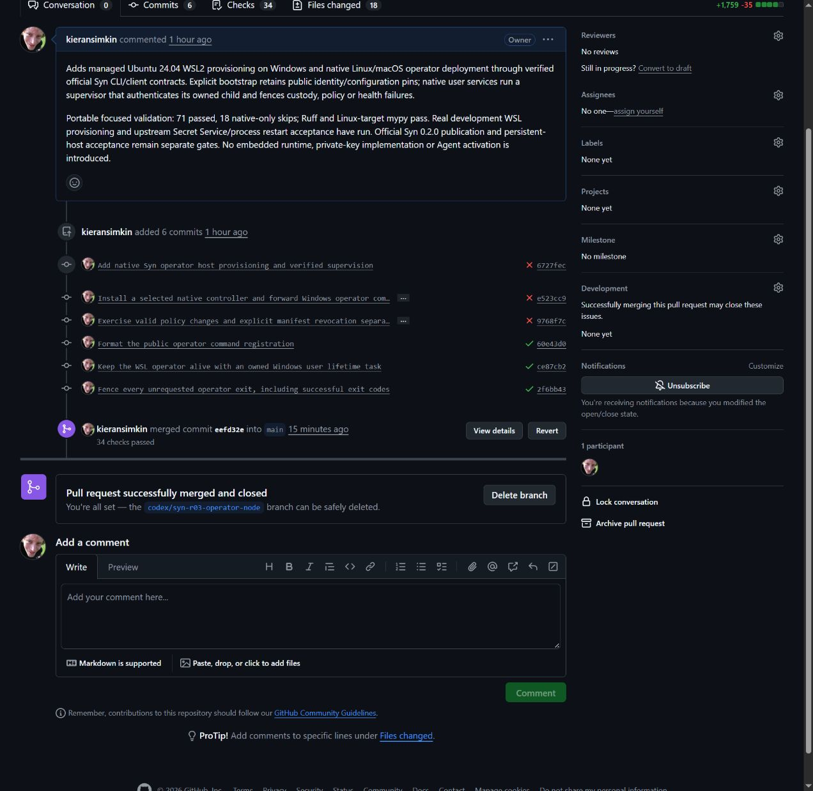

# Deploying the native Syn operator

SYN-R03 adds host provisioning, explicit bootstrap, authenticated attachment
and user-service supervision. Upstream Syn 0.2.0 was signed, published and
accepted against the reviewed Potbot controller on Linux and both Mac
architectures. The first persistent WSL handoff then found an interactive
terminal/unlock defect before password entry. Use the qualified 0.2.1 patch
for a new installation requiring private native-keystore unlock; its publication
and acceptance are separate gates. Syn 0.1.0 remains
service-only and is rejected by this deployment policy.



*Conceptual deployment flow. WSL provisioning was executed on Windows during
development. Production identity and official-release node acceptance are
recorded separately and are not implied by this diagram.*

## Switch the release for an existing operator

Stage the target with the [release installer](syn-release-installation.md#stage-a-runtime-upgrade).
Stop the supervised operator and quiesce enrollment maintenance. Supply the
current and target private policies on the native host.

```bash
potbot syn-operator switch-release --store /operator/syn-packages \
  --operator-root /operator/deployment --policy /operator/policy/current.json \
  --target-policy /operator/policy/target.json
```

The switch supports the exact official 0.2.1 → 0.3.1 and 0.3.1 → 0.4.0
operator packages. 0.4.0 → 0.3.1 is the supported package rollback when the
current policy allows the older target. 0.2.1 predates the anchored adoption
journal. A return to that package requires separate state qualification.



The command holds the existing supervisor lock and refuses a remaining socket,
incompatible policies, or disagreement between the official preflight reports.
The registered installation changes atomically. The native keystore, operator
configuration and authority files stay at their current paths. Start the
supervisor with the target policy and check authenticated attachment. A service
configured with a fixed old policy path requires explicit service reconciliation
before its next start. The switch returns a receipt and does not start a process.

The disposable [official lifecycle workflow](../../.github/workflows/syn-operator-lifecycle.yml)
uses signed releases, real Linux Secret Service and PostgreSQL. It exercises the
operator upgrade and rollback with a retained reservation, verifies refusal of
rewound authority bytes, and runs the packaged PostgreSQL migration from
`20261023_0014` to `20261024_0015` separately. The selected operator releases
advertise the same Alembic head. The PostgreSQL test also reopens the migrated
database with 0.3.1 and verifies that the schema and data stay at the new head.
The diagram describes the headless command sequence. The workflow receipt
records the actual observations without exposing terminal or custody data.

## Host preparation

`potbot syn-operator host-setup` installs a dedicated
`Potbot-SynOperator` WSL2 distribution from official Ubuntu 24.04 on Windows.
It retains an ownership receipt and installs Python, build prerequisites and
GNOME Secret Service under a dedicated non-root `synoperator` account.
It refuses an existing distribution without its receipt, a missing registered
distribution, or inconsistent lifecycle state. It never unregisters a distro,
silently adopts another installation, or replaces a Syn identity.

To prepare Windows forwarding, select an exact tested Potbot wheel and its
independently retained SHA-256:

```powershell
potbot syn-operator host-setup --controller-wheel C:\Reviewed\potbot.whl --controller-sha256 <selected-sha256>
```

This installs the selected controller in a permanent digest-specific native
environment, verifies its CLI and records its interpreter. Subsequent Windows
`syn-release` and `syn-operator` operations forward argument arrays directly
to that controller. Supply native absolute paths for store/policy/state and
trusted tools. No caller string becomes shell code. Only package acquisition
may forward the repository read token; it never reaches Syn child processes.
An unfinished controller installation is not admitted and requires explicit
reconciliation rather than silent replacement.

Linux uses the native OS and explicit apt prerequisites; other Linux package
managers require operator preparation. macOS uses native Keychain without a
VM. Password creation/unlock is an explicit private Syn terminal operation.
Potbot never receives a password or operator key.

## Deploy the selected release

Install Potbot's tested controller in the native account, then use the
[SYN-R02 installer](syn-release-installation.md) with a runtime policy selecting
`mode: operator`, profile `syn.operator-local/1` and these capabilities:
`authenticated-operator-ipc`, `native-os-operator-custody` and
`retained-operator-identity`. The exact version/source/manifest/key pins come
from an independently retained official-release receipt.

```bash
potbot syn-operator unlock --store /operator/packages --policy /operator/policy/syn.json --operator-root /operator/node
potbot syn-operator bootstrap --store /operator/packages --policy /operator/policy/syn.json \
  --operator-root /operator/node --new-identity --keyring-service syn.operator \
  --keyring-account primary --network-id private-network
potbot syn-operator install-service --store /operator/packages --policy /operator/policy/syn.json --operator-root /operator/node
potbot syn-operator attach --store /operator/packages --policy /operator/policy/syn.json --operator-root /operator/node
```

Paths are illustrative native absolute paths. The package store, policy and
mutable node root are private and separately owned. Bootstrap requires explicit
new-identity intent, calls only verified upstream Syn and stores public
identity/configuration/release pins. Existing or partially initialized state
requires reconciliation; bootstrap never repairs it by generating another key.

Linux/WSL uses a systemd user service; macOS uses a launchd user agent.
On Windows, `install-service` also registers one user-owned Task Scheduler task.
Its foreground WSL command waits for the native service to stop, keeping the
distribution alive while the operator runs. The task starts at that user's
logon, has no execution time limit and has no automatic fault restart.
Microsoft documents that [systemd services alone do not keep WSL alive](https://learn.microsoft.com/en-us/windows/wsl/systemd#how-does-enabling-systemd-affect-wsl-architecture).
An existing task with another host identity or action is refused. No Windows
password is collected or stored; the task uses the interactive user token.
Each invokes Potbot's verifier/supervisor, which starts a separate official
Syn process. Automatic restart is disabled after faults. A locked keystore,
changed policy/configuration, missing custody, unhealthy signed status or
unexpected exit fences the deployment. Human reconciliation precedes restart.

## Ownership and evidence

Attachment authenticates the exact base key, configuration and installed
runtime with a fresh challenge and native peer UID. An adopted operator remains
unowned by the attaching process. Supervision checks that the authenticated
endpoint's PID matches its child before declaring readiness. It stops only that
child/process group and never kills a PID recovered from a stale receipt.

Full package inventories are verified at startup/attach; heartbeat challenges
avoid repeatedly hashing the entire dependency environment. Policy changes are
rechecked during supervision. Immutable packages and mutable identity/state
are separate; neither admission nor host setup grants Agent activation.

Upstream Syn exclusively implements HD keys, custody, allocation, enrollment
permission and IPC. Its exclusive maintenance command commits public candidate
reservations before signatures. Agent process deployment, selected-key adoption,
encrypted transport and hardware qualification remain SYN-R04. The transitional
`syn-node/` tree stays unactivated until its qualified released replacement
permits removal at SYN-R07.

Development evidence: managed WSL Ubuntu 24.04 provisioning completed; actual
native Secret Service and separate Syn processes retained one disposable
identity across graceful and forced restart and refused a locked store.
This is development qualification, not an official-package production receipt.



*Actual [Potbot PR18](https://github.com/kieransimkin/potbot/pull/18), merged
at `eefd32ee42d9a9d1b55d9364d820705ca3c949d9` after its required checks.
The upstream four-platform official-package qualification subsequently passed
against this exact reviewed controller. Neither result proves that a user's
private keystore is unlocked or that a persistent user node has started.*

The WSL host and exact reviewed controller are installed, and the official
package was admitted from an authenticated offline preparing cache. The
interactive-unlock fix belongs to upstream Syn; Potbot does not copy its
terminal, password or native-custody implementation. First-time confirmation,
no-echo input and wrong-password refusal must pass in the actual native
credential-service acceptance before a private host retries that handoff.
There is no node UI or Agent exchange to film at this stage; the diagram and
sanitized execution receipts explain the actual boundary without exposing keys.
