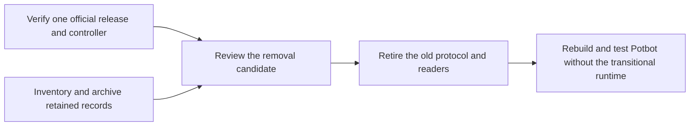

# SYN-R07 official-release parity

**Removal gate held.** Syn 0.8.0 and the exact Potbot controller below are
qualified for disposable Agent enrollment, private messaging, revocation,
operator recovery and legacy archival readback. The cutover requirements have
separate evidence. The Potbot checkout keeps the historical runtime and its test jobs.
Potbot distributions use only the independently released Syn path.

## Qualification pins

| Item | Exact pin |
| --- | --- |
| Official Syn | `0.8.0`, source `74f6ef75d77ab6aa00fb49d30ec446e3a6d4ebcd` |
| Signed manifest SHA-256 | `0ee89e2b5e27d38827e6d75ef25e7bca1ed1e0f40a5360df07404595912ec1d0` |
| Release authority SHA-256 | `a47f15e010613c0a839a48f2035b8f71d6f9e46ee3df07ed58487079d56ae216` |
| Potbot controller under test | `1862281634cf838f4d601162018afb948ab79dfb` |
| Transitional fixture tree | `ac34b663b65999744a74ac872931198dc3734e85` |

The [immutable release](https://github.com/Synsphere/syn/releases/tag/v0.8.0)
and [public asset check](https://github.com/Synsphere/syn/actions/runs/41768592689)
bind all seven assets to these release pins. The
[controller change](https://github.com/kieransimkin/potbot/pull/31) keeps the
original registration and requires signed readiness for the selected epoch.

## Parity evidence

| Behavior | Result and scope |
| --- | --- |
| Signed LAN discovery, protected pledge intake and explicit reservation | **Pass on 0.8.0.** Two separate sandboxed Agents enrolled and restarted on both Python versions in the [official Agent matrix](https://github.com/Synsphere/syn/actions/runs/41769604308). The [0.5.0 release](https://github.com/Synsphere/syn/releases/tag/v0.5.0) introduced this path. |
| Operator identity, selected Agent key, native group custody and local IPC | **Pass on 0.8.0.** The official Agent matrix used separate UIDs and keystores, authenticated readiness, restart and locked-custody refusal. The earlier [0.3.1](https://github.com/Synsphere/syn/actions/runs/41743928436) and [0.4.0](https://github.com/Synsphere/syn/actions/runs/41743474691) runs retain their historical acceptance. |
| Private messages and Cog grants | **Pass on 0.8.0.** The official Agent matrix exercised signed reception, one-use grants, refusal on changed task or missing grant, and fencing when the relay stopped. The [monitored authorization gate](38-operator-worker-qualification.md#authorization-with-official-syn-packages) exercises positive Cog dispatch and grant refusal in a disposable Ubuntu fixture. Deployed host qualification remains separate. |
| Revocation and epoch rollover | **Pass on 0.8.0.** After reopening both native keystores, the revoked Agent was refused with either epoch pin. The retained Agent kept its identity and assignment, refused the previous roster and joined epoch 2 through Potbot's mesh. [Official Agent matrix](https://github.com/Synsphere/syn/actions/runs/41769604308) |
| Operator recovery into a fresh native keystore | **Pass on 0.8.0.** Restored the pinned identity, protected control, adoption and LAN state into a fresh native keystore. Refused invalid, stale, partial and conflicting recoveries. [0.8.0 recovery run](https://github.com/Synsphere/syn/actions/runs/41770523153) |
| Original Phase 42 receipts and replay tombstones | **Pass on 0.8.0.** The four source snapshots matched the archived bytes. The original receipt and tombstone matched readback, both receipt signatures verified and a tampered archive was refused. [0.8.0 archive run](https://github.com/Synsphere/syn/actions/runs/41770521915) |

The Linux Agent matrix used Python 3.12 and 3.13. Operator checks include Linux,
Apple silicon macOS and Intel macOS. The artifacts describe disposable nodes and
generated enrollment records. Live installations require their own inventory
and acceptance.

## Disposition of the Phase 42 interfaces

| Historical surface | Replacement and disposition |
| --- | --- |
| `scripts/syn_phase42_preflight.py` and `SynStartupPlanner` | Use the signed-release installer and the [operator attachment path](syn-operator-deployment.md) for new operator readiness checks. Provision an Agent through the [released Agent controller](syn-agent-deployment.md). Retire the historical preflight script with its last caller. |
| `SynLocalDaemonClient` and `adoption_receipt.get` | Use the released client's signed readiness and assignment checks for active deployments. Route historical receipt lookup to `syn-operator legacy-state receipt` on an operator-pinned archive. Retire the old socket reader once its callers and records are accounted for. |
| `SynAdoptionLedger` and Phase 41/42 SQLite projection | Archive exact snapshot bytes and verify the original signed receipts. New enrollment uses Syn's protected native state, and Potbot's PostgreSQL remains authoritative for execution. An old receipt proves its historical assignment. Activation requires live signed readiness and current policy. |
| Phase 47 handoff and Phase 48 LAN journals | Keep grant, receipt and replay commitments together under the operator pin. Read the retired records with `syn-operator legacy-state replay`. The current protected LAN inbox owns replay protection for new enrollment. |

The tracked-source audit found the Phase 42 planner invoked by its standalone
preflight script. The daemon reader and projection have their own legacy tests.
Confirm any external callers with the installation owner before retirement.

## Cutover and removal

1. Land the qualified controller and confirm its merged tree matches the
   tested commit. Requalify any intervening changes that affect the boundary.
2. Have the owner of each installation account for four roles in a private
   cutover record. Record the public operator pin, the network and whether
   each receipt ledger, handoff journal, LAN inbox and Potbot projection is
   present or verified absent. Identify the owner of every remaining old
   socket client. An unavailable host or unknown journal stays open.
3. Quiesce legacy writers. For records that exist, make and pin standalone
   SQLite snapshots. Use the [Syn archive guide](https://github.com/Synsphere/syn/blob/74f6ef75d77ab6aa00fb49d30ec446e3a6d4ebcd/docs/development/legacy-state-archive.md)
   to verify archived readback of the original receipt bytes and replay
   commitments. Keep the source and archive pins separately under operator
   custody. Retire old protocol entry points after verified readback. Use the
   read-only archive if a historical lookup is needed after cutover.
4. Review one removal candidate covering `syn-node/`, the retired Phase 42
   interfaces and their callers. Remove or replace the four legacy-only jobs
   `syn-node-service`, `syn-python-hd`, `syn-inherited-adoption` and
   `syn-p2p-lan` together. Preserve the still-applicable contract checks from
   `syn-agent-enrollment`. Build both Potbot distributions and run the
   released multi-Agent suite against the resulting tree. Pin the legacy
   writer independently of the new controller for archive compatibility checks.
5. Keep deployed service changes subject to the owner’s host and rollback
   approval. Review U06-D's PostgreSQL reconciliation and U03/U16 host
   qualification separately before any general rollout.

The diagram shows the cutover decisions. These are headless
workflows with private custody prompts, so the linked CI evidence supplies
the test results and the guide uses a diagram for the operator sequence.
