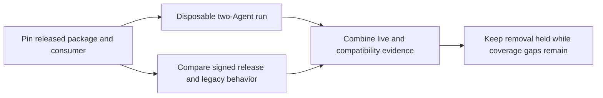

# SYN-R07 official-release parity

**Removal gate: held.** The official release supports the current local native
Agent flow. Some capabilities in the standalone transitional package have no
qualified successor in the pinned release. Keep the package and its historical
test jobs available while those gaps are resolved.

## Tested identities

- Potbot consumer `489203fd21e6891738b4f3cf2abd120b552597f2`.
- Transitional `syn-node/` tree `ac34b663b65999744a74ac872931198dc3734e85`.
  The tree matches the one exercised by the retained legacy jobs below.
- Official Syn 0.3.1 source `bb5f458fab11de6de408d19f53cc21524a1f7735`
  and manifest `10da08e7b0af7d32c48a3087e873c2e448e846e2e3aac6ad56df81330267b4f1`.
- Official Syn 0.4.0 source `6205baf95b87193133d45c749a0fe5d5b577581f`,
  manifest `a406356fba844a28c04870e45299ccd83e406b5dbe8b7a55741db6d5a6cd1088`,
  and independently approved authority
  `a47f15e010613c0a839a48f2035b8f71d6f9e46ee3df07ed58487079d56ae216`.
  Independent inspection verified the detached signature and the runtime wheel
  SHA-256 `49f53382314626869fb6439b4869960e7677ead8a367f9ba28cf914c3fd674c9`.
  The [upstream release record](https://github.com/Synsphere/syn/blob/9cd898692aeea5ea336930057647d4393bf9af9d/docs/development/releases/v0.4.0.md)
  supplies publication and pin provenance.

## Parity evidence

| Behavior | Evidence and result |
| --- | --- |
| Operator identity, selected-leaf adoption, native group custody and local IPC | **Pass on Python 3.12 and 3.13 for both releases.** The [0.3.1 run](https://github.com/Synsphere/syn/actions/runs/41743928436) and [0.4.0 run](https://github.com/Synsphere/syn/actions/runs/41743474691) each exercised a disposable operator and two native Agents with separate UIDs and keystores, authenticated readiness, retained identity across node/session restart and locked-custody refusal. Independent readback verified seven historical signed status receipts per job with the corresponding official SDK wheel. |
| Private Agent messages and Cog grants | **Pass on 0.4.0, Python 3.12 and 3.13.** The [0.4.0 run](https://github.com/Synsphere/syn/actions/runs/41743474691) exercised the public Potbot adapter, one-use grants, changed-task and missing-grant refusal, and relay-loss fencing. Independent readback verified two historical signed peer receptions per job. 0.3.1 predates that profile. Positive audited Cog process dispatch remains an independent host gate. |
| Signed LAN discovery and confidential pending-pledge intake | **Gap.** The [Phase 48 tests](https://github.com/kieransimkin/potbot/actions/runs/41350871903) cover signed discovery and encrypted TCP intake with durable pending records and replay tombstones. Syn 0.4.0 supports local encrypted enrollment and a bounded post-enrollment pub/sub cohort. Its service-mode libp2p discovery does not bind operator pulses to the protected intake flow. The signed wheel has no `syn-p2p` entry point or pending-inbox contract. |
| Private recovery into a fresh native keystore | **Gap.** The [legacy recovery suite](https://github.com/kieransimkin/potbot/actions/runs/41350871933) covers private-terminal BIP-39 recovery with an independent base-key pin and overwrite refusal. Syn 0.4.0 supports retained-state restart and detects stale anchored state. Its signed wheel exposes neither `show-recovery` nor `recover-operator`. |
| Phase 42 public receipt reads and retained legacy records | **Gap.** The [legacy service](https://github.com/kieransimkin/potbot/actions/runs/41350871991) and [adoption](https://github.com/kieransimkin/potbot/actions/runs/41350871840) jobs exercise immutable public receipt storage, signed lookup and conflicting-write refusal. The official path verifies native adoption certificates and fresh readiness through the new SDK. It has no qualified import or compatibility path for the old receipt and replay records. |
| Group revocation and epoch rollover | **Open acceptance gate.** Relay-loss fencing is tested. The [released pub/sub profile](https://github.com/Synsphere/syn/blob/9cd898692aeea5ea336930057647d4393bf9af9d/docs/development/private-pubsub.md) uses a frozen cohort and leaves general membership rotation open. |

The diagram summarizes the gate. CI artifacts supply the actual installation
and native protocol evidence. The fixture is headless and its custody prompts
are private.

## Required before removal

Potbot’s normal package and sandbox use the released Syn path. The transitional
distribution is separately installable. Its runtime and fixtures still own
the `syn-node-service`, `syn-python-hd`, `syn-inherited-adoption` and
`syn-p2p-lan` workflows. The historical Phase 42 client and its public-ledger
adapter need an explicit disposition alongside any legacy record migration.

1. Qualify an official protected LAN enrollment flow with two disposable peers,
   independently pinned operator identity, restart, duplicate and spoof
   rejection, and durable pending intake. Admission still requires separate
   operator approval.
2. Qualify a supported private recovery path that reproduces the pinned
   operator identity and preserves or explicitly reconciles protected
   enrollment state. Exercise a wrong phrase, partial destination, stale
   state and concurrent recovery.
3. Account for any retained Phase 42/48 records before retiring their readers.
   Preserve original signed bytes, immutable commitments and replay tombstones
   during a tested migration or read-only archival handoff. This audit did
   not inspect private installations or establish that they contain such data.
4. Exercise explicit member revocation and a new cohort/epoch against a released
   package, with a revoked peer refused after restart.
5. Repeat the official multi-Agent suite on the selected replacement release.
   Then remove the transitional package and its four legacy-only workflows
   together, with an install and test pass from the resulting Potbot tree.
