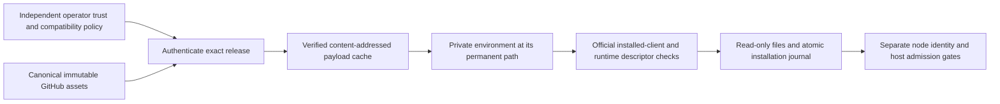
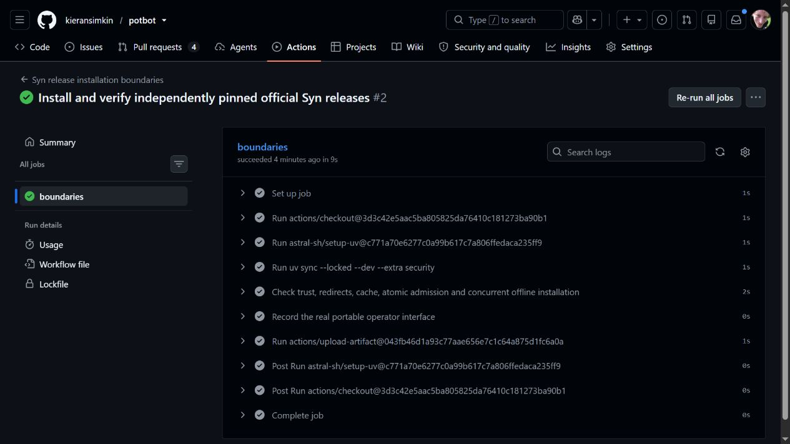

# Installing an independently selected Syn release

SYN-R02 introduces an operator-only package installer: `potbot syn-release`.
It consumes exact official assets from the canonical `Synsphere/syn` GitHub
release channel. It never builds Syn from a source checkout or activates the
transitional `syn-node/` implementation. Linux x86-64 is the initial installer
host; the CLI help remains portable. Windows native installation is a separate
qualification, even where an upstream client wheel supports Windows.



*Conceptual package admission flow. The diagram does not show an installed
operator or Agent node. The public boundary tests use disposable signing keys
and synthetic payloads; the private upstream acceptance workflow uses the actual
official release without publishing its access token or private records.*

## Prepare independent trust

An operator provisions a private absolute store outside every Agent home, using
a separate host identity from Agents. The policy file and its directory must be
operator-owned, without group/other access or symbolic-link parents. Missing or
corrupt existing registration never creates a replacement identity. Installation
uses the authenticated caller's UID; do not expose this API through model tools,
web requests or startup auto-repair.

The closed `potbot.syn-install-policy/1` object contains:

| Selection | Fields and meaning |
| --- | --- |
| Publisher | `repository` must be `Synsphere/syn`; `public_key` is the independently approved raw Ed25519 public key in hex; `release_key_sha256` binds that public key |
| Exact release | Stable `version`, full `source_commit`, and canonical `manifest_sha256`; no `latest`, branch, prerelease or metadata-derived trust |
| Offline dependencies | `dependency_cache_sha256` is null for initial online preparation, or the independently retained digest from a trusted preparing installation receipt for a fresh offline runtime |
| Current restrictions | `minimum_version`, sorted `revoked_keys` and `revoked_manifests`; restrictions are checked again on every operation |
| Installation | `component` is `runtime` or `client`; `mode` is explicit for a runtime and null for a client; `python_version` is `3.12` or `3.13` |
| Compatibility | Sorted explicit `required_profiles` and `required_capabilities`; missing requirements fail without negotiation |

Use the upstream's retained release receipt and independently approved authority
policy to populate these selections. Downloading a key and digest from the same
untrusted asset is not independent trust. The selected public key is never an
operator/Agent identity key. Private release-signing keys are never an installer
input. No actual private-repository policy or credential is bundled in Potbot.

For a private repository, provide read-only access as `POTBOT_SYN_GITHUB_TOKEN` in
the operator environment. The token goes only to the fixed canonical GitHub API,
never to redirected asset hosts, child processes, receipts or CLI output.
Redirects are HTTPS-only and restricted to GitHub's approved asset CDNs. Reads,
redirect counts, retries and subprocess output/deadlines are bounded.

## Fetch, install and verify

Install Potbot's `security` extra. Provision the private store and policy, then
use explicit trusted absolute executable paths for Python and reviewed uv
`0.12.23`:

```bash
potbot syn-release fetch --store /operator/syn-packages --policy /operator/policy/syn.json
potbot syn-release install --store /operator/syn-packages --policy /operator/policy/syn.json \
  --python /trusted/python3.12 --uv /trusted/uv
potbot syn-release verify --store /operator/syn-packages --policy /operator/policy/syn.json
```

These paths are illustrative. The caller must provision their actual operator
paths and independently approved policy; the commands do not grant host access.
A runtime must declare the requested mode before any package code executes.
The first official release declares only `service`: operator and Agent requests
remain blocked regardless of a successful package installation.

The bootstrap adapter verifies the independently pinned canonical manifest,
Ed25519 signature, exact tag/source, immutable non-draft publication and all five
payload digests. It checks wheel paths without unpacking archives. Only the
signed official wheels are installed; sdists remain retained verification
inputs. Runtime dependencies use the signed hashed export with binary-only
resolution from PyPI. Missing compatible dependency wheels fail closed.

The installed official `syn-client` repeats schema and compatibility checks.
A runtime also repeats official signature verification and must report exactly
the signed descriptor via isolated `syn.server --describe-json`. This operation
loads no configuration, opens no database and starts no node. The dependency-free
client library has no node descriptor; its installed distribution version is
checked without claiming runtime behavior.

A private environment is built at its final stable path because relocating a
virtual environment breaks executable paths. No journal entry admits that path
until its package checks succeed and files are sealed read-only. A single fsynced
atomic registry replacement publishes provenance and retained admission history.
Interrupted directories remain unadmitted and require explicit operator
reconciliation. Installation does not rewrite a live process or select an active
node. Existing identities, enrollment state and databases are outside this store.

## Offline use, concurrency and refusals

`fetch` retains all five payloads plus the canonical manifest and signature.
`install --offline` rechecks them. A fresh offline runtime requires the complete
private dependency cache, its retained inventory, and an explicit
`dependency_cache_sha256` adopted from the trusted preparing installation
receipt. Every dependency-cache file is checked against that inventory before
uv can consume it. Official local wheels use `--no-cache` so cached unpacked
code cannot substitute for their authenticated bytes. It performs no online fallback.
Retain `uv-cache/` and `dependency-cache-inventory.json` with the payloads when
preparing an offline host; carry the independent digest through trusted policy. Offline success establishes retained-byte verification, not a fresh GitHub
query or fresh knowledge of external revocation; the current operator policy
still supplies the revocation decision.

An operator-private `flock` serializes acquisition and admission. A competing
operation waits at most ten seconds and otherwise refuses; it never overlaps an
unfinished installation. Repeated successful selection verifies the existing
installation rather than replacing it. Exact version, artifact hashes, release
source, authority and policy digests, installed-file inventory, tool identities,
observed compatibility and acquisition mode are retained in `registry.json`.

Every explicit `verify` checks the full retained file inventory, including
permissions, extra files, hardlinks and escaping symlinks, before running the
read-only descriptor. Altered cache data, installed files or provenance fail.
Current revocations apply to existing installs. The version floor and retained
history reject downgrades and redefinitions of an admitted version. This is not
rollback-resistant identity storage: protected-state migration, revocation
refresh, authorized upgrade/restore and rollback policy remain SYN-R06 work.

## Evidence boundary



*Actual public CI at consumer revision `9647c759ad895bfde2e8c23493e9965af24a78bb`,
[run 41391526279](https://github.com/kieransimkin/potbot/actions/runs/41391526279).
All 41 then-current security and Linux store cases passed. Later changes require
fresh checks at their own revision; this screenshot does not prove installation
of a private official package or a running node.*


The focused public CI runs real signature/redirect/archive negative cases and
Linux cache, interruption, concurrency, offline and tamper cases using explicitly
synthetic packages. It also records actual CLI help. Official-package acceptance
is separate upstream CI against an explicitly reviewed Potbot commit and exact
independently pinned release. No public fixture result qualifies a real node.

There is no new installed-node UI to capture. The conceptual flow and retained
CLI/CI output explain this command-line package boundary. An actual multi-node
video belongs with SYN-R03 onward, after supported node modes and hosts exist.
