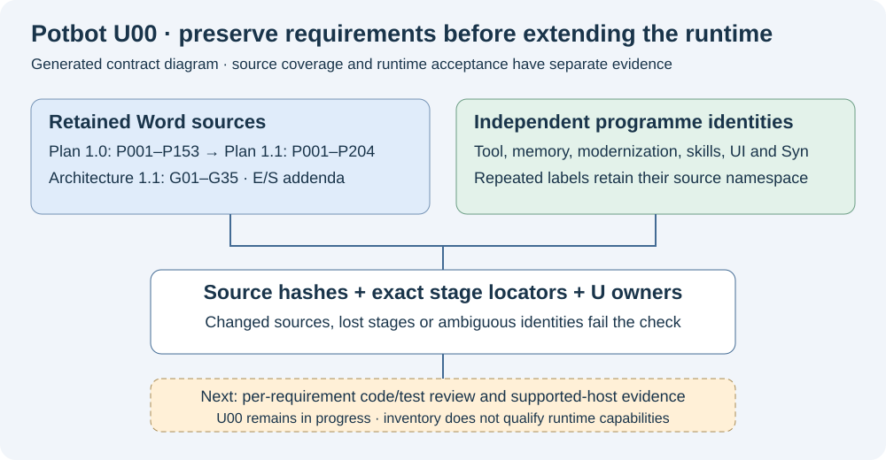

# U00-A closeout: roadmap and evidence reconciliation

**2 November 2026. Product baseline: `95610037311c80cdf7163372998b08e1b8958926`.**
U00-A is complete as a requirements audit. The next Potbot implementation milestone
is **U01-A: durable side-effect and crash recovery gap closure**. Product and
production-host qualification remain separate and incomplete.



*Generated architectural illustration. It explains the audit boundary; it is not
a runtime screenshot or evidence of a production deployment. No runtime interface
changed in this milestone, so a screenshot/video of a new feature would be
misleading. Existing relevant debugger, tool and Syn demonstrations remain beside
their delivery guides; their original fixture/host limits still apply.*

## What was reconciled

The [inventory](roadmap-inventory.json) discovers all tracked and unignored
documentation sources. The separately authored [review](roadmap-review.json)
records a disposition for each source and each of **731 explicit source rows in
21 independent programme namespaces**, supported by **39 capability assessments**.
Historical duplicates are retained: 731 is not a count of unique capabilities.

The scope includes all five retained Word documents, Markdown plans and guides,
JSON/CSV stage and historical verification records, root/developer documentation,
and media identities. Complete textual coverage uses Markdown sections, every
Word paragraph including table cells, and whole structured artifacts. This avoids
finding only sentences containing “must” and losing narrative requirements.
Examples and historical reports remain source data rather than commands or fresh
test results. Word paragraph locators do not imply rendered pages.

The product baseline contained 196 documentation assets. This closeout adds this
guide and updates the audit records, roadmap, README and illustration, bringing
the discovered source count to **197**. Audit-tool and test edits belong to this
closeout delta; current product runtime source remains at the pinned baseline.
Baseline CI is evidence for that baseline. The closeout's own PR must pass CI
before merging its new audit code and tests.

Each named row retains its original title, claim, source locator and hash. Its
review adds a requirement-specific disposition, U ownership, assessment, remaining
blockers and next action. Capability assessments link **hashed code and test
symbols**, describe their actual support scope, and distinguish existing
foundations from missing integration or qualification. A shared assessment is
explicitly limited; it does not assert that one test proves every linked row.
Planned capabilities have no invented implementation/test evidence.

GitHub inspection covered **all 24 PRs, zero non-PR issues and all 32 workflow
definitions**, with each workflow's latest inspected run and exact source head.
The two open PRs were read separately at their pinned heads, including **44
branch documentation files** and **24 SBT work packages** in PR1. Their proposed
code is outside main. The audit PR itself is a subsequent administrative delta.
The historical private conversation inputs are the two retained source-linked
reconciliations, not a new recursive search of private chat storage.

## Decisions and remaining product work

| Area | Reconciled conclusion | Owner / next action |
| --- | --- | --- |
| Plan versions | Plan 1.1 retains P001–P153 and adds P154–P204; Architecture 1.1 has G01–G35. Original user U IDs, unified U IDs, architecture G, tool-gap G, worker G, sandbox S and external-skill S remain distinct. | U00: retain checked namespaced IDs and source chronology. |
| Durable execution | Existing `ExecutionStore`, `ToolGateway`, outbox, receipt recovery, leases, task budgets and PostgreSQL reasoning checkpoints already exist. Local-tool tests include lost acknowledgements, duplicate delivery and stale recovery owners. | U01-A: close cross-producer gaps using these owners; add no replacement scheduler/store. |
| Monitoring | Core execution journal and REST/WebSocket replay exist. Universal model/MCP/workflow/internal-producer coverage and complete causal/measurement trees remain partial. | U01/U03/U04/U13: enumerate producers and qualify actual trigger/emitter, child runs, cursor recovery and loss. |
| Context authority | Application migrations 29–33 and Stage 10D supersede the standalone context prototype as the application baseline. Root MODEL/MEMORY are development records. | U09: preserve PostgreSQL authority, controlled data-only projections, scoped RPC and per-launch snapshots; close remaining constructor/protocol coverage. |
| Memory | Context triples and embeddings do not implement admitted per-object memory. All MG stages remain `not_started`/`not_run`; accepted-head CAS, correction, applicability, deletion-safe restore and federation are future work. | U10: follow the existing MG dependency cut, beginning with admitted identity/contracts. |
| Semantics/embeddings | Canonical catalogs, exact snapshot lookup and standard/named embeddings are foundations. Complete typed descendants, seven question profiles, meaning-preserving packets, hybrid/ANN quality and portability are not all qualified. | U04/U09/U10/U14: qualify coverage and standard retrieval before optional learned spaces. |
| Tool lifecycle | S9–S11 include tested activation and independent runtime repin checks. S12 is not established: `AiWorkspaceOperator.status` only reads a release-gate table; it does not supply its complete writer/enforcer. | U02/U04/U16: implement/recover postflight/release enforcement and rollback; S11 approval or S13 health is insufficient. |
| Guest logs | No owning S36 guest-log implementation was found in inspected main. S17 protects host Xpra `/var/logs/ai/operator`; it does not establish creator-only guest `/var/logs/ai`, aliases or retention. | U02/U03/U16: recover/implement S36 and qualify the actual guest mounts, writes, archive and recovery. |
| Syn distribution | Official signed release installation and real native operator/Agent paths now exist. Syn 0.4.0 consumer CI qualifies native identity, grant and heartbeat boundaries. It explicitly dispatches no positive audited Cog process. | U06/U03/U16: retain independent real host/accounting gates; finish SYN-R06/R07 before general rollout. |
| Syn durable authority | Old local SQLite enrollment/operator journals still need an explicit authority/migration contract relative to Potbot's PostgreSQL projections and Syn-owned custody. | U01/U06: preserve signatures, identity, uniqueness and replay state; no destructive migration in this audit. |
| Open PR1 | [PR1](https://github.com/kieransimkin/potbot/pull/1) contains governance/protected signing/shared-transaction/SBT requirements, not current-main implementation. Its vendored-submodule/private-build assumption conflicts with the later mandatory independent-release contract. | U06/U01/U16: retain per-Type authority/finality/recovery requirements; adapt public consumers to qualified official upstream releases. No automatic sender or consensus activation. |
| Open PR13 | [PR13](https://github.com/kieransimkin/potbot/pull/13) proposes installed MCP/API/CLI Cog factories and source-bound whole-programme acceptance. Those factories and acceptance claims are outside main. | U04/U01/U16: review/rebase against current released-Syn grants and production dispatch boundaries before integration. |
| Host and UI | Linux/WSL sandbox source contracts do not qualify this host's cgroup delegation, TASKSTATS, syscall-loss detection, concurrent hostile agents or Xpra lifecycle. Top-eight busy-CPU attribution is partial. | U03 before U06 joint lifecycle; U13 retains 60 BPM, weighted 180-second glow, separate 2-second flash, every-agent access and honest metric denominators. |
| Models and learning | Listed/downloaded models differ from selected/runnable/host-qualified deployments. Synthetic fixture scores are not live held-out quality. P149/P150/P152/P202/E09 remain optional post-baseline experiments. | U07/U14: pin actual models, tokenizers, tasks, costs and independent oracles; preserve reversible promotion and explicit training consent. |
| Skills, frontend and automation | Native authored skills, saved chat and a job queue are foundations, not full cross-agent compatibility, durable background inference, resumable PTY or durable triggers/A2A. | Existing C/S/T/U11/U13/U15 plans retain their requirements and dependencies; no duplicate registries or authorization services. |

The machine review contains the complete mapping, including research/reuse,
artifact transfer/retention, tool specialists, configuration watching, browser
control, provider protocols, backup/restore and release gates. Existing tool/MG
registry states are preserved; this audit does not promote them.

## Executed evidence and its limits

At the pinned baseline, all seven reported checks completed successfully:

- [Core verification, native identity and Windows launchers](https://github.com/kieransimkin/potbot/actions/runs/41532663749).
  The core job includes real PostgreSQL, sandbox/application, context, migration,
  clean-wheel and selected source-bound Cog acceptance checks.
- [Roadmap inventory](https://github.com/kieransimkin/potbot/actions/runs/41532663829),
  [Syn installation boundaries](https://github.com/kieransimkin/potbot/actions/runs/41532663812)
  and [KeywordMoves offline acceptance](https://github.com/kieransimkin/potbot/actions/runs/41532663681).

The old mypy failure at `63a7ba0` is historical and resolved; it no longer blocks
this reviewed main. Other workflow results in the review name their **own** heads.
Path-filtered jobs did not all execute at `9561003`. S46's live smoke is an
explicit qualified self-hosted workflow, separate from its hosted source tests.
Conditional skips, disabled physical devices and older preview results do not
qualify production. Passing a whole CI workflow does not promote every linked
plan row or silently enable a feature.

[Official Syn 0.4.0 native consumer acceptance](https://github.com/Synsphere/syn/actions/runs/41526414147)
passed both Python 3.12 and 3.13. Its evidence concerns actual native Syn
installation/identity/private heartbeats/restart/fault behavior, not positive
kernel-audited Cog dispatch. The retained production operator is a separate
installation; this audit neither upgrades it nor creates a new identity.

## Inaccessible evidence and continuation

P6-001–P6-045 saved artifacts and the exact historical saved tool-platform/security
design artifacts are unavailable in the inspected main/PR sources. Their
referenced requirements remain mapped; their contents and qualification are not
invented. U08/U04/U06/U16 own reconciliation if the exact originals are recovered.
Unavailable production-host evidence remains an explicit acceptance gate, rather
than an unmapped audit requirement.

U01-A starts by enumerating actual dispatch producers and their existing
intent/lease/budget/receipt owners. Its first extension is a controller-admitted
transport effect using a controlled local service, after reviewing PR13's current
integration. Required fault cases are:

1. Crash before intent: zero external attempts.
2. Crash after intent, before dispatch: recover only under the current fence.
3. Crash after effect, before acknowledgement: one attempt; resolve from retained
   target/receipt evidence or remain indeterminate without blind replay.
4. Crash after receipt, before settlement: reconcile the same receipt once,
   without double release of money, usage or concurrency.
5. Duplicate delivery, stale owner, changed task/repository/policy, pause/cancel
   and restart: reject stale writes and preserve causal evidence.

Use real PostgreSQL transactions and restricted roles. Fixture transport tests
qualify the stated recovery contract, not a remote provider or production host.

## Keeping the audit honest

```sh
uv run --locked python scripts/roadmap_inventory.py
uv run --locked python scripts/check_tool_plan.py
uv run --locked python scripts/check_memory_graph_plan.py
uv run --locked python -m pytest -q tests/unit/test_roadmap_inventory.py
```

The checker validates every source/stage disposition, hashes and code/test symbols,
all workflow mappings, the exact CI base and named inaccessible evidence before
setting `u00_exit_met=true`. `runtime_qualified` remains **false**. Narrative
coverage includes all text, not only a keyword-selected subset. The authored
review is excluded from its own source list and hashed separately in the inventory
to avoid a self-reference. `--refresh` regenerates the inventory **only after**
the review validates; it cannot write a review or repair stale assessments.
When a plan/source/evidence owner changes, explicitly renew the affected review.
Offline validation detects drift; it does not authenticate arbitrary CI JSON or
prove that an author's judgement is correct. Service links and pinned identities
make that judgement reviewable.
