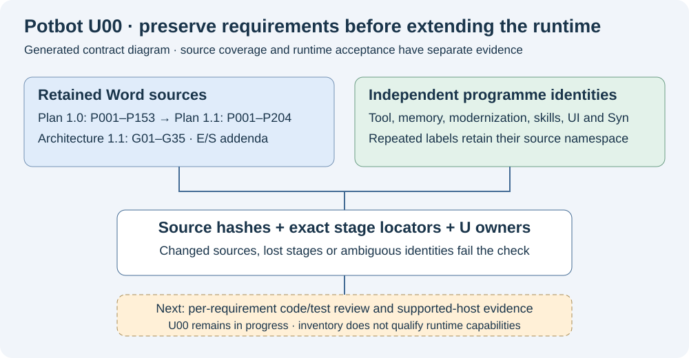
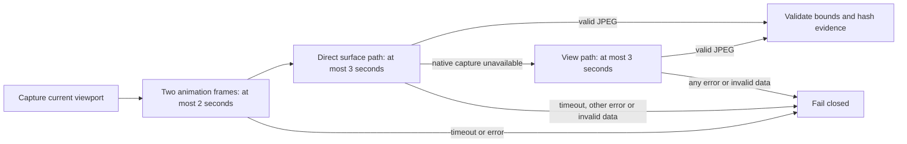

# U00 source inventory and first implementation increment

**2 November 2026. Reviewed GitHub main: `63a7ba08d4c3a4fe9530add78dbcd371ea6e97b2`.**
The [unified roadmap](unified-development-roadmap.md#first-next-milestone) makes
U00-A the first milestone, followed by U01-A durable-effect recovery. P001–P005
and tool stage T01.1 already have implementations; restarting them would discard
the later execution, context and sandbox work.

This increment implements a reproducible source inventory and explicit-stage
crosswalk. It resolves a material omission in the consolidated plan: the retained
**Plan 1.1 has 204 steps**, and **Architecture 1.1 has 35 qualification gates**.
The earlier reconciliation covered the original 153 steps and 24 gates.



*Generated explanation of the implemented inventory boundary. Source presence,
reported completion, executed tests and deployment qualification remain distinct.
There is no new runtime interface or node deployment to screenshot. A video of
this static crosswalk would add no acceptance evidence.*

## Sources and precedence

The baseline contains 185 documentation assets: 144 Markdown documents, five Word
documents, 21 JSON files, two CSV files and 13 images/recordings. The inventory
also includes this increment's new documentation. It discovers tracked sources
and unignored additions, so a new unstaged plan cannot silently escape the check.
Ignored local evidence and dependency trees are excluded.

All five Word sources are opened as bounded OOXML archives and their document
paragraphs, including table cells, are extracted without running Office, macros,
embedded objects or examples. Locators identify `word/document.xml` paragraph
ordinals; they do not claim Word page numbers or rendered-layout fidelity.
Media hashes identify assets, without certifying the behaviour pictured in them.

| Source | Verified identity and interpretation |
| --- | --- |
| [Original implementation plan](../Multi_Model_Coding_Agent_Implementation_Plan.docx) | Plan 1.0; P001–P153, retained as historical requirements and source claims. |
| [Revised implementation plan](<../Multi_Model_Coding_Agent_Implementation_Plan (1).docx>) | Plan 1.1; P001–P204, preserving the original IDs and inserting P154–P204 in dependency order. Numeric order is not execution order. |
| [Architecture specification](../Multi_Model_Coding_Agent_Architecture_Specification.docx) | Baseline 1.1; G01–G35. G25–G35 add semantic completeness, protocol/provider qualification, uncertain effects and executed reuse gates. |
| [Embedding addendum](../Local_Embedding_Addendum.docx) | E01–E09; qualify standard embeddings before optional learned spaces. |
| [Semantic addendum](../Agent_Semantic_Vocabulary_and_Semantics_v0_1.docx) | Local S01–S12; semantic meaning, coverage and profiles. These S IDs differ from sandbox/browser and external-skill S IDs. |

The revised plan reports 198 core and six optional steps. P202 is the added
optional learned-projection experiment. Preserve those source claims without
turning them into current runtime verdicts. For example, Plan 1.1 still labels
P154–P157 planned, while [the later Phase 3 guide](../phase-3.md) describes their
implementation. A crosswalk must retain this chronology and seek exact code/test
evidence, rather than downgrade existing work or promote an old status to truth.

Original user requirements U01–U15 also differ from the unified U00–U16 work
packages. Architecture G01–G35, tool-gap G01–G18 and monitoring G1–G7 have separate
meanings. Machine keys qualify the namespace, for example `architecture-1.1:G01`,
`tool-gaps:G01`, `worker-gates:G1` and `unified:U01`.

## Repeatable check

```sh
uv run --locked python scripts/roadmap_inventory.py
uv run --locked python scripts/check_tool_plan.py
uv run --locked python scripts/check_memory_graph_plan.py
uv run --locked python -m pytest -q tests/unit/test_roadmap_inventory.py
```

[The policy](roadmap-inventory-policy.json) declares 21 programme namespaces,
source selectors, expected IDs, U ownership and candidate code/test integration
anchors. [The generated inventory](roadmap-inventory.json) retains source hashes,
Word/text identities, exact stage locators, requirement-block hashes, original
status claims, blockers and next actions. The current explicit-stage crosswalk
has 731 rows, including both historical P-series variants. That is a source-row
count, not 731 independently qualified or unique product capabilities.

The checker rejects changed/missing sources, new documents absent from the saved
snapshot, duplicate/missing/added declared stages, missing programme namespaces,
unknown U owners and altered qualification flags. It hashes CI workflow files
and checks that candidate integration anchors exist. An anchor is a review lead,
not proof that a particular requirement has been implemented or tested.

After reviewing source changes, explicitly refresh the generated snapshot:

```sh
uv run --locked python scripts/roadmap_inventory.py --refresh
```

Refresh cannot mark runtime work qualified or close U00. It does not fetch
GitHub, execute documentation examples, import inspected modules, install tools,
load models or modify application databases. The existing tool and memory-plan
checkers retain their separate parity/dependency semantics. CI runs this audit
lane independently of the application lane.

## GitHub and implementation evidence at the checkpoint

The GitHub API and fetched `origin/main` agreed on the pinned baseline. The audit
retrieved all 13 PRs and zero non-PR issues. [PR 1](https://github.com/kieransimkin/potbot/pull/1)
and [PR 13](https://github.com/kieransimkin/potbot/pull/13) were open; their branches
are not assumed merged into main. The latest preview release was `v0.5.0.dev8`;
a release version and the newer main revision are separate identities.

The baseline [Potbot verification run](https://github.com/kieransimkin/potbot/actions/runs/41358430672)
failed during mypy. Consequently its complete application and later acceptance
sequence did not qualify that source revision. The native-identity and Windows
launcher jobs passed. The separate [KeywordMoves workflow](https://github.com/kieransimkin/potbot/actions/runs/41358430677)
passed its selected scope. Preserve each result independently. Saved historic
verification JSON and screenshots are not fresh results for current main.

The later R6/R6.1 and context Stage 10D implementations remain integration
foundations. PostgreSQL is authoritative; historical standalone context and
SQLite designs must not replace application migrations 29–33. Models, retrieved
documents, source claims and signatures do not confer execution authority.

Potbot must preserve its [release dependency gate](syn-release-dependency-and-node-deployment.md).
SYN-R01 inventory and a proposed package contract cannot substitute for an actual
official signed release with qualified operator and Agent modes. The transitional
`syn-node/` runtime is not a production fallback.

## Completion boundary and next work

**U00-A is in progress.** This source/stage inventory is implemented; its
`u00_exit_met` and `runtime_qualified` fields remain false. It is not an assertion
that every narrative requirement has been manually reconciled or every historical
implementation claim independently verified.

Continue the requirement-level code/test reconciliation, including narrative-only
requirements, context/worker protocols, U03 accounting, U06 custody and supported
host gates. Retain S12 release enforcement, S36 guest `/var/logs/ai`, unavailable
P6-001–P6-045 artifacts and authoritative-journal migration as named open items.
Complete the CI recovery checks below. Then define
U01-A against the existing intent, lease, checkpoint, outbox and accounting owners;
add no competing scheduler or state store.

There is no application migration, executable activation or change to the public
worker command schema. The continuation also repairs application typing and
bounded screenshot capture, as described below. Rollback the runtime repair
commit separately from the original audit commit; both leave the existing T/MG
registries and production data intact. No software release is claimed from an
audit check, and failed mandatory application CI remains a release blocker.

## CI recovery while preparing the increment

The initial PR application run reproduced all 158 baseline mypy errors. The
continuation repairs those contracts with typed records, concrete service
interfaces and explicit narrowing after existing admission checks. The complete
Linux type check now passes for 326 source files. No type-check exclusions or
blanket ignores were added. PostgreSQL remains authoritative, optional browser
packages remain optional, and isolated work still rejects arbitrary host callbacks.

Object and skill projections now share custody primitives through a common base,
while retaining their distinct inventory bounds and namespaces. Tool manifest
arrays and replayed steering decisions reject malformed structural data before
use. Interactive monitoring invokes the existing pinned native cgroup wrapper;
the obsolete reference to a removed Python pre-execution hook is gone.

The initial rendered-browser failure occurred while obtaining the first image,
before any click or fill. A later run also exposed Chromium's explicit
capture-unavailable error. Capture permits one private, read-only fallback:



*Conceptual flow of the implemented capture recovery. Neither branch performs
navigation, input or focus changes. The existing action protocol and no-replay
rule remain in force. This diagram is not evidence of a passing rendered run.*

The [CDP protocol source](https://github.com/ChromeDevTools/devtools-protocol/blob/master/pdl/domains/Page.pdl)
defines the view/surface selector and base64 screenshot result. Both attempts
share a six-second total deadline with a bounded two-frame readiness fence,
inside the worker's 12-second command deadline. The fence waits for rendering
without changing focus, navigation or page content. Invalid base64, missing/oversized images and malformed
JPEGs fail immediately. Only the selected engine's exact capture-unavailable
response permits the alternate read. A timeout may leave Chromium's capture
pending even after cancellation of the local wait; starting another capture can
then fail. Capture diagnostics established this overlap in the real acceptance
fixture. Direct surface capture now runs first, bypassing the higher-level font
readiness helper, and timeouts stop without overlap. Disconnection, permission
errors and cancellation also stop immediately. Regression tests cover actual
coroutine cancellation; synthetic unit images do not qualify a browser or host.

The next complete run reached 3,314 passing unit/Git tests, then exposed nested
AF_UNIX fixture paths and outdated CLI/service and migration-history fixtures.
The check runner now lets pytest allocate its own private tree directly under
`/tmp` on hosted Linux CI, preserving an explicit `POTBOT_TEMP_ROOT`. The pytest
child's standard temporary-file variables select the same parent for ordinary
`tempfile` socket fixtures; non-pytest checks retain the runner-owned tree.
Production socket permissions and admission checks remain unchanged. CLI fixtures now supply a real route
container and current service options; historical migration assertions select
versions 24/25 explicitly so later context migrations remain intact.

After the socket/fixture repair, the complete unit/Git lane passed 3,347 tests.
The PostgreSQL lane passed 322 tests and exposed three remaining expectation or
inventory gaps: default-model assertions retained the older five-model count,
and the committed-source inventory did not map the existing context namespace
or persistent service entrypoint. The assertions now check the declared model
catalogue and retain unqualified/health boundaries; inventory ownership and its
progress checks now include those existing sources explicitly. Capture-path
diagnostics use test output, preserving the rendered gate's closed identity
metadata schema.

Run the existing complete application, PostgreSQL, sandbox and four-profile
rendered acceptance lanes on the repaired revision before merging. Local Windows
checks do not qualify Linux namespaces, cgroups, Xpra or production node modes.
A successful audit lane still leaves the full U00 requirement reconciliation open.
