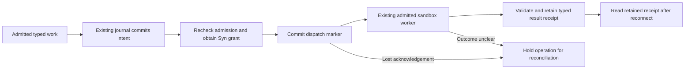

# U01-A: durable dispatch for sandbox transport effects

This first increment uses the existing PostgreSQL execution journal to record
mutating API, MCP and script work before entering the installed sandbox worker.
It adds no transport handler, scheduler, database table or host execution path.
Read-only work and direct trusted artifact/browser control services retain
their existing behavior.



*Illustration of the new journal boundary. There is no new UI, so a screenshot
or video would not add evidence of recovery. The fault test uses a labelled
worker RPC double with real PostgreSQL and restricted application roles; it does
not claim kernel, live Syn, provider or production-host qualification.*

Each mutating attempt claims the workspace, installed work kind and operation
reference in the existing journal. The workspace's commit-order lock makes
checking for unresolved attempts and recording the next intent atomic. An
active or indeterminate write blocks another invocation in that lane, including
after a controller restart or a task or policy change. Distinct operation lanes
remain independent. Unknown outcomes hold for operator reconciliation; this
increment does not resolve or clear them. The installed operation reference is
not yet a cross-operation business idempotency key.

The dispatch marker is written **before** entering `SandboxedCogExecutor`, after
admission and the Syn grant. If the commit acknowledgement is lost, no worker
call occurs; the observed marker still requires a hold because a marker alone
cannot establish whether a process started. Once execution may have occurred,
failed replies and incomplete observation remain indeterminate. A terminal
completion requires the marker and a retained result receipt.

The owner-scoped recovery read reports whether intent is pending, a run stopped
before dispatch, an outcome is indeterminate, or a receipt was recorded. It
verifies the intent hash and retained receipt bytes. It cannot retry work, settle
budgets, authorize another operation or independently verify an external effect.

The CI fault test covers zero attempts before durable intent, grant denial,
lost acknowledgement of the dispatch marker, a lost response after a possible
effect, a fresh controller attempting the same lane, foreign-workspace readback
and receipt recovery after loss of the final response. Reproduce against the
existing **disposable** PostgreSQL fixture:

```sh
uv run --locked python -m pytest -q tests/integration/test_sandbox_transport_recovery.py
```

Remaining U01-A work: bind an actual controlled transport service to the existing
sandbox worker, use target receipt/status evidence and a stable logical effect
identity, reconcile uncertain attempts under operator authority, and settle
budget and concurrency exactly once. Qualify concurrent admission, recovery and
lookup cost with a representative journal before enabling a production route.
Open PR #13's host callbacks cannot serve as executable worker installations.
