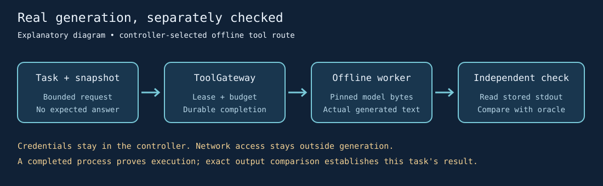

# Offline generation through a registered tool

The optional `potbot.models.local_tool` worker loads a pinned local causal model
inside the existing ToolGateway process boundary. This is operator-selected tool
execution. The fixture-only InferenceGateway and hosted provider routes retain
their existing contracts; this worker does not implement autonomous model choice.



*Generated explanatory diagram of the implemented route. It is not a screenshot
or evidence that a particular model, task or host passed qualification.*

The controller submits a normal task, captures the request repository, allocates
a candidate, claims its lease and reserves a call plus tool time. Register a fixed
ToolDefinition whose argv invokes the worker with these operator-owned values:

```python
ToolDefinition(
    "generate.local_text",
    "local_text_generation",
    (
        python,
        "-I",
        "-B",
        "-m",
        "potbot.models.local_tool",
        "--request",
        "request.json",
        "--model-directory",
        str(model_directory),
        "--model-id",
        model_id,
        "--revision",
        revision,
        "--manifest-sha256",
        manifest_sha256,
    ),
    mutates=False,
    timeout_ms=120_000,
    max_output_bytes=65_536,
    memory_bytes=24 * 1024**3,
    cpu_seconds=600,
    environment=(
        ("HF_HUB_OFFLINE", "1"),
        ("TRANSFORMERS_OFFLINE", "1"),
        ("HF_HOME", str(models_root / ".cache/huggingface")),
        ("HF_HUB_CACHE", str(models_root / ".cache/huggingface/hub")),
        ("TRANSFORMERS_CACHE", str(models_root / ".cache/transformers")),
        ("TORCH_HOME", str(models_root / ".cache/torch")),
    ),
)
```

Install the worker package and optional `embeddings` dependencies into the selected
Linux environment first. The operator owns model selection, licence review,
download, free-space checks and the immutable model manifest. Keep weights and
framework caches in the owning project's ignored `models/` directory. Model
provisioning is separate from execution: the worker performs no downloads.

The model directory contains `model-manifest.json` with `model_id`, a 40-character
commit `revision`, and a nonempty `files` array of `path`, `bytes` and `sha256`.
Include every file loaded by the tokenizer and model. Pin the manifest digest in
the tool definition; verify upstream weight digests before admitting the model.
ToolGateway mounts the workspace model area read-only. Only mount the installed
runtime and necessary source paths; exposing a parent of controller storage is
rejected. Keep the independent expected answer outside every mounted root.

The candidate's `request.json` has exactly `prompt` and `max_new_tokens`. Bounds
are 65,536 input bytes, 16,000 prompt characters, 4,000 rendered input tokens and
512 generated tokens. The worker uses local-only safetensors, disables remote
model code, runs float32 CPU inference with four threads, and decodes only the
newly generated tokens. It emits the actual text, request/model identities,
measured token counts, elapsed time and peak resident memory. Output text is data
to verify independently, never authority to run another command.

The normal process receipt and durable action completion establish execution.
Read the stored stdout artifact back and compare the generated result with the
independent criterion before marking the task verified. A successful worker exit
does not establish answer correctness. Native ToolGateway accounting settles calls
and tool time; emitted token counts are measurements, not InferenceGateway token
ledger entries or provider charges.

Resource limits are explicit operator policy. `memory_bytes` limits virtual address
space, not reserved RAM; `cpu_seconds` is a per-process CPU ceiling. The wall
deadline bounds the namespace. Qualify the actual Linux Bubblewrap/seccomp host
and size the profile for measured startup plus generation. Historical tools that
omit these optional fields retain their definition fingerprints and the existing
4 GiB/60 CPU-second defaults. Do not bypass isolation when a model needs a larger
declared profile.

This headless route has no graphical interface to capture. Its useful media are
the route diagram and the actual stdout, completion and verification receipts;
a screen recording of an idle terminal adds no behaviour evidence.
