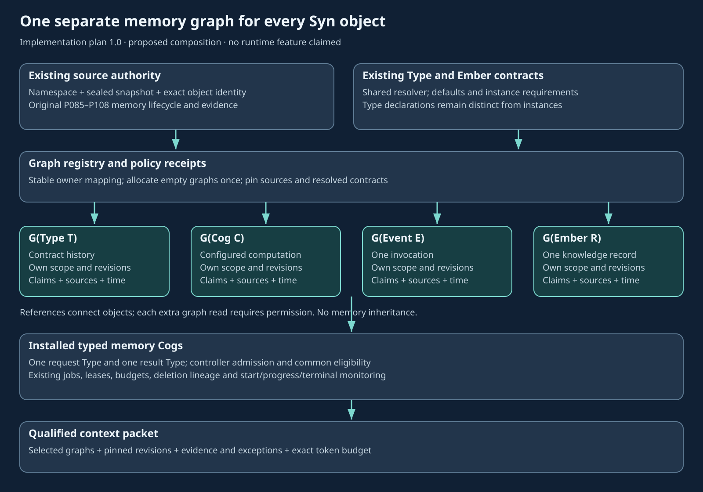

# Potbot per-object memory graph implementation plan

**Document version:** 1.0. **Date:** 23 October 2026. **Implementation state:** not started.

Implement one separately addressable memory graph for **every admitted Syn object identity** in Potbot. This includes all ten native kinds: Type, Thing, Event, Ember, Cog, Credential, Enigma, Pondle, Snug and Om. Connect graph memory to the existing Type hierarchy, inherited Ember contracts, durable task/Cog execution and qualified context packets. Keep the existing candidate/admission/applicability/deletion lifecycle as the single memory authority.

This is a detailed development contract, not a runtime feature or a database migration. All MG stages in [plan.json](plan.json) are `not_started`. The [plan checker](../../scripts/check_memory_graph_plan.py) verifies document/registry consistency only. A passing check does not qualify a memory service, model, host or access policy.

*Original explanatory illustration of the proposed composition. No memory-graph interface exists to screenshot or record. Actual API/operator captures and a recorded end-to-end demonstration are acceptance deliverables in MG08.3.*

## 1 Source baseline and ownership

Source baseline: [`0bbf4bbf90c397c626528504e881c66eb5c77422`](https://github.com/kieransimkin/potbot/tree/0bbf4bbf90c397c626528504e881c66eb5c77422). The runtime at this baseline is `0.5.0.dev2`. This document reserves neither a runtime version nor a numbered migration. Refresh main before implementation: another owner is extending debugger Cogs and work monitoring, with dev3 and a prospective migration 20 reserved outside this plan.

| Authority | What to reuse or extend |
| --- | --- |
| [Original implementation plan](../Multi_Model_Coding_Agent_Implementation_Plan.docx), P085–P094 | Stable memory items, immutable proposals, checked evidence, conflicts, deterministic admission, atomic accepted heads, applicability, lineage and deletion. Graph scope extends these records. |
| Same plan, P095–P108 | Purpose-specific retrieval, common eligibility, exact/lexical/vector/relationship channels, rank fusion, indivisible evidence bundles and reproducible packets. |
| [Syn integration](../syn-semantic-integration.md); [SynService](../../src/potbot/semantics/service.py); [Syn schema](../../src/potbot/persistence/syn_schema.py) | Existing source namespaces, sealed snapshots, exact references, Type inventories, ancestry and source ownership. |
| [Ember runtime](../agent-identity-and-ember-runtime.md); [Ember definitions/resolver](../../src/potbot/semantics/embers.py); [Ember service](../../src/potbot/semantics/ember_service.py) | `EmberRevision`, `TypeEmberContract`, `EmberInstance`, `EmberContractScope`, public/owner projections and deterministic inheritance. |
| [Primitive reconciliation](../syn-primitive-semantics-and-ember-contracts.md) | Keep intended meanings, configured Cogs and invocations distinct. Do not resolve the historical Enigma meaning divergence in a memory migration. |
| [Typed Cogs](../../src/potbot/cogs/contracts.py); [installed registry](../../src/potbot/cogs/registry.py); [mandatory tool-Cog contract](../implementation/10-syn-tool-cogs.md) | One registered input Type and output Type for every callable operation; sealed handler bindings; C01–C07; controller-admitted effects. |
| [Execution monitoring](../implementation/05-syn-execution-monitoring.md); [event ledger](../implementation/06-t013-event-ledger.md) | Existing causal run/attempt identities, fencing, start/progress/terminal statistics, outbox/cursor and REST/WebSocket projections. |
| [MemoryBundle and context packets](../../src/potbot/models/context.py) | Immutable artifact content plus inseparable qualifications, exact token accounting and recipient-specific packet construction. |
| [Named embeddings](../named-embeddings.md); [embedding service](../../src/potbot/memory/embeddings.py) | Independent immutable spaces, source revisions, budgeted supervised inference and the exact PostgreSQL baseline. |
| [Application migrations](../../src/potbot/persistence/schema.py); [database transactions](../../src/potbot/persistence/database.py) | Contiguous checked migration history, workspace RLS, actual database-role ownership, transactions and idempotent commands. |

The current snapshot exporter omits ordinary relationships, event targets and chronicles. The current Phase 6/7 search graph describes controller decisions and candidates; it is not an implemented per-object memory store. Extend its qualified interfaces where useful, without relabelling its nodes as durable object memories.

## 2 Required invariants

The R01–R32 requirement register and A01–A32 acceptance cases below are executable planning references. These rules control every stage:

1. Every admitted native object identity has exactly one logical graph in a workspace/source namespace. All revisions of that identity share that graph. Every instance has its own graph; Type objects also have graphs.
2. Namespace, exact identity and source revision remain distinct. `syn://thing/parser` in two sources is two graph owners. Valid Type aliases compare through the selected catalog's existing identity helper. Preserve original source spellings; never apply Type alias rules to instance references.
3. Graph allocation creates internal Potbot metadata, without minting a Syn object. If a memory claim itself has a real `syn://ember/...` identity, allocate that Ember's graph once. Allocating its empty graph creates no further Ember, Event or memory-Cog invocation.
4. Native Types remain class declarations. Do not assign a fabricated `typeRef`, insert a Type into `EmberInstance`, or weaken the existing rejection of that misuse.
5. Type inheritance supplies declared slots and pinned default Ember references. It does not copy episodic memory among parents, children or instances. Referencing shared knowledge and learning a new generalisation are separate operations.
6. One memory item belongs to one graph. Different graphs can retain separate claims about the same occurrence, citing one source identity. Byte deduplication never merges ownership, witnesses, assertions or authority.
7. Candidate, admitted/accepted, applicable, retrieved, used, verified and useful remain separate states. A well-typed Ember, a signature, a repeated assertion or successful storage is not proof of truth.
8. No graph read, edge traversal, cache, search channel, summary or packet can bypass the same graph, visibility, retention, lifecycle, purpose and applicability eligibility boundary.
9. Cross-graph retrieval requires an explicit graph set or a bounded, authorised expansion plan. References and inherited defaults grant no access.
10. Every callable memory operation is an installed Syn Cog. Transport wrappers and helper functions cannot create a second agent-facing execution route. Every actual invocation records its own required work-monitoring lifecycle.
11. Sources and instruction-like memories remain data. Memory changes cannot broaden controller capabilities, activate imported code, unlock credentials or replace action-time gates.
12. Historical evidence is immutable except for the existing authorised retention/deletion mechanism. Corrections append revisions and decisions; deletion retains minimal non-content audit evidence and prevents resurrection.

## 3 Identity and graph allocation

### Stable owner identity

Use a generated UUID `graph_id` with a database uniqueness constraint on `(workspace_id, namespace_id, canonical_owner_key)`. Reuse the repository-bound `syn_namespaces` identity; do not invent a second namespace registry. The key includes native kind plus the checked owner reference. For a Type, use the existing catalog identity/canonical-reference helpers after validation; for other kinds, preserve the exact checked instance reference. A model cannot supply a namespace migration or alias declaration.

An object's graph subject and its access-control owner are separate fields. A public source object may have a private workspace graph. Store explicit `active`, `unresolved`, `tombstoned` and `purging` graph/subject states; an unresolved descriptor is addressability, not resolved content or authority. An empty graph is a successful zero-memory state.

Admission points must cover: effective Type declarations and ordinary objects in a sealed snapshot; explicitly identified Embers/slot Things in accepted contract bundles; installed Cog objects; admitted memory Ember identities; and operational Events only when they actually acquire a Syn object identity. Do not treat every UUID or a reference-shaped substring in untrusted prose as an admitted Syn object. An explicit structured source may establish a placeholder identity while leaving its facts unresolved.

### Transactional coverage

For a new import, bulk-register identities, allocate missing descriptors, record source occurrences, and seal/publish the snapshot in the same authoritative transaction. Preserve the existing deferred seal and duplicate-import rules. A concurrent duplicate import returns the same graph IDs. A later snapshot adds an occurrence of the existing owner, rather than replacing the graph. Absence from a snapshot means absence from that source view, not deletion, revocation or non-existence.

Old installations receive a resumable, bounded backfill with a persisted cursor and counts for each source/kind. Keep the feature disabled for authoritative retrieval until coverage reconciliation finds zero admitted owners without a graph. Dry-run reports expose only counts visible to the operator. External/unresolved references remain explicitly unresolved, with no network dereference or permission inheritance.

## 4 Integration with Types and Ember contracts

### Keep graph ownership outside source declarations

The graph registry is authoritative for owner-to-graph mapping. Do not retrofit a required `memory_graph` slot onto every source Type, change imported `typeRef` values, or reseal old snapshots merely to attach memory. An optional graph-locator Ember may be exposed through an explicitly selected compatible contract profile. Its `value_kind` is `json` with a validated locator payload: a Potbot UUID is not a native Syn object reference, and `syn://graph/...` is not a supported primitive.

Keep these axes explicit: graph owner's native kind; owner's declared semantic Type; memory item's class; Ember's own `type_ref`; Ember's `value_type_ref`; graph/operation policy; and representation/embedding view. A memory about a Cog is not itself a Cog. A claim Ember's value may describe a Thing while the Ember remains knowledge.

### Resolve existing instances and Type declarations correctly

For an ordinary owner, select the exact `(workspace, namespace, snapshot, catalog hash, bundle, projection)` and use `EmberContractService` / `EmberContractResolver` to resolve declared instance bindings and inherited defaults. Record a receipt identifying contributing Type-contract revisions, slot identities, selected Ember pointers, projection and conformance. Reads must not reveal absent private bindings through counts, diagnostics or fallback.

For a Type owner, validate its membership in `syn_types` and expose a new **read-only effective-Type-contract method on the existing resolver/service**. It returns the inherited declarations, defaults and provenance for that class, with partial/public conformance explicitly labelled. Share the current resolver's contract-building algorithm. Do not construct an `EmberInstance`, evaluate required instance values that do not exist, or maintain a parallel inheritance algorithm.

Public Type/instance receipts omit private values, private identifiers, owner digests and hidden existence. Explicitly empty, absent, null and inaccessible remain separate. Inaccessible instance data never falls back to an inherited secret or signing handle. Old packets retain their old selected contracts; a new catalog/bundle creates a new view and applicability assessment.

### Contracts for the memory Cogs

Reuse existing native concepts before adding narrowly named memory data Types. Register proposed request/result/payload validators through the installed semantic-release mechanism; a Type declaration alone is insufficient. Select a Cog specialization compatible with the current installed Cog contract, rather than changing the native catalog's meaning.

| Slot responsibility | Required contract behaviour |
| --- | --- |
| Implementation/schema knowledge | Required effective value, fixed where the operation contract requires it; exact inherited implementation Ember revisions and independent source/binary identity. |
| Operation identity and trusted scope binding | Required instance value where applicable; never supplied as an inherited principal, grant, owner graph or live credential. |
| Default retention/retrieval policy | Explicit inherited default; an instance may replace it only when both resolver constraints and controller policy permit the change. A Type-compatible replacement is not automatically a permitted broadening. |
| Optional summarisation/ranking hints | Optional/additive only where explicitly declared; proposals remain bounded and cannot alter access, hard applicability or fixed implementation. |
| Graph-specific policy binding | Internal versioned binding to the selected policy/contract receipt, with explicit narrower overrides. Changes compare the expected prior graph revision and re-evaluate affected projections. |

Preserve existing cardinalities, `effective` versus `instance` satisfaction, fixed/replace/append semantics, diamond deduplication, compatible narrowing and explicit resolution of incompatible parent defaults. A graph's memory content does not become a Type default automatically. Generalisation proposes a separate knowledge revision plus explicit reviewed Type/contract update.

### Reuse the Ember format without abusing bundle storage

Memory revisions must use the existing `EmberRevision` canonical parser, constructor and content hash, including bounded `value_json`, separate own/value Types and existing secret checks. Add a normalized durable memory-Ember repository around that format; do not implement a second Ember schema or serialize arbitrary Python objects.

Existing immutable contract bundles remain the authority for contractual bindings. Their public projection deliberately includes referenced public Embers, and their bounded whole-bundle shape is not an append log for arbitrary memory. Graph entries can reference pinned contract Embers without copying values or editing bundles. New memory knowledge belongs to the canonical P085 memory lifecycle and its Ember revision storage.

V1 must preserve the current prohibition on owner-private contract values entering public payloads, general artifacts, vectors or inference. Keep those values behind the existing owner-view service; a graph may retain a permitted opaque reference/receipt without importing its content. Ordinary workspace memory is still subject to graph ACLs even when its Ember content is eligible for a public contract projection. General restricted-content indexing is a separately qualified profile, not an implied permission.

## 5 Persistence and transaction design

Names below are proposed logical records. Reconcile them with P085–P108 before selecting migration names. Memory lifecycle tables are the original planned tables extended with `graph_id`; there must not be independent `graph_memory_*` and `memory_*` acceptance systems.

| Record | Required columns and constraints |
| --- | --- |
| `object_memory_graphs` | Workspace, namespace, graph UUID, canonical owner key, native kind, state, policy-binding revision, deletion generation; unique owner key; composite FKs preserve workspace and namespace. |
| `syn_identity_occurrences` | Normalized identity and source occurrence. Exactly one checked origin variant: snapshot Type, snapshot object, contract Ember/slot declaration, admitted memory Ember or admitted Syn Event. References use actual typed origin FKs/normalized rows, not a pretend FK into arbitrary JSON. |
| `object_memory_subject_versions` | Graph plus selected occurrence/snapshot/catalog hash and source digest. Validate owner and namespace equality, including Types which live in a different source table. |
| `object_memory_policy_bindings` | Immutable graph policy revision, selected semantic release and contract receipt; separate authorised public/owner projection identities. |
| `memory_items`, `memory_revisions` | P085 stable item and immutable candidate revision, exactly one graph owner, class, canonical fact key, schema/version, predecessor, typed producer, Ember pointer and original content identity. Same content does not merge distinct source assertions. |
| `memory_evidence` | P086 exactly-one target variant, actual workspace-scoped FK, source occurrence/span/hash, common-source group, method and evidence classification. |
| `memory_relationships`, conflicts | P087 revision-specific support, contradiction, exception, prerequisite, derivation and supersession. Local endpoints share graph/workspace. External object endpoints use explicit namespace/ref and are not implicitly traversable. |
| Admission/lifecycle/accepted-head records | P088/P089 immutable decisions, expected predecessor, policy/evaluator versions and reasons. CAS updates accepted heads and appends outbox work atomically. Acceptance is eligibility for a stated use, not a truth label. |
| Applicability/guard records | P090–P092 revision, target state/environment/contract, guard inputs, evaluator identity and result; indexed dependencies for targeted revalidation. |
| Derivation, deletion and projection records | P093/P094 source-to-derived closure, deletion intent/generation, bounded cleanup cursor, index/summary/packet lineage and explicit freshness. |
| Retrieval manifests | P095–P108 exact selected graphs, projections, source/contract revisions, purpose, eligibility/ranking policies, consumed excerpts and packet/context artifacts. |

Use composite foreign keys for local endpoints, ownership and immutable revision references. Distinct assertion identities allow two witnesses to assert the same triple. N-ary occurrences use explicit participants/roles or reified assertion records; do not collapse a joint occurrence into several invented Events.

Transactions use the existing `Database.transaction(context)`, database-role binding, idempotent commands, append-only classification, outbox and worker leases. Force RLS for applicable new tables and check graph ACLs independently of workspace membership. Definer helpers, if required, have fixed search paths, minimal grants and tests using the actual restricted application login. Graph UUIDs and artifact IDs never confer authority.

Proposal persistence commits before admission. Admission evaluates schema, producer, evidence, scope, compatibility, conflicts and expected predecessor. Promotion CAS either commits accepted head + lifecycle + indexing/notification outbox together or leaves the committed proposal unchanged with an explicit conflict. Encode/model work happens outside database transactions; publication rechecks lease, source/policy revision and deletion generation.

### Time and correction

Claims carry valid time separately from trusted recording/transaction time. Preserve unknown/open bounds, precision, source timezone and claimed versus trusted timestamps. Known valid intervals use a documented half-open convention and reject reversed bounds. A correction learnt today about last week appends a new revision and system-time decision; it does not rewrite what the system previously knew.

Support `valid_at` and `known_at` independently. Trusted commit ordering uses the existing durable sequence; wall time is not a uniqueness or causal guarantee. Overlapping claims can remain disputed. Recency alone does not override evidence, an applicability guard, a version pin or fixed Type contract. Causal hypotheses need their own epistemic status; an extracted arrow is not experimental proof.

## 6 Import and provenance projection

Keep the existing typing snapshot and exporter compatible. Add an explicit versioned relationship sidecar with source namespace identity, base snapshot digest, coverage mode, source role/visibility, export transaction boundary, size/count limits and exact hashes. The source owner must define public-use projection rules; no default all-column or all-JSON relationship export.

Represent ordinary relationships, event-target roles/positions and eligible chronicle evidence separately. Preserve local references, original occurrence IDs and provenance. Validate all declared local endpoints against that sidecar/base scope. A targeted external reference can remain unresolved; it does not trigger a remote fetch. Reject an incompatible base, mixed namespace, duplicate assertion identity, missing required endpoint, over-limit input or mismatched digest before publication.

For consistent live exports, derive base records and sidecar under the same repeatable-read source transaction or a source-supported exact snapshot token. A file timestamp, maximum ID or independently fetched pair does not prove a shared snapshot. Import the reviewed base and sidecar atomically in Potbot, with idempotent content identities and graph-local contextual memberships. Replay/import is not memory admission: source assertions enter as candidates until P088/P089 permit use.

## 7 Callable operations and delivery surfaces

The following are proposed Cog operations; none is installed by this plan. Each has a distinct `syn://cog/...` identity, one registered request envelope Type, one registered result envelope Type and an allowed `potbot.cogs.*` handler. CLI, HTTP, MCP and jobs route through that same admitted dispatch boundary. Internal transactional allocation can be part of an existing import run without spawning a Cog for every inserted row.

| Cog operation | Typed request responsibility | Typed result responsibility |
| --- | --- | --- |
| `memory.graph.ensure` | Namespace, owner reference, explicit basis and idempotency key | Stable graph descriptor, resolved/unresolved/empty state and coverage receipt. |
| `memory.graph.inspect` | Graph selection, projection, page/cursor and basis | Authorised descriptor, exact visible counts/history and freshness; no hidden totals. |
| `memory.contract.resolve` | Owner, source/bundle/catalog selection, projection | Instance contract or effective-Type declaration receipt, explicitly distinguished. |
| `memory.propose` | One graph, typed candidate payload/evidence, expected predecessor | Committed immutable proposal, not automatic acceptance. |
| `memory.admit` | Committed proposal and expected accepted head; trusted policy context supplied separately | Accepted/rejected/deferred/conflict decision and reasons, with atomic head/outbox receipt. |
| `memory.recall` | One owner graph, purpose/time/applicability target, query and limits | Qualified, bounded evidence bundle or explicit gap/abstention. |
| `memory.federate` | Explicit bounded graph set or permitted expansion plan | Per-graph eligibility outcomes and a reproducible combined bundle, without merging stores. |
| `memory.consolidate` | Graph revision range, installed profile, task/budget and checkpoint | Candidate derived summaries/links with lineage and cost; no automatic trust promotion. |
| `memory.revalidate` | Changed dependency and affected revision set | Updated applicability assessments and queued follow-up needs. |
| `memory.forget` | Exact graph/item/derivation selection, authorised intent and expected generation | Persisted deletion intent or reconciled cleanup state; requests and completed erasure differ. |

Request/result envelopes use explicit schema versions, native-valid Type URI syntax, bounded arrays and typed success/denied/unsupported/pending/cancelled/failed/indeterminate variants. Never put live database sessions, Python objects, raw secrets or model-controlled grants into values. Mutation requests require exact graph/item predecessors and request identities. Privileged deletion/admission is controller policy, not a capability obtained by discovering a Cog.

Implement proposed adapters such as `potbot memory graph inspect`, `potbot memory recall` and versioned `/api/memory/...` endpoints only after Cog conformance. Reuse the existing REST/WebSocket operator surface and job IDs. The operator view shows graph owner/basis, current policy, candidate/accepted/disputed/applicability state, source links, freshness, run children and actual metrics. It distinguishes no memory, no access, unresolved source and unavailable measurements without leaking private existence.

## 8 Retrieval, packets and federation

Use the original `RetrievalRequest` purposes and a single P096 eligibility implementation for every channel. Derive scope from trusted caller context, validate owner and source basis, check graph ACLs and projection, then apply deletion, lifecycle, valid/known time, semantic class, hard applicability and freshness. A current-guidance query cannot quietly return a superseded procedure; a historical-evidence query may return it with qualifications.

Start with exact owner/item/Ember/source lookup and deterministic complete visible inventory. Add native PostgreSQL lexical ranking and the existing named-space exact vector baseline. Preserve separate candidate lists and query provenance. Scope the candidate population before ranking; post-filtering a global vector top-k is not a valid isolation or recall strategy. Namespace and graph membership become materialisation keys/eligibility filters without mixing equal-dimensional encoder spaces.

P101 traversal follows an explicit predicate allowlist with bounded depth, visited revision set, per-graph/total record, edge, elapsed-time and token limits. Check permission and deletion at every endpoint. Include required support, contradiction, exception and prerequisite records as an atomic bundle. If qualifications cannot fit, omit/defer the whole item or report truncation; do not keep an unqualified attractive claim. Use an exact one-hop/two-hop baseline before an optional PageRank experiment.

Rank fusion can start with P105 reciprocal-rank fusion, retaining separate similarity, source quality, applicability, uncertainty and measured utility. Degree, popularity, confidence and reward are not permission or truth. Approximate vector search, learned write policies and automatic global graph traversals are later opt-in profiles with matched evaluations and bounded exact fallback.

Federation always retains the separate source graphs. A request lists permitted graphs; an expansion request also carries allowed relation types, max new graphs and an independently checked per-target policy. No denied graph contributes text, private edge counts, reranker features or cache entries. Repeated source material counts once for evidence independence while graph-local perspectives remain distinct. Different policies can produce different authorised views of the same source.

Construct content plus qualification artifacts through the existing `MemoryBundle` and `ArtifactContextSource` contracts. Private contract bundles/handles are excluded. Build the retrieval/packet manifest in one consistent read transaction, then finish that transaction before model inference. A high-water sequence is an audit cursor, not a replacement for snapshot isolation. Pin graph revisions, semantic release, Ember/contract pointers, source hashes, target state/environment and the actual recipient tokenizer/template/token budget. Every expansion creates a new packet/context-update record; old packets stay reproducible, subject to authorised deletion.

## 9 Consolidation, monitoring and deletion

Retain checkpoint episodes and tool results through existing jobs, artifact/evidence stores and outbox. A deterministic job key includes graph ID, input revision range, source/profile/policy identities and deletion generation. Workers claim existing leases, emit real progress, infer outside transactions and publish only if fencing and input checks still pass. A restart resumes or reuses a recorded result without admitting it twice or billing as a new completed outcome.

Consolidation proposes summaries, candidate links and reusable lessons. Source-linked summary trees are derived indexes inside a graph; their edges are not `subTypeOf`. Dirty-path refresh invalidates only dependent projections, with bounded cross-graph dependency notifications where authorised. Changed contract/policy/source inputs invalidate the appropriate caches and reopen dependent questions. A summary alone cannot preserve a claim after its sources are deleted or excluded.

Every memory Cog, including pure transformations and nested encoders, obeys C07: real start, actual progress/result-received transition, terminal state and measured/provider-reported/estimated/unavailable statistics with units. Reuse the canonical execution ledger, direct trigger/emitter fields, leases, cursor, REST/WebSocket read models and outbox. Failure before monitored dispatch blocks dispatch; an uncertain committed write after telemetry loss enters reconciliation and is not blindly replayed.

**Prevent telemetry recursion:** writing a lifecycle event does not invoke another monitored memory Cog. Bulk descriptor allocation is internal to the originating command. The optional checkpoint-to-memory collector has an explicit origin filter and idempotency key `(source occurrence, target graph, extraction profile)`, suppresses its own administrative/collector events by default, and never turns each monitoring update into another run. Explicitly remembering an operational Event allocates its graph once.

Forgetting persists authorised intent first and increments a graph/item deletion generation. Deny retrieval immediately under the eligibility policy, then resumably remove/redact the registered closure: candidates/accepted projections, lexical chunks, vectors, summaries, cached results, context artifacts and any permitted training exports. Follow shared-source reference rules so another authorised graph's retained evidence is not deleted accidentally. Old jobs reject stale generations. Restore replays the deletion journal before serving reads, preventing a backup or reimport from resurrecting erased content. Minimal audit records contain no deleted payload or reversible embedding.

## 10 Proposed implementation map

These paths are development allocations, not claims of existing files. Refresh source ownership before editing them.

| Path | Responsibility |
| --- | --- |
| `src/potbot/domain/object_memory.py` | Checked graph identities, references, claim/time states, revision and request/result contracts. |
| `src/potbot/persistence/object_memory_schema.py` and later split migrations | New graph/identity sidecars and extensions of the original memory lifecycle; actual revision numbers assigned at integration. |
| `src/potbot/semantics/embers.py`, `ember_service.py` | Shared effective-Type-contract read method, existing canonical Ember validation and source/projection receipts. Preserve old APIs. |
| `src/potbot/semantics/service.py`, existing bundle/identity import paths | Atomic graph allocation and normalized source-occurrence registration. |
| `src/potbot/memory/objects.py`, `admission.py`, `eligibility.py`, `retrieval.py` | Graph repository service and original P085–P108 lifecycle, common eligibility and qualified recall. |
| `src/potbot/memory/consolidation.py`, `deletion.py` | Existing-job adapters, lineage/freshness, fenced derived publication and resumable forgetting. |
| `src/potbot/cogs/object_memory.py`, installed semantic definitions | Allowed-namespace handlers and one-input/one-output operation bindings; controller mediation and monitoring. |
| Existing `models/context.py`, API/CLI/dashboard adapters | Qualified memory boundary, reproducible packets, transport wrappers and operator projections. |
| `scripts/export_syn_snapshot.py` plus a bounded companion exporter | Backward-compatible typing snapshot and explicit relationship sidecar/source transaction contract. |
| `tests/unit/test_object_memory_*.py`, `tests/integration/test_object_memory_*.py` | Contract/negative tests and real PostgreSQL/Cog/worker/restart/isolation evidence. |

Do not create a new graph database or model service for V1. The existing PostgreSQL, typed semantics, artifact, embedding, Cog, job and execution primitives are the implementation substrate. Install useful model weights/caches only under the owning project's ignored `models/` when an authorised later evaluation actually needs them.

## 11 Milestones and dependencies

Each milestone has four independently tracked work packages in [plan.json](plan.json), explicit dependencies, requirement coverage and acceptance cases. S/M/L are relative engineering scope, not promised durations. External P/T/C prerequisites must be inspected and qualified; their presence in a plan is not delivery.

| Milestone | Work packages and concrete exit gate |
| --- | --- |
| **MG01 identity and allocation** | MG01.1 normalize owner/source identity (M); MG01.2 graph schema/role isolation (M); MG01.3 transactional import/bundle/allocation hooks (L); MG01.4 bounded old-source backfill and coverage audit (M). Exit: all admitted kinds, Type aliases, namespaces and concurrent imports produce the right stable empty graphs after restart. |
| **MG02 hierarchy and Ember contracts** | MG02.1 semantic reuse and payload schemas (M); MG02.2 effective-Type declaration method using the existing resolver (M); MG02.3 graph/Cog policy and pinned inheritance receipts (L); MG02.4 memory Ember storage and safe projections (M). Exit: Type owners work without becoming instances; diamond/default/cardinality/visibility and schema negatives pass. |
| **MG03 sources and relationships** | MG03.1 compatible versioned sidecar (M); MG03.2 atomic consistency/endpoint validation (M); MG03.3 evidence, common-source grouping and shared-event perspectives (M); MG03.4 source/revision/deletion lineage (M). Exit: exact reviewed sources and roles survive export/import without exposure, duplicate observations or cross-scope links. |
| **MG04 memory lifecycle and time** | MG04.1 original P085 candidates and immutable revisions (M); MG04.2 P087–P089 conflict/admission/CAS/outbox (L); MG04.3 bitemporal correction/as-of queries (M); MG04.4 P090–P092 applicability and targeted invalidation (L). Exit: competing writers, late correction, changed dependencies and unknown evidence preserve the correct qualified state. |
| **MG05 retrieval and context** | MG05.1 common eligibility/exact inventory (M); MG05.2 scoped lexical/named-vector baseline (L); MG05.3 bounded traversal and indivisible qualification bundles (M); MG05.4 consistent `MemoryBundle`/context packets (L). Exit: every channel enforces the same visibility/deletion/purpose guards and reconstructs the exact model input. |
| **MG06 jobs and lifecycle reliability** | MG06.1 monitored Cog dispatch and collector recursion guard (L); MG06.2 resumable budgeted consolidation (L); MG06.3 incremental projections/cache invalidation (M); MG06.4 authorised forget/purge/restore journal (L). Exit: restarts, crashes, stale leases/generations and telemetry loss neither duplicate effects nor resurrect data. |
| **MG07 federation and operator access** | MG07.1 explicit per-target federation policy (M); MG07.2 shared-source reconciliation/rank provenance (M); MG07.3 API/CLI wrappers through Cogs (M); MG07.4 existing operator views/live run evidence (M). Exit: mixed-access graphs preserve separate perspectives and reject transport bypasses with zero dispatch. |
| **MG08 qualification and rollout** | MG08.1 upgrade/backfill/rollback fixtures (L); MG08.2 matched retrieval/quality/cost evaluation (L); MG08.3 actual end-to-end demonstration and retained evidence (M); MG08.4 exact-head CI, source/semantic/runtime release and operator rollout (M). Exit: all applicable A-cases and existing mandatory suites pass; actual release/host states are recorded independently. |

Dependency cut: MG01 and MG02 establish identity/contracts; MG03/MG04 establish faithful eligible memory; MG05 provides a useful recall slice. MG06.1 is a prerequisite to callable MG05/MG07 production qualification even when deterministic service tests run earlier. Deletion and restore qualification are mandatory before storing real persistent user memory. Federation and model-based consolidation remain disabled until their own gates pass. A small complete first release can ship registry + checked claims + exact recall with restricted scope; it must expose later features as unavailable and still meet monitoring, deletion and security gates for the shipped slice.

MG06.4 depends on the core lineage/packet/dispatch foundations, not on enabling model-based consolidation. Register the cleanup interfaces for each derived representation before that representation can be activated. This permits a useful safe first slice without making forgetting depend on an optional inference feature.

## 12 Acceptance matrix

Every acceptance case below requires retained inputs, exact source/semantic/runtime identities, expected/observed outcomes and a qualification report. Unit fixtures do not replace real PostgreSQL, restricted-role, process-restart or admitted-Cog execution where required.

| ID | Required scenario and pass condition |
| --- | --- |
| A01 | Every native kind, effective Type, contract Ember and explicitly admitted placeholder receives exactly one graph; empty graphs require zero model calls. |
| A02 | Identical instance references in two namespaces yield distinct graphs; valid Type aliases in one scope converge; invalid instance aliases fail. |
| A03 | Import, contract-bundle and memory-Ember registration allocates finite descriptors without recursive object creation or collector runs. |
| A04 | Concurrent/replayed imports and a later snapshot preserve graph IDs and atomic seals; rollback leaves no published partial coverage. |
| A05 | Old-source backfill resumes after crash, reports visible coverage correctly and blocks feature activation while owners are missing. |
| A06 | A native Type graph resolves inherited declarations/defaults; constructing a Type as `EmberInstance` continues to fail. |
| A07 | Diamond inheritance, fixed/replace/append, cardinality narrowing, instance-required versus effective values and incompatible parents match the existing resolver. |
| A08 | Ember own Type/value Type, catalog/bundle/source revisions and payload schema are checked; equal bytes with different provenance remain distinguishable. |
| A09 | Owner-private fields, identifiers/digests and hidden counts never reach public results, vectors, artifacts or provider input; denial cannot trigger inherited-secret fallback. |
| A10 | A JSON graph locator validates as a locator; unsupported native kinds, fake authority and uninstalled request/result Types fail before dispatch. |
| A11 | Base/sidecar exports share an actual source snapshot boundary; wrong digest, unknown local endpoint, coverage or namespace fails atomically. |
| A12 | Two graph perspectives cite one joint Event and original result; common-source grouping prevents invented independent witnesses or duplicate occurrences. |
| A13 | Evidence variants have actual ownership/target FKs and exactly-one target checks; malformed sources/spans and cross-workspace endpoints fail. |
| A14 | A proposal survives restart independently of admission; deterministic rejection/defer reasons do not change accepted heads. |
| A15 | Two writers admit against the same predecessor: one CAS wins; the other proposal remains recoverable with conflict, and outbox publication is atomic. |
| A16 | Late correction, overlapping disagreement, unknown/open times and `valid_at`/`known_at` queries preserve both historical belief and current applicability. |
| A17 | Version/contract/environment/file changes invalidate only affected assessments and reopen appropriate questions; unsupported guards return `unknown_requires_check`. |
| A18 | Restricted application-role queries reject cross-graph read/write, forged scope and cross-graph local endpoints even when IDs are known. |
| A19 | Exact inventory is complete/deterministic for the visible basis; unresolved, empty and inaccessible states remain distinct without leaking hidden totals. |
| A20 | Lexical and exact vector channels use the same eligible graph population; equal-dimensional incompatible spaces fail and query plans/recall are retained. |
| A21 | Traversal storms, cycles and hubs remain within limits; a necessary exception/contradiction cannot be dropped while retaining its claim. |
| A22 | Concurrent writes produce independently reproducible qualified packets with exact token/template/deployment identities; expansions produce new packets. |
| A23 | Every operation runs through its registered Cog with one input/output Type; wrong signatures, changed handler bindings or raw API/CLI bypass prove zero dispatch. |
| A24 | Real start/progress/terminal and nested tool statistics have direct trigger/emitter/lease identities; missing metrics are unavailable and monitor loss reconciles uncertain effects. |
| A25 | Remembering collector/monitoring Events does not create an unbounded recursive run stream; per-source/graph/profile replay is idempotent. |
| A26 | Consolidation job restart, cancellation and stale lease/source/policy/generation cannot duplicate admission, publish stale content or fabricate completed cost. |
| A27 | Source/policy corrections dirty only dependent summaries/indexes/caches; a missing qualification yields a gap rather than stale guidance. |
| A28 | Forgetting immediately excludes targeted content, finishes the derived closure, preserves unrelated authorised shared evidence and prevents restore/reimport resurrection. |
| A29 | Explicit federation applies per-target access and budgets before expansion/reranking; denied graphs contribute no data or private existence. |
| A30 | CLI/API/operator views show exact owner, states, lineage and real child runs; no-memory/no-access/source-unavailable and requested/completed cancellation are accurate. |
| A31 | Matched held-out synthetic and coding-task ablations report evidence precision/recall, abstention, stale/unsupported use, p50/p95 freshness/latency and full build/query cost; no unearned quality claim. |
| A32 | Upgrade/rollback/restore, full existing CI and Cog/host acceptance pass at exact published source; release assets/hashes/semantic pins and any configured registry are independently read back. |

## 13 Migration, evaluation and release

Allocate contiguous new migrations from refreshed main at integration time; do not edit migrations 1–19 or claim migration 20. Logical batches are graph/identity registry, canonical memory/evidence lifecycle extensions, retrieval/projection structures and optional operator/federation additions. Existing main and supported preview lineage upgrades need fixtures with real PostgreSQL. Backfills are resumable commands with explicit activation checkpoints, not unbounded inference inside DDL.

Use default-off graph reads, writes, consolidation and federation flags with documented dependencies. New imports enforce graph coverage once allocation is enabled; switching reads off never discards stored graph data. Rollback first disables entry points and drains/checkpoints owned jobs. Prefer a forward-compatible application rollback retaining new immutable data; do not automatically drop memory tables. Restore validates source/application/semantic versions and replays deletion intent before enabling queries. Record operator acknowledgement and actual host acceptance separately from a software release.

Evaluate exact-only; scoped lexical/vector; temporal/applicability; bounded traversal; and derived-summary variants using the same corpus history order, source/graph scopes, answer model, tokenizer/template and token budget. Add explicit federation as a separate ablation. Use public-safe synthetic cases and held-out repository tasks. Report ingestion/consolidation as well as query costs, memory freshness, denied-query behaviour, correctness and calibrated abstention. Set production SLOs from an actual measured fixture; do not copy paper headline scores or invent performance targets. Any cross-scope leak, secret exposure, unauthorised effect or deletion resurrection is a hard stop regardless of accuracy.

Plan publication uses a separate `memory-plan-v1.0` documentation release without changing the runtime version or uploading a runtime wheel. Runtime implementation later requires its own reviewed version, sealed semantic artifacts, migration checksums, test evidence, configured release/registry checks and independent package readback. Preserve the current lightweight core and qualified Linux inference boundary. No installation, live migration, model download, user-memory backfill or service startup is authorised by creating this plan.

Research rationale: [MAGMA](https://arxiv.org/abs/2601.03236v2), [Zep](https://arxiv.org/abs/2501.13956), [HippoRAG 2](https://arxiv.org/abs/2502.14802), [Hindsight](https://arxiv.org/abs/2512.12818), [MemForest](https://arxiv.org/abs/2605.23986v3) and [MemCurrent](https://www.databricks.com/blog/memcurrent-designing-persistent-memory-production-agents) motivate typed relations, time, source-linked recall and consolidation. They do not qualify this particular per-object design. The [existing public research article](https://kieransimkin.co.uk/2026/10/23/a-memory-of-its-own/) describes its proposal status.
