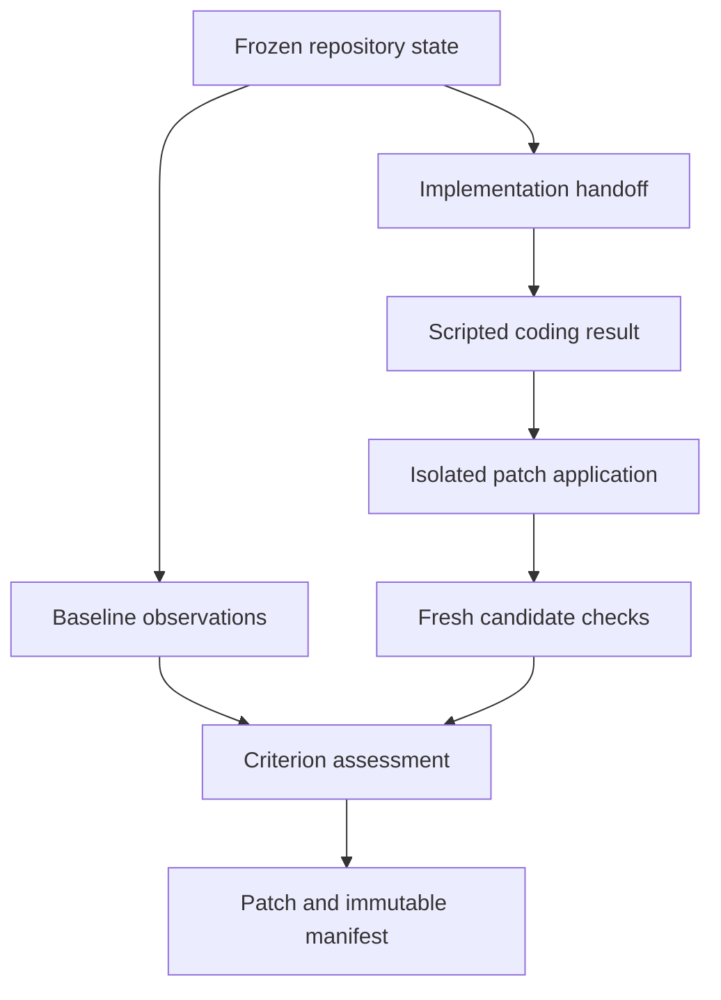

# Phase 4: the first verified patch

Version **0.4.0** implements approved plan steps **P035–P040** and the requested
startup additions: integrated dependency progress, BAT/PowerShell/Bash entry points,
and native credential storage with a first-start PostgreSQL prompt.

The patch producer in this milestone is explicitly scripted. It consumes a supplied
patch through the same bounded contract, deployment, context-packet and invocation
records that later live coding adapters will use. It makes no model inference claim.

## Architecture



The task contract supplies stable acceptance-criterion IDs, allowed paths,
capabilities and resource budgets. A verification profile binds each check to a
stable behavior ID, installed tool definition, repository test-definition files,
requirement IDs and declared authority. Profile contents and check definitions are
hashed. The environment is an independent immutable identity.

Baseline and candidate checks run through the existing tool gateway. Each check
receives a fresh candidate materialized from the exact target state; compilation or
test-generated files from one check do not silently become another check's input.
Actual input state, active contract revision, invocation, completion, stdout/stderr,
process receipt and resource usage remain linked in PostgreSQL.

The coding handoff freezes the active task revision, exact base, path scope, expected
behavior, required check IDs/digests, reuse/adapt/build decision, and supplied search
receipt artifacts. Phase 4 retains explicit discovery limitations: online libraries,
developer tools and internal workflows are part of the review contract, while live
discovery adapters remain later work. Receipt existence and hash validation do not
make caller-supplied source claims authoritative.

The scripted producer records its actual adapter as the only participating coding
deployment. It retains the exact manual context packet and raw response. Token usage
is explicitly synthetic, using rounded-up UTF-8 byte counts divided by four. It
returns exactly one bounded patch or classified inability.

Patch bytes enter the sandbox through a frozen, scoped stdin artifact. A controller
installed tool definition must explicitly allow stdin; a proposal cannot grant that
permission to itself. The receipt binds the artifact ID and byte digest. Git validates
the patch inside the sandbox, checks paths against the implementation scope, and
applies it only to an isolated candidate with a current mutation lease and matching
base. The initial adapter supports UTF-8 text additions, edits and deletions. Binary
patches, renames/copies, symlink changes, special files and Git administrative paths
are rejected. The controller compares the resulting snapshot changes against scope.

`applied` establishes applicability. It does not establish correctness. Imported
changes retain explicit provenance and require a new verification run bound to that
application, even if another candidate already passed on similar bytes.

## Verification policy

| Status | Meaning |
| --- | --- |
| `passed` | The configured check completed successfully against its exact recorded input. |
| `failed` | The check ran and reported a behavioral failure. |
| `blocked` | A required definition, admission prerequisite or resource was unavailable. |
| `not_run` | The configured check has no completed observation. |
| `inconclusive` | Evidence is incomplete, incomparable, timed out, changed, or awaits reconciliation. |
| `infrastructure_error` | The tool/runtime failed, or a configured infrastructure exit code was observed. |

The default infrastructure exit-code convention is 69/78 and is part of each check
definition; adapters can declare a different finite set. The system does not guess
that an arbitrary nonzero exit is a missing dependency. The process supervisor also
classifies a tool that cannot be launched as infrastructure failure.

Baseline comparison distinguishes resolved failures, regressions, pre-existing
failures, unchanged passes and incomplete/incomparable observations. A pre-existing
failure remains failed. It can be nonblocking only if the frozen profile explicitly
marks that unrelated check optional. A mandatory pre-existing failure prevents a
verified outcome.

Removing or changing a configured test definition prevents its result from being
treated as comparable to the baseline. A different environment or task contract
cannot borrow the old passing evidence. Requirement coverage is explicit; a passing
test does not verify an unrelated requirement, and only agent-authored tests cannot
establish a requirement by themselves. Missing mandatory checks stay visible.

The final outcome is `verified` only when every acceptance criterion and mandatory
check passes under these rules. Otherwise the manifest reports `partial` or `blocked`,
with individual statuses and limitations. Verification is bounded by the installed
checks and profile; it is not a proof of all possible program behavior.

## Run the scripted fixture

First provision the schema, workspace and restricted principal using the existing
[Phase 2 instructions](phase-2.md). Configure the application URL in the native vault
or through `POTBOT_DSN`. A qualified Linux sandbox is required for the actual checks.
The fixture creates an intentionally faulty disposable repository and leaves the
original files unchanged while building its patch in separate candidates.

```bash
bash ./start.sh patch \
  --dev-auth --workspace WORKSPACE_UUID --principal PRINCIPAL_UUID \
  --artifacts .potbot/artifacts --candidates .potbot/candidates \
  --receipts .potbot/receipts \
  demo --fixtures .potbot/fixtures --key first-phase4-demo \
  --preexisting-failure --output .potbot/results/first-demo
```

The command reports stages to stderr and a JSON result to stdout. It returns the
pipeline ID, task ID, final outcome and export. The optional `--preexisting-failure`
fixture demonstrates that an unrelated, explicitly optional failing check remains
visible while the calculator's required behavior is repaired.

Use `--stop-after baseline`, `--stop-after application`, or `--stop-after verification`
to exercise a checkpoint. Restart the process and continue with the returned ID:

```bash
bash ./start.sh patch \
  --dev-auth --workspace WORKSPACE_UUID --principal PRINCIPAL_UUID \
  --artifacts .potbot/artifacts --candidates .potbot/candidates \
  --receipts .potbot/receipts \
  resume PIPELINE_UUID --output .potbot/results/first-demo
```

Use the same storage directories on restart. `patch inspect PIPELINE_UUID` inspects
the durable task and exported results. `patch export EXPORT_UUID --output DIRECTORY`
copies a retained result again. The shared scope/storage arguments precede the
subcommand. Reusing an export directory is allowed only when the existing files are
identical; different files and symlinks are not overwritten.

The export contains:

- `candidate.patch`: the exact selected patch bytes.
- `manifest.json`: the immutable contract, profile, application, states, environment,
  checks, observations, executions, actual deployment/packet/invocation provenance,
  artifact hashes and limitations.
- `SHA256SUMS`: content hashes for the patch and manifest.

The manifest uses the existing `synny://type/potbot-data-document-json` representation
type. Its application schema is identified separately as `potbot.patch-verification-manifest`;
no new unregistered semantic term is invented. Existing SYN/synny alias handling,
named embedding spaces and semantic task pins are preserved.

Candidate cleanup does not remove these retained artifacts. Result export does not
apply the patch to a user's working tree or publish it to GitHub. A caller can inspect
and apply the returned patch as a separate action.

## Restart and concurrency

Each stage has a deterministic idempotency key and immutable inputs. Baseline,
coding, application, candidate checks, assessment and export can be reconstructed
from PostgreSQL. Completed work is reused rather than dispatched again. Checks are
serialized across controllers per verification-run/check identity.

The existing gateway stores a process receipt outside the candidate. After a lost
acknowledgment, a matching receipt plus proof the process stopped can complete the
operation without another execution. Uncertain work stays indeterminate and keeps
its reservation until reconciliation; no blind retry is permitted. The scripted
adapter separately recovers recorded generation and synthetic-usage settlement.

A requirement revision before finalization makes the old pipeline ineligible for
success. The service persists an open, scoped information need for a new handoff,
criterion mappings, profile and fresh checks. Repeated resume calls create one need
per pipeline/current-contract pair, exposed by `patch inspect` as `reassessment_needs`.
Historical evidence remains inspectable. This milestone does not implement an
autonomous reasoning policy that synthesizes the revised plan.

## Database upgrade

This source delivery is cumulative from GitHub commit
`88de7ee`: it includes the previously delivered Phase 3 execution foundation, which
was absent from that GitHub revision, plus Phase 4. It preserves GitHub's SYN additions.

Two published schema histories converge without ledger rewrites:

| Revision | GitHub main lineage | Phase 3 preview lineage |
| --- | --- | --- |
| 1–5 | Original application and named-vector migrations | Identical original migrations |
| 6 | SYN schema | Repository schema |
| 7 | Repository schema | Semantic schema |
| 8 | Semantic schema | Execution schema |
| 9 | Execution schema | SYN schema |
| 10 | Phase 4 coding, verification and export schema | Same Phase 4 schema |

The migration runner selects the known history by the recorded revision-6 name,
then validates every original checksum. Unknown, changed or reordered histories are
rejected. Administrative grants use the same history validation. Existing populated
rows, IDs, checksums and ledger timestamps are preserved; old actions acquire only
the new nullable stdin-artifact link.

```bash
bash ./start.sh admin migrate
```

Use the saved administrative URL or `POTBOT_ADMIN_DSN` for that command. Existing
application logins receive grants on the new tables from the migration runner, which
reapplies the validated grant set for existing principals. The explicit
`grant_application_role` operation also checks the recorded lineage before regranting.

The new scoped, append-only tables cover implementation contracts and search-receipt
links; coding results; application intents/results; verification profiles/runs/attempts/
observations; criterion assessments; exports; and pipeline identities. Composite
workspace foreign keys, application RLS and immutable-row triggers remain in force.

## Delivered implementation steps

| Step | Deliverable | Principal acceptance tests |
| --- | --- | --- |
| P035 | Frozen baseline profiles and explicit observations | `test_verification.py` |
| P036 | Bounded handoffs and honest scripted deployment/invocation | `test_coding_pipeline.py`, `test_coding_patch_contracts.py` |
| P037 | Exact-base, scoped sandbox patch application | `test_coding_pipeline.py` |
| P038 | Criterion coverage, changed-definition detection and baseline comparison | `test_verification.py`, `test_patch_vertical_slice.py` |
| P039 | Retained patch and immutable, integrity-checked manifest | `test_patch_vertical_slice.py` |
| P040 | Scripted end-to-end workflow and restart checkpoints | `test_patch_vertical_slice.py`, `test_patch_cli.py` |
| Startup addition | uv launchers and dependency progress/resume | `test_launchers.py`, `test_dependencies.py`, Windows launcher smoke |
| Credential addition | Native-vault abstraction and first-use URL validation | `test_credentials.py`, `test_startup.py`, `test_startup_credentials.py` |
| Upgrade addition | Both populated historical ledgers upgrade safely | `test_phase4_upgrade.py` |

The machine-readable status and qualification report are
`phase-4-implementation-status.json` and `phase-4-verification.json`.

## Remaining scope

Phase 5 introduces live reasoning/coding adapters and actual qualification of the
five requested default models. The later ensemble search, learned memory policy,
production library/tool/workflow search, IBM MCP and DanceFlow MCP integrations retain
their existing roadmap positions. This phase supplies the verified patch contract
and execution evidence those components will consume.
