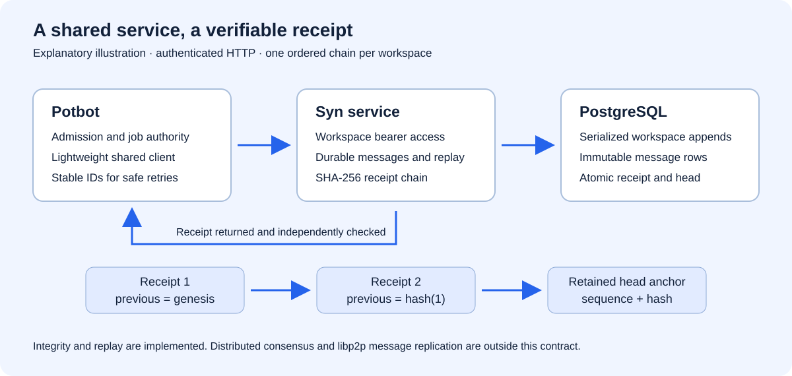

# Startup, dependency downloads and credentials

Potbot 0.4 adds a common startup flow for Windows BAT, Windows PowerShell and Bash.
The entry scripts live at the repository root. They work from another current directory
and from a checkout path containing spaces. Arguments, stdin and exit codes pass
through to the same Python entry point, `potbot.startup`.

## Starting the application

First initialize the pinned Syn source with `git submodule update --init --recursive`.
For a new checkout use `git clone --recurse-submodules`; GitHub source ZIPs do not
include submodules. A complete source distribution must include `vendor/syn`.
Launchers report a missing submodule before attempting downloads. The lightweight
Syn client installs with all runtime extras; connecting to Syn additionally needs
the explicit service configuration in [Syn service setup](syn-service.md).



*Explanatory diagram, not a startup screenshot; no new graphical startup interface is added.*

| Platform | Entry point |
| --- | --- |
| Windows Command Prompt | `start.bat` |
| Windows PowerShell 5.1 or PowerShell 7 | `.\start.ps1` |
| Linux or macOS with Bash | `bash ./start.sh` |

Each script reports four stages: find or install uv 0.12.23; obtain managed Python
3.12; synchronize `uv.lock` and every Python runtime extra; start Potbot. uv's own
download/install progress remains visible. The scripts use the project `.venv`,
with bootstrap binaries and caches under `.potbot/`. They do not change the user's
global PATH. `UV_CACHE_DIR` and `UV_PYTHON_INSTALL_DIR` can select preexisting caches.

The runtime installation is equivalent to:

```bash
uv python install 3.12 --no-bin --no-registry
uv sync --locked --all-extras --no-dev --python 3.12 --managed-python
uv run --no-sync python -m potbot.startup
```

The actual scripts also pass the project path explicitly. The Linux/Windows lock
selects CPU PyTorch. An ordinary first startup installs Python libraries, including
the embedding runtime, but does not download model weights. The scripted Phase 4
patch workflow needs no model weights. Developers can add tools separately:

```bash
uv sync --locked --extra postgres --extra semantics --extra credentials --dev
```

`uv sync --locked` fails if the project metadata and lock disagree. Fix or update the
lock deliberately; the launcher does not silently resolve a new dependency set.
The scripts propagate failed installation and application exit codes.

## PostgreSQL on first startup

With no command-line arguments, startup resolves the application connection in this
order:

1. `POTBOT_DSN`, when explicitly set.
2. `postgres.application` in the selected native credential-store profile.
3. A hidden interactive prompt for a `postgresql://` or `postgres://` URL.

A newly entered value is syntax checked, tested with a bounded read-only database
connection, and saved only after validation succeeds. Storage is read back to confirm
persistence. The URL and password are never printed in normal status or failure
messages. An unsuccessful connection is not saved. Environment overrides are used
for that process and are not automatically copied into the vault.

Startup confirms connectivity and prints the command help. It does not create
database roles, apply migrations, or start a long-running worker automatically.
Application operations still require the restricted PostgreSQL login and scoped
workspace/principal established by the Phase 2 provisioning flow.

The administrative connection is independent. `potbot admin migrate` resolves
`POTBOT_ADMIN_DSN`, then `postgres.admin` in the vault, then its own hidden prompt.
An application URL is never substituted for a missing administrative URL.

| Platform | Explicitly selected secure backend |
| --- | --- |
| Windows | Windows Credential Manager through keyring's `WinVaultKeyring` |
| macOS | Keychain through keyring's macOS backend |
| Linux desktop | Secret Service through keyring's SecretService backend |

`POTBOT_CREDENTIAL_PROFILE` selects a bounded profile name; the default is `default`.
Profiles have separate application/admin accounts. The backend is selected explicitly,
so a third-party keyring configuration cannot silently switch persistence to a
plaintext file or a null backend.

Manage a saved URL without placing it in shell history:

```bash
bash ./start.sh credentials status
bash ./start.sh credentials set --purpose application
bash ./start.sh credentials set --purpose admin
bash ./start.sh credentials --profile staging status
bash ./start.sh credentials delete --purpose application
```

`status` reports whether each account exists; it does not return values. `set` uses
the hidden prompt and connection check. `delete` removes only the selected account.
The corresponding Windows commands use `start.bat` or `.\start.ps1` with the same
arguments.

On a headless machine without an unlocked native vault, inject `POTBOT_DSN` and,
when needed, `POTBOT_ADMIN_DSN` through the host's secret-management facility. Missing
configuration in a noninteractive process is an explicit error. Potbot never writes
a URL to a repository file as a fallback. Help, version, `info`, offline catalogs,
and `dependencies` commands do not prompt for database credentials.

## Integrated model downloader

The initial download profile is the already qualified standard embedding model:
`Qwen/Qwen3-Embedding-0.6B`, revision
`97b0c614be4d77ee51c0cef4e5f07c00f9eb65b3`. Six pinned assets total **1,207,469,240
bytes**. Python packages, temporary partial files and runtime memory require additional
space.

```bash
bash ./start.sh dependencies status
bash ./start.sh dependencies download
bash ./start.sh dependencies download --model-dir /data/models/qwen3-embedding-0.6b
```

The default model path is `models/qwen3-embedding-0.6b` beneath the project selected
by the launcher. Explicit `--model-dir` is supported. JSON results go to stdout;
human progress goes to stderr and includes file names, completed bytes and percentage.

The downloader uses bounded HTTPS reads, a fixed revision, exact expected byte counts
and embedded SHA-256 digests. It serializes concurrent downloads, writes into an
owned partial directory, resumes using HTTP ranges where the server supports them,
and restarts a file when a server ignores or invalidates the range. Corrupt or wrong-sized
files never become a ready installation. The final manifest is published after every
asset is verified. Completed files and existing valid installations are reused offline.

CLI `embedding setup` uses the same downloader. CLI encoding operations (`embedding
smoke`, indexing/search and vector-backed SYN search) ensure the standard model is
present after parsing arguments and before starting the isolated worker. The encoder
itself loads local files with remote code disabled; direct Python encoder calls remain
explicit and do not trigger hidden network activity.

The five reasoning/coding catalog defaults are not downloaded automatically. Their
live deployment adapters and qualification belong to Phase 5. No custom embedding
model is introduced here.

## Host services and platform qualification

uv installs Python and Python packages. It cannot provision an operating-system
credential service, PostgreSQL server, Git, or the Linux sandbox primitives. Potbot
uses an existing PostgreSQL service with pgvector. Registered repository operations
also need Git. Qualified execution and supervised embeddings currently require Linux
Bubblewrap, libseccomp, `prlimit`, and permitted private namespaces:

```bash
sudo apt-get install bubblewrap libseccomp2 util-linux git
```

`dependencies status` reports package/model state and the host tools it can find.
Windows/macOS launchers support installation, credential handling and management
commands; the repository execution backend remains Linux-only. Use a suitable Linux
host or WSL environment for the controlled patch workflow. A WSL vault is a Linux
credential service, separate from the Windows Credential Manager.

The release tests exercise a real clean Bash startup, local HTTP download failure
fixtures, a live pinned HTTPS file, offline validation of the complete Qwen assets,
and real PostgreSQL first-use validation with an injected test vault. Windows-native
BAT/PowerShell argument and exit-code tests are included in CI. Native Windows/macOS
vaults and the Windows CI job were not executed in the Linux development environment.

## Implementation boundaries

`credentials.py` owns the OS-vault adapter, credential selection, hidden prompts and
sanitized connectivity probe. `startup.py` owns first-run orchestration and forwards
explicit commands. `dependencies.py` owns download manifests, partial transfer state,
locking, progress and verification. Database CLI handlers request credentials only
after argument parsing. Credential values are control-plane inputs; they are not
added to model packets, candidate snapshots or tool definitions by this integration.

This installation flow manages Potbot's own dependencies. Future repository-specific
dependency discovery and installation must remain part of the task's declared tool,
environment, network and budget policies.
