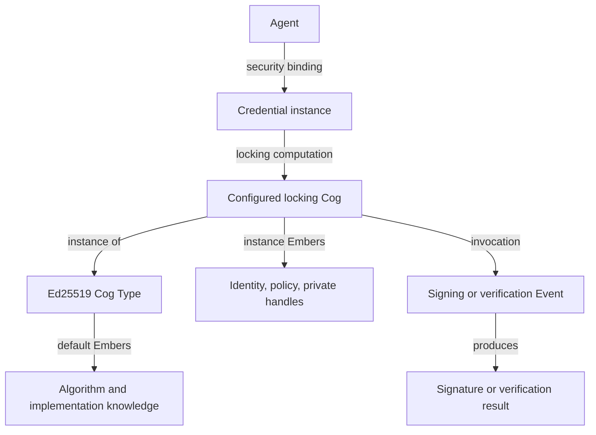

# SYN primitive semantics and inherited Ember contracts

**Date:** 22 October 2026

**Status:** Source reconciliation and semantic contract; the local runtime is now implemented as described in [Agent identity and Ember runtime](agent-identity-and-ember-runtime.md).

**Scope:** Addendum to the Potbot implementation plan, the semantic-placement
profile, and the separately developed security architecture 1.2.0.

This addendum records the owner's clarified meanings of Agent, Cog, and Type,
recovers the evidence for the authentication primitive, and defines the contract
needed for inherited and instance-specific Embers. It corrects the earlier guide's
treatment of implementation-era primitive mappings as complete semantic definitions.

The existing placement profile remains a versioned description of the inspected
catalog. The new Agent security extension implements the clarified meanings through
explicit subtypes and scoped Ember contracts. It preserves the frozen native catalog.
The runtime guide separates implemented software from remaining host qualification
and advanced custody work.

## 1. What the recovered sources establish

### The additional authentication primitive is implemented as Credential

The supplied Syn repository contains a real native **Credential** primitive:

- Object reference: `syn://credential/<slug>`.
- Root Type: `syn://type/credential`.
- Public identifying field: `publicKeyHash`, an opaque nonempty binary value when
  present, with a uniqueness constraint.
- Owner-private field: `privateData`, an opaque binary value excluded from public
  payloads. ORM loading is deferred and accidental access raises.
- Placeholder Credentials may leave both fields unset.

The original commit is `d66f2aff290a228b3f5f3e201e45e697fccbfda8`, dated
11 August 2026, **Add Credential primitive with binary secret fields**. The change
adds the kind, model, table, reference domain, root Type, and placeholder controller.
The same named change appears in the later integration history. All 45 commits
reachable from the supplied repository's refs were examined for the relevant
naming and semantic changes. No adopted replacement name or rename was found. [S1]

The recovered Hearth/Synesis conversation contains several earlier candidates:

| Candidate | Meaning in that conversation | Evidence status |
| --- | --- | --- |
| Kleis | Public/private key controlling an identity or capability | Assistant proposal under a table headed “Suggested identifier”; no adoption recovered. |
| Sphragis | Digital signature, described as an authenticating seal | Assistant proposal for a signature. |
| Tekmerion | Credential or evidence of a qualification/capacity; also used for proof/evidence | Assistant proposal with broader uses, not a defined lock primitive. |
| Seal | Signature | Later English naming proposal. |
| Keyring | Wallet and key/permission manager | Naming proposal, not an additional native kind. |

**Kleis is a relevant historical naming clue, but there is insufficient evidence
to call it the adopted missing primitive.** Credential is the name established by
the implementation. Neither source supports creating a second type merely to
preserve a speculative synonym. [H1]

The search covered the supplied source and recovered Git history, the two original
July conversation exports, and targeted retrieval of earlier conversations. The
Hearth export contains the visible context available when exported; the ontology
export preserves user messages with reconstructed assistant summaries. They are
not a complete export of every past conversation. A missing adoption message in
these sources is not proof that the conversation never occurred. [H1, H2]

### Semantic history needs reconciliation

The July 30 project report records meanings supplied by the owner: Ember is
knowledge, Enigma trust, Pondle reasoning, Snug emotion, and Om morality or good
karma. “Unit” does not imply currency, fungibility, or a universal score. [S2]

The original generic primitive tables did not encode those distinctions as root
Type ancestry. Commit `d4073196eb15d67b5a99f43b51f61eb0f7366a60`, on August 1,
added the following narrower mappings and tests for them. The recovered commit
history contains no explanation that reconciles the earlier meanings with these
choices. They are intentional implementation choices, but their existence does
not establish that the original meanings were superseded. [S3]

| Primitive | Intended or clarified meaning | Current implementation | Consequence |
| --- | --- | --- | --- |
| Type | A class contract with parents, inherited default Embers, and definitions of required/optional instance Embers | Parent graph and direct typed property cardinalities | Add default bindings, instance bindings, inherited contract resolution, and validation. |
| Thing | An identifiable referent, entity, or information object | Generic typed object | Select a more specific primitive where its meaning applies. |
| Event | An occurrence | Typed object with `occurredAt` | Keep an invocation distinct from the configured entity that can be invoked. |
| Ember | A unit of knowledge; includes property knowledge and implementation knowledge | `knowledge-record` | Broadly compatible, but a generic JSON field does not implement the Ember binding contract. |
| Cog | Something capable of computation; a typed computational entity | `computational-process` | Broaden the model to cover a configured, idle computation-capable instance. |
| Credential | Existing owner-held authentication-related primitive; must support the clarified security-lock role | `information-object`, public hash, private data, placeholder API | Add explicit locking Cog, policy, custody, and verification relationships. |
| Enigma | Recorded intended meaning: unit of trust | `question` | Unresolved semantic divergence. A question does not automatically constitute trust. |
| Pondle | Recorded intended meaning: unit of reasoning | `evaluation-record` | Objective evaluation is a narrower case; do not make it the entire meaning. |
| Snug | Recorded intended meaning: unit of emotion | `attachment-record` | Attachment/investment is a narrower case. |
| Om | Recorded intended meaning: unit of morality or good karma | `karma-unit` | Broadly aligned; no generic numeric or reward interpretation follows. |

Cog's broader interpretation is supported by the original naming request for
“something capable of computation like a computer,” and by the current signing
Cog example. [H2] The owner's current Type and Agent clarifications control the
design below. The unresolved Enigma discrepancy must be settled explicitly before
changing its registry ancestry or reclassifying existing objects.

## 2. Agent identity and the security relationship

**An Agent is an autonomously acting entity or coordinated group operating under
one wallet key hierarchy.** A process, deployment, role, machine, or worker is not
automatically a separate Agent. Several cooperating workers can act as one Agent
when they operate under the same identity and authority hierarchy.

The supplied general-world ontology currently places people, animal agents, and
organizations beneath its broad `agent` class. That ancestry alone does not supply
a wallet. Migration must distinguish broad real-world agency from the registered,
operational Agent contract above, using an explicit profile or specialization
rather than fabricating wallet ownership for existing referents. Activation of a
SYN/Potbot Agent requires the clarified wallet and security bindings. [S3]

That shared hierarchy does not require every worker to possess the root private
key. Delegated keys and constrained signing operations can remain inside the
established custody boundary. Hourly child keys remain subordinate to the same
stable base identity; rotating the operational signing key does not create another
Agent. This agrees with the separate security architecture's distinction between
the base wallet identity and routine hourly signing. [P1]

The following relationship is implemented by the Agent security view and the
native broker. Signing/verification Events can describe invocations; creating an
Event is not required to verify a public signature:

The Credential is the security primitive that identifies the authentication
arrangement. Its locking Cog performs the configured computation. The Agent
security binding identifies the applicable Credential and policy revision.
Historical, revoked, or superseded bindings remain distinguishable from the active
binding. A placeholder Credential is a resolvable reference, not usable evidence
of ownership or an operational signing capability.

The locking arrangement must express both the permitted signing operation and the
verification rules. A cryptographically valid signature is evidence about a key
and message. Workspace permissions, delegation, admitted capabilities, and policy
still decide whether the requested action is authorized. [P1]

The security package's `authentication-key-slot` is a different concept: an unlock
method and wrapped vault-key metadata. It is not the remembered native primitive
or the locking Cog. Also, the existing native class named `security` denotes a
financial instrument; its name must not be reused for authentication. [S3, P1]

Agent definitions, workflow definitions, their implementations, configured Cogs,
invocations, and records describing those invocations retain separate identities.
A Cog need not be autonomous, and its existence does not imply that it has run.

## 3. A Type has two separate Ember responsibilities

### 3.1 Inherited default Embers

A Type can bind identified Embers that are available to all instances of that Type
and its subtypes. Examples include the algorithm definition, implementation bytes
or a content-addressed implementation reference, supported operations, input/output
contracts, and verification test vectors.

These are shared, versioned knowledge objects. An instance inherits a binding to
an Ember; it need not receive a mutable copy of the Ember's bytes. A change to a
Type's defaults creates a new effective contract revision. It must not silently
change the implementation selected by an existing version-pinned security Cog.

Some bindings are ordinary overridable defaults. Others are fixed by the Type's
contract. For example, replacing the algorithm with an incompatible algorithm
cannot leave an instance validly typed as an Ed25519 Cog. The contract must state
which kind of binding applies.

### 3.2 Required and optional instance Ember definitions

A Type also declares the property Embers that an instance must or may bind. A
declaration is a constraint, rather than a value or an Ember instance. At minimum
it needs the following information:

| Contract element | Meaning |
| --- | --- |
| Property identity | Stable identity of the property or slot, distinct from its display name. |
| Ember Type | What kind of knowledge Ember can occupy the slot. |
| Value/referent Type | The Type of the value or object represented by that Ember, where applicable. |
| Cardinality | Minimum and maximum permitted values; `0..1` optional, `1..1` exactly one, and bounded collections where appropriate. |
| Satisfaction source | Whether an inherited effective value can satisfy the requirement, or the instance must provide its own binding. |
| Disclosure | Who may resolve the binding and whether it may appear in a public projection. |
| Override/combination rule | Fixed, explicitly replaceable, or explicitly additive, with conflict resolution. |
| Revision and provenance | The Type/slot declaration and Ember revisions from which the effective value is derived. |

The existing `TypeProperty.propertyTypeRef` describes the semantic Type of a
property's value/referent. Native examples use `place` and `text-value`. It must
not be silently reinterpreted as the Type of the property Ember itself. An explicit
Ember Type reference and a value/referent Type reference serve different purposes.
[S4]

Requiredness is evaluated against the declared satisfaction source. A required
algorithm implementation can be satisfied by an inherited default. A required
Agent identity binding must come from that instance. An optional property may
have a default. A public projection can omit a private required binding without
making the underlying owner-visible object incomplete.

Validation therefore needs separate results for complete owner-visible objects,
partial references, and public projections. It must not expose a private value or
its presence merely to let an unauthorized caller validate a projection.
Absent, inaccessible/redacted, and explicitly null values are different states.
Redaction must never trigger fallback to an inherited credential or signing handle.
If an unbounded maximum is introduced, its representation must be explicit; the
current native property schema has a required finite integer maximum.

## 4. Deterministic inheritance and validation

The following rules make the proposed contract reproducible:

1. **Resolve one scoped Type identity.** Normalize the equivalent `syn://type/`
   and `synny://type/` spellings within the selected catalog. Apply the same rule
   to property and default references that are Type references. Preserve source
   spelling as provenance; do not create duplicate declarations or instances.
2. **Pin the catalog and contract revisions.** Resolve the complete parent DAG,
   reject cycles and unavailable required dependencies, and identify every
   declaration participating in the effective contract.
3. **Combine inherited constraints.** An instance of a subtype must continue to
   satisfy all parent contracts. A child may narrow compatible constraints, but
   cannot remove a required parent property, widen its allowed values, or weaken
   private disclosure restrictions. An empty intersection is a Type conflict.
4. **Resolve defaults explicitly.** The same Ember revision reached through a
   diamond counts once. Incomparable parents supplying different defaults for a
   single-valued property require an explicit compatible resolution. Sorting
   parent URLs or using database row order must not choose a semantic winner.
5. **Apply authorized instance bindings.** An explicitly replaceable default can
   be replaced by a conforming instance value. Additive properties combine values
   under their declared cardinality and duplicate rule. Fixed bindings cannot be
   replaced. Omission does not silently delete an inherited requirement.
6. **Validate before activation.** Check cardinality, Ember Type, value/referent
   Type, permitted source, revision integrity, disclosure, and applicable policy.
   Unresolved conflicts or missing required private bindings prevent activation.
7. **Return an explainable effective view.** Preserve the supplying Type, ancestor
   path, Ember revision, and override decision. A public view includes only
   information its caller is allowed to see.

These are design rules for the new resolver. Exact type inventory remains a
separate operation over declared Type identity and ancestry. It must preserve all
matching occurrences within its stated snapshot and access scope; a nearest-vector
result or a placement suggestion cannot establish complete type membership.
Completeness of inventory also does not prove every object satisfies the new
Ember contract. Report membership, conformance, and activation eligibility as
different facts.

Named embeddings may describe admitted public views of these objects. They must
never encode private keys, recovery material, private handles, or private Ember
payloads. Inheritance must not create an indirect route from private data into a
public materialized view, artifact, or embedding input. [P1]

Public exports need positive field/binding allowlists and enforced access checks.
Adding a `private` annotation or avoiding the existing `privateData` field name is
not sufficient to protect a newly introduced property.

## 5. Ed25519 locking Cog example

The Type supplies the shared computational knowledge; each instance binds its
own identity and permitted operations. The runtime guide maps these concepts to
the registered security Types, property slots and versioned wire schemas.

| Ember/property | Supplied by | Requirement and disclosure |
| --- | --- | --- |
| Algorithm specification | Cog Type | Required effective binding; exact algorithm/profile revision. |
| Signing implementation | Cog Type | Required for signing-capable Cogs; immutable implementation/build identity. |
| Verification implementation | Cog Type | Required effective binding; immutable implementation/build identity. |
| Known-answer test vectors | Cog Type | Inherited implementation evidence, with pinned provenance. |
| Implementation admission evidence | Applicable admitted deployment/profile | Links the selected build to qualification evidence; inheritance alone does not admit code. |
| Base public-key hash | Cog/Credential instance | Required own binding identifying the stable Agent wallet; permitted public projection. |
| Signing-policy/profile binding | Cog/Credential instance | Required own binding to the active authorized policy; no choice from untrusted request content. |
| Private signing handle | Signing-capable instance | Required own binding inside the owner-private boundary; never a shared Type default or public property. |
| Public verification key | Cog/Credential instance | Publish the raw 32-byte base public key and its stable fingerprint. A signed delegation certificate publishes each hourly verification key. |
| Operational key/epoch binding | Invocation and signing profile | Identifies the authorized operational child key without replacing the stable base identity. |

A verification-only view or instance does not require possession of a private
signing key. **Signing uses private key material; signature verification uses the
actual public verification key. A hash alone cannot perform standard Ed25519
verification.** [R1]

The owner's 22 October instruction authorizes publishing the verification key and
supersedes the earlier hash-only restriction in security architecture 1.2.0.
Public identity descriptor v2 contains the raw base Ed25519 public key and its
SHA-256 fingerprint. Hourly delegation v1 binds an hourly public key to that base
identity and its exact UTC epoch. Public signature bundle v1 carries both alongside
the existing signature envelope v2. A verifier pins the expected base fingerprint,
checks both signatures and enforces its own scope, expiry and replay policy.
Private keys, recovery material, vault keys and owner-private operation handles
remain excluded from publication. Public chain codes are not needed by this protocol.

The simple example can bind an Ed25519 key directly, but Potbot's current security
design has a stable base identity and separate hardened hourly signing children.
The Cog must inherit/select the exact approved profile and compatible key format.
An Ed25519 extended private key must not be passed to an ordinary seed-based API
merely because both are described as Ed25519. The inherited implementation Ember
records that compatibility; the broker enforces it. [P1]

Once the hourly signing policy is active, an instance override must not downgrade
new signatures to the historical base-key policy. The broker selects the allowed
hourly leaf; an ordinary caller cannot select arbitrary key bytes or an epoch to
bypass that policy.

The private key remains in the protected vault/broker. Its instance Ember carries
an opaque, owner-private operation handle or reference under the same custody
rules. It does not contain exportable private-key bytes in ordinary graph JSON.
Resolving a Type, importing an Ember, or possessing a handle-shaped string cannot
grant permission to sign. Algorithm code stored in an Ember is data until an
approved execution path admits its exact implementation revision.

Content hashes identify implementation bytes; they do not by themselves prove
correctness, safe custody, or permission to execute. Qualification evidence must
refer to the exact build, algorithm variant, key format, and execution boundary.

## 6. Source baseline and implemented additions

Native Syn has the primitive tables, a Type parent DAG, direct Type property
cardinalities, generic object relationships, and the Credential fields. The property
endpoint reads only declarations attached directly to the requested Type. The
supplied 529-Type database snapshot contains zero TypeProperty rows. There is no
implemented default-Ember resolver or enforced wallet/Credential/Cog contract in
that source. Deferred loading of `privateData` does not provide encryption, secure
memory, authorization, or a signing service. [S1, S4, P2]

The Potbot implementation now supplies these logical additions:

- **Ember property declarations:** Type/slot identity, Ember Type, value/referent
  Type, cardinality, source, disclosure, override rules, and contract revision.
- **Type default bindings:** defining Type revision, property identity, referenced
  Ember revision, and permitted replacement/combination behavior.
- **Instance bindings:** subject object, property identity, referenced Ember
  revision, visibility, and provenance; private bindings stay in private storage.
- **Effective contract resolution:** deterministic inheritance, conflict detection,
  conformance, projection rules, and inspectable provenance.
- **Agent security bindings:** wallet identity, Credential, locking Cog and policy
  connected to an owner-private native signing operation. Revocation and active
  deployment admission remain separate lifecycle work; an immutable imported view
  does not imply admission.

Migration 13 adds immutable public and owner Ember bundle tables. Owner rows have
restrictive principal/login row-level security and are never artifact or vector
sources. The public projection is independently content-addressed and cannot reveal
private binding identities or claim complete owner conformance. Versioned JSON
schemas and the source implementation define the wire contracts.

If a native field such as `Credential.publicKeyHash` also has an Ember projection,
define one authoritative value and a checked projection. Two independently
editable copies must not disagree about the identity protected by a locking Cog.

The original delivery sequence was:

1. Record this semantic clarification and resolve the outstanding Enigma meaning.
2. Reconcile canonical Type identities and cross-package declarations. The current
   security package and APS hierarchy both declare `synny://type/type-definition`
   with different parents/interpretations. It must have one consistent meaning,
   or a distinct concept must receive an explicitly distinct identity. Changing
   `syn://` to `synny://` cannot resolve that collision.
3. Freeze the versioned Ember declaration/default/instance contract, including
   private versus public validation and multiple-inheritance conflict cases.
4. Implement deterministic resolution and exact effective-property inspection.
   Preserve existing snapshot revisions and imported source semantics.
5. Integrate Agent/Credential/Cog relationships with the security architecture's
   qualified broker, immutable profiles, and verification-key provisioning.
6. Add conformance evidence for inherited required values, explicit instance-only
   requirements, diamond inheritance, conflicting parents, private projection,
   fixed implementations, key/profile mismatch, revocation, and exhaustive typed
   inventory. Runtime activation requires the corresponding security evidence.

This extends the main plan's security/trust boundary and the separate security
plan's typed-contract work. It does not renumber that plan or claim every SEC step
is implemented. Code for an ordinary operating-system credential store is not
evidence that the planned wallet vault or signing broker already exists. [P1]

## 7. Source record

| ID | Source and relevant location |
| --- | --- |
| H1 | `hearth_synesis_full_chat_files_references_2026-07-30.zip`: `chat_transcript.md`, suggested key/signature names around lines 529–535, credential at 588, later signature names at 4147/4170; archive README states coverage limits. |
| H2 | `knowledge_ontology_chat_archive.zip`: `conversation_reconstructed.md`, verbatim user turns 1, 3, and 16; `recommended_names.md`; README distinguishes user originals from assistant reconstruction. |
| S1 | Supplied Syn source and recovered Git objects: commit `d66f2aff290a228b3f5f3e201e45e697fccbfda8`; `src/syn/alembic/versions/20260811_0010_credential_primitive.py`; `src/syn/models.py::Credential`; `src/syn/controllers/credential.py`; README. |
| S2 | Supplied Syn source: `synny/reports/2026-07-30.md`, “Understanding of Syn” section, especially the owner-supplied primitive meanings around lines 76–79. This is a contemporaneous report, not a verbatim transcript of that instruction. |
| S3 | Supplied Syn Git history: initial models `38e7c7f652b749289f57c9d7aaf3da288d6e340e`; initial ontology `b2e8924d50438473732ef40a95db92b430f9e020`; primitive roots/properties `d4073196eb15d67b5a99f43b51f61eb0f7366a60`; `src/syn/ontology.py`; `20260801_0007_primitive_type_refs.py`. |
| S4 | Supplied Syn source: `src/syn/models.py::TypeProperty`; `src/syn/controllers/type.py::getTypeProperties`; `tests/test_type_controller.py`; migration `20260801_0009_type_properties.py`. |
| P1 | Concurrent `Potbot_Security_Architecture_v1_2` design, inspected 21 October 2026: `docs/security-architecture.md`, `docs/security-implementation-plan.md`, hourly signing profile and security Type snapshot. Status: defined, not implemented at its stated baseline `88de7ee06ca985015527618bf8ca7ffb8fdf3755`. |
| P2 | This repository: [SYN integration](syn-semantic-integration.md), [database provenance](../vocab/syn-database-types.provenance.json), [placement profile](type-hierarchy-and-syn-primitives.md), and APS/hierarchy Type declarations. |
| R1 | [RFC 8032, sections 5.1.6–5.1.7](https://www.rfc-editor.org/rfc/rfc8032.html#section-5.1.6), Ed25519 signing and verification inputs. |

The owner's current instructions establish the wallet-bound Agent meaning,
locking Cog example, private-key prohibition, inherited algorithm Embers, and
the separation between Type defaults and required/optional instance Embers.
The detailed conflict, revision, binding, and validation rules in this addendum
are proposed implementation semantics derived from those requirements.
