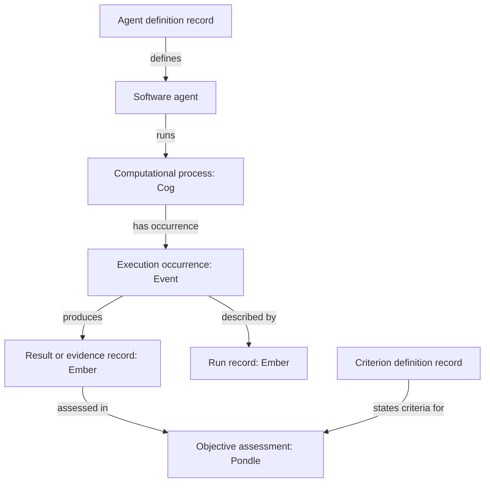

# Potbot type hierarchy and SYN primitive placement

Potbot's **semantic-placement profile 0.1.0** extends the APS **0.2.0 draft** with
explicit guidance for representing processes, occurrences, questions, records, and
assessments in SYN. It is an opt-in catalog and inspection feature. Its recommendations
help an author choose a representation; they do not rewrite imported objects or
establish new admission, verification, or permission rules.

The profile identity is `urn:potbot:semantic-placement:0.1.0`. Its machine-readable
source is [`hierarchy_profile.json`](../src/potbot/semantics/hierarchy_profile.json),
with a navigable [type reference](type-hierarchy-reference.md). The existing SYN
adapter, import boundaries, and source ownership rules remain documented in
[SYN snapshots and exact lookup](syn-semantic-integration.md).

**Semantic clarification, 21 October 2026:** the source-derived placements below
describe the inspected implementation. The owner's broader primitive meanings,
wallet-bound Agent identity, and inherited/default/required/optional Ember contracts
are recorded in [SYN primitive semantics and inherited Ember contracts](syn-primitive-semantics-and-ember-contracts.md).
That addendum corrects the interpretation of a Cog as only a running process and
records the unresolved Enigma trust/question discrepancy. The current machine
profile does not yet implement those clarified contracts.

## What this release adds

| Component | Logical classes | Treatment |
| --- | ---: | --- |
| Native SYN catalog | 529 | Existing definitions and parent edges retained. |
| Protected legacy Potbot representations | 47 | Existing identities, metadata, classifiers, and compatibility mappings retained. |
| APS 0.2.0 authored hierarchy | 80 | Exact existing `SynType` dictionaries copied, including metadata strings. |
| New placement concepts | 34 | Narrower process, occurrence, question, record, assessment, and definition classes. |
| Effective opt-in Potbot hierarchy | **690** | One class per scoped type identity. |

The exported [`potbot-hierarchy.snapshot.json`](../vocab/potbot-hierarchy.snapshot.json)
contains **114 authored declarations** and `objects: []`, using `extend_builtin`.
Import composes those declarations with the existing native and protected catalogs.
Ordinary `syn catalog` retains its existing default catalog; selecting this profile
does not silently add it to every snapshot.

This is not an APS 0.3 release. APS payload schemas, descriptor identities, explicit
profile bindings, and port eligibility stay at their existing 0.2.0 draft boundary.
A new class or placement recommendation does not supply a payload validator. In
particular, a declaration for a run record does not establish that the record
conforms to an APS run protocol. The profile records source provenance and its own
`profile_hash`; the effective hierarchy has a separate `catalog_hash`.

## Separate the record, its subject, and its storage kind

An agent definition, a deployed software agent, the process it runs, and a report
about that run have different identities and lifetimes. Reusing one identity for
all four makes otherwise simple questions ambiguous: “which agent?”, “which
execution?”, and “which evidence revision?” need different answers.

Keep these axes explicit:

| Axis | Example | Meaning |
| --- | --- | --- |
| Primitive kind | `cog` in `syn://cog/build-17` | The source's native record family. |
| Semantic class | `synny://type/agent-process` | What the represented item is declared to be. |
| Representation class | `synny://type/agent-run-record` | A record describing an execution, rather than the execution itself. |
| Encoding selection | `general_text` plus an exact space UUID | The source text view and immutable encoder profile used for ranking. |

The adapter additionally derives a protected representation type for each imported
public record. A source assertion in `typeRef` does not turn that wrapper into a
validated APS descriptor. A native Type row has **no assigned instance `typeRef`**:
it defines a class. An APS type-definition descriptor is a separate information
record whose `defined_type` identifies the class being defined. Finding every
descriptor of type `type-definition` is therefore different from finding every
instance of the class described by one descriptor.

There is **no native `artifact` primitive kind**. Native `syn://type/artifact` is a
semantic class for material artifacts. Potbot's artifact store holds immutable bytes,
which can be shared by distinct source occurrences. Neither meaning creates a
`syn://artifact/...` reference. These boundaries follow
[`domain/syn.py`](../src/potbot/domain/syn.py),
[`semantics/catalog.py`](../src/potbot/semantics/catalog.py), and the
[existing crosswalk](../vocab/syn-typing-crosswalk.json).

## Primitive mappings in the inspected implementation

The inspected SYN source exposes ten local kinds: one class-definition kind and
nine instance kinds. Its `src/syn/refs.py::LOCAL_KINDS`, model classes, and named
ontology declarations establish the following structural interpretations. These
are not a complete account of the original primitive semantics; see the
[reconciliation addendum](syn-primitive-semantics-and-ember-contracts.md).
Source identities and hashes are retained in the profile provenance and existing
crosswalk.

| Native kind | Fits | Does not establish |
| --- | --- | --- |
| `type` | A class definition, its parents, and direct property declarations. | An instance of that class, or a runtime APS payload validator. |
| `thing` | A modeled entity or information object, including an actual software agent, program, API, or workflow. | That a described agent has been deployed or a workflow executed. |
| `cog` | The current native `cog` class descends from `computational-process`. The clarified design also includes configured computation-capable entities that are idle. | An agent-definition document or a run report merely because it mentions computation; nor that every Cog is currently executing. |
| `event` | An occurrence; the model includes `occurredAt`. | The contents or correctness of the occurrence's outcome. |
| `ember` | A known information record, including observation results and recorded evidence. | Truth, acceptance into memory, sufficient evidence, or verification. |
| `enigma` | A question or information need that can receive a response. | An encrypted secret or credential container. |
| `pondle` | An objective evaluation record, such as an assessment against stated criteria. | That the assessment is correct, independent, or authorized to approve an action. |
| `credential` | A credential record with an opaque public-key hash and an owner-private boundary. | Possession of a key, permission to use it, or a functioning signing service. |
| `snug` | An investment or emotional attachment record, following the native definition. | A generic user preference, importance score, or arbitrary relation. |
| `om` | A unit of Karma in the native model. | A token budget, currency balance, generic reward, or model score. |

The source does not impose a universal rule that an object's assigned class must
descend from the namesake primitive class. For example, native `execution` descends
from both `computation` and `event`; it is not a descendant of `cog`. Potbot therefore
keeps placement recommendations explicit rather than inferring compatibility from
names or forcing every computational class beneath `cog`.

The profile reviews **51 native classes** in its `reuse_decisions`. A native placement
card's abstraction flag is local advisory policy, not an extracted native ontology
declaration. Broad classes such as `information-object` and `record` select no
concrete default. The original 80 APS abstraction flags remain exactly as declared
in their source metadata.

The strongest concrete example is SYN's
`src/syn/feed_jobs.py::_buildWitnessObjects`. It creates an **Event** typed
`observation`, a separate **Ember** typed `observation-result`, and another **Ember**
typed `network-measurement`. `EventTarget` and `ObjectRelationship` records connect
the occurrence to its results. This demonstrates that observing and the recorded
observation result are separate objects. The current Potbot snapshot exporter
omits those ordinary relationship tables; this guide does not imply those links
are automatically imported or traversable.

## Reuse existing concepts before adding a narrower class

The profile's `reuse_decisions` explain where a native class already supplies the
needed meaning. The additional classes distinguish operational roles that the
generic native class alone cannot express; they are not replacements for native
identities. The comparison below also identifies useful native classes outside the
51 reviewed placement cards; the inspector returns a recommendation only where
the profile explicitly supplies one.

| Concept | Native meaning to reuse | Narrower representation or placement decision |
| --- | --- | --- |
| Software agent | `software-agent` | Keep the entity distinct from `agent-definition`, `agent-deployment-record`, and `agent-run-record`. |
| Algorithm, program, workflow | `algorithm`, `program`, `workflow`, `procedure` | Reuse these for the modeled procedure. APS skill/workflow definitions remain descriptions; an actual running process can use a Cog. |
| Tool interface | `api`, `software-function` | `tool-definition` describes the interface. An actual invocation is a separate `tool-invocation` occurrence; native material `tool` is not a substitute for an API. |
| Generic execution | `execution`, `job`, `computational-process` | Use a specialized agent, workflow, inference, retrieval, embedding, tool, or verification class only when that narrower meaning is needed. |
| Observation and measurement | `observation`, `observation-result`, `measurement-result`, `network-measurement` | Preserve occurrence versus result. A retrieval result or execution trace is information, even when produced by a process. |
| Evidence and provenance | `evidence-record`, `provenance-record` | An `evidence-manifest` describes the selected evidence set; it does not prove that the evidence supports a claim. |
| Claim or decision | `claim`, `proposition`, `decision` | `claim-record` and `decision-record` retain the recorded assertion or decision with provenance. Their existence does not make them true or binding. |
| Question | `question`, `enigma` | `information-need` and clarification, diagnostic, or verification questions specialize the requested information. |
| Evaluation | `evaluation`, `assessment`, `evaluation-record` | Separate evaluation activity from the recorded objective result. Verification, benchmark, retrieval, and policy assessments can use Pondle placement. |
| Preference | `preference` | A `preference-record` records the preference. Choose Snug only for the narrower native attachment or investment meaning. |
| Budget or score | `quantity-value`, `monetary-amount`, `metric` where applicable | `resource-budget-record` records explicit limits or consumption. Generic numeric accounting does not acquire Karma semantics. |
| Policy and criteria | `policy`, `rule`, `specification` | An `evaluation-criterion-definition` is a definition record. A policy assessment is distinct from granting permission. |
| Type, value, or relation | `type`, `number`, `sequence`, `relation` | A type descriptor, numeric value occurrence, array occurrence, or relation-binding record describes or represents its subject; that link is not `is_a`. |

The new record and definition classes stay in the information hierarchy. The new
process and occurrence classes denote the activity itself. This preserves APS's
existing 80-class representation hierarchy without changing the meaning of its
deployment or run records. The [reference](type-hierarchy-reference.md) lists the
exact direct parents and placement cards.

### A lifecycle with separate evidence



This is a modeling example, not a newly implemented relationship wire schema.
Create separate identities where the application needs to track separate referents;
the profile does not require every run to create every node. A simple occurrence
may need only an Event and its result. A long-running computational process may
also need a Cog. Existing source kinds and public payload bytes remain unchanged.

An assessment should be interpretable with its target, criterion revision, evidence,
producer, and time or scope. The profile recommends placement but does not enforce
those payload fields. A Pondle can record a failed or inconclusive evaluation. An
Ember can contain a disputed assertion. Verification status, accepted-memory
lifecycle, and capability authorization continue to have independent owners.

### Inspect a concrete example

The [synthetic example snapshot](../vocab/example-potbot-primitive-views.snapshot.json)
contains the full opt-in hierarchy and 12 deliberately separate objects: an agent
definition, software agent, process, execution, run record, question, outcome, file
occurrence, evaluation criterion, assessment, preference record, and budget record.
Each object has one native reference and one assigned semantic class. Their payloads
are illustrative public records; they do not claim APS admission or a live execution.

The companion [example links](../vocab/example-potbot-primitive-links.json) show
`defines`, `records`, `produces`, `evaluates`, `answers`, and other proposed relations.
They are bound to the example snapshot fingerprint and checked against the profile's
relation scopes when generated. The snapshot importer does not ingest this separate
link file. Use it to review the intended identities and relations before implementing
the corresponding relationship storage and runtime contracts.

## Inspect the profile without a database

The hierarchy and placement commands load packaged data and pure Python graph
logic. They do not connect to PostgreSQL, load an encoder, or resolve remote objects.

```bash
uv run --locked potbot syn hierarchy --summary
uv run --locked potbot syn hierarchy --limit 1000
uv run --locked potbot syn hierarchy \
  --type-ref synny://type/execution-record --include-subtypes
uv run --locked potbot syn hierarchy --primitive-kind cog
uv run --locked potbot syn placement \
  --type-ref synny://type/agent-process --check-kind cog
```

`hierarchy` defaults to 100 rows. Use `--limit` up to 1,000 and `--offset` for paging;
the response reports `selected_count`, `returned_count`, `has_more`, and
`next_offset`. With the current 690-class catalog, `--limit 1000` returns the full
unfiltered hierarchy. `--type-ref` means exact identity unless `--include-subtypes`
is supplied. Multiple parent paths do not duplicate a class. When collecting pages,
keep `profile_hash` and `catalog_hash` fixed; restart if a package update changes them.

Here, `--primitive-kind` filters **explicit advisory recommendations**. It does not
count objects and does not infer a recommendation for an unannotated native class.
`placement --check-kind` returns a diagnostic such as `matches_recommendation`,
`different_from_recommendation`, `abstract`, or `no_recommendation`. A different kind
does not become an import error, and a matching kind does not certify a payload.

## Import the declarations and query actual instances

Provision the existing application schema and repository as described in the
[SYN integration guide](syn-semantic-integration.md#install-migrate-and-import).
Set `POTBOT_DSN` to the restricted application login. Import is an explicit operation:

```bash
uv run --locked potbot syn import \
  --workspace-id WORKSPACE_UUID --principal-id PRINCIPAL_UUID \
  --repository-id REPOSITORY_UUID --namespace potbot-hierarchy-0-1 \
  --file vocab/potbot-hierarchy.snapshot.json \
  --artifact-root artifacts/objects --schema potbot
```

Retain the returned snapshot UUID. Its Type definitions can be inspected through
`syn catalog --snapshot-id ...` or resolved by Type URL. Its object inventory is
empty: a types-only import creates neither agents nor executions. It also does not
modify previously published snapshots. To query real instances, import a bounded
snapshot that actually contains them and the applicable type declarations, then
select that returned snapshot explicitly.

For such an object snapshot, this command enumerates declared agent processes whose
**stored native kind** is Cog:

```bash
uv run --locked potbot syn list \
  --workspace-id WORKSPACE_UUID --principal-id PRINCIPAL_UUID \
  --snapshot-id OBJECT_SNAPSHOT_UUID \
  --type-ref synny://type/agent-process --include-subtypes \
  --primitive-kind cog --page-size 100 \
  --artifact-root artifacts/objects --schema potbot
```

The primitive filter and semantic-class filter must both match. An agent-process
assertion stored as a Thing is not silently moved into the Cog result. To enumerate
all instances in the selected snapshot, omit `--type-ref`, `--include-subtypes`,
`--primitive-kind`, and any `--data-type` filter, then exhaust the returned
`next_cursor` pages. Keep the same principal, snapshot, filters, and page size on
subsequent requests. Type definitions are enumerated by `catalog`, not by object
`list`; `--primitive-kind type` is not an instance filter.

“All objects” means **all matching visible objects in that immutable imported
snapshot**. It says nothing about omitted relationship tables, later source changes,
other namespaces, or a global SYN network. Catalog completeness and instance
completeness are separate claims. Read-only source exports retain the existing
64 MiB envelope and 100,000-object limits and fail rather than truncate.

For semantic ranking, `syn search --record-kind objects` accepts the same
`--primitive-kind` filter alongside type filters. Candidate scope is selected before
named vector ranking. Search still needs the exact embedding name/space, task episode,
runtime budget, and provider options described in [named embeddings](named-embeddings.md)
and [the SYN search guide](syn-semantic-integration.md#index-and-rank-within-that-scope).
It returns bounded ranked matches, not an exhaustive inventory. `--record-kind types`
ranks Type definitions and rejects instance-kind filters. Import and exact reads do
not load an encoder.

## Identity, source preservation, and provenance

Authored class references prefer concise `synny://type/<slug>` URLs. The existing
effective catalog loader normalizes these new nonprotected slugs to
`syn://type/<slug>`. Both spellings identify one type within the selected catalog;
source spelling remains in the imported declaration. The 47 protected legacy
`potbot-data-` classes retain their existing effective spelling.

Changing the slug changes identity. `synny://type/agent-definition` is not an
automatic alias for `synny://type/potbot-data-agent-definition`. APS's 75 explicit
migration mappings remain a separate migration plan; this import does not execute
them, revise existing records, or extend the legacy classifier alias registry.
Use full Type URLs for the new public hierarchy. Existing compact compatibility
IDs remain historical adapter inputs, not new public type names.

Three provenance boundaries make the extension reproducible:

- The supplied `syn.zip` source archive has SHA-256
  `8b38905371c40d62d67d54860c62a730c56a90d024bbb63d71f9abec0a5678ff`.
  The profile cites native source paths and named declarations; the feed witness
  source has SHA-256
  `b0080781a1664877a94c11d5e4609f0b36e1d30326bd40dcf8f00a67dddeb561`.
- The supplied PostgreSQL dump contributes 529 native classes and 859 direct
  parent edges. Its SHA-256 is
  `2f4d949fb5b2996ee88d2dbcbbbe6996cdd7213d1c4aef50b26fad4857a1ab3e`.
  [Extraction provenance](../vocab/syn-database-types.provenance.json) records the
  selected COPY sections, zero direct property declarations, and omitted instances.
- The exact APS 80-class extension snapshot has SHA-256
  `58cc3988c83c56a8574e0b017dc6cb558ec8754f681ed0a6dce7416dd4a829fc`.
  Its preserved records and source metadata are included in the new profile; no
  inferred payload bindings or revised definitions are substituted.

The profile's identity and content hash describe this placement policy. Snapshot
source, effective-catalog, and artifact hashes retain the existing meanings in the
[snapshot hash contract](syn-semantic-integration.md#hashes-and-the-stored-envelope).
Neither hash nor type assignment grants execution authority, proves a result, or
turns the snapshot adapter into a global object or relationship resolver.

## Reproduce the generated assets

The [generation script](../scripts/generate_type_hierarchy.py) validates the profile
schema, checks preservation of all 80 APS declarations, and regenerates the import
snapshot, [provenance](../vocab/potbot-hierarchy.provenance.json), authored-type table,
and synthetic example. The normal verification gate checks that these assets match:

```bash
uv run --locked python scripts/generate_type_hierarchy.py
uv run --locked python scripts/generate_type_hierarchy.py --check
```

The wheel verification gate also runs the offline hierarchy inspector from a clean
installation, ensuring that the profile data is packaged with the application.
Repository text checks normalize CRLF to LF so Windows checkouts reproduce the same
catalog hashes. Archived source hashes continue to identify their original bytes.
